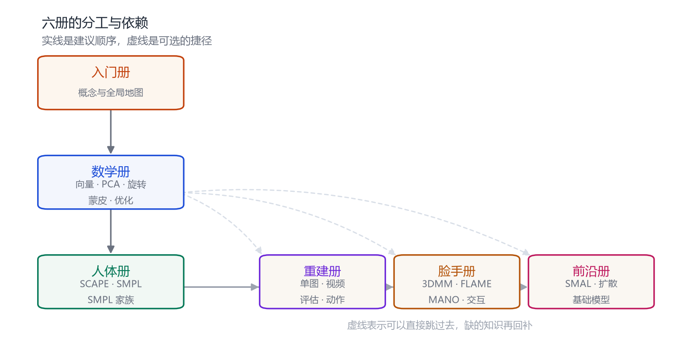

# 第 5 章 这套技术怎么用，往哪里走

前面四章把概念立起来了：形状可以压缩成参数，参数可以从数据里量出来，骨架和蒙皮让形状动起来，反推参数就是把“像不像”变成一个可以最小化的问题。这一章换一个视角，说清楚这套东西在真实世界里被用来做什么，以及这个系列剩下的部分各自解决什么问题。

## 5.1 四类真实需求

**第一类是“把人放进虚拟世界”。** 游戏、影视、社交应用都需要大量的人形角色。手工建模一个角色要几天到几周，而且每换一身衣服就得重做。用参数化模型，换个 $\beta$ 就是一个新体型，换个 $\theta$ 就是一帧新动作，成本从“天”降到“毫秒”。这是 SMPL 系列最直接的用途。

**第二类是“从图像里读出人”。** 一张照片、一段视频，能不能算出这个人的身高、体型、关节角度、朝向？这是计算机视觉的经典问题。参数化模型给了它一个天然的输出层：网络不需要输出几万个顶点，只需要输出几十个参数，剩下的交给模型去生成。这让问题从“高维回归”变成了“低维回归”，难度下降一个数量级。

**第三类是“让人动起来自然”。** 捕捉到的动作常常要迁移到别的角色身上，或者要凭空生成没有拍过的动作。参数化的骨架让动作变成一串关节角序列，可以插值、可以混合、可以喂给生成模型。

**第四类是“做出照片级的数字人”。** 参数模型给的是几何骨架和粗略外观，细节（皮肤纹理、毛发、衣服褶皱）得另外处理。所以近年来的做法是把参数模型当“先验”或“接口”，再叠一层神经渲染，去补它的不足。

这四类需求不是并列的，它们往往串在一起。一个直播数字人的链路可能是：摄像头采集 → 参数回归 → 动作重定向 → 神经渲染输出。参数化模型站在中间，是唯一一处所有环节都能理解的共同语言。

## 5.2 为什么分五册

同一套方法，落到不同对象上，工程细节差别很大。人手有 21 个关节，人脸有几十块表情肌，动物有四条腿和一条尾巴，这些差异不是换个参数就能应付的，需要各自的数据、各自的骨架、各自的失败模式。

所以这个系列这样分：

- **入门册**（本册）：只建立概念，不推导公式。
- **数学册**：向量与矩阵、最小二乘、概率与 PCA、三维表示与旋转、骨架与蒙皮、统计形状模型，以及位姿优化。五册里所有的公式，都在这一册里交代清楚。
- **人体册**：SCAPE 怎么把形状和姿态拆开，SMPL 的每一项怎么来，之后的 STAR、ATLAS、MHR 又改了什么。
- **重建册**：从图像反推参数的完整技术栈，包括单图、视频、多人、数据集与评估、着装与神经渲染、动作生成。
- **脸手册**：3DMM 与 Basel Face Model、FLAME、高保真人脸、驱动与神经头像，加上 MANO、单手重建、手物交互。
- **前沿册**：SMAL 与动物重建、鸟类与鱼类、扩散模型与 3DGS、人体基础模型，以及研究脉络。

<figure class="fig">

<figcaption><b>图 5-1</b>　系列的依赖关系。入门册是唯一的入口；数学册是其余各册的共同前置；人体册是重建、脸手、前沿三个方向的地基。箭头表示“读之前建议先读”，不表示必须按顺序。</figcaption>
</figure>

## 5.3 三条阅读路线

**路线一，从头读到尾。** 入门 → 数学 → 人体 → 重建 → 脸手 → 前沿。约 800 页，适合要在这个方向长期做下去的人。读完能自己读论文、判断一篇新工作改了什么。

**路线二，带着问题查。** 已经会 PCA 与蒙皮，只想知道 SMPL 的公式：直接读人体册第 2 章，遇到不熟的符号回数学册查。做游戏或影视工程的读者大多走这条。

**路线三，只做一个对象。** 只做人脸就从脸手册第 1 章开始；只做人手从第 5 章开始；只做动物从前沿册第 1 章开始。缺的前置知识在每册前言里都写明了，按指路回补即可。

## 5.4 五个常见误解

**误解一：参数越多模型越强。** 参数越多，能表达的差异越细，但也越容易被噪声和配准误差带偏，越容易在训练数据之外崩溃。SMPL 只用 10 个形状参数还能统治十年，说明“少而准”比“多而全”重要。

**误解二：这是一个已经解决的问题。** 单图人体重建的精度在公开基准上已经很高，但那是特定数据集、特定指标下的成绩。换到真实场景，遮挡、罕见姿势、宽松衣服、极端光照都会让它失效。这个问题远没有结束。

**误解三：参数化模型会被神经渲染取代。** 神经渲染擅长细节，不擅长“控制”。要让一个人抬左手三十度，神经场没有直接的旋钮，参数化模型有。所以现实中的做法是把两者接起来，而不是让一个取代另一个。

**误解四：换个数据集就能适配所有人。** 统计模型只认识训练数据里的规律。要覆盖更广的人群，得重新采集、重新配准、重新训练，而不是调一下参数范围。

**误解五：公式看懂了就等于会用。** 会用意味着知道什么时候它会坏。第 2 章讲的那些边界（配准误差、参数范围、数据集偏差），在实际项目里比公式更容易让你翻车。

## 5.5 往下走

如果你只想记住一件事，记住这句：**参数化的本质不是 PCA，而是“用少数几个有明确含义的量，去控制一个高维形状”。** PCA 只是目前最常用的一种取法，换成自编码器、换成神经场，这个结构没有变。

技术会继续往前跑。2020 年之后，扩散模型、3D 高斯泼溅、视觉基础模型又换了一轮底座，但“压缩成参数、用参数控制、从观测反推参数”这三件事一直没变。愿这个系列在你换方向、换任务、换模型的时候，还能剩下一点可迁移的东西。

## 本章小结

- 这套技术服务于四类需求：虚拟角色、从图像读人、动作迁移与生成、照片级数字人。
- 系列分六册：入门建立概念，五册专业篇分别深入数学、人体模型、图像重建、人脸与人手、动物与前沿。
- 三条路线：顺序通读、带着问题查、只做一个对象。
- 五个常见误解：参数多不等于强、问题没解决、不会被神经渲染取代、换数据集不是万能、看懂公式不等于会用。
- 参数化的本质是“用少数有含义的量控制高维形状”，PCA 只是一种取法。

## 思考题

1. 你手上的任务属于本章四类需求里的哪一类？它真正的瓶颈是模型精度，还是数据、评估或工程链路？
2. 如果一个团队只有两周时间要做出“能实时驱动的人体”，你会选优化法还是回归法？为什么？
3. 想一个你熟悉的场景，其中参数化模型的“控制能力”比“细节真实度”更重要。
