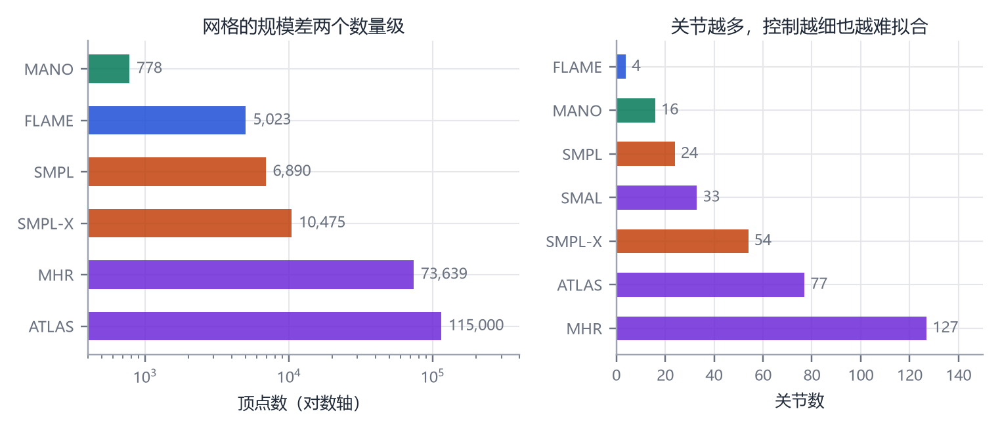

# 第 5 章 模型家族全景：四种对象，七个名字

> **本章导读**：前面四章讲的是原理，这一章换一种讲法：把今天真正在用的模型摊开，看看一共有几种、各自解决什么、规模有多大。每个模型都只给两句话——它是什么、它有什么短板。读完这一章，你应该能在别人提到 SMPL-X、FLAME、MANO、SMAL 时，立刻知道它管的是人身上哪一块。

## 5.1 为什么不是一个模型管全部

这一节回答一个很自然的问题：既然都是人体，为什么不做一个大模型通吃？结论是分辨率、数据、自由度三样都不同，所以只能分四支。

一个人有身体、有脸、有手，还可能有四条腿的动物版本。听上去应该做一个大模型一次搞定，但现实是分成好几套模型，原因有三个。

**第一是分辨率要求不一样。** 身体可以粗略，一个成年人的体型差异用几十个参数就能抓住主要轮廓；脸不行，眼睛、嘴、鼻翼差几毫米就“不像这个人”了；手更极端，手指的粗细和关节角度直接决定能不能抓住东西。

**第二是数据不一样。** 身体模型靠人体扫描，脸靠头部扫描和表情库，手靠专门的手部姿态数据集，动物靠玩具模型和少量真实标本。采集方式不同，模型就没法共享训练集。

**第三是自由度不一样。** 身体 24 个关节已经够用，手要 16 个才能让每根手指独立弯曲，动物要 33 个才能兼顾四条腿和尾巴。自由度不同，参数维度就不同。

**表 5-1**　四支对象各自的难点、数据来源与典型规模。

| 对象 | 主要难点 | 数据从哪来 | 典型规模 |
|---|---|---|---|
| 身体 | 体型差异大、关节处会塌陷 | 全身扫描、动捕 | 万级顶点、几十关节 |
| 人脸 | 细节差几毫米就不像 | 头部扫描、表情序列 | 数千到几万顶点、少关节 |
| 人手 | 自遮挡、动作幅度小、单图里像素少 | 手部姿态数据集 | 千级顶点、十几关节 |
| 动物 | 物种形状差异极大、无法配合扫描 | 玩具模型、标本、少量实拍 | 千级顶点、几十关节 |

<figure class="fig">

<figcaption><b>图 5-1</b>　四类对象、一条相似的演化路线。四类模型的起点不同，但都经历了“加关节、加参数、把骨架与形状解耦”这三步。标出的年份是各模型的论文发表年，不代表工业可用的时间。</figcaption>
</figure>

所以四支不是重复造轮子，而是四个不同的问题。认清这一点，看到一堆陌生的模型名字时就不会慌：先问它管哪一支。

## 5.2 五个零件：所有模型都是同一套积木

这一节给你一把拆解任何模型的螺丝刀。结论是：五花八门的模型拆开都是五样东西，学一个就等于学了全部。

看起来眼花缭乱的模型，拆开之后都是五样东西。理解这一点，比记住任何名字都有用。

**零件一，一个模板网格。** 一个“标准人”或“标准脸”，几千到几万个顶点，附带固定的三角形连接。所有变形都从这个模板出发。

**零件二，一组形状方向。** 把很多扫描对齐后做统计，得到若干个“体型怎么变”的方向。用这些方向乘上系数再相加，就得到不同的个体。这就是“参数”的主力。

**零件三，一组姿态参数。** 每个关节三个角，描述“怎么摆”。身体 24 个关节就是 72 个数，动物 33 个关节就是 99 个。

**零件四，一套骨架与权重。** 骨架是关节的父子树，权重规定“哪块皮肤跟着哪根骨头走”。两者合起来就是蒙皮，让模板跟着姿势动。

**零件五，一个关节回归器。** 给定体型参数，直接算出关节位置。没有它，模型只能给出表面，没法给出骨架。

这五样东西的关系，很像一套乐高：底座是模板，形状方向是各种积木块，姿态参数是关节件的转轴角度，权重决定每块积木粘在哪，回归器是随箱附赠的一张“位置表”。

这五个零件在每个模型里的名字几乎一模一样：模板叫平均形状，形状方向叫形变基，姿态偏移叫姿势修正，权重就是权重，回归器是一个小函数。所以学会一个模型，其余几个只要换数字就能读。

差别只在数字上：换对象就换模板与关节数，换数据就换形状方向的统计来源，换精度就换顶点数。

所以如果只记一件事，记住这句：**参数化模型 = 模板 + 形状方向 + 姿态参数 + 骨架蒙皮 + 关节回归。** 后面每见到一个新模型，都可以按这五格去填。

## 5.3 身体：从 SMPL 到 MHR 的十年

这一节是本书最重要的一张名单。结论是身体这一支有七个关键名字，主线是“越做越细，最后把骨架和形状拆开”。

**SMPL（2015）** 是整个家族的起点。6890 个顶点、24 个关节，形状用 10 个参数，姿态用 72 个参数。它把“体型”和“姿势”彻底拆开，还用一项叫“姿态修正”的技巧补上了蒙皮的塌陷。

> - 一句话定位：今天的通用语言，几乎所有工具链都先支持它。
> - 一个短板：它只有身体，没有手指也没有表情；而且关节是从表面回归出来的，想单独把肩加宽，肩膀会被体型参数拉回去一部分。

**SMPL+H（2017）** 把两只手接了上去。做法很直接：身体还是 SMPL，每只手挂一个手部模型的 15 个关节，于是模型能表示手势，但脸仍然空着。

> - 一句话定位：要手势、不要表情时的过渡方案。
> - 一个短板：手是“挂上去”的，手腕处的接缝和一致性要额外处理，手和身体不是一起优化的。

**SMPL-X（2019）** 一次补齐两处：10475 个顶点、54 个关节，多了下颌与眼球，多了 10 维表情参数。它是今天“全身带表情和手势”的事实标准。

> - 一句话定位：一个模型同时给出身体、手势、表情和视线方向。
> - 一个短板：顶点与参数都变多，拟合更贵；骨架依然是从表面回归的，没有摆脱 SMPL 那条路线。

**STAR（2020）** 换了一种关节表示。SMPL 的每个关节固定 3 个轴角，姿态修正项有两百多维；STAR 改用更稀疏的关节校正，用更少的参数表达更极端的姿势。

> - 一句话定位：姿势更极端、参数更省的 SMPL 改进版。
> - 一个短板：生态比 SMPL 小，很多现成工具、数据集、动作库还是围绕 SMPL 建的。

**GHUM（2020）** 走的是另一条路：把身高尺度做成连续变量，关节做成层级结构。它的动机很现实——人的身高从一米到两米都有，而统计模型在训练数据之外的尺度上会失真。

> - 一句话定位：专门对付“特别高、特别矮”这类尺度问题。
> - 一个短板：公开可用的工具与数据不如 SMPL 丰富，工程上接入成本更高。

**ATLAS（2025）** 与 **MHR（2025）** 是最新一代，核心改动是把“骨架”和“形状”彻底拆开。SMPL 的做法是先有表面、再从表面回归出关节，所以你想“只把肩宽加宽”时，肩膀会被体型参数拉回去一部分。ATLAS 反过来：先有骨架，再在骨架上“长肉”，于是调骨长、调肩宽都能单独生效。

规模也大了一个量级：ATLAS 有 11.5 万顶点、77 个关节；MHR 有 127 个关节，并提供从几千到七万多个顶点的多级精度版本。

> - 一句话定位：给引擎和装置用的工业级骨架，骨长、肩宽这类属性可以单独调。
> - 一个短板：体量大、绑定复杂，拟合和部署成本都上去了；生态还在建立，很多下游还只认 SMPL。

所以身体这一支的十年，可以概括成两句话：先把形状和姿势拆开（SMPL），再把骨架和形状拆开（ATLAS、MHR）。前者让你能换动作，后者让你能改骨架。

## 5.4 人脸：从 3DMM 到 FLAME

这一节讲脸的路线。结论是：脸的起点比身体更早，但长期缺两样东西——脖子和表情，直到 FLAME 才补齐。

**3DMM（1999）** 是这条路线的开端。它把一批人脸网格对齐、做统计，得到“平均脸 + 若干形变方向”。一个关键数字能说明它有多有效：一张几万顶点的脸，被压缩成不到两百个数字，压缩比达到四个数量级。

> - 一句话定位：把“统计形状”这套思想第一次用在人脸上，后来所有脸模型的祖先。
> - 一个短板：只有中性表情，也没有脖子和关节，所以它描述的是“一张脸”，不是“一个会说话的头”。

**Basel Face Model（2009）** 让这件事变成公共基础设施。它基于 200 位受试者的中性表情扫描，公开形状与纹理两套统计基，还配了拟合代码。在它之前，每篇论文用自己的私有数据和自己的对齐方法，结果无法比较；在它之后，大家至少共用一张平均脸和一套顶点编号。

> - 一句话定位：人脸研究的第一份公共底座，让不同论文的结果第一次能互相比。
> - 一个短板：同样是中性脸、没有表情；形状和纹理分开存，光照一变就得重新拟合。

人脸这一支长期有两个缺口：**没有脖子**（只知道下巴往上），**没有表情**（扫描全是中性脸）。第二个缺口后来被证明更致命。

**FLAME（2017）** 补上了这两块。它用 5023 个顶点、4 个关节（颈、下颌、左右眼球）、15 个姿态参数，加上 300 维身份和 100 维表情，把“这是谁”“他什么表情”“头朝哪边”写成同一个公式。

> - 一句话定位：一个会点头、会说话、会做表情的头，数字人系统的常用底座。
> - 一个短板：它刻意选了低分辨率，因为要进游戏引擎、要在手机上跑；代价是法令纹、眼袋这类中频细节画不出来，只能靠后面的细节层补。

**高保真与新方法（2019 之后）** 走的是另一条路：不再追求“一个模型描述所有脸”，而是用模型提供骨架、用神经表示或细节层补纹理与褶皱。

> - 一句话定位：负责“像不像”，不负责“能不能动”。
> - 一个短板：通常不能直接驱动，需要和 FLAME 这类模型绑定使用。

所以脸的路线和身体不同：身体的难点是尺度与自由度，脸的难点是细节与表情。今天一个商用数字人系统，通常是“FLAME 或 3DMM 打底 + 一个细节模型修饰”，两者各管一半。

## 5.5 人手：MANO

这一节讲手。结论是手是四支里“关节最密”的一支，而 MANO 是它的标准答案。

**MANO（2017）** 是手的标准模型。778 个顶点、16 个关节（1 个腕关节 + 15 个手指关节），10 维形状、48 维姿态。它把“形状”和“姿态”同样拆开，和身体、脸用同一套写法。

> - 一句话定位：手的公共格式，手势识别、手物交互、VR 手柄映射都用它。
> - 一个短板：顶点少，指尖和掌纹的细节有限；而且它只管手，手腕以外的一切（前臂、身体、握着的物体）都在模型之外，单看手定不出尺度。

这里有一个外行经常困惑的地方：**“16 个关节”和“21 个关键点”不是一回事**。关节是骨架上的转动中心，16 个；关键点是贴在表面上的语义点，21 个，比关节多出 5 个指尖——指尖是抓取和触摸时最重要的接触位置，但它并不对应一个独立的转动中心。所以工程上常见的做法是：骨架用 16 个关节，另外从网格上取 5 个指尖顶点，凑成 21 个关键点做监督。

手为什么难？手指细、自遮挡严重、动作幅度小、单张图里一只手常常只有几十个像素。这也是手部估计的精度长期落后于身体的原因。

所以看手部模型时，要习惯两套“点数”：关节数决定能怎么动，关键点数决定怎么被监督，两者不能混。

## 5.6 动物：SMAL 与跨物种

这一节讲动物。结论是动物这一支的突破口不是精度，而是“让不同物种共用一套顶点编号”。

**SMAL（2017）** 的方法和前面几个不太一样。动物不会站着让人扫，物种之间的形状差异又极大（河马和马能差十倍），所以它换了个思路：**用玩具模型来学形状空间**。玩具可以随意摆姿势、可以从任意角度拍，还能保证同一套顶点编号；把这些玩具扫描对齐之后做统计，就得到一个覆盖多个物种的形状空间。

> - 一句话定位：把狗、马、河马装进同一个形状空间，能插值、能迁移动作。
> - 一个短板：形状空间是从玩具学来的，和真实动物的皮毛、肌肉有差距；覆盖的物种也有限，越少见的动物越不准。

它的骨架有 33 个关节，串成一条脊柱、四条腿、一条两节尾巴，姿态参数 99 维。最关键的一步是**对应**：“狗”和“马”的网格顶点一一对应，于是可以做形状插值、动作迁移、跨物种比较。你今天看到的“把狗的走路动作套到马身上”，底层就是这套对应关系。

之后的动物工作（用少量真实照片做重建、跨物种生成）都建立在这个形状空间上。

所以动物这一支的思路值得单独记一句：数据拿不到，就换一个能拿到数据的替身，再把对应关系搬到真实对象上。

## 5.7 一张对照表

这一节把前面的名字压进两张表。结论是：记不住细节没关系，能对上“名字 → 用途 → 短板”就够了。

| 对象 | 模型 | 年份 | 顶点 | 关节 | 参数规模 |
|---|---|---:|---:|---:|---|
| 身体 | SMPL | 2015 | 6890 | 24 | 10 形状 + 72 姿态 |
| 身体+手 | SMPL+H | 2017 | 6890 | 24 + 手 15×2 | 同上，手部另加 |
| 全身 | SMPL-X | 2019 | 10475 | 54 | 10 形状 + 10 表情 + 姿态 |
| 身体 | STAR | 2020 | 6890 | 稀疏关节 | 更少参数表达极端姿势 |
| 身体 | GHUM | 2020 | — | 层级关节 | 含连续尺度 |
| 身体 | ATLAS | 2025 | 115k | 77 | 骨架与形状解耦 |
| 身体+手 | MHR | 2025 | 73639–595（多级） | 127 | 204 姿态参数 |
| 人脸 | 3DMM / BFM | 1999 / 2009 | 几万 | 无骨架 | 约 200 形状主成分 |
| 人脸 | FLAME | 2017 | 5023 | 4 | 300 身份 + 100 表情 + 15 姿态 |
| 人手 | MANO | 2017 | 778 | 16 | 10 形状 + 48 姿态 |
| 动物 | SMAL | 2017 | — | 33 | 形状 + 99 姿态 |

表里“无骨架”和“—”不是省略，而是模型本身没有这个概念、或者不同实现不一致；遇到不确定的数字，本书宁可留空。

**表 5-2**　规模对照：顶点数与关节数的数量级差。

<figure class="fig">

<figcaption><b>图 5-2</b>　规模对照。左边是顶点数（对数轴），右边是关节数。网格规模从几百到十几万，差两个数量级；关节数从 4 到 127。规模越大，能表达的细节越多，但拟合越难、部署成本越高。</figcaption>
</figure>

**表 5-3**　名字速查：一句话知道它是干什么的、它卡在哪。

| 名字 | 一句话 | 短板 |
|---|---|---|
| SMPL | 身体的通用语言 | 没手没脸；骨长不能单独调 |
| SMPL+H | SMPL 加两只手 | 手是挂上去的，接缝要单独处理 |
| SMPL-X | 身体 + 手势 + 表情 | 体量大、拟合贵；仍从表面回归关节 |
| STAR | 更省参数的极端姿势 | 工具与数据生态较小 |
| GHUM | 连续尺度、层级关节 | 公开工具少，接入成本高 |
| ATLAS | 骨架与形状完全解耦 | 规模大，生态还在建立 |
| MHR | 面向引擎的工业级绑定 | 体量大、绑定复杂，下游多还只认 SMPL |
| 3DMM | 统计人脸的起点 | 中性脸、没脖子、无关节 |
| BFM | 公共人脸底座 | 无表情；形状纹理分离 |
| FLAME | 会说话会点头的头 | 低分辨率，中频细节丢失 |
| MANO | 手的标准格式 | 只管手，细节有限、尺度靠外部 |
| SMAL | 跨物种的动物空间 | 玩具数据，与真实动物有差距 |

所以这两张表不用背。用到的时候来这里对一眼，比记住一堆名字有用；真正要记的是“它在五个零件里填了什么数、短板落在哪一格”。

## 5.8 怎么选：三个判断

这一节给一个可以直接用的选型方法。结论是：先按对象分，再按要不要改骨架分，最后看下游接不接得住。

**第一，你要的输出是身体、脸、手，还是动物？** 这一条基本决定了用哪一支。

**第二，你要不要“分开调骨架”。** 如果只想改体型（胖瘦、身高），SMPL 这类就够；如果要改骨长、肩宽、臂展这类骨架属性，得用 ATLAS 或 MHR 那类解耦模型。做鞋、做护具、做假肢的人最在意这一条，因为他们要的是骨头的长度，不是肉的多少。

**第三，你的下游能不能吃这个格式。** 生态比精度更重要：数据集、动作库、评估脚本、引擎插件，绝大多数都以 SMPL 为公共语言。这就是为什么新一代模型更准、更可控，却仍然要提供“转成 SMPL”的通道。

现实里的常见做法是：**SMPL 当公共语言，需要精细编辑时再换到解耦模型**。这也是这一章想留给你的印象——家族里没有“最强”的模型，只有“这一环最合适”的模型。

所以看到一个新模型发布，可以按这三问过一遍。三问都过了才值得投入，过不了就等它把生态补齐。

## 本章小结

- 参数化模型分成身体、人脸、人手、动物四支，各自的数据、分辨率、自由度不同，所以没有一个大模型通吃。
- 所有模型都是同一套积木：模板、形状方向、姿态参数、骨架蒙皮、关节回归；换对象只是换数字。
- 身体一支的主线是 SMPL → SMPL+H → SMPL-X → STAR/GHUM → ATLAS/MHR，最新的改动是“骨架与形状解耦”。
- 人脸的起点是 3DMM，公共基础设施是 BFM，把脖子与表情接进来的是 FLAME。
- 人手的标准是 MANO：778 顶点、16 关节、21 个关键点；关节管“怎么动”，关键点管“怎么监督”；动物靠 SMAL 的玩具扫描与跨物种对应。
- 选型看三件事：输出对象、是否需要单独调骨架、下游能不能吃这个格式。

## 思考题

1. 为什么人脸的顶点数（5023）比人手（778）多得多，而关节数（4）却比手（16）少得多？
2. “骨架与形状解耦”解决了什么具体问题？用“只想加宽肩膀”这个例子说明。
3. 如果让你做一个“只做手语识别”的系统，你会选哪个模型，为什么？
