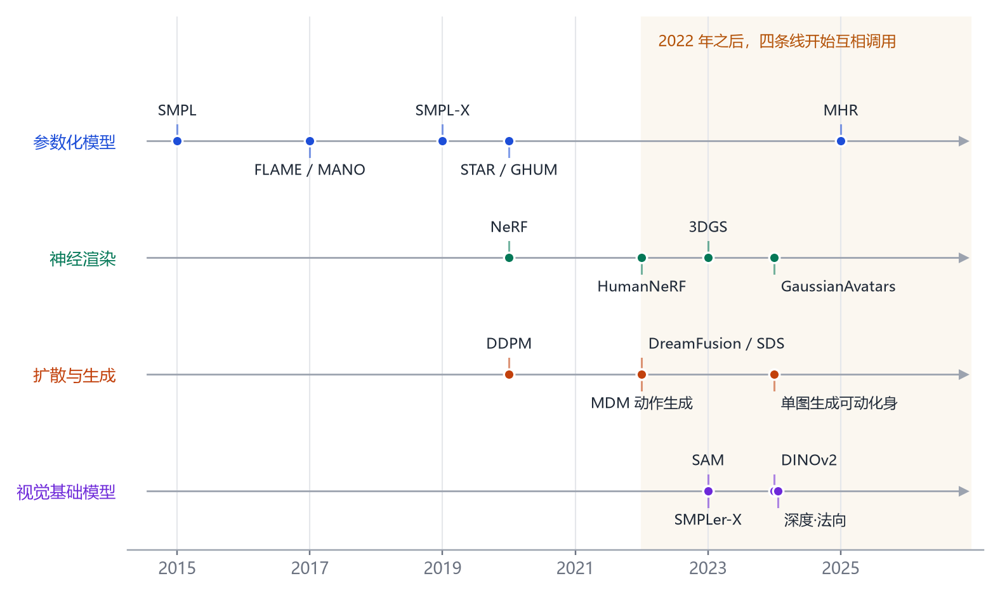
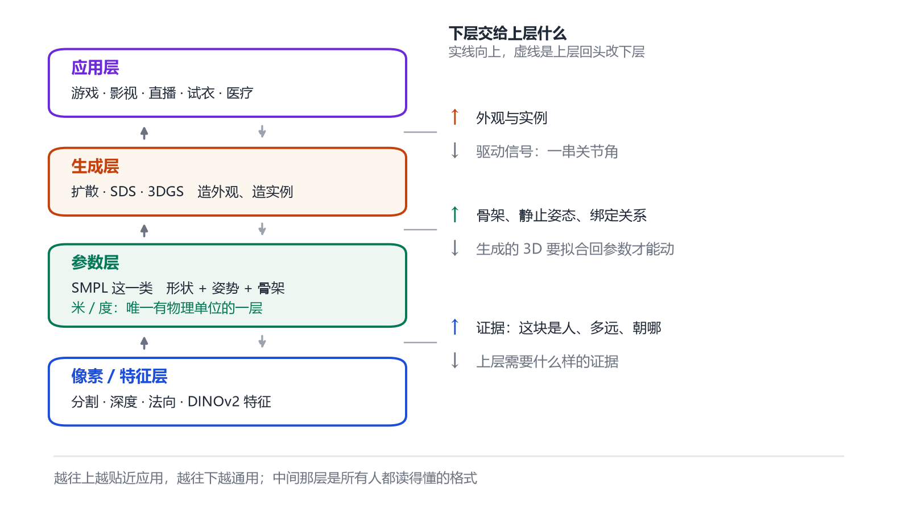

# 第 6 章 2020 年之后：神经渲染、扩散与基础模型

> **本章导读**：前五章有一个共同前提，人可以被压成几十个数。2020 年之后最热闹的几项技术都不太相信这个前提：神经渲染嫌它太光滑，扩散模型根本不经过它，视觉大模型干脆绕到它上游去了。这一章讲这四件事各自在做什么、在哪儿会坏，以及它们为什么最后还是要回到参数化模型上来。仍然不推公式，能说清“它擅长什么、它的边界在哪”就够了。

## 6.1 参数模型只给到一半

这一节要说清参数化模型缺了什么。结论很直接：它能摆出任何姿势，却渲染不出真实的皮肤、头发和衣服。

第 3 章结束时，一个人已经能站、能坐、能挥手。但如果真把它渲染出来看一眼，会觉得不对劲。皮肤像塑料，没有毛孔，没有头发，衣服要么没有，要么是一层贴身的壳。

这三样东西缺在不同的地方。

**皮肤质感。** 参数模型里存的是几何，顶点的位置和法线。皮肤的质感是一个光学问题：光打上去，一部分被吸收，一部分在表层散射，换个角度看颜色就变了。这些信息在 6890 个顶点里根本没有位置可放。

**毛发。** 一颗头上大约有十万根头发，每根有自己的粗细、弯曲和反光。要用三角形表达，一根头发就得几十个面片，一整头是百万级的面片，而且动起来每一根都要重算。

**衣服。** 更麻烦，因为它不属于身体。一件宽松的衬衫和身体之间有空隙，褶皱随动作变化，还会和身体互相挤压。把衣服烘进体型参数，得到的是一件“长在身上的衣服”；另做一套布料模拟，就要处理碰撞、摩擦和自碰撞。

所以第 3 章那台机器的能力边界很清楚，**它长于结构与运动，短于细节与外观。**

这不是缺陷，是取舍。要让“抬左手三十度”变成一个确定的、几十毫秒就能算完的操作，就不能同时背着几百万个毛发顶点。

有人会问，那把网格加密行不行。加密解决的是“形状更细”，不是“外观”。把 6890 个顶点加到几十万个，毛孔仍然要靠颜色和光照去表达，而颜色在网格上只是每个顶点挂一个值，细节全被平均掉了。

那细节怎么办？换一种表示，让细节有地方待。2020 年之后出现了三条新路，它们和一条一直在旁边慢慢走的老路一起，构成了这一章的全部内容。

<figure class="fig">

<figcaption><b>图 6-1</b>　四条技术线在 2015–2026 上的位置。参数化模型那条最平缓，十一年里只换了几代；神经渲染、扩散生成、视觉基础模型三条几乎同时在 2020 年前后起步，2022 年之后开始互相借东西。</figcaption>
</figure>

图 6-1 里最值得看的是右边那块阴影。四条线并不是各走各的，2022 年之后它们频繁地互相调用，而“怎么调用”正是后面几节的主题。

所以这三条新路不是“替代品”，而是三块补丁：参数模型给的是骨架和旋钮，它们分别补外观、补生成、补证据。

## 6.2 把场景存成一个可以查询的函数

这一节讲 NeRF（Neural Radiance Field）在做什么。结论是它不存点、不存面，只存一个可以查询的函数。

2020 年的 NeRF 提了一个和前面完全不同的想法 [@mildenhall2020nerf]。它不存点，不存面片，也不存网格，只存一个函数。

这个函数的输入是一个三维坐标和一个观察方向，输出是“这一点是什么颜色、有多不透”。你拿坐标去问它，它回答你。可以这样想象：把一个房间的气味做成一台查询机，你报一个位置，它告诉你那儿是什么味、多浓。整个房间没有被打包成任何一个具体的物体，它只是变成了一次查询。

这个函数从哪来？从照片里反推。

摆一圈相机，对着同一个人拍几十到上百张。每条从相机出发、穿过某个像素的视线，都在空间里划过一串点。把这些点的颜色按“有多不透”累加起来，就得到这个像素应该是什么颜色。拿它和照片比，差多少就改一点函数的参数。几十万个像素一起提意见，函数就被压到了“从各个角度看都对”的位置上。

这套流程有一个很大的好处，它天生是三维一致的。函数只认坐标，不认相机，所以换一个从没拍过的角度去问，它照样回答。这就是为什么 NeRF 出现时，“从一圈照片里造出一个可以转着看的人”这件事突然变得可行。

代价也很实在。

第一，它要很多视角。几十张是下限，单张照片做不了，因为没被看到过的地方，函数没有任何理由给出正确答案。

第二，它慢。训练一个场景要几个小时，渲染一帧要把每条视线上的几百个采样点逐个问一遍。做演示可以，做直播不行。

第三，它不可编辑。整个场景被压进了一个函数，而函数里没有“左手”这个东西。你没法说“把左手抬起来”，只能重新训练一个“左手抬起来的人”。

第三点最关键。它解释了为什么 NeRF 虽然惊艳，却没有取代参数化模型：**它给出的是外观，不是结构。**

所以遇到“从一圈照片重建一个人”的方案时，先问一句：它给的是能动的结构，还是一段只能看的画面。

## 6.3 一堆椭球，和一个能实时的理由

这一节讲三维高斯泼溅。结论是它换了一种更“显式”的存法，用这个换来了实时。

2023 年 SIGGRAPH 上的三维高斯泼溅换了一个存法 [@kerbl20233dgs]。

不再用一个连续的函数，改用一大堆“带朝向的椭球”。每个椭球有自己的位置、三个轴的长度、一个朝向、一个颜色、一个透明度。渲染时把它们按深度排好，投影到屏幕上，像半透明的贴纸一样一层层贴上去混合。

这些椭球也不是手工摆的。起点是一团粗糙的点云，每个点上放一个椭球，然后同样拿照片比对，该长的地方复制出新的椭球，多余的地方删掉，位置、形状和颜色一起微调。和 NeRF 一样是从照片里优化出来的，只是优化对象从函数的权重换成了一堆椭球的属性。

为什么这样就快？因为“贴一堆半透明贴纸”这件事，显卡天生擅长。画三角形是显卡的本职工作，把几万个椭球投影、排序、混合，和画几万个三角形是同一类活儿，可以并行、可以流水线。而 NeRF 那种“每条视线问几百个点”，显卡帮不上忙，只能一个一个算。

**换一种表示，换来的往往不是更准，而是更快。** 这是这一节最该记住的一句。

3DGS 还有一个更重要的性质，它是显式的。每个椭球有明确的位置，可以被移动、被复制、被删掉、被绑到别的东西上。NeRF 的隐式函数做不到，你没法从函数里“拿出”一个椭球。

这个性质在后来的两年里被反复利用。脸、头发、手，都可以用椭球拼出来；一个人的化身可能只需要很少的椭球；而要让化身动起来，只要把椭球绑到骨头上。下一节就展开这一点。

它的边界和 NeRF 差不多，甚至更明显。仍然需要多视角采集，仍然假设场景是静止的（人要动，就得给每个时刻单独备一套椭球），仍然不能控制。而且椭球不是“表面”，它更像一团有颜色的雾。想量腰围、算碰撞、在它上面贴一层布料，都不方便。要几何，还是得回到网格。

所以三维高斯擅长“看”，不擅长“量”和“动”；要动，还得回到骨架和网格。

## 6.4 两套表示怎么缝在一起

这一节讲参数模型和神经表示怎么接起来。结论是让外观待在静止姿态里，用骨架去搬它。

到这里，两边的能力刚好互补。参数模型有骨架、有姿势、有明确的关节，但没有细节；神经表示有细节，但没有关节。

很自然的想法是把它们接起来。接法一句话可以说清，**让神经表示待在“静止姿态”里，用骨架去搬它。**

想象一个人先站成标准的 T 字，在这个姿势下把他身上的颜色、毛发、衣服全部拍下来、学下来，得到一个“静止的人”。这个静止的人没有任何姿势，就是一团外观。然后每一帧给他一套关节角，第 3 章的蒙皮把这团外观整体搬成当前的姿势。

用式子写出来是这样。想在世界的某个位置 $\mathbf{x}$ 上知道颜色，先用当前姿势对应的变换把这个点“退回去”，问静止的那个人这里是什么颜色：

$$
\mathbf{c}(\mathbf{x}) = F_\Theta\big(M^{-1}(\boldsymbol{\theta})\,\mathbf{x}\big).
\tag{6.1}
$$

$M$ 就是第 3 章那套“骨头带着顶点走”的变换，$M^{-1}$ 是它的逆，$F_\Theta$ 是学出来的外观。人看上去在动，其实外观本身没有动，动的是查询的位置。

HumanNeRF 做的就是这件事，它把一个人的外观场和一个由姿势驱动的变形绑在一起，从单目视频里学出一个能换角度、换姿势的人 [@li2022human]。3DGS 版本更直接，把每个椭球绑到最近的骨头上，骨头动，椭球跟着动。GaussianAvatars 就是这么做人头的，把高斯直接挂在 FLAME 的骨架上。

这套缝合有一个隐含假设：**外观是贴在皮肤上的。** 紧身衣、皮肤、纹身符合这个假设；宽松的裙子、飘动的头发、被风吹起的衣角不符合。因为第 3 章的蒙皮只保证“顶点跟着骨头走”，它不知道布料会自己垂下来。

所以这一类系统在真实场景里的失败往往长一个样。脸很好，手很好，衣服下摆糊成一团，或者裙子和腿粘在一起。

分工到此为止就很清楚了。参数模型管三件事，几何、运动、可编辑的旋钮。神经表示管一件事，外观。而把它们粘在一起的胶水，是第 3 章的蒙皮。这也回答了一个反复出现的疑问：为什么已经有了照片级的渲染，工业管线里还是要放一个 SMPL。要驱动，要重定向，要和别的资产对齐，这些事神经表示一件都做不了。

## 6.5 扩散：从噪声里雕出一张图

这一节讲扩散模型。结论是它把生成拆成很多步“擦噪声”，所以稳、覆盖广，也能中途插手。

2020 年还有另一件事，它和三维没有直接关系，却在两年之后改掉了几乎所有生成任务的做法，那就是去噪扩散模型（DDPM）。

一句话说清它的思路，**先教会一个网络“什么是噪声”，再反过来用它把噪声擦掉。**

拿雕刻打个比方。给你一块大理石，你不知道人像埋在哪里，但你知道“哪里不该是石头”。于是一点一点凿掉，凿几百次，人像从石头里浮出来。扩散模型的每一步做的就是“这一块看起来像噪声，应该减掉这么多”，重复几十步到上百步。

训练的时候不需要人教它哪里该凿。拿一张真照片，随机撒一把噪声上去，让网络猜“你撒了什么”，猜错就调参数。这件事比“直接生成一张照片”容易得多，因为噪声没有结构、没有语义，网络只要学会辨认“不像照片的地方”。

生成的时候反过来用。给它一张纯噪声，它说“这里的噪声大概长这样”，减掉；再问一次，再减一点。结构是一层层从噪声里长出来的，先出现大色块，再出现轮廓，最后才是细节。

文字怎么进去？把一句话编码成一串数字，在每一步去噪时都喂给网络。这句话不直接画图，它只影响“往哪个方向减”。所以同一张噪声配不同的话，会长出完全不同的东西。

和 GAN 相比，扩散模型有三样明显的好处。训练稳，不用两个网络互相博弈；覆盖广，不容易只学会几种模式；可控，每一步都能插手。三样加起来，让它在两年里变成了生成图像的事实标准。

## 6.6 一句话生成一个人，能到哪一步

这一节看扩散搬到三维能走多远。结论是外形能生成，结构还得落回参数化模型。

现在把上一节的东西搬到三维。麻烦立刻出现：扩散模型是在图像上训练的，图像有几十亿张；三维模型只有几十万个，质量还参差。用三维数据训一个扩散模型，数据根本不够。

2022 年底的 DreamFusion 想了一个绕过去的办法 [@poole2023dreamfusion]。既然二维的图像模型已经见过足够多的世界，那就请它当评委。

流程是这样。先随便有一个三维表示，可以是一团 NeRF，也可以是一堆椭球。从某个随机角度把它渲染成一张图，给这张图加一点噪声，然后问图像模型“这张图里的噪声是什么”。图像模型不知道什么是三维，但它非常清楚“一张像狗的照片应该长什么样”。它给出的答案和真正加进去的噪声之间的差，恰好说明“这张图哪里不像狗”。把这个差一路回传到三维表示上，改一点。换个角度，再来一遍。转上几十圈，三维表示就慢慢变成了一只从各个角度看都像狗的东西。

这个办法叫分数蒸馏采样，SDS。写成一行大概是

$$
\nabla_{\phi}\,\mathcal{L}_{\text{SDS}} \;\approx\; \mathbb{E}_{t,\boldsymbol{\epsilon}}\Big[\big(\hat{\boldsymbol{\epsilon}}_\psi(\mathbf{x}_t;t,y)-\boldsymbol{\epsilon}\big)\,\frac{\partial \mathbf{x}}{\partial \phi}\Big],
\tag{6.2}
$$

其中 $\phi$ 是三维表示自己的参数，$\mathbf{x}$ 是渲染出来的那张图，$\hat{\boldsymbol{\epsilon}}_\psi$ 是图像模型猜的噪声，$\boldsymbol{\epsilon}$ 是真正加进去的噪声，$y$ 是那句文字。整条式子的意思只有一句：图像模型的意见，通过“图怎么随三维参数变”这座桥，传到了三维上。

为什么这能成立？因为图像模型对“像不像”的判断里藏着大量几何常识。它见过大量的狗的照片，知道狗有四条腿、腿在身体下面、头在前面。这些常识没有被写成三维规则，但它们确实影响了它对一张图“哪里不对”的判断。SDS 做的事，就是把这些判断翻译成三维的修改方向。

它的毛病也很典型。**多头**，从正面看很好，转到背后发现长了三个鼻子，因为每个角度都是独立提的意见，没人管整体一致。**颜色发艳**，图像模型偏爱高对比高饱和的图，学出来的表面往往像塑料。**慢**，每改一步都要渲染一次、再去噪好几次。

那它能生成什么？

静态的人、单件衣服、道具、小场景，这一类最成熟。给一句话，等一段时间，得到一个能转着看的模型。可动的化身也行，但要多做一步，把生成出来的东西绑到骨架上，或者干脆生成在参数模型的静止姿态里，让它天生带骨架。动作序列是另一回事，下一节说。

不能稳定做什么，也得说清楚，因为宣传材料里通常不提。

**拓扑。** 手臂贴着身体生成，两者会长成一坨；出来的表面常常不是封闭的、干净的网格，没法直接进引擎。

**手指、脚趾、牙齿、眼睛。** 这些东西小、遮挡多、训练数据里也少，生成出来经常是粘连的，或者数量不对。

**物理。** 脚会浮空，重心不对，衣服会穿模。SDS 只关心“看起来像”，不关心“站得住”。

**可控性。** 说“抬左手三十度”，它做不到。它只认“看起来像一个正在抬手的人”，不认具体的角度。

最后一条最要命，也最容易被忽略。**生成出来的东西，通常还要落回参数化模型，才能被动画驱动。**

现实里的做法有两条。一条是生成完再拟合，拿生成的模型当目标，用第 4 章那套反推求一组 SMPL 参数把它套住。另一条更彻底，干脆不让网络生成顶点，让它直接生成参数。Human 3.0 这一类工作走的是后面这条路，先把“人”的表示统一到参数上，再在各种任务上一起训练。

两条路背后的判断是同一个。扩散负责“想出一个人”，参数化负责“让这个人能动、能量尺寸、能进引擎”。它们不竞争。

所以看到“文生三维人”的宣传时，可以问一句：生成完之后，它能不能被驱动。

## 6.7 动作本来就是一串参数

这一节讲动作生成。结论是动作天生就是一张参数表，所以生成动作就是生成一张表。

第 3 章说过一句容易被跳过的话，动作数据存成一串旋转，不存关节坐标。当时给的理由是坐标会漂、旋转不会。

这句话还有一个后果，到这里才显现。**一段动作就是一个表格，行是时间，列是关节角。** 一个人走十秒，就是一串几百行、七十多列的数。于是“生成动作”变成了“生成一串数”，和生成图像在形式上没有区别。

这件事的意义比听上去大。动作生成模型的输出天生就是一串参数，可以直接喂给第 3 章那台机器，也可以直接和别的动作做混合、插值、重定向。它不像图像生成那样要“先造出一个东西，再想办法让它动”，它一开始就在参数空间里工作。这也是本章四块内容里跟参数化模型关系最紧的一块，几乎可以说它就是长在参数层上面的。

文本驱动动作是最常见的一种。给一句“一个人慢慢蹲下，再站起来”，要求输出一段几十帧的关节角序列。做法和图像扩散同源，把“帧 × 关节”当成一张表，往整张表上加噪声再一步步去噪，文字条件在每一步注入。整段一起生成而不是一帧一帧生成，前后才连贯。

音频驱动是另一种。说话、唱歌、跳舞的时候，音频给出节奏和重音，动作模型要把这些映射到姿势上。跳舞最难，因为音乐的重拍和动作的落点要对齐，差半拍人就能看出来。

这些模型要训练，就得有数据。动作数据主要有三个来源。

**光学动捕。** 演员穿紧身衣、贴反光球，一圈红外相机同时拍，三角化出每个球的位置，再解算出关节角。最准，也最贵，一个棚、一套设备、一批演员，按小时计费。

**惯性动捕。** 十几个传感器绑在身上，靠加速度计和陀螺仪积分出朝向。便宜，能穿出门，但会漂，时间一长就对不上。

**视频。** 便宜、量大、什么场景都有，但从视频里估三维动作有第 4 章那些老问题，深度歧义、脚滑、遮挡。

三种来源的格式各不相同，骨骼定义也各不相同。AMASS 做的事就是把它们统一到 SMPL 的参数格式上，让上万段动作可以放在一起训练 [@mahmood2019amass]。这一步听起来只是工程整理，实际上是这一行能规模化的前提：格式不统一，数据再多也用不上。

评价是这一块最难的地方，比生成还难。

第一，没有唯一正确答案。同一句话可以有很多种合理动作，它们之间的差别不算错误。

第二，逐帧误差没有意义。一段动作整体晚三帧，看起来一模一样，逐帧比对的误差却大得吓人；反过来，把几个合理动作平均一下，误差很小，看起来却是一个半蹲不蹲的怪姿势。第 4 章讲过的回归到均值，在这里一模一样地重演。

第三，物理合理性很难量。脚有没有打滑、有没有穿地、重心有没有超出支撑面，这些要专门的检测器，而检测器自己也会错。

所以现在的做法通常是几个指标拼在一起再加人工评分。指标之间经常互相矛盾，一个变好另一个就变差，最后还是要人看。

## 6.8 基础模型改的是“取证据”那一步

这一节讲视觉基础模型。结论是它们抬高的是下限，不是上限。

回到第 4 章那条反推链路上。链条中间有几个零件，找出人在哪、分出人的轮廓、估每个像素的深度、找关节的位置。很长一段时间里，这些零件各自是一个小网络，各自用自己的数据集训练，各自带着自己的偏差。

2020 年之后，这批零件被“什么都能做一点”的大模型换掉了。

SAM 负责分割 [@kirillov2023sam]。它的特别之处是可以被提示，给一个点、一个框、一条粗略的边，它就把那个东西的完整轮廓分出来，不需要针对“人”重新训练。对反推链路来说，这意味着“哪一块是人”这一步几乎不用自己做了。

DINOv2 负责特征 [@oquab2024dinov2]。它没有针对任何具体任务训练，只是看了大量图片，学出一套“这张图的这一块和那张图的这一块像不像”的本事。这件事对多视角、跨帧、跨视频的对应关系特别有用，而这些恰好是反推里最容易出错的地方。

深度和法向的大模型提供几何线索。单目深度估计给出每个像素“大概多远”，法向估计给出“这一小片朝哪个方向”。两者都不精确，但足以把一个很差的初值拉到一个不错的初值。

三样东西的共同点是，**它们不是替代参数化模型，而是把“从图像里取证据”这一步做得更稳。**

这句话值得展开。参数回归的精度上限取决于参数模型能表达什么，这一点没有变；大模型改变的是下限，是那些光照差、遮挡重、姿势怪的样本上，原来会崩掉、现在不崩了。用统计的话说，它降的是方差，不是偏差。

于是“人体基础模型”这个说法开始出现。它现在大致指三件事凑在一起。

**统一的表示。** 一次前向，同时给出参数、关节、分割、深度，而不是四个网络各说各话。

**多任务。** 同一个模型能做人体重建、姿态估计、动作生成，共享大部分权重。

**大规模、多样的数据。** 不再是几万张合成图，而是尽量覆盖真实场景、真实人群。

Human 3.0 这一支就是这么定位的，把人的表示统一到参数上，用一个模型覆盖多种任务 [@ge2023human321]。注意它做的事和上一节的扩散模型正好相反：扩散是从文字造出一个具体的人，基础模型是从一张图里读出这个人。两者共用“参数”这个落脚点。

它还没解决什么？四件事，每一件都还是开放问题。

**度量尺度。** 模型说“这个人一点七五米”，实际含义往往是“这看起来像一个一点七五米的人”。单张照片定不出绝对尺度，这件事第 4 章讲过，大模型并没有消掉它，只是把猜测变得更像样了。

**接触。** 手扶栏杆、脚踩地、两个人拥抱。接触点的位置要准到厘米乃至毫米，还要判断“到底碰上了没有”。现在的模型给出的手和物体，经常是穿插在一起的。

**物理。** 重量、摩擦、平衡。一个人单脚站立会不会倒，模型不知道。

**长尾。** 儿童、老人、孕妇、残障人士、极胖极瘦的人、特殊的服饰和发型。第 2 章那句话在这里又出现了一次，模型只认识训练数据里出现过的模式，数据里没有，它就没有词。

四件事有一个共同点，它们都不是“看得更清楚”能解决的。尺度要靠参照物，接触要靠几何精度，物理要靠仿真，长尾要靠重新采集数据。大模型擅长的是“在见过的分布里保持稳定”，这四件事恰好都在它见过的范围之外，或者在物理那一层。

所以基础模型买到的是稳定性，不是全能。它让烂照片不那么烂，但不会让照片里多出它没见过的信息。

## 6.9 四层栈

这一节把全章摞成一张图。结论是这一摞里有一层被所有环节共用，缺了它谁也不好过。

把这一章讲的东西摞起来，会得到一个四层的结构。

<figure class="fig">

<figcaption><b>图 6-2</b>　四层栈与层间的交换。最下面是像素与特征，它只知道图；往上是参数，它知道人但不知道细节；再往上是生成，它能造出没见过的东西但不知道能不能动；最上面是应用。右侧注的是下层交给上层什么，以及上层回头向下层要什么。</figcaption>
</figure>

**最下面一层是像素与特征。** 原始像素、分割、深度、法向、通用特征。这一层不知道“人”是什么，它只知道“图”。

**第二层是参数。** 形状、姿势、骨架、蒙皮，也就是第 2、3 章那套东西。这一层知道“人”，但不知道细节。

**第三层是生成。** 扩散、SDS、三维高斯。这一层能造出没见过的东西，但不知道“能不能动”。

**最上面是应用。** 游戏、影视、直播、试衣、医疗、机器人。

相邻两层之间交换的东西是明确的。特征层往上给证据，这块是人、这个像素大概三米远、这一小片朝上。参数层往上给结构，这是骨架、这是静止姿态、这个顶点绑在这根骨头上。生成层往上给外观，照片级的皮肤和衣服。反过来，上面也往下要东西：应用层要一串关节角来驱动，生成层要一套骨架来绑定，参数层要更好的证据来对齐。

拿一场直播举例，看看四层是怎么串起来的。摄像头采到画面，特征层给出人的轮廓、每个像素的深度；参数层用这些证据反推出体型和姿势，再把姿势换成目标角色的骨架；生成层按这套骨架渲染出皮肤和衣服的外观；应用层把画面推出去，同时把观众的互动变成下一帧的驱动信号。四层各干一件事，任何一层换掉，另外三层都不用重写。这就是分层的意义。

这张图里，参数层的位置很特殊。它是唯一被所有环节都能读懂的格式，分割网络不懂骨骼，渲染器不懂关节角，但参数两边都能接。它也是这一摞里唯一带明确物理单位的一层，米和度，别处都是像素、特征、相对深度。它还把一个人压到了几十个数，使传输、比对、检索、驱动都变得便宜。

所以这册书想留给你的结论，不是某一个模型的名字，而是这一句，**参数层是承上启下的共同语言。**

反过来说，很多现象都能解释。为什么神经渲染做得再好，工业管线里还是要一个 SMPL，因为要驱动、要重定向、要和别的资产对齐。为什么扩散生成的人再漂亮，也要拟合回参数，因为要动。为什么大模型越来越强，参数化模型却没有消失，因为大模型回答的是“这张图里有什么”，参数化模型回答的是“这个东西怎么摆、怎么动、多大”。

这两类问题的答案无法互相替代。认清自己在哪一层、手里那一层能给上下层提供什么，比追新模型有用得多。

## 本章小结

- 参数模型长于结构与运动，短于细节与外观；皮肤质感、毛发、衣服褶皱需要另一种表示来承载。
- NeRF 把场景存成一个可以查询的函数，靠多视角照片优化，慢但三维一致；3DGS 换成一堆带朝向的椭球，因为可以光栅化而实时，而且显式、可编辑。
- 两者与参数模型的分工是：参数模型管几何与运动，神经表示管外观，接口是骨骼绑定与蒙皮；这套缝合假设外观贴在皮肤上，宽松衣服会失效。
- 扩散把“生成”变成“逐步去噪”，SDS 让二维图像模型给三维提意见；生成结果通常还要落回参数模型才能被动画驱动。
- 动作是一段参数序列，数据来自动捕、视频和 AMASS；基础模型把“取证据”做得更稳，却没解决尺度、接触、物理与长尾。四层栈里，参数层是承上启下的共同语言，也是这本册子想让你记住的那一句。

## 思考题

1. 一个人穿着长裙拍了一段视频，用 6.4 那套“绑在骨架上”的神经表示去重建，最可能在哪里出问题？如果换成直接用参数模型拟合，问题会变成什么？
2. SDS 用二维图像模型给三维提意见，为什么会出现“多头”？如果要求每个角度看到的是同一个三维物体，这个要求在式 (6.2) 里体现了吗？
3. 假设你要做一个“用一句话生成一个能跳舞的数字人”的产品，四层栈里每一层你各需要什么？哪一层的短板最可能让产品做不出来？
