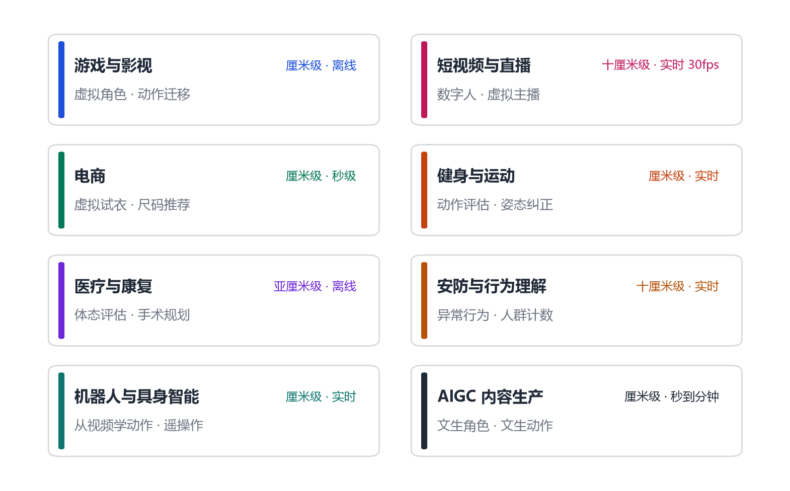

# 第 7 章 这套技术用在哪，边界在哪

一个模型在论文里跑出漂亮的结果，和一个团队拿它交付，中间隔着的往往不是算法。模型只管一件事，给输入吐输出。真实场景要管的是一堆别的事：输入是不是总能拿到，输出下游接不接得住，错了谁来兜，以及这套东西的许可能不能过法务。

这一章不谈新方法，只做三件别的事。把八类真实场景摊开，看它们各自被什么卡住；把数据和评估里最容易把人绕晕的概念说清楚；再拆掉几条流传很广的说法。读完你未必会做，但应该能判断别人做的东西靠不靠谱。

## 7.1 八类真实场景

这一节把八类真实场景摊开。结论是决定方案能不能用的，往往不是它属于哪一类方法，而是这个场景允许它错多少、等多久、从几个角度看。

按算法分类的书很多，按场景分类的少。可是决定一个方案能不能用的，几乎从来不是它属于哪一类方法，而是这个场景允许它错多少、等多久、从几个角度看。

同一套单图回归，放在短视频里够用，放在手术规划里不够用，模型一行没改，约束换了。所以下面这八类，每类都讲四件事：谁在用、输入是什么、输出是什么、卡在哪，最后给一个产品形态。产品形态说的是这类东西在市场上长成的样子，不是某家公司的某个型号。

**游戏与影视。** 用的人是角色美术、绑定师、动画师。输入通常是动捕棚里录的动作、美术手工雕的体型，或者扫描来的演员。输出是一套带骨骼和权重的角色网格，外加一份能搬到别的角色身上的动作。

这里卡的往往不是精度，是一致性。同一个动作库要装到几百个角色上，高矮胖瘦各不相同，重定向之后脚会滑、手会穿进身体、肩膀会脱臼。一个角色调两天，一百个角色就是两百天，所以管线要的是批量不出错，不是单个做到极致。

产品形态是游戏引擎里的人体绑定与动作重定向插件，或者影视预览用的数字替身。参数化模型在这个环节的价值，是把体型和动作拆成两笔可以分开采购的资产 [@loper2015smpl]。

**短视频与直播。** 用的人是主播、运营，以及做挂件的开发者。输入是一部手机的前置摄像头，运气好还有一颗深度传感器。输出是每一帧的体型、姿态、表情和手势，交给渲染层去驱动一个虚拟形象。

卡在两处。一是预算，一帧只有几十毫秒，识别、驱动、渲染、编码要挤在一起。二是人，主播不会配合你，会侧身、低头、用手挡脸、走到逆光里。

还有一条不成文的要求，不能抖。轻微的系统性偏差观众看不出来，每秒抖三次观众立刻关掉。产品形态是手机端的虚拟主播应用、直播平台的数字人挂件。这一档对绝对尺度不敏感，对稳定性和延迟极敏感 [@kanazawa2018hmr]。

**电商。** 输入是用户自报的身高体重、两三张照片，加上商家的尺码表。输出是围度估计、尺码推荐，以及一个可以转动的试衣预览。它的用户其实有两拨，买东西的人和定尺码表的商家，两拨人要的东西并不一样。

卡在绝对尺度。单张照片定不出厘米，只能定比例，得靠自报数据把尺度钉住，而自报数据本身就不准，人们还习惯往小里报。

另一处是收益门槛。模型的误差必须小于相邻两个尺码之间的间距，否则推荐等于没推。产品形态是手机端的虚拟试衣、商品详情页里的尺码推荐组件。这类系统真正的考核指标不是误差，是退货率。

**健身与运动分析。** 输入是手机架在地上拍的一段动作，或者健身镜里的摄像头。输出是关节角序列、动作阶段的切分，以及与标准动作的偏差，比如深蹲时膝有没有内扣、硬拉时背有没有塌。

卡在视角。大多数人只能从一个方向拍，侧面拍时左右方向的信息被压掉了，正面拍时前后方向又被压掉，而膝内扣恰好发生在被压掉的那个方向上。换一句话说，最容易错的那一维，正好是最缺证据的那一维。

还有节奏。数错一次深蹲，用户立刻会发现；把一次标准的深蹲判成不标准，用户会卸载。产品形态是健身应用里的动作计数与姿态纠正、康复诊所里用的动作评估软件。

**医疗与康复。** 输入是多视角相机、深度相机、站立位照片、步态视频。输出是体态参数、步态周期、左右对称性，或者一副假肢、矫形器的取型数据。

卡的东西和前面几类完全不同。可重复性比绝对精度重要，同一个病人这周和下周测出来的数要能比，否则治疗有没有效根本看不出来。结果还要能翻译成临床量表上的语言，医生不会接受一个没有单位的数。设备要过审批，这一步的时间往往比开发还长。

而病人恰恰是数据集里最少的那批人，肥胖、畸形、术后、带着支具。产品形态是体态评估软件、假肢与矫形器的数字化取型、术前规划用的三维重建。

**安防与行为理解。** 输入是几路到几百路监控视频。输出是人的位置轨迹、姿态、行为标签、人群密度。

卡在距离。画面里的人可能只有几十个像素高，关节根本看不见，能用的只有轮廓和运动。再往下一层是实例，一张画面里几十个人，谁是谁的关节要先分清楚，这件事本身就有专门的方法在做 [@baradel2024multihmr]。

最后是工程与合规。系统要连续跑几个月，误报率稍微高一点，保安就会把告警关掉。人脸和步态都属于敏感信息，采集在哪、存多久、谁能看，都有说法。这一类的精度要求在这八类里算低的，十厘米级就够用，难的是稳定和低成本。产品形态是园区与地铁的客流统计、摔倒检测、异常行为告警。

**机器人与具身智能。** 输入是人类演示的视频，或者操作员戴着设备做的遥操作。输出是关节角序列、手部姿态、物体交互的轨迹，最后要映射到一台自由度完全不同的机器人身上。

卡在形态差。人有二十几个关节和一只万能的手，机器人可能只有六七个自由度的臂加一个两指夹爪，人的动作没法照搬，得重新解一遍，还要保证解出来的轨迹不撞到自己、不超出关节限位。

还卡在接触。视频里看得见手碰到杯子，看不见用了多大力气，而抓取成不成，恰恰取决于那点力。产品形态是人形机器人的动作学习管线、VR 遥操作采数系统。这一档既要精度，又要世界坐标，还要实时，是八类里要求最全的。

**AIGC 内容生产。** 输入是一段文字、一张图，或者一小段视频。输出是一个参数化的角色加一串动作，可以直接进引擎，也可以进下一个生成环节。

卡在可控和一致。同一个角色在十个镜头里得是同一个人，改一个姿势不能把脸也改了，而这两件事恰好是纯生成模型最不擅长的。它擅长的是单张图好看，不擅长连续十张图都对。

还有版权。训练数据里的形象、生成结果的权利归属，目前都没有定论。产品形态是网页上的文生 3D 角色工具、视频软件里的文生动作插件。这一档对物理精度最宽容，对能不能编辑最苛刻。

<figure class="fig">

<figcaption><b>图 7-1</b>　八类场景的一张地图。每块写三样东西：场景名、它最终要交出的东西、以及精度与时延的档位。没有哪一块能同时占住“厘米级”和“实时”，这是场景差异最直接的体现。</figcaption>
</figure>

把八块放在一起看，会发现一件容易被忽略的事。这八类场景对“像不像”的要求差别很大，但对“能不能被下游接住”的要求是一致的。影视要的是能进引擎的网格，医疗要的是能写进病历的数，机器人要的是能被逆解的角度，直播要的是能立刻上屏的一帧。

模型输出的东西如果没法被下一个环节直接消费，精度再高也只是一个演示。这一行里失败的项目，大多数不是模型不够好，是模型和下游之间缺了一层没人愿意写的转换代码。

一条真实的链路可以说明这件事。直播数字人的完整流程是，摄像头采集、参数估计、动作重定向、渲染、编码推流。参数估计只占其中一环，而观众感受到的卡顿、穿模、口型不同步，可能来自任何一环。把整条链的误差都算在估计头上，是外行最常犯的归因错误。

所以选型的第一个问题不是哪个模型准，而是自己在哪一环、这一环的输入由谁决定、输出要交给谁。答案不同，同一个模型的评价可以完全相反。

这八类里还有几对其实在解决同一个问题。短视频和 AIGC 都在追同一件事，让同一个虚拟的人在不同时刻看起来还是同一个人；电商和医疗都在追绝对尺度，只是一个用自报数据，一个用设备标定；机器人和健身都在追关节角，只是一个要喂给机械臂，一个要喂给评分规则。认出这种同构，能省掉很多重复的调研。

## 7.2 一张对照表

这一节把八类场景的约束排进一张表。结论是精度和时延是两条独立的轴，经常互相拉扯。

把八类场景的约束排进一张表，精度和时延会露出两条独立的轴。这两条轴经常互相拉扯，要更准，往往要更多视角、更多计算；要更快，往往要牺牲一部分约束。

**表 7-1**　八类场景的约束对照。精度与时延都只给档位，不给具体指标。一格写两件事的，说明那个场景两样都要。

| 场景 | 主要输出 | 精度要求 | 时延要求 | 单目还是多目 |
|---|---|---|---|---|
| 游戏与影视 | 角色网格、关节角、动作序列 | 厘米级，且比例要对 | 离线，分钟级可接受 | 多目与动捕为主 |
| 短视频与直播 | 每帧体型、姿态、表情 | 十厘米级 | 实时，约 30fps | 单目 |
| 电商 | 围度、尺码、试衣预览 | 厘米级，且要绝对尺度 | 秒级 | 单目加自报数据 |
| 健身与运动 | 关节角、动作阶段、偏差 | 厘米级 | 实时，可略微滞后 | 单目 |
| 医疗与康复 | 体态参数、步态、取型数据 | 亚厘米级，重可重复性 | 离线 | 多目或深度相机 |
| 安防与行为 | 轨迹、行为标签、人群密度 | 十厘米级 | 实时 | 多目为主 |
| 机器人与具身 | 关节角、手部姿态、世界坐标 | 厘米级 | 实时 | 多目或头戴设备 |
| AIGC | 参数化角色、动作序列 | 厘米级，看得过去即可 | 秒到分钟级 | 不需要真实输入 |

表格里有三个规律值得单独说。

**第一个，精度要求最高的两行，恰好都不是从消费级视频里取数据的。** 医疗用多目或深度相机，机器人用多目或头戴设备。这不是巧合。要亚厘米级的可重复性，就得控制拍摄条件；一旦把相机交给用户，光照、角度、距离全都失控，误差立刻上一个档。

所以“我们的算法在手机上也能做到亚厘米”这种说法，先要问它指的是什么条件下的亚厘米。多半是指某个固定工位、固定距离、配合良好的场景，而不是任何人拿起来就拍。

**第二个，实时的场景几乎都是单目，单目的场景几乎都容忍十厘米级。** 这不是技术偏好，是算力预算。多视角意味着多路解码、多路推理，还要做时间同步和三维融合，延迟立刻翻倍，而直播和机器人都不接受翻倍。

反过来说，单目的信息量本来就不足以支撑厘米级的绝对精度，尤其是深度方向。这两件事互为因果，短期内不会改变。谁要打破它，得先打破算力或者打破成像原理，换一个网络结构是不够的。

**第三个，大多数场景真正在意的不是最准，是稳定。** 直播怕抖，安防怕误报，医疗怕这周和下周对不上，电商怕同一个用户两次推荐的结果不一样。这些都是平均误差反映不出来的，而恰恰是平均误差最擅长掩盖的。

单图估计这几年进步很快，更强的视觉骨干和规模大得多的训练数据，把野外照片上的稳定性推高了一截 [@shin2024hmr2]。但稳定这个要求仍然要靠工程手段保证，比如时间上的平滑、跨帧的一致性约束、以及失败时的兜底策略。

还有两样东西表格里没写，却经常决定项目生死。

**一是成本。** 多目方案要标定、要同步、要布线，一个工位的安装成本可能比算法授权贵一个量级。数据侧更贵，一段带三维真值的素材，背后是棚、是设备、是标注人力。

**二是谁说了算。** 有些场景的验收标准写在合同里，比如退货率、比如误报次数；有些场景的标准只在工程师心里，比如看着顺不顺眼。前者要按指标优化，后者要按体验优化，两套做法经常冲突。

同一个场景内部还会分档。影视有预览和成片，预览要快、能看就行，成片要慢、必须过审；医疗有筛查和诊断，筛查可以粗、诊断必须有出处。把两个档位混成一个需求，是项目定义阶段最常见的错误。

档位也不是固定的。硬件在变，原本只能放在后台离线跑的任务，这几年陆续被搬到了前端实时，于是同一个功能的验收标准跟着变。看这张表的时候要记住，它描述的是当下，不是物理定律。

所以这张表的用法是“对需求”：先写下你的场景允许错多少、等多久，再去表里找同类，最后才去挑模型。

## 7.3 数据和评估，外行最容易绕晕的地方

这一节讲数据和评估。结论是论文数字和实际体验的差距，大多来自三件事：数据从哪来、指标在量什么、对齐怎么做。

论文里的数字和实际体验对不上，是这一行最常见的抱怨。原因通常不在作者造假，而在读者看不到数字背后的三件事，数据从哪来、指标在量什么、对齐是怎么做的。这三件事任一不同，同一套方法能差出一倍。

### 7.3.1 数据从哪来

**三维扫描。** 让人站在一圈相机中间，一瞬间同时拍，再拼成一张带颜色的表面。精度最高，也最贵，一套设备的价格从几万到几百万元不等。

它的偏差很具体。愿意走进棚里的人本身就不是随机样本，年轻人、学生、本地人偏多；扫描要求穿紧身衣、摆固定姿势，于是衣服和姿态的多样性被抹掉了；拼接和配准还会引入一层谁都不愿意承认的误差。

**动捕。** 演员身上贴反光点，十几台红外相机追这些点，得到的是关节轨迹而不是表面。动作的精度和自然度都很好，但没有形状，只能告诉你骨头怎么动，不能告诉你人长什么样。

公开的动捕数据被陆续统一到同一套骨架和参数上，才有了今天能直接拿来训练的大规模动作库 [@mahmood2019amass]。它的偏差在动作类型，库里堆满了走路、跑步、跳舞、打斗，而蹲下去系鞋带、抱着孩子上楼梯这类日常动作少得可怜。

**多视角影棚。** 几十台同步相机围一圈，加一套标定，可以拍出带时间的四维表面。它是目前最接近真值的东西，几乎所有带三维标注的数据集都靠它。

偏差在于棚。固定光照、固定背景、有限的活动范围，人在里面做的动作和在外面做的不一样，走两步就得到边。设备贵还带来一个后果，能进棚的受试者数量有限，人群覆盖自然就窄。

**网络视频。** 规模最大、最真实，也最脏。没有三维真值，只能靠弱监督、伪标签、或者多视角自洽来凑。近年来的大模型路线基本都建立在这类数据上，因为它便宜、量大、覆盖真实场景。

它的偏差不在采集，在筛选。能被算法挑出来用的，往往是清晰、居中、全身可见的片段，而这恰好不是真实监控和真实直播的样子。用这种数据训出来的模型，会天然地高估画面质量。

**合成数据。** 用渲染引擎造人，姿势、体型、光照、相机全都可控，标注是完美的，因为真值本来就知道。这条路线在近几年变成主流，原因很直接，真实数据的三维真值太贵，而渲染便宜。

它的软肋是差距。渲染出来的人缺真实的皮肤质感、衣服褶皱、运动模糊，也很少有真实的遮挡关系。模型在合成数据上学会了，换到真实照片上会掉一截。常见的补救是把合成数据和真实数据混着训，再在真实数据上做微调。

五种来源之上还有一层，谁都绕不开，就是标注。三维真值不是从天上掉下来的，是扫描加配准算出来的，配准由人或算法做，做的人不同、标准不同，结果就不同。同一批扫描交给两个团队配准，得到的关节位置可能差出肉眼可见的一截。

这一层最容易被当成免费的。数据集的论文里通常只有一句“我们做了精细的配准”，而这句话背后可能是几个月的人工。买数据的时候，配准质量比条数重要得多，因为它会以系统性偏差的形式，悄悄进入你后面所有的指标。

**表 7-2**　五种数据来源各自能拿到什么、缺什么。

| 来源 | 拿到什么 | 主要偏差 | 典型用途 |
|---|---|---|---|
| 三维扫描 | 高精度静态表面 | 人群、姿势、衣着都窄 | 形状空间、体型统计 |
| 动捕 | 关节轨迹 | 动作类型集中，无形状 | 动作库、动作生成 |
| 多视角影棚 | 带时间的四维表面 | 场地受限，人数少 | 评测真值、视频重建 |
| 网络视频 | 规模与真实场景 | 无真值，筛选偏清晰片段 | 大规模预训练 |
| 合成数据 | 完美标注、可控条件 | 与真实存在外观差距 | 预训练、极端姿势补充 |

把这五种混在一起看，会看到三种偏差在叠加。

**人群偏差。** 数据里的人偏年轻、偏瘦、偏健康，老人、孕妇、极端体型的人少。模型的平均误差因此看起来很漂亮，因为这个平均值主要由最容易被表示的那批人贡献。

**动作偏差。** 日常动作和运动动作多，劳动动作、病理动作、带物体的交互少。一个人正常走路模型都估得不错，让他蹲下来搬箱子就开始出错。

**衣着偏差。** 紧身衣和短袖多，羽绒服、长裙、工装、头盔少。而模型是裸体的，衣服越厚，它越猜不出里面那个人的形状。

这三种偏差不会互相抵消，只会一起把模型往标准人做标准动作的方向拉。模型在标准人身上表现得越好，在其余人身上就可能越离谱，因为它的好是靠这条窄分布撑起来的。

数据配比因此比数据总量更值得讨论。一份由九成标准样本和一成长尾样本组成的数据，训出来的模型在整体指标上可能很好，在长尾上几乎不可用。要不要为长尾牺牲整体分数，是一个产品决策，不是技术决策。

### 7.3.2 四个指标，各自在量什么

外行看论文最容易犯的错，是把不同指标的数字放在一起比。它们量的根本不是同一件事，就像拿体重和体脂率比谁更健康。

**MPJPE（Mean Per-Joint Position Error，平均每关节位置误差）。** 把预测的关节和真值的关节按同一种方式对齐，通常只把根节点挪到同一个位置，然后量每一对关节之间的距离，取平均。它量的是关节在空间里对得准不准。

听起来最直白，问题也最多。它受对齐方式影响很大：允不允许旋转，结果能差一大截。它还被容易的关节主导，骨盆、胸腔在多数姿态下都好猜，误差小，脚踝、手腕难，误差大，一平均就看不出谁坏了。

它还把尺度和朝向算进误差里。于是一个身材完全正确、只是整体缩小了一点的结果，分数会很难看。而一个身材明显不对、但整体大小刚好蒙对的结果，分数反而好看。

**PA-MPJPE（Procrustes-Aligned MPJPE），加了对齐的版本。** 前面的 PA 指 Procrustes 对齐，先给预测做一次相似变换，平移、旋转、整体缩放都允许，把它拧到和真值最贴合的位置，再量关节距离。

为什么要这么绕？因为很多任务根本不关心人站在世界的哪个角落、面朝哪边、在画面里多大，只关心姿势和身材比例对不对。把整体的平移、旋转、尺度对齐之后再比，量的是形状，不是位姿。

这也是为什么它总比 MPJPE 小，小得让人误会。代价是把尺度一起抹掉了，一个把所有女性都预测成缩小版的方法，在这个指标上可以很好看，而它完全不能用来量身高。用在电商这种要绝对尺寸的场景，这个指标几乎不能作为依据。

**PVE（Per-Vertex Error，逐顶点误差）。** 关节只有十几个，顶点有几千个，PVE 量的是整张皮对不对。它比 MPJPE 更能反映体型，腰围估粗了两厘米，关节可能一个都没偏，但腹部那一圈顶点会整体外移。

它的麻烦在依赖配准。真值网格和预测网格必须是同一套拓扑、同一个顶点编号，否则压根比不了；而真值本身来自扫描和配准，配准错了，这个指标就在惩罚正确的结果。

另一个坑是衣服。真值是穿着衣服扫的，模型是裸体的，宽松衣服下 PVE 天然就大，这个大和算法好坏没关系。看到 PVE 数值的时候，先问一句真值穿的是什么。

**加速度误差，也叫抖动。** 视频任务专用。把每一帧的关节位置对时间求两次差分得到加速度，再和真值的加速度比，量的是动作的平滑程度和节奏感。

这个指标最容易被优化，也最容易被误读。一个干脆不动的预测，加速度误差接近零，分数极漂亮，可它什么也没做。反过来，真实的快速动作，挥拍、起跳、急停，加速度本来就大，系统稍微平滑一点就会被扣分。

所以它必须和位置类指标一起看，单独看没有意义。它真正能抓的是一种病，每帧结果都在跳、单帧看上去还行、连起来像抽搐。那种病在位置指标里几乎看不出来。

还有一件和指标有关、但常被跳过的事，测试集本身。同一个数据集，不同的预处理、不同的关节定义、不同的对齐实现，算出来的数可以差很多。所以论文里的比较，只有在大家用同一套评测代码时才有意义。自己复现时对不上，先怀疑评测脚本，再怀疑方法。

四个指标的分工可以这样记。关节准不准看 MPJPE，形状比例对不对看 PA-MPJPE，表面和体型像不像看 PVE，动作顺不顺看加速度。四件事没有哪一件能代替另一件。

### 7.3.3 指标之外

即使四个指标都读懂了，还是有一层东西是数字给不了的。排行榜上的分数是整段测试集上的平均，而你要的是在你的场景里不出事。

所以看一个系统，至少要把结果切开看，按遮挡程度切、按体型切、按动作类型切、按拍摄距离切。平均值好看而某一片全错，是这类系统最典型的失效方式，因为那一片往往正好是你的用户。

再往下一层是下游。动作识别准不准、尺码推荐退不退、医生愿不愿意用，这些才是真正结算的地方。一个重建结果在指标上平平，但关节稳定、时间连续，下游往往比一个指标漂亮但每帧乱跳的结果好用。

这也是为什么很多工程团队宁可选一个分数一般但脾气好的方案。指标是给评审看的，稳定是给用户用的，两者不总是一回事。

还有一层是时间。同一段视频，逐帧独立估计和带时序约束的估计，单帧指标可能差不多，连起来看差别巨大。评价视频结果时，逐帧指标必须配一个时序指标，否则等于只看静帧。

所以看到数字之前，先问这个数字是怎么算出来的：对齐了吗、真值穿的什么、测的是单帧还是序列。

## 7.4 六条常见误解

这一节拆六条流传很广的说法。结论是它们大多把“榜上的表现”当成了“你场景里的表现”。

**榜首就等于能用。** 榜是在同一个数据集上排的，测试集和训练集同源，拍摄条件、人群分布、衣着、镜头都一样，模型只要把这批数据的规律记住就能排前面。

换到你的场景，先变的就是分布。摄像头在门口，逆光，人离得远，冬天穿羽绒服。跨数据集掉一截是常态，掉多少取决于两个数据集有多像。

更隐蔽的一条是标注口径。榜上的真值关节按某套骨架定义，而你要的可能是围度、是肩斜角，两者根本不是一回事。看榜的时候，先看它的测试集长什么样，再看它的指标是不是你要的东西。

榜单还有一个副作用，它把注意力吸到小数点后一位。前十名之间的差距，往往小于换一个摄像头带来的差距。与其纠结那一点，不如把自己的场景拍一段，拿几个候选方案跑一遍，看谁在你的数据上不崩。

**参数多就准。** 形状参数从十个加到几百个，模型确实能表达更多个体差异。但在从图像估参数这件事上，参数越多问题越病态。

解的空间变大，同一张图对应更多组合适的解，估计器更容易被噪声推到一个奇怪的角落。表现出来就是体型估得很有个性但不对，或者同一个人在两帧之间体型跳变。

参数多的收益，常常被配准误差和数据覆盖不足吃掉。真正决定精度的是数据质量与约束强弱，不是参数个数。一个参数少但训练数据干净的模型，往往比参数多但配准歪掉的模型更可靠。

**有骨架就一定能驱动。** 输出一串关节角，不等于你的角色能直接用它。中间隔着绑定，顶点要绑到骨头上，权重得对，模型的基准姿势得和你的角色一致。

骨骼的命名、层级、朝向、单位都得对得上，任何一处不一致，动作搬过去就是歪的。还有比例，同一个抬腿三十度，腿长不同，脚落的位置差很远，脚会滑。

所谓重定向就是专门解决这件事的一层工程。它比模型本身更容易出问题，也更容易被低估，因为它在论文里通常只占一句“我们把结果重定向到目标骨架”。

**神经渲染能取代参数模型。** 神经渲染擅长的是从某个角度看上去像，不擅长改一个量。要让角色抬左手三十度，参数模型有一个明确的旋钮，神经场没有；要量肩宽，参数模型能直接读出来，神经场得另想办法。

再加上导出、碰撞、物理、多级精度、引擎兼容这一整套，工业管线需要的是一个能被别的软件消费的接口，而不是一张只能自己渲染的场。

现实里的组合是参数模型当骨架和先验，神经层补外观细节，各管一段。两者的分工不是妥协，是各自做自己擅长的那一半。

**模型许可可以随便用。** 这条最不像技术问题，却最常在临近上线时炸。SMPL、MANO、FLAME 这些模型，学术研究免费，商业使用需要单独授权。

模型的权重、由它生成的资产、以及基于它训练出来的网络，都可能受条款约束。团队在实验室里用了两年，产品要发布时才发现不能用，这种事一点不罕见。

选型时应该把许可和精度放在同一张表里比较，而不是等法务来告诉你。同样的道理也适用于数据集，很多公开数据集只允许研究用途，用它训出来的模型能不能商用，是另一个问题。

**数据越多越好。** 数量是最容易堆的一项，也最不解决问题。一批配准歪掉的扫描，会把配准误差学进主成分，模型从此带着一个查不出来的系统性偏移。

一批重复的、近重复的样本，会让网络记住而不是学会。长尾人群在总量里占不到几个百分点，把总数据量翻一倍对它们的改善，还不如专门补一小批。

数据的价值在覆盖和一致，不在体积。判断一份数据值不值得买，先看它的采集流程有没有统一，再看它覆盖了哪些人，最后才看有多少条。

所以这六条误解有一个共同点：都把“某个条件下的表现”当成了“普遍能力”。

## 7.5 难的地方不在模型

这一节收束全章。结论是卡住项目的常常不是算法，而是算法之外的那三段。

把这八类场景、四个指标、六条误解放在一起，会看到一个共同的形状。一个系统真正难的地方通常不在模型，而在数据、评估、部署这三段连成的链。

数据决定模型认识什么，评估决定你以为它认识什么，部署决定它实际遇到了什么。三处任一断裂，模型再好也交不出去，而断裂处往往离论文最远。

这三处断裂的症状各不相同。数据断裂的表现是模型在某些人身上系统性地错，而且换模型也不好转；评估断裂的表现是分数很好但一上线就挨骂；部署断裂的表现是演示惊艳、装机之后处处别扭。

所以判断一个新方案，可以先问三个问题，都答得上来再谈用它。

**它的输入假设是什么。** 假设全身上下都看得见，还是允许遮挡？假设人在画面中央，还是允许小目标？假设白天顺光，还是允许夜视？假设单目，还是偷偷用了多视角或多帧？

论文里这些假设往往写在实验设置里，两行字，却是你能不能用的全部。它不写，你就得从数据集的名字和示例图里猜。

**它的输出能不能被下游消费。** 是一套标准拓扑的网格，还是一堆没编号的点？是绝对尺度的米，还是归一化之后的相对值？是每帧独立的结果，还是带时间一致性的序列？

下游接不住，等于没有输出。这一条比精度更容易被忽略，因为它在论文里根本不出现。

**它的失败模式是什么。** 遮挡的时候会怎样，是穿模、是消失、还是给个平均人？极端体型会怎样，是崩掉，还是老老实实退回训练分布的边缘？

失败模式可预期，系统就能用，加个兜底、加个人工复核就能上；失败模式不可预期，就只能停在演示里。工程上大量的人力，花在把不可预期的失败变成可预期的失败上。

三个问题问完，如果还想再进一步，就看它出错时的样子。把几个明显的坏样本喂进去，逆光、遮挡、远景、侧躺，看它怎么错。错得有理有据的方案，改起来有方向；错得莫名其妙的方案，只能换掉。

如果只记一句话，记这句。这套技术的边界不在它能生成多像的人，而在它知道自己什么时候不知道。

所以选型时可以反过来用这句话做筛子：演示再漂亮，如果它答不上“什么时候会坏”，就先别急着上。

## 本章小结

- 八类场景的差别不在算法，在约束。精度和时延是两条独立的轴，同时要高的场景通常只能靠多目和离线。
- 数据有五种来源，扫描、动捕、多视角影棚、网络视频、合成数据，各自带着人群偏差、动作偏差、衣着偏差，这些偏差会叠加而不是抵消。
- 四个常用指标各量一件事。MPJPE 量关节位置，PA-MPJPE 去掉整体位姿后量形状，PVE 量表面，加速度误差量平滑，数字之间不可横比。
- 六条误解里最容易被忽略的是许可。学术免费不等于商用免费，它常常在临近上线时才暴露。
- 系统难在数据、评估、部署这条链。判断一个新方案就问三件事，输入假设、输出能否被下游消费、失败模式是否可预期。

## 思考题

1. 你要做一个手机拍一张照、估出三围的功能。按这一章的框架，它最大的风险在数据、评估还是部署？为什么单图方案在这个任务上注定要依赖额外输入？
2. 一个方法在你的测试集上 MPJPE 很好，而 PA-MPJPE 和它几乎一样好。这说明它的误差主要来自哪里？如果反过来，PA-MPJPE 远小于 MPJPE，又说明什么？
3. 假设你要把一套开源的参数化人体模型接进商业产品。除了精度和速度，你会列一张什么样的清单去和法务、和下游引擎团队对齐？
