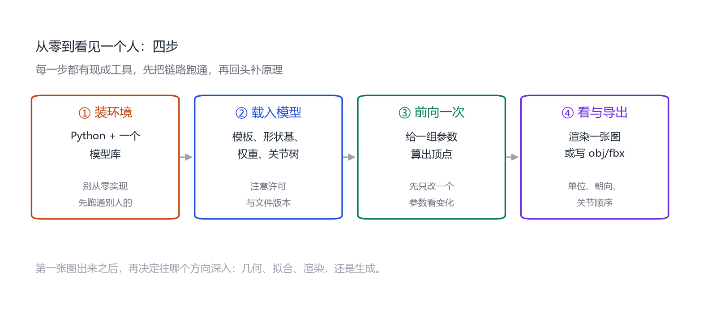

# 第 8 章 怎么开始

前面七章都在讲"是什么"。这一章讲"怎么碰它"：需要装什么、先跑什么、会踩哪些坑。这里不假设你会深度学习，也不假设你有显卡。

## 8.1 先用别人的，别从零写

参数化模型的公式不难，但从零实现一遍要处理一堆琐事：关节树的遍历、权重的归一化、坐标系朝向、文件格式的版本差异。这些事对理解原理几乎没有帮助，却会吞掉你第一周的全部时间。

所以第一步是跑通一条现成的链路。今天比较省事的选择有三类：

- **Python 生态**：一个模型库负责加载与求值，一个渲染库负责把网格画出来。前者的作用是把"模板 + 参数"变成顶点数组，后者负责把它变成一张图。
- **引擎插件**：主流游戏引擎与三维软件都有导入参数化模型的插件，适合只想看看效果、或者要把模型塞进已有美术流程的人。
- **在线体验**：不少研究项目提供网页 demo，输入一张照片就能看到结果。适合先建立直觉，不适合做工程。

三类都值得花半小时试一遍。第一张图出来之后，你对"参数—网格—图像"这条链的理解会比读三章文字更实在。

<figure class="fig">

<figcaption><b>图 8-1</b>　从零到看见一个人的四步。每一步都有现成工具，先把链路跑通，再回头补原理。真正花时间的是第四步的细节：单位、朝向、关节顺序。</figcaption>
</figure>

## 8.2 四步走

**第一步，装环境。** 一个 Python 解释器，加一两个模型库。不要一上手就编译 CUDA 相关的包，先用纯 CPU 版本跑通。

**第二步，载入模型。** 模型文件通常包含五样东西：模板顶点、形状方向、姿态方向、蒙皮权重、关节的父子关系。加载之后先做三件事：数一数顶点数是不是你以为的那个数、检查关节数量、确认单位是米还是厘米。

**第三步，前向一次。** 给一组形状参数和一组姿态参数，算出顶点。第一遍建议只改一个参数：把第一个形状参数从 0 调到 1，你会看到一小块区域整体鼓起来——这就是"参数控制形状"最直观的样子。

**第四步，看与导出。** 渲染一张图，或者写成通用的网格格式塞进三维软件。这一步最容易出问题，因为单位、坐标轴朝向、关节顺序、旋转的表示方式（矩阵、四元数、轴角）在不同工具里都不一样。

## 8.3 六个容易踩的坑

**坑一，许可。** 这一类模型的许可差异很大：有的允许学术使用、商用需要另外授权；有的要求你不得再分发模型文件本身。工程落地时，这是第一个要确认的东西，不是最后一个。

**坑二，单位。** 同一套模型，不同实现导出的文件可能一边按米、一边按厘米。混用之后人会变大一百倍或缩小一百倍，而看起来"只是相机没调好"。

**坑三，坐标朝向。** 有的工具 Y 轴朝上，有的 Z 轴朝上。不改朝向直接导入，人会躺在地上。

**坑四，关节顺序。** 不同库给关节编号的顺序可能不同。用错顺序做监督，训练会一直不收敛，而且看不出原因。

**坑五，旋转表示。** 姿态参数到底是轴角、四元数还是旋转矩阵，决定了你怎么插值和怎么优化。把轴角当成欧拉角用，会出现莫名其妙的翻转。

**坑六，姿态的基准。** 参数都是相对"某个基准姿势"说的。基准不同（比如手臂张开的角度），同一组参数指向的姿势就不一样，跨模型搬参数时必须做对齐。

## 8.4 三条深入路线

跑通之后，往哪走取决于你想解决什么问题。

**想做几何与建模**：搞清形状空间、姿态修正、骨架解耦这几件事。这条线的产出是"更准更可控的模型"。

**想做从图像到人**：搞清优化与回归两条路线、关键点与轮廓的监督、可微渲染。这条线的产出是"从照片或视频里把人读出来"。

**想做渲染与生成**：搞清神经渲染与扩散模型怎么和参数化模型配合。这条线的产出是"照片级、可驱动的内容"。

三条线不冲突，很多人是"以其中一条为主线，另外两条够用就行"。

## 8.5 五本值得翻的原始文献

不必从头读到尾，它们的作用是"当你需要细节时有地方可查"。

1. 主动形状模型与三维形变模型：参数化形状的开端，思路至今没变。
2. SCAPE：第一次把形状和姿态拆开。
3. SMPL：把一个可实时求解的公式写成标准，也是今天的事实接口。
4. FLAME 与 MANO：把同一套方法搬到脸和手。
5. SMAL：把同一套方法搬到动物，并解决跨物种对应。

读论文时抓三件事就够：它把什么当成"参数"、它用什么数据学这些参数、它的失败模式是什么。剩下的公式，等你要复现时再看。

## 8.6 一句提醒

这个领域变化很快：三年换一批模型，五年换一套底座。但有几件事没变——**用少数几个有含义的量去控制高维形状**、**把形状和姿态分开**、**用可微的方式把观测和模型连起来**。

如果你只打算记住三句话，记这三句。它们比任何具体模型都活得久。

## 本章小结

- 先用现成工具跑通链路，再看原理；第一张图出来的价值远大于读完三章。
- 上手分四步：装环境、载入模型、前向一次、看与导出。
- 六个坑：许可、单位、朝向、关节顺序、旋转表示、姿态基准。
- 三条深入路线：几何与建模、从图像到人、渲染与生成。
- 值得翻的五篇原始文献：ASM/3DMM、SCAPE、SMPL、FLAME/MANO、SMAL。
- 不变的三件事：低维参数控制高维形状、形状与姿态分离、可微地把观测和模型连起来。

## 思考题

1. 如果你只有一台没有显卡的笔记本，本章推荐的四步里哪一步最可能卡住？为什么？
2. 为什么"关节顺序"这种细节会让训练不收敛，却几乎不会报错？
3. 你自己的工作或兴趣，更接近本章三条深入路线里的哪一条？
