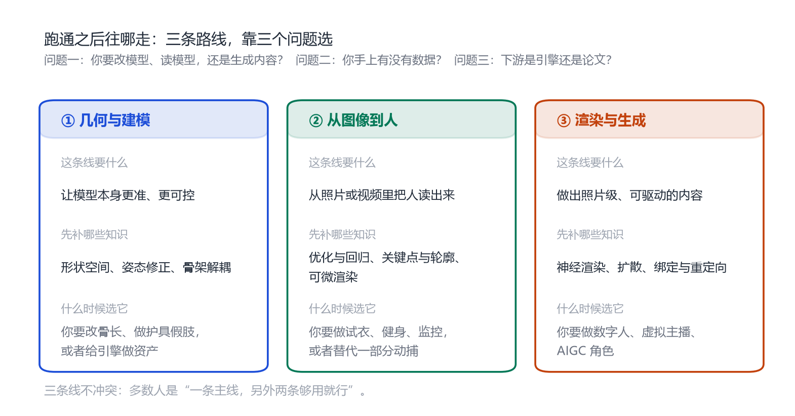

# 第 8 章 怎么开始

> **本章导读**：前面七章都在讲“是什么”。这一章讲“怎么碰它”：需要装什么、先跑什么、每一步会看到什么、会在哪一步卡住。这里不假设你会深度学习，也不假设你有显卡。读这一章要一个下午，照它动手要一周，用一台普通笔记本就够。

## 8.1 先用别人的，别从零写

这一节要说服你不要从零实现。结论是：先跑通一条现成链路，你对原理的理解会比读三章文字更实在。

参数化模型的公式不难，但从零实现一遍要处理一堆琐事：关节树的遍历、权重的归一化、坐标系朝向、文件格式的版本差异。这些事对理解原理几乎没有帮助，却会吞掉你第一周的全部时间。

所以第一步是跑通一条现成的链路。今天比较省事的选择有三类：

- **Python 生态**：一个模型库负责加载与求值，一个渲染库负责把网格画出来。前者的作用是把“模板 + 参数”变成顶点数组，后者负责把它变成一张图。
- **引擎插件**：主流游戏引擎与三维软件都有导入参数化模型的插件，适合只想看看效果、或者要把模型塞进已有美术流程的人。
- **在线体验**：不少研究项目提供网页 demo，输入一张照片就能看到结果。适合先建立直觉，不适合做工程。

三类都值得花半小时试一遍。第一张图出来之后，你对“参数—网格—图像”这条链的理解会比读三章文字更实在。

具体到装什么，一份最小清单是这样的。

**一个 Python 解释器。** 近两年的 Python 3 就行，不必追最新版。装的时候记得勾上“加入环境变量”，否则后面每条命令都要写全路径。

**两三个包。** 一个负责读模型、算顶点（业界常用的 `smplx` 就是这件活）；一个负责读网格、算面积、导出文件（`trimesh` 好用）；一个负责把结果画成图（`pyrender` 或 `matplotlib` 都行）。再装个 `numpy` 打底。

**模型文件。** 这一类模型通常不在普通软件源里，要去官方网站注册账号、同意许可协议之后下载。这一步会劝退不少人，但它是版权要求，绕不过去。

**一个看得见结果的地方。** 一开始用 `matplotlib` 画个散点就够了；想看得舒服点，把导出结果丢进 Blender 看。

还有一个常被问到的问题：要不要显卡。答案是前四步都不需要。加载模型、改参数、渲染一张图，普通笔记本的 CPU 就够；只有开始做参数优化、训练网络、跑神经渲染时，显卡才变得重要。所以不要一上手就买卡，先用 CPU 把链路走通。

这一节的重点不是清单本身，而是顺序：先能看见，再去理解。装环境的痛苦是一次性的，卡在原理上的痛苦是持续的。

<figure class="fig">

<figcaption><b>图 8-1</b>　从零到看见一个人的四步。每一步都有现成工具，先把链路跑通，再回头补原理。真正花时间的是第四步的细节：单位、朝向、关节顺序。</figcaption>
</figure>

所以第一天的目标不要定成“搞懂 SMPL”，定成“看到一张自己生成的图”就好。

## 8.2 四步走：每一步你会看到什么

这一节给一份可对照的清单。结论是四步各有明确的“应该看到什么”，对不上就说明卡在哪一步。

**第一步，装环境。** 一个 Python 解释器，加一两个模型库。不要一上手就编译 CUDA 相关的包，先用纯 CPU 版本跑通。这一步成功的标志很朴素：在命令行里能打印出版本号，`import smplx` 不报错。

**第二步，载入模型。** 模型文件通常包含五样东西：模板顶点、形状方向、姿态方向、蒙皮权重、关节的父子关系。加载之后先做三件事：数一数顶点数是不是你以为的那个数、检查关节数量、确认单位是米还是厘米。

这一步你会看到几个很具体的数字。以身体模型为例，顶点数应该是 6890，关节数应该是 24，形状参数 10 个。三个数里有一个不对，就说明你加载的不是它，或者读错了文件。

**第三步，前向一次。** 给一组形状参数和一组姿态参数，算出顶点。第一遍建议只改一个参数：把第一个形状参数从 0 调到 1，看看人往哪个方向变。

多数模型里，第一个形状参数最接近“整体胖瘦或体量”，调到端点会看到整个人变壮或变瘦，而不是某个局部鼓起来。不同模型、不同数据下顺序会变，所以这里不做保证，自己试最准。

再试一次姿势：只把右肘的角度改 30 度。你应该看到右前臂和右手跟着动，肩膀以上和左半边完全不动。如果动的范围不对，说明关节顺序或者骨架的父子关系读错了。这些角度一开始手填就行，等你要跑真实动作，才需要从动作文件里读。

顺带说清一个容易混淆的地方：动作数据和模型文件不是一回事。模型文件里存的是模板、方向、权重；动作数据里存的只是每帧几十个关节角。所以同一段动作可以套到任何体型上，这也是“换人跳舞”能成立的原因。

**第四步，看与导出。** 渲染一张图，或者写成通用的网格格式塞进三维软件。这一步最容易出问题，因为单位、坐标轴朝向、关节顺序、旋转的表示方式（矩阵、四元数、轴角）在不同工具里都不一样。

这一步你会得到两样东西：一张 PNG，一个 `.obj` 或 `.ply` 文件。打开之后如果人站着、大小正常、姿势对，链路就通了。

**表 8-1**　看到的画面不对时，先查哪里。

| 你看到的 | 最可能的原因 | 第一步查什么 |
|---|---|---|
| 人躺着或趴着 | 坐标轴朝向不一致 | 两边的“上”是哪个轴 |
| 人变大一百倍 | 单位混用（米与厘米） | 量一下模型高度是 1.7 还是 170 |
| 人站着但姿势怪 | 关节顺序或基准姿势不同 | 打印关节列表逐个对数 |
| 只有一条手臂在动 | 骨架的父子关系读错 | 检查关节的父节点 |
| 手臂突然翻转 | 旋转表示被混用 | 确认是轴角、四元数还是矩阵 |
| 渲染全黑或全白 | 相机没对准，或法线朝里 | 先画顶点散点，不画面 |

所以四步的价值在于“可对照”。每一步都有一个应当看到的画面，对不上就往回退一步查，比盲目读文档快得多。

## 8.3 六个容易踩的坑

这一节把最常见的六种失败列出来。结论是：它们几乎都不报错，只会让结果“看着不对”，所以必须知道每个坑长什么样。

**坑一，许可。** 这一类模型的许可差异很大：有的允许学术使用、商用需要另外授权；有的要求你不得再分发模型文件本身。

具体症状：研究和演示都好好的，产品要上线时，法务问一句“这个模型文件能不能随安装包发出去”，才发现不能。工程落地时，这是第一个要确认的东西，不是最后一个。

**坑二，单位。** 同一套模型，不同实现导出的文件可能一边按米、一边按厘米。

具体症状：人变大一百倍，或者缩成蚂蚁那么大。你第一反应会以为是相机没调好，其实是单位错了。查的办法很简单：量一下模型的高度，人应该是一点几，而不是一百七十或者零点零几。

**坑三，坐标朝向。** 有的工具 Y 轴朝上，有的 Z 轴朝上。

具体症状：人不站着，而是躺着或者面朝地面。所有关节位置看着都对，整体就是转了九十度。这一步没有技巧，只能查清楚两边各自的约定。

**坑四，关节顺序。** 不同库给关节编号的顺序可能不同。

具体症状：不报错，但训练不收敛，或者可视化时关节连成一团乱麻。因为你的第 5 号是左手腕，人家的第 5 号是右脚踝，监督信号全对错了人。这类错误最难查，因为它不崩，只是慢慢变差。快速定位的办法：把两套关节名字打印出来，一行一行对着看，别靠猜。

**坑五，旋转表示。** 姿态参数到底是轴角、四元数还是旋转矩阵，决定了你怎么插值和怎么优化。

具体症状：把轴角当成欧拉角用，动作会在某些角度突然翻个面；或者两个姿势做插值时，手臂绕了一大圈才到位。看到“翻转”“绕远路”，先怀疑表示方式。

**坑六，姿态的基准。** 参数都是相对“某个基准姿势”说的。

具体症状：跨模型搬参数时，整体姿势偏了一点，比如手臂张角不同、膝盖微微弯。基准不同（比如手臂张开的角度），同一组参数指向的姿势就不一样，所以搬之前要先做对齐。

所以这六个坑的共同点是“静默失败”。它们不弹错误框，只给你一个看着别扭的结果；知道症状，就能反推是哪一环。

遇到“看着不对”时，可以按这个顺序自查：先查大小（单位），再查方向（朝向），再查姿势（关节顺序与旋转表示），最后查形状（参数是否在合理范围内）。前三条都能用一眼看出来的症状确认，最后一条要靠对比。

## 8.4 七天能干到什么

这一节给一个可以照做的时间表。结论是：一周足够从“完全不懂”走到“能自己改参数、能跑一段动作”。

**第一天，跑通官方示例。** 目标是看到一张图。装环境、下载模型、跑一个最小的脚本，把结果存成 PNG。这一天的成败标准只有一个：图出来了。

**第二天，玩形状参数。** 把第一个到第三个形状参数各推到两端，一共存几张图，排在一起看。你会第一次直观感受到“参数就是方向”。

**第三天，玩一个关节。** 只改右肘，从 0 度到 90 度，看前臂怎么跟着走。再故意改左肩，确认右臂没动。这一天你会真正理解“转一个关节只影响下游”。

**第四天，导出。** 写一个 `.obj`，拖进 Blender 或任意三维软件，检查大小、朝向、姿势。这一天最容易卡住，也最值得卡：把它修好，后面所有实验都省事。

**第五天，跑一段动作。** 找一段公开的动作数据，按帧喂给模型，渲染成一段视频或一串图片。注意这里只要“看着像在走”，不要求精确。

**第六天，试一次反推。** 用现成的开源工具，拿一张自己的照片估一组参数，再渲染出来对比。你会亲眼看到第 4 章说的那些麻烦：体型偏胖、姿势温和、尺度不对。

**第七天，写一页笔记。** 记下你踩过的坑、你用的版本、你改过的参数，以及哪一步最花时间。版本这一项别省：同一个模型的不同版本，参数个数和关节顺序都可能变，两个月后你自己也未必记得当时用的是哪个。这一页笔记比任何教程都贴近你自己的工作。

如果一天挤不出两小时，还有个压缩版：第一天只管跑通，第三天只管改一个关节，第六天只管试一次反推。三件事做完，你也能得到同样三种手感，只是少了几张对比图。

所以一周的目标不是“学会”，而是“建立手感”。手上有过一张图、一段动作、一次失败的拟合，再读公式就不会飘。

## 8.5 三条深入路线怎么选

这一节给一个选方向的依据。结论是：路线由“你要什么”和“你手上有什麼”共同决定，不由哪个方向更热决定。

<figure class="fig">

<figcaption><b>图 8-2</b>　三条路线各自要什么、先补什么、什么时候该选它。它们不冲突，很多人是“一条主线，另外两条够用就行”。</figcaption>
</figure>

**想做几何与建模**：搞清形状空间、姿态修正、骨架解耦这几件事。这条线的产出是“更准更可控的模型”。适合手上有一批扫描数据、或者要给引擎做资产的人。

**想做从图像到人**：搞清优化与回归两条路线、关键点与轮廓的监督、可微渲染。这条线的产出是“从照片或视频里把人读出来”。适合做试衣、健身、监控，或者想替代一部分动捕的人。

**想做渲染与生成**：搞清神经渲染与扩散模型怎么和参数化模型配合。这条线的产出是“照片级、可驱动的内容”。适合做数字人、虚拟主播、AIGC 角色的人。

三条线不冲突，很多人是“以其中一条为主线，另外两条够用就行”。选的时候可以问自己三个问题。

第一个问题：**你手上有没有数据？** 有扫描数据就往几何走，有视频就往反推走，只有文字和想法就往生成走。

第二个问题：**你要的是“准”还是“快”？** 医疗、工业测量要准，可以慢；直播、游戏要快，可以稍微不准。这一条直接决定你用优化还是回归。

第三个问题：**你的下游是引擎、是论文，还是 App？** 引擎要标准网格和骨架，论文要比指标，App 要延迟和稳定。三种下游对同一个模型的评价可以完全相反。

有一个常见的误判值得单独提：以为“先把三条线都学一遍再动手”。这三条线各自都有一整套知识，一起学的结果通常是每条都停在第一章。更划算的做法是选一条走到底，走到能交付一个小东西，再回头补另外两条里真正用到的部分。

如果三条都想碰，也有个便宜的办法：先做一条线上的一个小交付。比如在几何线上把某个角色改成你要的体型，在反推线上把一张照片拟合成参数，在生成线上把一个静态角色绑上骨架跳一段舞。三个小东西各花一两天，做完你对三条线的体感就都有了。

所以别按“哪个方向热”选。按你手上有什么、下游要什么选，选完再补知识，顺序就不会错。

## 8.6 五篇值得翻的原始文献

这一节列五篇源头文章。结论是：不必从头读到尾，它们的作用是“需要细节时有地方可查”。

1. 主动形状模型与三维形变模型：参数化形状的开端，思路至今没变。
2. SCAPE：第一次把形状和姿态拆开。
3. SMPL：把一个可实时求解的公式写成标准，也是今天的事实接口。
4. FLAME 与 MANO：把同一套方法搬到脸和手。
5. SMAL：把同一套方法搬到动物，并解决跨物种对应。

每篇的重点部位也不一样。看 ASM 与 3DMM 那两篇，看的是“平均 + 主成分”这个框架怎么被提出来；看 SCAPE，看的是它为什么要拆成形状和姿态两部分；看 SMPL，看的是它怎么把这件事做得又快又可微，以及它给参数起的名字；看 FLAME 与 MANO，看的是同一套写法在更小的对象上要做哪些妥协；看 SMAL，看的是数据拿不到时怎么绕。

读论文时抓三件事就够：它把什么当成“参数”、它用什么数据学这些参数、它的失败模式是什么。剩下的公式，等你要复现时再看。

这五篇都不难找。论文本身在 arXiv 上就有预印本；模型和代码一般在项目主页或 GitHub 上，跟着 README 走一遍，比读方法部分更快建立印象。

这三问听起来简单，却能帮你判断一篇论文值不值得读下去。如果它说不清自己用什么数据，那它的指标就不用太当真；如果它不写失败模式，那你用的时候就会替你发现。

所以看文献的正确姿势，是把它当成“一份说明书的附录”，而不是“一本要背下来的书”。

## 8.7 一句提醒

这一节收个尾。结论是：模型会换，底层那三件事不会换。

这个领域变化很快：三年换一批模型，五年换一套底座。但有几件事没变——**用少数几个有含义的量去控制高维形状**、**把形状和姿态分开**、**用可微的方式把观测和模型连起来**。

如果你只打算记住三句话，记这三句。它们比任何具体模型都活得久。

补一句更实用的：这三件事同时也是排查问题的顺序。形状不对，先看参数空间和数据；动作不对，先看骨架和蒙皮；从图里读不准，先看监督和可微。

所以这一章给的不是一条固定的学习路径，而是一套判断方法：知道每一步该看到什么，知道坑长什么样，知道方向怎么选。有了这套方法，换哪一代模型都能重新上手。

## 本章小结

- 先用现成工具跑通链路，再看原理；第一张图出来的价值远大于读完三章。
- 最小清单是：一个 Python 解释器、两三个包、官网注册下载的模型文件、一个能看图的地方。
- 上手分四步：装环境、载入模型、前向一次、看与导出；每一步都有“应当看到什么”可以对照。
- 六个坑：许可、单位、朝向、关节顺序、旋转表示、姿态基准。它们几乎都不报错，只会让结果看着别扭。
- 一周可以走到“能改参数、能跑动作、试过一次反推”，目标是手感不是精通。
- 三条深入路线：几何与建模、从图像到人、渲染与生成；按“手上有什么、下游要什么”来选。

## 思考题

1. 如果你只有一台没有显卡的笔记本，本章推荐的四步里哪一步最可能卡住？为什么？
2. 为什么“关节顺序”这种细节会让训练不收敛，却几乎不会报错？
3. 你自己的工作或兴趣，更接近本章三条深入路线里的哪一条？
