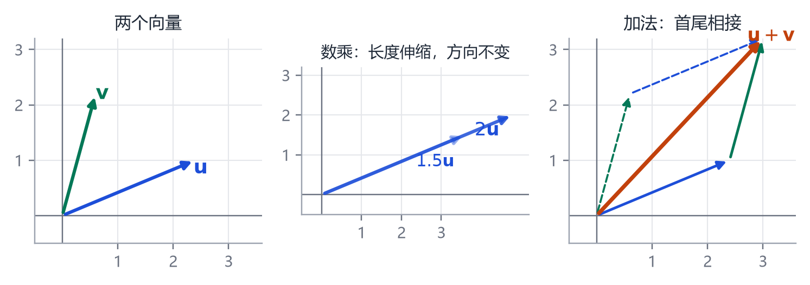
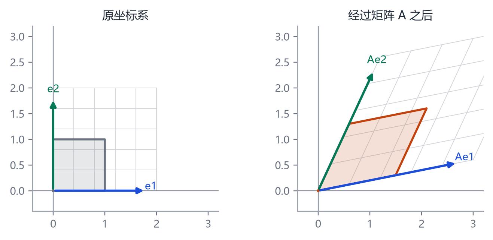
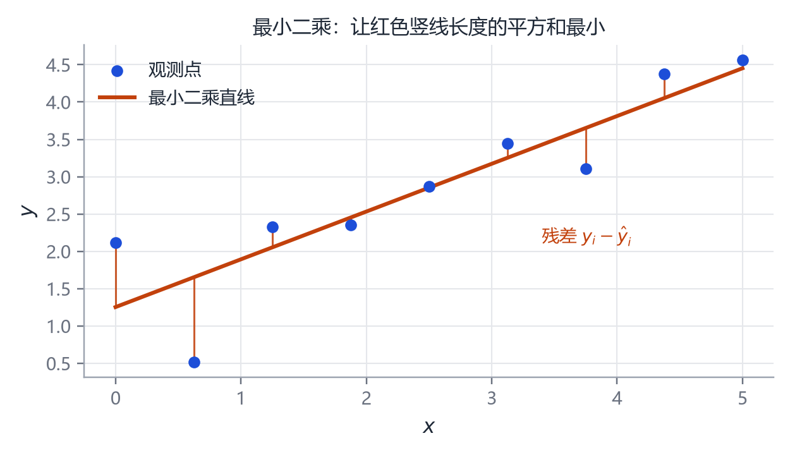
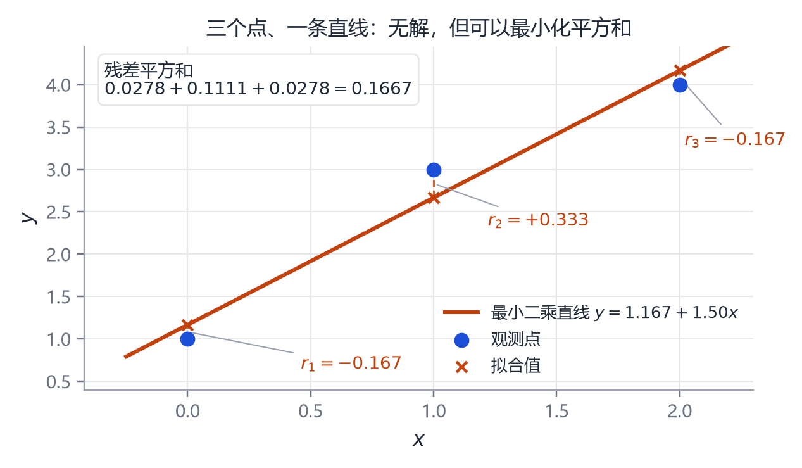
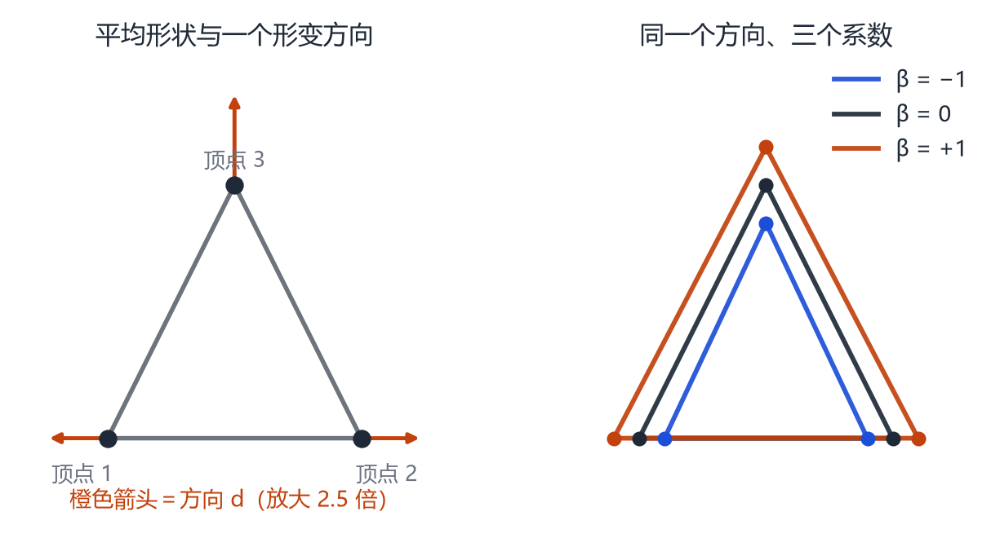

# 第 1 章 数学工具箱（一）：向量、矩阵与最小二乘

> **本章导读**：把一个人体变成一个可以计算的量，需要三样东西：把形状写成向量、把变形写成矩阵、把“拟合”写成求最小值。这一章把这三样从零讲起，每个概念都配一个能手算的小例子。读完你应当能自己写出二十行代码，完成“三点拟合直线”和“用两个参数生成一串形状”。

## 1.1 为什么人体可以用一列数字表示

要解决的问题：计算机不认识“人”，它只认识数字。我们要找一种写法，把一个人的形状完整地写进内存，并且让“两个人的形状有多像”这种问题变成算术。

办法很直接：给网格的每一个顶点编号，然后把坐标按编号顺序排成一列。

一个三角形有三个顶点，每个顶点有 $x,y,z$ 三个坐标，一共 9 个数。写成：

$$
\mathbf{x}=(x_1,y_1,z_1,\ x_2,y_2,z_2,\ x_3,y_3,z_3).
\tag{1.1}
$$

这就是一个**向量**（vector）：把若干个数按顺序排成一列。人体网格有 6890 个顶点，就对应 $6890\times3=20670$ 个数，写成向量就是 20670 维。维度高只是“这一列很长”，概念上和一列 9 个数没有区别。

这里有一个必须提前说清的约定：**顶点的编号顺序要固定**。第 100 号顶点在每个人身上都必须对应“左手腕内侧”这同一个位置，否则把它们相减没有意义。为什么？算一下就知道。假设甲的 100 号是左手腕、乙的 100 号是鼻尖，两者坐标相减得到一个几百毫米的差；这个差既不代表身高手臂的差异，也不代表任何解剖量，只是一堆噪声。后面所有模型——PCA、SMPL、任何统计形状模型——都建立在“所有网格已经对齐、顶点一一对应”这个前提上。第 6 章会把“如何建立对应”单独讲一遍。

## 1.2 向量：箭头与一列数

这一节要回答两个问题：向量能做什么运算，这些运算在几何上长什么样。结论是：加法与数乘负责“组合”，点积负责“投影与相似”，距离负责“差多少”。

同一个向量有两种看法，计算时完全等价：

- **一列数**：$(1,2)$ 就是两个数字，便于写程序；
- **一支箭头**：从原点出发、指向 $(1,2)$ 的箭头，便于想象。

<figure class="fig">

<figcaption><b>图 1-1</b>　向量的三种基本操作。左：两个向量；中：数乘把长度拉长，方向不变；右：加法把第二个箭头的起点接到第一个箭头的终点。</figcaption>
</figure>

### 1.2.1 加法与数乘

两个向量相加，就是对应位置相加：

$$
(1,2)+(3,-1)=(4,1).
\tag{1.2}
$$

几何上，这是把第二个箭头的起点移到第一个箭头的终点，再从原点连到新的终点（图 1-1 右）。用形状来理解：如果 $\mathbf{u}$ 是“把肩膀抬高 1 厘米”的位移，$\mathbf{v}$ 是“把手臂向外伸 3 厘米”的位移，那么 $\mathbf{u}+\mathbf{v}$ 就是“同时做这两件事”的总位移。

数乘更简单：一个数 $k$ 乘向量，就是把每个分量都乘 $k$：

$$
2\cdot(1,2)=(2,4).
\tag{1.3}
$$

几何上，方向不变，长度变成原来的 $|k|$ 倍；$k<0$ 时方向反过来。把式 (1.2) 和式 (1.3) 合起来，就得到**线性组合**：

$$
a\mathbf{u}+b\mathbf{v}.
\tag{1.4}
$$

整个系列里“平均形状 + 若干形变方向 × 系数”的模型，本质上都是线性组合。后面写成 $S=\bar S+B\beta$ 的那个式子，就是把 $\bar S$（平均形状）当作常数项、把 $B$ 的每一列当作一个方向、把 $\beta$ 的每一维当作系数。

### 1.2.2 点积：投影与相似度

两个向量的**点积**（dot product，也叫内积）定义为对应分量相乘再相加：

$$
\mathbf{u}\cdot\mathbf{v}=u_1v_1+u_2v_2+\cdots+u_dv_d.
\tag{1.5}
$$

输入是两个同样长的向量，输出是一个数。例如：

$$
(1,2)\cdot(3,1)=1\times3+2\times1=5.
$$

点积有一个几何解释，这是理解 PCA 的关键：

$$
\mathbf{u}\cdot\mathbf{v}=\|\mathbf{u}\|\,\|\mathbf{v}\|\cos\theta,
\tag{1.6}
$$

其中 $\|\mathbf{u}\|=\sqrt{\mathbf{u}\cdot\mathbf{u}}$ 是长度，$\theta$ 是两向量之间的夹角。式 (1.6) 右边三个因子分别是：长度、长度、夹角的余弦。它的用处是可以反解夹角：

$$
\cos\theta=\frac{\mathbf{u}\cdot\mathbf{v}}{\|\mathbf{u}\|\,\|\mathbf{v}\|}.
\tag{1.7}
$$

算一个具体的。取 $\mathbf{u}=(1,2)$、$\mathbf{v}=(2,1)$：$\mathbf{u}\cdot\mathbf{v}=1\times2+2\times1=4$，两个长度都是 $\sqrt5\approx2.236$，所以 $\cos\theta=4/5=0.8$，$\theta\approx36.87^\circ$。两个向量看起来“差不多同向”，夹角 37 度，符合直觉。

从式 (1.6) 能直接读出三种情况：

- 点积为 0 → $\cos\theta=0$ → 两向量垂直（**正交**，orthogonal）；
- 点积为正 → 夹角小于 $90^\circ$，方向大致相同；
- 点积为负 → 夹角大于 $90^\circ$，方向大致相反。

如果 $\|\mathbf{v}\|=1$，那么 $\mathbf{u}\cdot\mathbf{v}=\|\mathbf{u}\|\cos\theta$，正好是 $\mathbf{u}$ 在 $\mathbf{v}$ 方向上的**投影长度**（带符号：在 $\mathbf{v}$ 的反方向就是负的）。把 $\mathbf{u}$ 换成“一个人的形状减去平均形状”，把 $\mathbf{v}$ 换成“某个形变方向”，这个点积就是在问：**这个人在这方向上偏离了多少**。这就是第 2 章 PCA 编码系数的全部内容。

### 1.2.3 距离：两个形状差多少

两个向量的欧氏距离是

$$
\|\mathbf{u}-\mathbf{v}\|=\sqrt{\sum_i (u_i-v_i)^2}.
\tag{1.8}
$$

先相减，再取长度。它衡量两个形状有多不一样：把两个人体网格都展平成 20670 维向量，算一次距离，就得到一个“形状差异”的数。

举个能算的：$\mathbf{u}=(1,2,3)$、$\mathbf{v}=(1,2,0)$，距离是 $\sqrt{0+0+9}=3$。这两个形状只在第三个坐标上差 3 个单位。

人体重建里常用的两个指标就是这个距离的平均：

- **PVE**（per-vertex error）：逐顶点算距离，再对所有顶点取平均，单位是毫米；
- **MPVE**：逐顶点算距离、取平均，但先去掉了全局对齐（允许整体旋转平移），避免“模型对但朝向差一点”被算成大误差。

> 注意单位。网格坐标通常用米，所以 $\|\mathbf{u}-\mathbf{v}\|$ 算出来是米；报指标时要乘 1000 换成毫米，否则 0.003 这个数会被误读成“3 毫米还是 0.003 毫米”。

## 1.3 矩阵：一台变形机器

这一节要解决的问题是：怎样用一张数表描述“把整个空间拉长、转一下、压扁”这类操作。结论是：矩阵就是这种操作本身，它的每一列是一个“变形后的坐标轴方向”。

一个 $m\times n$ 的矩阵就是一个 $m$ 行 $n$ 列的数表。先别把它当成“线性代数的抽象对象”，把它当成一台机器：喂进去一个 $n$ 维向量，吐出来一个 $m$ 维向量。

<figure class="fig">

<figcaption><b>图 1-2</b>　矩阵乘法的几何意义。左图是原来的单位正方形与坐标轴；右图是经过矩阵 $A$ 变换后的结果。平面被拉伸、旋转、错切，但网格线仍然是直线、原点仍然不动——这就是“线性变换”。</figcaption>
</figure>

### 1.3.1 矩阵乘向量

矩阵乘向量的规则是“行乘列”：结果的第 $i$ 个数，等于矩阵第 $i$ 行与向量做点积。

$$
\begin{bmatrix}2&1\0&3\end{bmatrix}
\begin{bmatrix}1\2\end{bmatrix}
=
\begin{bmatrix}2\times1+1\times2\0\times1+3\times2\end{bmatrix}
=
\begin{bmatrix}4\6\end{bmatrix}.
\tag{1.9}
$$

逐项读一遍：结果第一个分量 $4=2\times1+1\times2$，是矩阵第一行 $(2,1)$ 与输入 $(1,2)$ 的点积；第二个分量 $6=0\times1+3\times2$，是第二行的点积。输入是 2 维，输出也是 2 维，所以矩阵是 $2\times2$。

但“行乘列”只是算法，不能帮你理解它在几何上干了什么。更有用的看法是**列的组合**：

$$
\begin{bmatrix}2&1\0&3\end{bmatrix}
\begin{bmatrix}1\2\end{bmatrix}
=
1\cdot\begin{bmatrix}2\0\end{bmatrix}
+2\cdot\begin{bmatrix}1\3\end{bmatrix}
=
\begin{bmatrix}2\0\end{bmatrix}
+\begin{bmatrix}2\6\end{bmatrix}
=
\begin{bmatrix}4\6\end{bmatrix}.
\tag{1.10}
$$

矩阵的第一列 $(2,0)$ 是“输入的第一根坐标轴被搬到了哪里”，第二列 $(1,3)$ 是“输入的第二根坐标轴被搬到了哪里”。输入向量里的每个数，就是在说“这个方向要走多远”。所以 $\mathbf{A}\mathbf{x}$ 的意思是：**按 $\mathbf{x}$ 的比例，把 $\mathbf{A}$ 的各列混起来。**

这正是参数化模型的写法。$B\beta$ 就是“用 $\beta$ 的每一维去组合 $B$ 的每一列”：$B$ 的每一列是一个形变方向（全身每个顶点怎么动），$\beta$ 的每一维是这个方向用多少。

还有一个视角值得记住，它在第 4 章求导时会反复出现：**矩阵的第 $(i,j)$ 个元素，等于“输出的第 $i$ 个分量对输入的第 $j$ 个分量的偏导”**。因为 $y_i=\sum_j A_{ij}x_j$，所以 $\partial y_i/\partial x_j=A_{ij}$。线性变换的导数就是它自己，这是线性系统好算的根本原因。

### 1.3.2 矩阵乘矩阵：复合变换

如果先做变换 $\mathbf{A}$，再做变换 $\mathbf{B}$，合起来就是 $\mathbf{B}\mathbf{A}$。注意顺序：**右边的先作用**。

$$
(\mathbf{B}\mathbf{A})\mathbf{x}=\mathbf{B}(\mathbf{A}\mathbf{x}).
\tag{1.11}
$$

手算一个 $2\times2$ 的例子。取 $\mathbf{A}=\begin{bmatrix}1&2\3&4\end{bmatrix}$、$\mathbf{B}=\begin{bmatrix}0&1\1&0\end{bmatrix}$（把两个坐标对调）：

$$
\mathbf{A}\mathbf{B}=
\begin{bmatrix}1&2\3&4\end{bmatrix}
\begin{bmatrix}0&1\1&0\end{bmatrix}
=
\begin{bmatrix}0+2&1+0\0+4&3+0\end{bmatrix}
=
\begin{bmatrix}2&1\4&3\end{bmatrix},
$$

$$
\mathbf{B}\mathbf{A}=
\begin{bmatrix}0&1\1&0\end{bmatrix}
\begin{bmatrix}1&2\3&4\end{bmatrix}
=
\begin{bmatrix}3&4\1&2\end{bmatrix}.
$$

两个结果不一样。矩阵乘法不满足交换律，$\mathbf{A}\mathbf{B}\ne\mathbf{B}\mathbf{A}$，这不是数学上的怪癖，而是“先做哪一步”的物理差别。

看一个更有画面感的对比。设 $\mathbf{R}$ 是逆时针转 $90^\circ$，$\mathbf{S}$ 是把横轴拉长 2 倍：

$$
\mathbf{R}=\begin{bmatrix}0&-1\1&0\end{bmatrix},\qquad
\mathbf{S}=\begin{bmatrix}2&0\0&1\end{bmatrix}.
$$

- 先拉长再转：$\mathbf{R}\mathbf{S}\begin{bmatrix}1\0\end{bmatrix}=\mathbf{R}\begin{bmatrix}2\0\end{bmatrix}=\begin{bmatrix}0\2\end{bmatrix}$，横轴被拉成 2 倍后转到竖直方向，长度是 2；
- 先转再拉长：$\mathbf{S}\mathbf{R}\begin{bmatrix}1\0\end{bmatrix}=\mathbf{S}\begin{bmatrix}0\1\end{bmatrix}=\begin{bmatrix}0\1\end{bmatrix}$，横轴先转到竖直方向，此时它已经不在“横轴”上了，拉伸管不到它，长度还是 1。

同一个输入、同样的两个操作，结果长度差一倍。**顺序就是语义。**

在人体模型里，每个关节的变换都是一个 $4\times4$ 矩阵，它同时包含旋转和平移；一长串父子关节的变换相乘，就得到从局部坐标到世界坐标的完整变换。第 3 章会把 $4\times4$ 的写法讲清楚，第 5 章会用它把骨架连起来。

### 1.3.3 转置、单位矩阵、逆矩阵

三个基本对象，先认识名字和用途：

- **转置** $\mathbf{A}^\top$：把行和列互换，$(m\times n)$ 变 $(n\times m)$。$2\times2$ 的例子里 $\begin{bmatrix}1&2\3&4\end{bmatrix}^\top=\begin{bmatrix}1&3\2&4\end{bmatrix}$。
- **单位矩阵** $\mathbf{I}$：对角线上全是 1、其余是 0。它乘任何向量都不改变向量，相当于“什么都不做”。
- **逆矩阵** $\mathbf{A}^{-1}$：满足 $\mathbf{A}^{-1}\mathbf{A}=\mathbf{I}$。几何意义是“撤销这个变换”。

$2\times2$ 矩阵的逆有闭式。设 $\mathbf{A}=\begin{bmatrix}a&b\\c&d\end{bmatrix}$，先算**行列式**（determinant）：

$$
\det\mathbf{A}=ad-bc,
\tag{1.12}
$$

它等于“单位正方形被这个变换映射成的平行四边形的面积”（带符号，负号表示翻转了朝向）。逆就是

$$
\mathbf{A}^{-1}=\frac{1}{ad-bc}\begin{bmatrix}d&-b\-c&a\end{bmatrix}.
\tag{1.13}
$$

手算一个：$\mathbf{A}=\begin{bmatrix}2&1\0&3\end{bmatrix}$，$\det=2\times3-1\times0=6$，所以

$$
\mathbf{A}^{-1}=\frac16\begin{bmatrix}3&-1\0&2\end{bmatrix}
=\begin{bmatrix}0.5&-0.1667\0&0.3333\end{bmatrix}.
$$

验算第一行第一列：$2\times0.5+1\times0=1$；第一行第二列：$2\times(-0.1667)+1\times0.3333=0$。对上了。

$\det=0$ 时会出事。取 $\mathbf{M}=\begin{bmatrix}1&2\2&4\end{bmatrix}$，$\det=1\times4-2\times2=0$。这个矩阵把整个平面压成一条直线：输入 $(2,-1)$ 会被送到 $(1\times2+2\times(-1),\ 2\times2+4\times(-1))=(0,0)$，和输入 $(0,0)$ 得到同一个输出。两个不同的输入挤到同一个输出上，就再也分不开——**这就是不可逆的实际含义**：信息被压掉了，撤销不回来。

工程上我们很少真的去求逆。求逆慢，而且数值上不稳定（第 2 章会讲条件数被平方的问题），通常改成“解方程”或“最小二乘”。看到公式里写 $\mathbf{A}^{-1}$，读的时候应当理解成“解一个线性方程组”，而不是“先算逆矩阵再乘”。

### 1.3.4 秩：还剩几个独立方向

矩阵的**秩**（rank）可以理解成“变换后还剩几个独立方向”，也就是“输出能张成几维”。

$\mathbf{M}=\begin{bmatrix}1&2\2&4\end{bmatrix}$ 的第二列是第一列的 2 倍，两列指向同一条直线，所以它的秩是 1：输入是二维的，输出只能落在一条一维直线上。秩为 2 的矩阵把平面映成平面，秩为 1 的映成直线，秩为 0 的映成一个点（零矩阵）。

秩还有一个等价的看法：**它是“能互相区分的输入方向”的个数**。秩 1 的矩阵里，沿 $(2,-1)$ 方向走多远都不影响输出，这个方向上的信息完全丢了。

PCA 里，协方差矩阵的秩最多是 $n-1$（$n$ 是样本数）。为什么少一个？因为计算协方差之前要先减去均值，而“减去均值”这一步把数据按掉了一个维度：$n$ 个样本的中心化向量加起来恰好是零向量，最后一个可以由前 $n-1$ 个拼出来。第 2 章会把这个论证补完整。这里先记住它的实际后果：**1000 个样本最多只能张成 999 维**，哪怕原始数据有 20670 维。数据的“有效维度”远小于表面维度，这正是降维能成立的根本原因。

## 1.4 把“求解”变成“找最小”

这一节要解决的问题是：方程组的解不存在时，怎么给出一个“最不坏”的答案。结论是：把“让等式成立”换成“让误差的平方和最小”，问题就永远有解，而且解法只是一次线性方程。

### 1.4.1 三个点拟合一条直线

假设你量了三个人的身高和体重，想用一条直线 $y=a+bx$ 概括它们。三个点取 $(0,1)$、$(1,3)$、$(2,4)$。

每个点都给一个方程：

$$
\begin{cases}
a+0\cdot b=1,\\
a+1\cdot b=3,\\
a+2\cdot b=4.
\end{cases}
\tag{1.14}
$$

三个方程、两个未知数，一般无解。直接试：从第一式得 $a=1$；代入第二式得 $b=2$；代进第三式，$1+2\times2=5$，而右边是 $4$，差了 1。矛盾。

换个角度看这个矛盾：第二式减第一式得 $b=2$，第三式减第一式得 $2b=3$，也就是 $b=1.5$。两个方程对 $b$ 提出了不同要求。**这就是“超定”（overdetermined）的典型样子**：方程比未知数多，条件互相打架。

写成矩阵就是

$$
\underbrace{\begin{bmatrix}1&0\\1&1\\1&2\end{bmatrix}}_{\mathbf{A}}
\underbrace{\begin{bmatrix}a\\b\end{bmatrix}}_{\mathbf{w}}
=
\underbrace{\begin{bmatrix}1\\3\\4\end{bmatrix}}_{\mathbf{y}}.
\tag{1.15}
$$

$\mathbf{A}$ 是 $3\times2$：三行对应三个样本，两列对应“常数项”和“$x$ 项”。第一列全是 1，因为每个方程里 $a$ 的系数都是 1。

既然无解，就退一步。定义**残差**（residual）：把某个 $\mathbf{w}$ 代进去之后，每个方程差多少。

$$
\mathbf{r}=\mathbf{y}-\mathbf{A}\mathbf{w},\qquad r_i=y_i-(a+bx_i).
\tag{1.16}
$$

输入是一个候选的 $(a,b)$，输出是三个差值。我们要求的是“三个差值整体上尽量小”。衡量“整体”最常用的方式是**残差平方和**：

$$
L(\mathbf{w})=\sum_{i=1}^{3}r_i^2=\|\mathbf{A}\mathbf{w}-\mathbf{y}\|^2.
\tag{1.17}
$$

式 (1.17) 左边是三个数的平方和，右边是同一个量的向量写法（$\|\cdot\|^2$ 就是各分量平方相加，见式 (1.8)）。这个目标函数叫**最小二乘**（least squares）。“二乘”就是平方，“最小”就是让平方和最小。

<figure class="fig">

<figcaption><b>图 1-3</b>　最小二乘的几何直觉。每个红竖线是一个残差；我们要找一条直线，让所有红竖线长度的平方和最小。注意是“平方和”而不是“绝对值和”：绝对值在 0 点不可导，没法用求导的办法找最小值。</figcaption>
</figure>

<figure class="fig">

<figcaption><b>图 1-4</b>　本节三个点的手算结果。直线 $y=1.1667+1.5x$ 不穿过任何一个点；三条竖线的长度分别是 $0.167$、$0.333$、$0.167$，平方和 $0.1667$。中间那个点在上方，两侧的在下方，残差加起来正好是 0。</figcaption>
</figure>

### 1.4.2 怎么求最小值：正规方程

$L$ 是 $\mathbf{w}$ 的二次函数，形状像一个碗，碗底就是最小值。找碗底的办法是求导、令导数为零。

先把式 (1.17) 展开（$\|\mathbf{v}\|^2=\mathbf{v}^\top\mathbf{v}$）：

$$
L=(\mathbf{A}\mathbf{w}-\mathbf{y})^\top(\mathbf{A}\mathbf{w}-\mathbf{y})
=\mathbf{w}^\top\mathbf{A}^\top\mathbf{A}\mathbf{w}-2\mathbf{w}^\top\mathbf{A}^\top\mathbf{y}+\mathbf{y}^\top\mathbf{y}.
\tag{1.18}
$$

三项分别读：第一项是 $\mathbf{w}$ 的二次项（碗的曲率），第二项是 $\mathbf{w}$ 的一次项（碗的倾斜），第三项是常数（碗底的高度，与 $\mathbf{w}$ 无关）。两边对 $\mathbf{w}$ 求导，二次项按 $\partial(\mathbf{w}^\top\mathbf{M}\mathbf{w})/\partial\mathbf{w}=2\mathbf{M}\mathbf{w}$（$\mathbf{M}$ 对称），一次项按 $\partial(\mathbf{w}^\top\mathbf{c})/\partial\mathbf{w}=\mathbf{c}$，常数项导数为零：

$$
\frac{\partial L}{\partial\mathbf{w}}=2\mathbf{A}^\top\mathbf{A}\mathbf{w}-2\mathbf{A}^\top\mathbf{y}.
\tag{1.19}
$$

令它等于零，得到**正规方程**（normal equation）：

$$
\mathbf{A}^\top\mathbf{A}\,\mathbf{w}=\mathbf{A}^\top\mathbf{y}.
\tag{1.20}
$$

如果 $\mathbf{A}^\top\mathbf{A}$ 可逆，解就是

$$
\mathbf{w}=(\mathbf{A}^\top\mathbf{A})^{-1}\mathbf{A}^\top\mathbf{y}.
\tag{1.21}
$$

把手算继续做完。$\mathbf{A}^\top\mathbf{A}$ 是 $2\times2$：

$$
\mathbf{A}^\top\mathbf{A}=
\begin{bmatrix}1&1&1\\0&1&2\end{bmatrix}
\begin{bmatrix}1&0\\1&1\\1&2\end{bmatrix}
=
\begin{bmatrix}3&3\\3&5\end{bmatrix},
\qquad
\mathbf{A}^\top\mathbf{y}=
\begin{bmatrix}1&1&1\\0&1&2\end{bmatrix}
\begin{bmatrix}1\\3\\4\end{bmatrix}
=
\begin{bmatrix}8\\11\end{bmatrix}.
$$

第一个矩阵的第一行第一列 $3=1+1+1$，是“常数项这一列与自己的点积”；第一行第二列 $3=0+1+2$，是“常数项列与 $x$ 列的点积”，也就是 $\sum x_i$；第二行第二列 $5=0+1+4$，是 $\sum x_i^2$。用统计量写就是

$$
\begin{bmatrix}n&\sum x_i\\ \sum x_i&\sum x_i^2\end{bmatrix}
\begin{bmatrix}a\\b\end{bmatrix}
=
\begin{bmatrix}\sum y_i\\ \sum x_iy_i\end{bmatrix}.
\tag{1.22}
$$

这个式子在很多教材里被直接给出，其实它只是 $\mathbf{A}^\top\mathbf{A}\mathbf{w}=\mathbf{A}^\top\mathbf{y}$ 在“直线拟合”这个特例下逐项写开。

解这个 $2\times2$ 方程组。行列式 $\det=3\times5-3\times3=6$，用式 (1.13)：

$$
\begin{bmatrix}a\\b\end{bmatrix}
=\frac16\begin{bmatrix}5&-3\\-3&3\end{bmatrix}
\begin{bmatrix}8\\11\end{bmatrix}
=\frac16\begin{bmatrix}40-33\\-24+33\end{bmatrix}
=\begin{bmatrix}7/6\\9/6\end{bmatrix}
=\begin{bmatrix}1.1667\\1.5\end{bmatrix}.
$$

所以最小二乘直线是 $y=1.1667+1.5x$。代回三个点，看残差：

| $x_i$ | $y_i$ | $\hat y_i=a+bx_i$ | 残差 $r_i$ |
|---:|---:|---:|---:|
| 0 | 1 | 1.1667 | $-0.1667$ |
| 1 | 3 | 2.6667 | $+0.3333$ |
| 2 | 4 | 4.1667 | $-0.1667$ |

残差平方和 $=0.1667^2+0.3333^2+0.1667^2=0.0278+0.1111+0.0278=0.1667$。

有两个数可以当“验算”：**残差之和为 0**（$-0.1667+0.3333-0.1667=0$），以及**残差与 $x$ 的加权和为 0**（$0\times(-0.1667)+1\times0.3333+2\times(-0.1667)=0$）。这两个“零”不是巧合，它们就是正规方程的两行：$\mathbf{A}^\top\mathbf{r}=\mathbf{0}$，而 $\mathbf{A}$ 的两列正是“全 1”和“$x$”。

另一个等价写法更接近直觉：

$$
b=\frac{\sum_i(x_i-\bar x)(y_i-\bar y)}{\sum_i(x_i-\bar x)^2},\qquad a=\bar y-b\bar x,
\tag{1.23}
$$

其中 $\bar x=1$、$\bar y=8/3\approx2.6667$。分母 $=(0-1)^2+(1-1)^2+(2-1)^2=2$；分子 $=(-1)(1-2.6667)+0+(1)(4-2.6667)=1.6667+1.3333=3$；所以 $b=3/2=1.5$，$a=2.6667-1.5=1.1667$。和矩阵解完全一致。

### 1.4.3 几何读法：为什么残差是垂直的

把三个观测值看成一个三维空间里的点 $\mathbf{y}=(1,3,4)$。$\mathbf{A}$ 的两列是这个空间里的两支箭头：

$$
\mathbf{A}\text{的第一列}=(1,1,1),\qquad \mathbf{A}\text{的第二列}=(0,1,2).
$$

所有可能的 $\mathbf{A}\mathbf{w}$ 构成一个平面，这个平面由这两支箭头张成。三个点不共线，意味着 $\mathbf{y}$ 不在这个平面上——这就是“无解”的几何含义。

最小二乘做的事是：在这个平面里找离 $\mathbf{y}$ 最近的那个点。最近点必然满足“连线垂直于平面”，也就是

$$
\mathbf{A}^\top\mathbf{r}=\mathbf{0},
\tag{1.24}
$$

即残差与 $\mathbf{A}$ 的每一列都垂直。式 (1.23) 里那两个“零”就是这条几何事实的坐标版本。

这个读法值得记住，因为它解释了后面所有拟合问题：**有解 = 目标点落在模型能张成的集合里；无解 = 不在，我们能做的最好的事是往这个集合上做垂直投影，投影的垂足就是最小二乘解。** 第 2 章 PCA 的“投影”、第 4 章的高斯-牛顿、第 7 章的参数拟合，都是这句话的不同外衣。

在 Python 里，你几乎不会手写式 (1.21)：

```python
import numpy as np
w, *_ = np.linalg.lstsq(A, y, rcond=None)
```

这一行内部做的是 SVD，数值上比显式构造 $\mathbf{A}^\top\mathbf{A}$ 再求逆稳得多（原因在 2.6 节）。但你必须知道它在算什么：**把“解方程”换成“最小化误差”。这是所有参数拟合、所有神经网络训练的共同起点。**

### 1.4.4 加一点约束：正则化

最小二乘有一个隐患：如果某一列几乎全是零，或者两列几乎一样，$\mathbf{A}^\top\mathbf{A}$ 会接近奇异，解会跑到很大的数值上。这在人体拟合里非常常见——某个形变方向在训练数据里几乎没出现过，一拟合就会炸。

解决办法是加一个“惩罚项”，让参数不要太大：

$$
L(\mathbf{w})=\|\mathbf{A}\mathbf{w}-\mathbf{y}\|^2+\lambda\|\mathbf{w}\|^2.
\tag{1.25}
$$

第一项还是“拟合得好不好”，第二项是“参数大不大”，$\lambda>0$ 决定两者的相对权重。这叫**岭回归**（ridge regression）。按 1.4.2 的同样推导，正规方程变成

$$
(\mathbf{A}^\top\mathbf{A}+\lambda\mathbf{I})\mathbf{w}=\mathbf{A}^\top\mathbf{y},
\tag{1.26}
$$

解是 $\mathbf{w}=(\mathbf{A}^\top\mathbf{A}+\lambda\mathbf{I})^{-1}\mathbf{A}^\top\mathbf{y}$。$\lambda\mathbf{I}$ 的作用是把 $\mathbf{A}^\top\mathbf{A}$ 的所有特征值都加上一个正数，原本接近 0 的方向被“托”起来，矩阵一定可逆，解也就不会爆炸。

用上面的例子算一遍，取 $\lambda=1$：$\mathbf{A}^\top\mathbf{A}+\mathbf{I}=\begin{bmatrix}4&3\\3&6\end{bmatrix}$，行列式 $24-9=15$，于是

$$
\begin{bmatrix}a\\b\end{bmatrix}
=\frac{1}{15}\begin{bmatrix}6&-3\\-3&4\end{bmatrix}
\begin{bmatrix}8\\11\end{bmatrix}
=\frac{1}{15}\begin{bmatrix}48-33\\-24+44\end{bmatrix}
=\begin{bmatrix}1.0\\1.3333\end{bmatrix}.
$$

参数从 $(1.1667,1.5)$ 缩到 $(1.0,1.3333)$：两项都变小了，向 0 靠近。$\lambda$ 越大缩得越狠，$\lambda\to\infty$ 时解趋向 $(0,0)$。这就是“正则化会牺牲一点拟合精度来换取稳定性”的确切含义。

在人体重建里，这一项无处不在：$\lambda_\beta\|\boldsymbol{\beta}\|^2$ 防止形状参数跑到不合理的区域，$\lambda_\theta\|\boldsymbol{\theta}-\boldsymbol{\theta}_0\|^2$ 让姿态不要偏离常见姿势太远。第 4 章的目标函数、第 7 章的拟合实验都带着它。

### 1.4.5 加权最小二乘：有的点更可信

式 (1.17) 把每个点的误差看得一样重。但实际数据里常常不是这样：某个点来自高精度设备，另一个点来自手工标注；或者某个点明显是错的（外点），不该让它主导结果。于是给每个点一个权重 $w_i>0$：

$$
L(\mathbf{w})=\sum_{i=1}^{3}w_i\,r_i^2
=(\mathbf{A}\mathbf{w}-\mathbf{y})^\top\mathbf{W}(\mathbf{A}\mathbf{w}-\mathbf{y}),
\qquad \mathbf{W}=\mathrm{diag}(w_1,w_2,w_3).
\tag{1.27}
$$

$\mathbf{W}$ 是一个对角矩阵，对角线上就是三个权重。推导过程与 1.4.2 完全一样，只是每个内积里多插了一个 $\mathbf{W}$，结果变成

$$
\mathbf{A}^\top\mathbf{W}\mathbf{A}\,\mathbf{w}=\mathbf{A}^\top\mathbf{W}\mathbf{y}.
\tag{1.28}
$$

用三点例子算一遍，把第三个点的权重降到 $0.25$，其余保持 1：

$$
\mathbf{A}^\top\mathbf{W}\mathbf{A}=\begin{bmatrix}2.25&1.5\\1.5&2.0\end{bmatrix},\qquad
\mathbf{A}^\top\mathbf{W}\mathbf{y}=\begin{bmatrix}5.0\\5.0\end{bmatrix}.
$$

第一行第一列 $2.25=1+1+0.25$，是权重之和；第二行第二列 $2.0=0+1+0.25\times4$，是 $\sum w_ix_i^2$。解出来是 $a=1.1111$、$b=1.6667$，比不加权时的 $(1.1667,1.5)$ 更靠近前两个点（它们几乎在一条斜率 2 的线上）。

这个式子的用处远超“数据精度不同”。第 4 章讲鲁棒核时，会把“这个点残差太大、先降权”写成 $w_i=\rho'(r_i)/r_i$，然后反复解式 (1.28)——那就是迭代重加权最小二乘。所以这里的 $\mathbf{W}$ 不是一个小小的推广，而是后面处理外点的入口。

## 1.5 矩阵分解：把复杂变换拆成简单部分

这一节要解决的问题是：一个矩阵里混着“转、拉、错切”好几种效果，怎样把它拆成几个独立的方向和倍数。结论是：对称矩阵用特征分解，任意矩阵用 SVD，两种拆法都只用几个数字就能概括整个变换。

### 1.5.1 特征分解

对方阵 $\mathbf{C}$，**特征分解**（eigendecomposition）要找一组特殊方向 $\mathbf{p}_i$ 和对应的数 $\lambda_i$，使得

$$
\mathbf{C}\mathbf{p}_i=\lambda_i\mathbf{p}_i.
\tag{1.29}
$$

意思是：矩阵作用在 $\mathbf{p}_i$ 上，只改变长度（乘 $\lambda_i$），不改变方向。这样的方向叫**特征向量**（eigenvector），$\lambda_i$ 叫**特征值**（eigenvalue）。

手算一个 $2\times2$ 的：

$$
\mathbf{C}=\begin{bmatrix}2&1\\1&2\end{bmatrix}.
$$

试 $\mathbf{p}=(1,1)$：$\mathbf{C}\mathbf{p}=(2+1,\ 1+2)=(3,3)=3\cdot(1,1)$。所以 $(1,1)$ 是特征向量，特征值 3。

试 $\mathbf{p}=(1,-1)$：$\mathbf{C}\mathbf{p}=(2-1,\ 1-2)=(1,-1)=1\cdot(1,-1)$。所以 $(1,-1)$ 是特征向量，特征值 1。

两个方向互相垂直（$(1,1)\cdot(1,-1)=0$）。对对称矩阵，这条性质总是成立。

把 $\mathbf{C}$ 理解成“对平面上每个方向都拉一下”的机器：沿 $45^\circ$ 方向拉 3 倍，沿 $-45^\circ$ 方向不动，其他方向介于两者之间。特征值就是“这个方向的拉伸倍数”。

如果 $\mathbf{C}$ 是协方差矩阵，特征值就是“这个方向上的方差”，特征向量就是数据云的主轴。这是第 2 章整章的技术基础。两个特征值相加 $3+1=4$，正好等于 $\mathbf{C}$ 的对角线之和 $2+2=4$。这个等式叫“特征值之和等于迹”，可以当成手算时的验算。

### 1.5.2 奇异值分解

**奇异值分解**（Singular Value Decomposition, SVD）适用于任意矩阵，不必是方阵。任何 $m\times n$ 的 $\mathbf{X}$ 都可以写成

$$
\mathbf{X}=\mathbf{U}\mathbf{S}\mathbf{V}^\top,
\tag{1.30}
$$

其中 $\mathbf{U}$ 的列互相正交（$m$ 维），$\mathbf{V}$ 的列互相正交（$n$ 维），$\mathbf{S}$ 是对角矩阵，对角线上的数叫**奇异值**（singular value），按从大到小排列。

几何上：$\mathbf{V}^\top$ 先旋转一次，$\mathbf{S}$ 沿坐标轴拉伸，$\mathbf{U}$ 再旋转一次。任何线性变换都是“转—拉—转”三步，奇异值就是每步拉了多少。

手算一个秩 1 的例子：

$$
\mathbf{X}=\begin{bmatrix}1&2\\2&4\end{bmatrix}.
$$

它的两列成比例，秩是 1，所以只有一个非零奇异值。$\|\mathbf{X}\|_F^2=1^2+2^2+2^2+4^2=25$，而奇异值的平方和等于这个数，所以 $s_1=5$、$s_2=0$。方向也能读出来：行和列都指向 $(1,2)$，归一化后是 $(1,2)/\sqrt5\approx(0.4472,0.8944)$，这就是 $\mathbf{U}$ 和 $\mathbf{V}$ 的第一列。验算：$5\times0.4472\times0.4472=5\times0.2=1$，正是 $\mathbf{X}$ 的左上角元素。

SVD 是 PCA 的数值实现方式。原因很简单：把式 (1.28) 代进协方差的定义，$\mathbf{V}$ 的列就是协方差矩阵的特征向量，而 $s_i^2/(n-1)$ 就是特征值。第 2 章会推这一步；这里先记住结论：**要 PCA，不必显式造出巨大的协方差矩阵，直接对数据矩阵做 SVD 就够。**

## 1.6 二十行代码：把这一章跑一遍

这一节要解决的问题是：前面四节的概念能不能落成能运行的代码。结论是：能，两个小实验加起来不到二十行。

全部代码只需要 NumPy。第一个实验把 1.4 节的手算交给机器，顺便验证你手算的结果。

```python
import numpy as np

# ---------- 实验一：三点拟合直线 ----------
x = np.array([0.0, 1.0, 2.0])
y = np.array([1.0, 3.0, 4.0])

A = np.column_stack([np.ones_like(x), x])   # 每行是 [1, x_i]，就是式 (1.15) 的 A
w, *_ = np.linalg.lstsq(A, y, rcond=None)   # w = [a, b]
r = y - A @ w                               # 式 (1.16) 的残差

print("a, b =", w.round(4))                 # 期望 [1.1667 1.5   ]
print("残差平方和 =", (r ** 2).sum().round(4))  # 期望 0.1667
print("A^T r =", (A.T @ r).round(10))       # 期望约等于 [0. 0.]
```

三行输出就是本章的体检：

```text
a, b = [1.1667 1.5   ]
残差平方和 = 0.1667
A^T r = [0. 0.]
```

第一行对上了 1.4.2 的手算；第二行是式 (1.17) 的值；第三行是式 (1.24) 的几何条件——残差与 $\mathbf{A}$ 的两列都垂直，机器算出来是 $10^{-16}$ 量级的零。

第二个实验把 1.2.1 的线性组合变成“生成形状”：

```python
# ---------- 实验二：平均形状 + β × 一个形变方向 ----------
S0 = np.array([[0.0, 0.0], [1.0, 0.0], [0.5, 1.0]])      # 平均形状：三个二维点
d  = np.array([[-0.1, 0.0], [0.1, 0.0], [0.0, 0.15]])    # 一个形变方向

for beta in (-1.0, 0.0, 1.0):
    S = S0 + beta * d                                    # 式 (1.4)
    print(f"beta={beta:+.0f}", S.tolist())
```

输出：

```text
beta=-1 [[0.1, 0.0], [0.9, 0.0], [0.5, 0.85]]
beta=+0 [[0.0, 0.0], [1.0, 0.0], [0.5, 1.0]]
beta=+1 [[-0.1, 0.0], [1.1, 0.0], [0.5, 1.15]]
```

$\beta=-1$ 时三角形变矮变胖，$\beta=+1$ 时变高变瘦。三个形状共用同一套“点编号”（第 0、1、2 号点），所以可以直接逐点相加。这就是所有参数化形状模型的最小原型：一个平均形状 $\bar S$，一个方向 $d$，一个系数 $\beta$。把方向从一个换成十个、把点从三个换成 6890 个，公式一个字都不用改。

<figure class="fig">

<figcaption><b>图 1-5</b>　实验二的三个形状画在一起。灰色是 $\beta=0$ 的平均形状，橙色箭头是方向 $d$，也就是“$\beta$ 加 1 时三个顶点各走多远”（图中箭头放大 2.5 倍）。$\beta=-1$ 与 $\beta=+1$ 把顶点沿箭头反向、正向推同样的距离，于是三角形变矮变胖或变高变瘦。</figcaption>
</figure>

> 三个容易踩的坑：`np.ones_like(x)` 返回的是浮点数组（因为 `x` 是浮点），如果 `x` 是整数数组，拼出来的 $\mathbf{A}$ 也是整数，`lstsq` 仍能算但打印出来不好看；`A @ w` 的 `@` 是矩阵乘法，写成 `A * w` 会变成逐元素乘（广播），结果完全不同；残差要算 `y - A @ w` 而不是 `A @ w - y`，符号反了不影响平方和，但会影响你对“偏大还是偏小”的判读。

## 1.7 这一章在系列里的位置

你现在手上有三样工具：

1. 用向量表示形状，用距离衡量“两个形状差多少”；
2. 用矩阵表示变换与线性组合，用“列的组合”理解 $B\beta$；
3. 用最小二乘把“拟合”变成一个求最小值的问题，并且知道它的解就是一次投影。

第 2 章会用这三样工具回答一个问题：**给定一大堆人体，怎样自动找到那组“最好的方向”？** 答案就是 PCA：把数据云的协方差矩阵做特征分解，取最大的几个特征向量当方向。第 3 章补上三维空间里“旋转”和“相机”的写法，第 5 章把矩阵变换用到骨架上得到线性混合蒙皮，第 6 章把 PCA 用到形状数据上得到统计形状模型。再往后，SMPL 那样的模型本质上就是“PCA 形状空间 + 骨架变换 + 最小二乘拟合”三件东西的组合。

所以这一章不是预备知识，而是后面每一章都会回来查的手册。

## 本章小结

- 形状可以展平成向量，前提是所有网格的顶点一一对应；距离就是逐点差的平方和开根。
- 点积同时给出“投影长度”和“夹角余弦”，是 PCA 编码系数的来源。
- 矩阵乘向量是“用输入的比例组合矩阵的列”；矩阵乘矩阵是“变换的复合”，顺序不能换。
- $\det=0$ 意味着信息被压掉、不可逆；秩就是“变换后还剩几个独立方向”。
- 方程无解时，最小二乘给出残差平方和最小的折中解，几何上是一次垂直投影；加 $\lambda\|\mathbf{w}\|^2$ 可以把不稳定的方向托起来。
- 特征分解找“不被矩阵转向的方向”，特征值就是该方向的方差；SVD 把任意矩阵拆成“转—拉—转”，是 PCA 的数值实现。

## 思考题

1. 用本章的三点例子，把第二个点的 $y$ 从 3 改成 3.5，重新手算 $a,b$ 与残差平方和。残差之和还是 0 吗？为什么？
2. 一个 $2\times2$ 矩阵把单位正方形变成面积为 3 的平行四边形，它的行列式可能是多少？如果变换还把平面翻转了，符号是什么？
3. 为什么最小二乘用平方而不用绝对值？从“求导是否方便”和“一个外点的影响有多大”两个角度各说一句。
4. 式 (1.13) 里的逆矩阵要求 $ad-bc\ne0$。如果 $\mathbf{A}$ 是 $3\times2$（像 1.4 节那样），$\mathbf{A}^{-1}$ 根本不存在，那式 (1.21) 里的 $(\mathbf{A}^\top\mathbf{A})^{-1}$ 为什么存在？
5. 在 1.4.4 的例子里，把 $\lambda$ 从 1 改成 10，解会变成多少？先估个方向，再手算验证。
