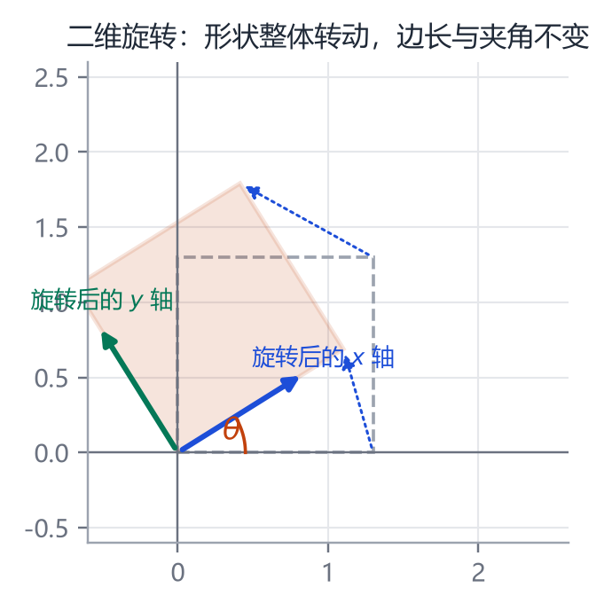
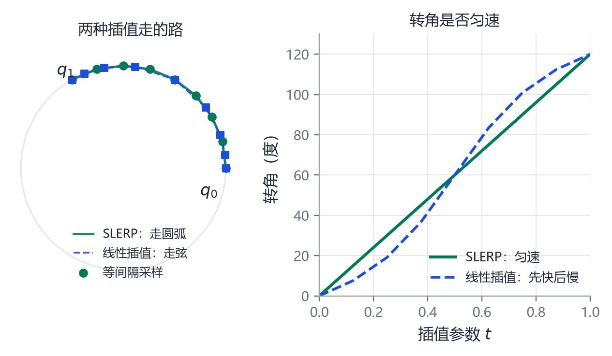
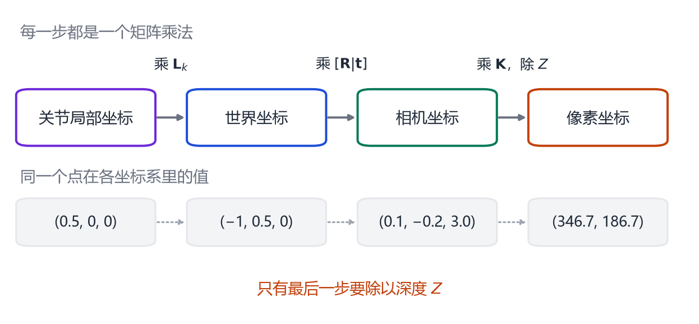
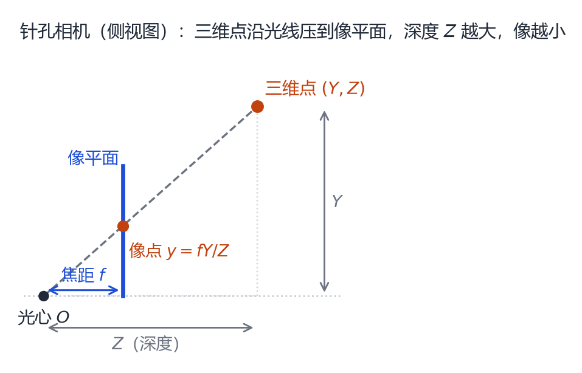
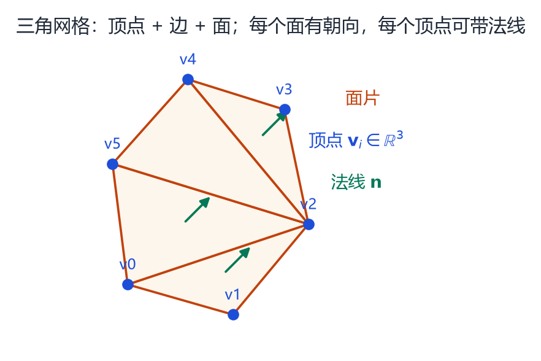

# 第 3 章 三维世界的表示：点、网格、旋转与相机

> **本章导读**：参数化模型生活在三维空间里。要读懂 SMPL 的公式，你得先知道“一个点怎样被旋转、平移、投影到照片上”。这一章用四个工具把这条路铺完：三维点与坐标系、旋转的四种写法、刚体变换矩阵、针孔相机。最后一个工具是三角网格，它决定了模型长什么样。

## 3.1 三维点与坐标系

这一节要解决的问题是：$(1,2,3)$ 这三个数到底指空间里的哪个位置。结论是：离开坐标系约定，这三个数没有意义，而约定不一致正是“模型躺着、镜像、倒着”的头号原因。

一个三维点就是三个数 $(x,y,z)$。但“三个数”本身不携带任何几何信息，必须先约定三件事：

- **原点在哪**：$(0,0,0)$ 对应人体的哪个部位；
- **各轴指向哪**：$x$ 轴向左还是向右，$y$ 轴向上还是向前；
- **单位是什么**：米、厘米还是毫米。

人体模型通常这样约定：原点在骨盆中心（SMPL 的根关节）；$y$ 轴向上；单位是米；人面朝 $+z$。不同实现会有出入：有些引擎 $z$ 轴向上，有些人脸模型面朝 $-z$。这些差别看起来琐碎，却会在你第一次加载模型时全部暴露出来。

### 3.1.1 右手系

多数图形学与机器人库使用**右手坐标系**（right-handed coordinate system）：右手拇指指 $x$、食指指 $y$，中指自然指向 $z$。等价的说法是，三个轴满足

$$
\mathbf{e}_x\times\mathbf{e}_y=\mathbf{e}_z.
$$

右手系有一个直接后果：**交换任意两个轴，手性就反了**。例如把 y 轴和 z 轴互换，

$$
(x,y,z)\ \longrightarrow\ (x,z,y),
$$

对应的矩阵是 $\begin{bmatrix}1&0&0\\0&0&1\\0&1&0\end{bmatrix}$，行列式是 $-1$。这意味着变换之后的模型是原来模型的镜像——左手变成了右手。渲染出来的人看起来“没什么不对”，但解剖上是反的。

正确的做法是用一个**真正的旋转**来换轴。把 “$y$ 向上” 换成 “$z$ 向上”，可以绕 $x$ 轴转 $90^\circ$：

$$
\begin{bmatrix}x'\\y'\\z'\end{bmatrix}
=
\underbrace{\begin{bmatrix}1&0&0\\0&0&-1\\0&1&0\end{bmatrix}}_{\mathbf{R}_x(90^\circ)}
\begin{bmatrix}x\\y\\z\end{bmatrix}
=
\begin{bmatrix}x\\-z\\y\end{bmatrix}.
\tag{3.1}
$$

这个矩阵的行列式是 $+1$，所以它是旋转，不会把模型变成镜像。代一个点进去：$(1,2,3)$ 变成 $(1,-3,2)$；而直接交换 y、z 得到的 $(1,3,2)$ 是另一个点。两者在屏幕上可能都“站起来了”，但一个是转过来的，一个是被翻过来的。

> 调试口诀：模型看起来“躺下”→ 检查 up 轴；模型左右手互换 → 检查行列式符号；模型特别大或特别小 → 检查单位。这三件事占加载问题的绝大多数。

## 3.2 旋转的矩阵写法

这一节要解决的问题是：怎样用一张数表把“转一个角度”写成乘法。结论是：旋转矩阵的每一列，就是旋转之后的坐标轴方向；写出这两列，矩阵就写完了。

二维的情况最容易看懂。把点 $(x,y)$ 绕原点逆时针转 $\theta$：

<figure class="fig">

<figcaption><b>图 3-1</b>　二维旋转。整个形状绕原点转过 $\theta$，任意两点之间的距离、任意两条边的夹角都不变。旋转矩阵的两列，就是旋转后的 $x$ 轴与 $y$ 轴。</figcaption>
</figure>

推导只要两步。$x$ 轴上的单位向量 $(1,0)$ 转 $\theta$ 之后落在 $(\cos\theta,\sin\theta)$，这是矩阵的第一列；$y$ 轴上的 $(0,1)$ 转 $\theta$ 之后落在 $(-\sin\theta,\cos\theta)$，这是第二列。于是

$$
\begin{bmatrix}x'\\y'\end{bmatrix}
=
\begin{bmatrix}\cos\theta&-\sin\theta\\ \sin\theta&\cos\theta\end{bmatrix}
\begin{bmatrix}x\\y\end{bmatrix}.
\tag{3.2}
$$

手算一个，取 $\theta=30^\circ$（$\cos=0.8660$、$\sin=0.5$）：

- $(1,0)\to(0.8660,\ 0.5)$，长度还是 1；
- $(0,1)\to(-0.5,\ 0.8660)$，长度还是 1；
- $(2,0)\to(1.7321,\ 1)$，长度还是 2。

三个点的长度都没变，夹角也没变（两个坐标轴转完仍然垂直：$0.8660\times(-0.5)+0.5\times0.8660=0$）。长度和夹角不变，正是“旋转”与“拉伸、错切”的区别。

这个 $2\times2$ 矩阵叫旋转矩阵 $\mathbf{R}(\theta)$。它有两个关键性质：

$$
\mathbf{R}^\top\mathbf{R}=\mathbf{I},\qquad \det(\mathbf{R})=1.
\tag{3.3}
$$

第一条说“转回去就是转置”：$\mathbf{R}^\top=\mathbf{R}(-\theta)$，所以 $\mathbf{R}^\top\mathbf{R}=\mathbf{R}(-\theta)\mathbf{R}(\theta)=\mathbf{I}$。第二条说“旋转不改变面积、也不镜像”：单位正方形转完还是单位正方形，面积 1，朝向没翻。

满足这两条的矩阵组成**特殊正交群** $SO(2)$；“特殊”就指行列式为 $+1$。三维版本记作 $SO(3)$，条件一模一样，只是矩阵换成 $3\times3$。

在三维里，$\mathbf{R}$ 有三列，每一列是旋转后的一个坐标轴方向。把三个轴想象成三根互相垂直的筷子，旋转就是整体转动这三根筷子；三根筷子始终等长、始终互相垂直，所以 $\mathbf{R}$ 的三列始终是三个正交的单位向量。

### 3.2.1 绕三个坐标轴的基本旋转

绕 $x$ 轴转 $\alpha$，$x$ 坐标不动，$y,z$ 在 $y$-$z$ 平面里像二维旋转一样转：

$$
\mathbf{R}_x(\alpha)=
\begin{bmatrix}1&0&0\\0&\cos\alpha&-\sin\alpha\\0&\sin\alpha&\cos\alpha\end{bmatrix}.
\tag{3.4}
$$

绕 $y$ 轴转 $\beta$ 时，注意符号的位置和 $x$ 轴不同：

$$
\mathbf{R}_y(\beta)=
\begin{bmatrix}\cos\beta&0&\sin\beta\\0&1&0\\-\sin\beta&0&\cos\beta\end{bmatrix},
\qquad
\mathbf{R}_z(\gamma)=
\begin{bmatrix}\cos\gamma&-\sin\gamma&0\\ \sin\gamma&\cos\gamma&0\\0&0&1\end{bmatrix}.
\tag{3.5}
$$

$\mathbf{R}_y$ 的 $-\sin$ 在左下、$+\sin$ 在右上，不是笔误。用右手定则验一下：右手拇指指向 $+y$，四指从 $+z$ 弯向 $+x$，所以绕 $+y$ 转 $90^\circ$ 应该把 $z$ 轴转到 $x$ 轴，把 $x$ 轴转到 $-z$ 轴。代进去：$\mathbf{R}_y(90^\circ)(1,0,0)=(0,0,-1)$，确实是 $-z$。这就是为什么三个矩阵长得不一样：它们各自的“正方向”不同。

任何旋转都可以写成这三个矩阵的乘积，比如 $\mathbf{R}=\mathbf{R}_z(\gamma)\mathbf{R}_y(\beta)\mathbf{R}_x(\alpha)$。但**顺序不同，结果不同**（1.3.2 讲过矩阵乘法不交换），这就是下一节“欧拉角”的麻烦来源。

## 3.3 轴角：更接近直觉的写法

这一节要解决的问题是：用九个数字描述一个只有三个自由度的东西太浪费，能不能只用三个数？结论是：能，但三个数的写法一定在某些角度上坏掉，所以工程上只把它当作“增量”来用。

想象门绕合页转动：转轴是合页，转角是门打开的角度。任何三维旋转都可以这样描述：**绕某个单位轴 $\mathbf{n}$ 转 $\theta$ 角**。这套参数叫**轴角**（axis-angle），也叫旋转向量（rotation vector），因为把轴和角乘起来就是一支长度为 $\theta$ 的箭头。

给定轴 $\mathbf{n}=(n_x,n_y,n_z)$（长度为 1）和角 $\theta$，旋转矩阵由 **Rodrigues 公式**给出：

$$
\mathbf{R}(\mathbf{n},\theta)=\mathbf{I}+\sin\theta\,[\mathbf{n}]_\times+(1-\cos\theta)[\mathbf{n}]_\times^2 ,
\tag{3.6}
$$

其中

$$
[\mathbf{n}]_\times=
\begin{bmatrix}0&-n_z&n_y\\ n_z&0&-n_x\\ -n_y&n_x&0\end{bmatrix}
\tag{3.7}
$$

叫 $\mathbf{n}$ 的**反对称矩阵**（skew-symmetric matrix），因为它的转置等于自己的相反数。它的用处只有一个：把叉乘写成矩阵乘法，$[\mathbf{n}]_\times\mathbf{p}=\mathbf{n}\times\mathbf{p}$。

式 (3.6) 逐项读：$\mathbf{I}$ 是“什么都不做”，$\sin\theta\,[\mathbf{n}]_\times$ 是“一阶的转动”（小角度时主导），$(1-\cos\theta)[\mathbf{n}]_\times^2$ 是“二阶修正”（把长度拉回来）。为什么需要二阶项？因为一阶项会把点沿切线推出去，点会离轴越来越远；二阶项把它拉回圆周上。

### 3.3.1 手算一个轴角

取最简单的轴：$\mathbf{n}=(0,0,1)$（绕 $z$ 轴），$\theta=90^\circ$。先写两个矩阵：

$$
[\mathbf{n}]_\times=\begin{bmatrix}0&-1&0\\1&0&0\\0&0&0\end{bmatrix},
\qquad
[\mathbf{n}]_\times^2=\begin{bmatrix}-1&0&0\\0&-1&0\\0&0&0\end{bmatrix}.
$$

（第二式就是第一式自乘：第一行乘第一列得 $-1$，第一行乘第二列得 0，依此类推。）

代入式 (3.6)，$\sin90^\circ=1$、$1-\cos90^\circ=1$：

$$
\mathbf{R}=\begin{bmatrix}1&0&0\\0&1&0\\0&0&1\end{bmatrix}
+\begin{bmatrix}0&-1&0\\1&0&0\\0&0&0\end{bmatrix}
+\begin{bmatrix}-1&0&0\\0&-1&0\\0&0&0\end{bmatrix}
=\begin{bmatrix}0&-1&0\\1&0&0\\0&0&1\end{bmatrix}.
$$

这正是 $\mathbf{R}_z(90^\circ)$：与式 (3.5) 在 $\gamma=90^\circ$ 时一致。三个矩阵相加这一步，就是“恒等 + 一阶 + 二阶修正”的合成，最后恰好落在 $z$ 轴不动、$xy$ 平面转 90° 的旋转上。

轴角用 3 个数表示 3 个自由度，没有冗余。可是式 (3.6) 里的 $\mathbf{n}$ 必须是单位向量，写代码时如果传进去一个长度 1.0001 的轴，矩阵就不再正交，所以多数库要求你传“旋转向量” $\boldsymbol\phi=\theta\mathbf{n}$，由库内部除一次长度。

**SMPL 为什么用轴角？** 因为它没有冗余、容易插值、也容易加正则。SMPL 的姿态参数 $\boldsymbol{\theta}\in\mathbb{R}^{72}$ 就是 24 个关节各 3 个数，共 72 个数；其中根关节的那 3 个数同时也是“整体朝向”。读代码时常见的 `body_pose` 是 63 维，那是把这 3 个数（`global_orient`）单独拆出去了：$72-9=63$，即 21 个非根关节各 3 个数。

### 3.3.2 欧拉角与万向锁

欧拉角把旋转拆成“绕 $x$ 转 $\alpha$、绕 $y$ 转 $\beta$、绕 $z$ 转 $\gamma$”，只需三个数，非常直观，几乎所有三维软件的界面都这么显示。

它有两个毛病。

**第一，不唯一。** $(\alpha,\beta,\gamma)$ 和 $(\alpha+\pi,\pi-\beta,\gamma+\pi)$ 表示同一个旋转。这不算致命，只是“同一个姿态有好几种写法”。

**第二，万向锁**（gimbal lock）。当第二个角 $\beta=\pm90^\circ$ 时，第一根轴和第三根轴转到重合，两个参数去控制同一个转动方向。用矩阵算一遍最清楚。取 $\beta=90^\circ$，$\mathbf{R}=\mathbf{R}_z(\alpha)\mathbf{R}_x(90^\circ)\mathbf{R}_y(\gamma)$，把 $\alpha=0.3$、$\gamma=0.7$ 代进去，与 $\mathbf{R}_z(1.0)\mathbf{R}_x(90^\circ)$ 比较（$1.0=0.3+0.7$），两者逐元素相同。也就是说，**只要 $\alpha+\gamma$ 不变，旋转就不变**：两个参数只剩一个自由度。

这不是数值精度问题，是参数化本身的坐标奇点。后果在优化与插值里最明显：动画里让 $\beta$ 平滑地从 $80^\circ$ 走到 $100^\circ$，反解出来的 $\alpha$ 和 $\gamma$ 会同时跳变，看起来像“翻跟头”。（4.5 节会用一个数值实验把这个跳变画出来。）

所以在需要优化、插值、做动画的系统里，通常用轴角或四元数做内部表示，只在界面显示时转成欧拉角。

### 3.3.3 四元数：四个数的旋转

四元数是形如 $q=w+x\mathbf{i}+y\mathbf{j}+z\mathbf{k}$ 的数，其中 $\mathbf{i}^2=\mathbf{j}^2=\mathbf{k}^2=\mathbf{i}\mathbf{j}\mathbf{k}=-1$。这四个分量记作 $(w,x,y,z)$。**单位四元数**（$w^2+x^2+y^2+z^2=1$）可以表示旋转：

$$
q=\left(\cos\frac{\theta}{2},\ \sin\frac{\theta}{2}\,\mathbf{n}\right),
\tag{3.8}
$$

输入是轴 $\mathbf{n}$ 与角 $\theta$，输出是四个数。为什么要用**一半**的角度？因为用四元数旋转一个点要乘两次（$p'=q\,p\,q^{*}$），两次乘起来角度自然翻倍，所以存的时候先减半。

算一个具体的：绕 $z$ 轴转 $90^\circ$，$q=(\cos45^\circ,\ 0,\ 0,\ \sin45^\circ)=(0.7071,\ 0,\ 0,\ 0.7071)$。

要把四元数变回矩阵，用

$$
\mathbf{R}(q)=
\begin{bmatrix}
1-2(y^2+z^2) & 2(xy-wz) & 2(xz+wy)\\
2(xy+wz) & 1-2(x^2+z^2) & 2(yz-wx)\\
2(xz-wy) & 2(yz+wx) & 1-2(x^2+y^2)
\end{bmatrix}.
\tag{3.9}
$$

代入 $w=0.7071$、$x=y=0$、$z=0.7071$（于是 $y^2+z^2=0.5$），逐项算三个位置：

- 第 1 行第 1 列：$1-2(y^2+z^2)=1-1=0$
- 第 1 行第 2 列：$2(xy-wz)=2(0-0.5)=-1$
- 第 2 行第 1 列：$2(xy+wz)=2(0+0.5)=+1$
- 第 3 行第 3 列：$1-2(x^2+y^2)=1$

其余位置：含 $x$ 或 $y$ 的项全为零，只剩对角上的两个 1。合起来正好是 $\begin{bmatrix}0&-1&0\\1&0&0\\0&0&1\end{bmatrix}$，与 3.3.1 手算的轴角结果一致。同一段旋转，两种表示给出同一个矩阵，这说明它们说的是同一件事。

四元数的好处有三条：

- **没有万向锁**：四个数住在单位球面（三维）上，任何姿态都能平滑地走过去；
- **插值平滑**：两个朝向之间可以直接做**球面线性插值**（spherical linear interpolation, SLERP）：

$$
\mathrm{slerp}(q_0,q_1;t)=\frac{\sin\big((1-t)\Omega\big)}{\sin\Omega}\,q_0+\frac{\sin(t\Omega)}{\sin\Omega}\,q_1,
\qquad \cos\Omega=q_0\cdot q_1 ,
\tag{3.10}
$$

其中 $\Omega$ 是两个四元数之间的夹角，$t\in[0,1]$ 是插值比例。两个系数长得像“加权平均”，但权重是按正弦分配的，所以插值结果始终落在单位球面上，转角匀速变化。

- **组合便宜**：两个旋转合成只需要一次四元数乘法（16 次乘法），比两个 $3\times3$ 矩阵相乘（27 次）便宜。

算一个 slerp：从“不转” $q_0=(1,0,0,0)$ 到“绕 $z$ 转 $90^\circ$” $q_1=(0.7071,0,0,0.7071)$。两者点积 $0.7071$，所以 $\Omega=45^\circ$。取 $t=0.5$：

$$
\mathrm{slerp}=\frac{\sin22.5^\circ}{\sin45^\circ}q_0+\frac{\sin22.5^\circ}{\sin45^\circ}q_1
=0.5412\,(q_0+q_1)=(0.9239,\ 0,\ 0,\ 0.3827),
$$

这对应转角 $2\arccos(0.9239)=45^\circ$——正好是两者的一半。如果粗暴地做线性插值再归一化，得到的方向也接近，但转角不是严格匀速的；转动幅度大时这个差别会看得出来。

<figure class="fig">

<figcaption><b>图 3-2</b>　两种插值方式的差别（二维示意）。圆周上的点代表朝向，$q_0$ 到 $q_1$ 是一条圆弧。SLERP 沿圆弧等角速度走；线性插值走的是弦，再归一化回圆周，中间几步会“快—慢—快”。角度越大，差别越明显。</figcaption>
</figure>

> 两个必须记住的细节：$q$ 与 $-q$ 表示**同一个**旋转（因为旋转公式里 $q$ 出现两次），所以比较两个四元数时要取 $|q_0\cdot q_1|$；插值或加权平均之后要重新归一化，否则长度不再是 1，矩阵公式就不再给出旋转。

## 3.4 齐次坐标与刚体变换

这一节要解决的问题是：旋转是乘法，平移是加法，两种运算混在一起，就没法把“转一下再挪一下”写成一个矩阵。结论是：给点补一个 1，变成四维，就能把两者合并成一次 $4\times4$ 乘法。

先看麻烦在哪。一个**刚体变换**（rigid transformation）是“先旋转再平移”：

$$
\mathbf{p}'=\mathbf{R}\mathbf{p}+\mathbf{t}.
\tag{3.11}
$$

输入是一个三维点，输出是另一个三维点；$\mathbf{R}$ 管转向，$\mathbf{t}$ 管挪位。这个式子做一次没问题，做两次就难看：先 $\mathbf{R}_1,\mathbf{t}_1$，再 $\mathbf{R}_2,\mathbf{t}_2$，合起来是

$$
\mathbf{p}''=\mathbf{R}_2(\mathbf{R}_1\mathbf{p}+\mathbf{t}_1)+\mathbf{t}_2=(\mathbf{R}_2\mathbf{R}_1)\mathbf{p}+(\mathbf{R}_2\mathbf{t}_1+\mathbf{t}_2),
$$

旋转部分是乘积，平移部分却多了一项 $\mathbf{R}_2\mathbf{t}_1$。写成“一个矩阵”就写不出来，因为它带了加法。

解决办法是给每个点补一个 1，变成四维的**齐次坐标**（homogeneous coordinates）$\tilde{\mathbf{p}}=(x,y,z,1)^\top$：

$$
\begin{bmatrix}\mathbf{p}'\\1\end{bmatrix}
=
\begin{bmatrix}\mathbf{R}&\mathbf{t}\\ \mathbf{0}^\top&1\end{bmatrix}
\begin{bmatrix}\mathbf{p}\\1\end{bmatrix}.
\tag{3.12}
$$

展开就是 $\mathbf{R}\mathbf{p}+\mathbf{t}\cdot1$ 和 $1$，和式 (3.11) 完全一样。可是形式上它是一次矩阵乘法，于是可以连乘、可以求逆、可以求导。

手算一个。取 $\mathbf{R}=\mathbf{R}_z(90^\circ)$、$\mathbf{t}=(1,0,0)$、$\mathbf{p}=(2,0,0)$：

$$
\begin{bmatrix}1\\2\\0\\1\end{bmatrix}
=
\begin{bmatrix}0&-1&0&1\\1&0&0&0\\0&0&1&0\\0&0&0&1\end{bmatrix}
\begin{bmatrix}2\\0\\0\\1\end{bmatrix}.
$$

读法：第一行 $0\times2+(-1)\times0+0\times0+1\times1=1$，是 $x$ 方向；第二行 $1\times2=2$，是 $y$ 方向；第三行 $0$；第四行 $1$ 保证结果仍是齐次坐标。几何上就是“先把 $(2,0,0)$ 转到 $(0,2,0)$，再沿 $x$ 挪 1”。

这个 $4\times4$ 矩阵就是**刚体变换矩阵**，也是 SMPL 里每个关节的 $\mathbf{G}_k$。它有两块：左上 $3\times3$ 是旋转，右上 $3\times1$ 是平移，最后一行永远是 $(0,0,0,1)$。

### 3.4.1 连乘：骨架是怎么算出来的

多个变换可以连乘：先做 $\mathbf{G}_1$ 再做 $\mathbf{G}_2$，总变换是 $\mathbf{G}_2\mathbf{G}_1$（右边先作用，和 1.3.2 一致）。骨架的父子关系就是这样一串矩阵乘法：

$$
\mathbf{G}_k=\mathbf{G}_{\text{parent}(k)}\,\mathbf{L}_k ,
$$

其中 $\mathbf{L}_k$ 是关节 $k$ 相对父关节的**局部变换**（local transform）。

用一个二维的小骨架算一遍。骨盆在原点，肩在骨盆正上方 1 米处，肘在肩右边 0.5 米处。静止姿势下：肩 $(0,1)$，肘 $(0.5,1)$。

现在让整个躯干绕骨盆逆时针转 $90^\circ$：

- 肩：局部偏移 $(0,1)$ 被转到 $(-1,0)$，加回原点还是 $(-1,0)$；
- 肘：它相对**肩**的偏移是 $(0.5,0)$，先跟随父节点一起转，变成 $(0,0.5)$，再加到肩的世界位置 $(-1,0)$ 上，得到 $(-1,0.5)$。

注意这两步的区别：肩的位置只受“父链”影响，肘的位置要先算父链、再加自己在父坐标系里的固定偏移。用矩阵写就是

$$
\mathbf{G}_{\text{elbow}}=\underbrace{\mathbf{G}_{\text{pelvis}}}_{\text{绕原点转 }90^\circ}\cdot
\underbrace{\mathbf{L}_{\text{shoulder}}}_{\text{平移}(0,1,0)}\cdot
\underbrace{\mathbf{L}_{\text{elbow}}}_{\text{平移}(0.5,0,0)}.
$$

**偏移量是在静止姿势下量出来的**，一旦存好，姿势怎么变都不需要重新量。这正是树结构能高效计算的原因：每个关节只需要一个固定的局部矩阵，加一个随时间变的旋转。

<figure class="fig">

<figcaption><b>图 3-3</b>　一个点从关节局部坐标走到照片像素要过的四道关：局部变换 $\mathbf{L}_k$（进世界）、相机外参 $[\mathbf{R}|\mathbf{t}]$（进相机）、内参 $\mathbf{K}$ 与除以深度（进像素）。每一关都是一个矩阵乘法，串起来就是一次端到端的投影。</figcaption>
</figure>

### 3.4.2 逆变换，以及与代码的对应

刚体变换的逆有一个便宜的闭式。因为旋转的逆就是转置，所以

$$
\begin{bmatrix}\mathbf{R}&\mathbf{t}\\ \mathbf{0}^\top&1\end{bmatrix}^{-1}
=
\begin{bmatrix}\mathbf{R}^\top&-\mathbf{R}^\top\mathbf{t}\\ \mathbf{0}^\top&1\end{bmatrix}.
\tag{3.13}
$$

意思是：**反着转回去，再把平移反着挪回去**——但挪的方向要先转到旋转后的坐标系里，所以是 $-\mathbf{R}^\top\mathbf{t}$ 而不是 $-\mathbf{t}$。

验算：取 $\mathbf{R}=\mathbf{R}_z(90^\circ)$、$\mathbf{t}=(1,2,3)$。$\mathbf{R}^\top\mathbf{t}=(2,-1,3)$（把 $(1,2)$ 转 $-90^\circ$），所以逆变换的平移是 $(-2,1,-3)$。代回：先正变换把点搬到 $\mathbf{R}\mathbf{p}+\mathbf{t}$，再逆变换，两步合起来回到原点的误差在 $10^{-16}$ 量级。

写代码时，$4\times4$ 矩阵就是 NumPy 的一个数组：

```python
import numpy as np
T = np.eye(4)              # 单位阵：什么都不做
T[:3, :3] = R              # 左上 3x3 = 旋转
T[:3, 3] = t               # 右上 3x1 = 平移
p_h = np.append(p, 1.0)    # 齐次坐标
p_new = (T @ p_h)[:3]      # 变换后取前三维
```

下标 `T[:3, :3]` 读作“前 3 行、前 3 列”，`T[:3, 3]` 读作“前 3 行的第 4 列”。这两个切片是读所有 3D 库代码的通用入口：看到 `[:3,:3]` 就是旋转，看到 `[:3,3]` 就是平移。

## 3.5 相机：三维如何变成二维

这一节要解决的问题是：照片是二维的，三维点怎么就变成了一个像素坐标。结论是：除以深度，再乘焦距，再加主点偏移；三步都是乘除，所以整条链对三维点是可导的。

<figure class="fig">

<figcaption><b>图 3-4</b>　针孔相机模型（侧视图）。三维点与光心的连线交像平面于一点；由相似三角形可得 $y=fY/Z$。深度 $Z$ 越大，成像越小，这就是“近大远小”。</figcaption>
</figure>

最简单的模型是**针孔相机**（pinhole camera）：所有光线都经过一个点（光心），在光心后方距离 $f$ 处放一张像平面。$f$ 叫**焦距**（focal length），单位是像素。

由相似三角形：物体的高度 $Y$、深度 $Z$、成像高度 $y$ 满足 $y/Y=f/Z$，于是

$$
x=f\frac{X}{Z},\qquad y=f\frac{Y}{Z}.
\tag{3.14}
$$

输入是相机坐标系下的三维点，输出是像平面上的坐标（以光轴为中心）。这里的关键运算是**除以深度**：深度翻倍，成像尺寸减半。

算一个具体的。焦距 $f=800$ 像素，某个关节在相机坐标系下是 $(0.1,-0.2,3.0)$（单位米）：

$$
x=800\times\frac{0.1}{3}=26.67,\qquad y=800\times\frac{-0.2}{3}=-53.33.
$$

这是相对光轴的偏移。真实图像还有主点（principal point）$(c_x,c_y)$，通常接近图像中心，比如 $(320,240)$。加上去得到像素坐标 $(346.67,\ 186.67)$。

把深度从 3 米改成 6 米，偏移变成 $13.33$ 与 $-26.67$，像素坐标 $(333.33,\ 213.33)$——**更靠近画面中心**。这就是“人走远了看起来更小”。

写成矩阵：

$$
Z\begin{bmatrix}x\\y\\1\end{bmatrix}
=
\begin{bmatrix}f&0&c_x\\0&f&c_y\\0&0&1\end{bmatrix}
\begin{bmatrix}X\\Y\\Z\end{bmatrix}
=
\mathbf{K}\begin{bmatrix}X\\Y\\Z\end{bmatrix}.
\tag{3.15}
$$

左边乘了一个 $Z$，是因为式 (3.15) 想把“除以深度”暂时藏起来：矩阵乘法只能做线性组合，做不了除法，所以先把 $Z$ 乘到左边，等需要像素坐标时再除掉。$\mathbf{K}$ 叫**内参矩阵**（intrinsic matrix），它描述“这台相机怎么把光线变成像素”，与相机摆在哪无关。

如果三维点在世界坐标系里，还要先乘一个**外参矩阵**（extrinsic matrix）$[\mathbf{R}|\mathbf{t}]$ 把它变到相机坐标系：

$$
Z\tilde{\mathbf{x}}=\mathbf{K}\,[\mathbf{R}|\mathbf{t}]\,\tilde{\mathbf{X}}.
\tag{3.16}
$$

这就是完整的投影公式。从左往右读：$\tilde{\mathbf{X}}$ 是世界坐标下的点；$[\mathbf{R}|\mathbf{t}]$ 把它搬到相机坐标系（这一步是刚体变换，就是 3.4 节的矩阵去掉最后一行）；$\mathbf{K}$ 把相机坐标变成“带深度的像素”；最后除以 $Z$ 得到真正的像素。

人体重建里的“重投影误差”，就是比较式 (3.16) 算出的二维点与图像上检测到的二维点：

$$
E_{2D}=\sum_j\big\|\pi(\mathbf{J}_j)-\mathbf{j}_j^{\text{obs}}\big\|^2,
\tag{3.17}
$$

其中 $\pi$ 是“式 (3.16) 再除以深度”这一整套投影函数，$\mathbf{J}_j$ 是模型的三维关节，$\mathbf{j}_j^{\text{obs}}$ 是图像上检测到的二维关节。加和号里的每一项是一个二维向量差，平方和就是所有关节的总误差。

用上面的数字算一项：假设模型给出关节 $(0.1,-0.2,3.0)$，投影得到 $(346.67,186.67)$；而检测器在图上标的是 $(350,190)$。那么这一项的误差平方是 $(346.67-350)^2+(186.67-190)^2=11.1+11.1=22.2$，开根约 $4.7$ 像素。单图重建方法（SMPLify 一类）就是把这个和降到最小。

> **注意**：式 (3.14) 假设相机没有畸变、像素是正方形。真实手机镜头有径向畸变，广角更明显：直线在画面边缘会弯。做高精度重建时要先标定并去畸变，否则站在画面边缘的人体会被拉歪，拟合出来的体型也会跟着偏。

## 3.6 三角网格：顶点的连接关系

<figure class="fig">

<figcaption><b>图 3-5</b>　三角网格的组成：顶点、边、面。每个面有一个朝向（法线），用于光照与内外判断；顶点法线通常是相邻面法线的加权平均，用于平滑着色。</figcaption>
</figure>

参数化模型的输出通常是三角网格。一个网格由两部分组成：

- **几何**：$N$ 个顶点的坐标 $\mathbf{V}\in\mathbb{R}^{N\times3}$；
- **拓扑**：$F$ 个三角形，每个三角形记录三个顶点的编号，形状是 $F\times3$ 的整数数组。

以 SMPL 为例：$N=6890$ 个顶点，$F=13776$ 个三角面。这两个数不是随便挑的，它们满足一条硬约束。封闭网格的顶点、边、面满足**欧拉公式**（Euler's formula）：

$$
V-E+F=2 .
$$

每个三角面贡献 3 条边，每条边被两个面共用，所以 $E=3F/2=20664$。代进去：$6890-20664+13776=2$，对上了。这条公式是检查“网格文件是否完整”的最快办法：如果算出来是 1 或 3，说明有洞或者有重复面。

拓扑是“连接关系”，它在模型变形时保持不变。这一点非常重要：SMPL 的所有人共享同一套拓扑，所以第 100 号顶点在任何人身上都对应同一个解剖位置，才能做 PCA、做对应、做蒙皮。

法线分两种，用途不同：

- **面法线**（face normal）：三角形两条边的叉乘，再归一化，垂直于这个面：

$$
\mathbf{n}_f=\frac{(\mathbf{v}_1-\mathbf{v}_0)\times(\mathbf{v}_2-\mathbf{v}_0)}{\|(\mathbf{v}_1-\mathbf{v}_0)\times(\mathbf{v}_2-\mathbf{v}_0)\|}.
\tag{3.18}
$$

叉乘的另一个用处是算面积：$\|(\mathbf{v}_1-\mathbf{v}_0)\times(\mathbf{v}_2-\mathbf{v}_0)\|/2$ 就是三角形面积。

- **顶点法线**（vertex normal）：相邻面法线的平均（按面积加权更常见），用于让曲面看起来光滑。

渲染时，光照计算需要法线；做碰撞、判断内外时，也需要法线朝向。法线方向反了，模型会看起来“里外翻转”：该亮的地方发黑，该暗的地方发亮。判断标准是“法线指向物体外部”，而面法线的朝向由三个顶点的**绕序**（winding order）决定——这也解释了为什么很多库在导入模型后要先检查一下有没有“面片反了”。

## 3.7 可微渲染：把“渲染”变成可求导的函数

这一节要解决的问题是：从图像反推模型参数，需要对“渲染”这一步求导，可渲染器看起来是一段黑箱程序。结论是：只要把渲染写成可导函数，误差就能一路反传到模型参数上。

传统渲染器输入模型与相机，输出图片，但你没法问它“顶点往右移一点，像素会怎么变”。**可微渲染**（differentiable rendering）把渲染写成可导函数，于是可以把图像误差反传回模型参数。

整条链的导数就是各段导数的乘积：

$$
\frac{\partial L}{\partial\boldsymbol\theta}
=
\underbrace{\frac{\partial L}{\partial \mathbf{I}}}_{\text{像素误差}}
\cdot
\underbrace{\frac{\partial \mathbf{I}}{\partial \mathbf{V}}}_{\text{渲染}}
\cdot
\underbrace{\frac{\partial \mathbf{V}}{\partial\boldsymbol\theta}}_{\text{形变与蒙皮}} .
\tag{3.19}
$$

三段分别读：第一段是“像素差对图像像素的导数”，就是损失函数自己的梯度，最容易写；第二段是“图像对顶点的导数”，这一段最难，因为涉及遮挡与光栅化；第三段是“顶点对模型参数的导数”，第 5 章的 LBS 会给出它的闭式。

最简单的情况是只渲染关节点：关节三维坐标经过式 (3.16) 得到二维坐标，这一步对三维坐标可导（导数就是 3.5 节里那个 $f/Z$ 的矩阵），误差可以直接反传。SMPLify 用的就是这种“稀疏关键点”渲染——它只关心十几个关节点，不关心皮肤上的纹理。

渲染完整网格要复杂得多：需要处理遮挡、光栅化、纹理采样。OpenDR、PyTorch3D、nvdiffrast、Kaolin 等库提供了可微实现。它们让“从图片反推参数”的端到端优化成为可能。

> **一句话总结**：参数化模型负责“生成几何”，可微渲染负责“把几何变成图像”，两者接起来，才能从图像反推参数。

## 本章小结

- 三维点必须附带坐标系约定；人体模型通常以骨盆为原点、米为单位、$y$ 轴向上。换轴要用旋转（行列式 $+1$），直接交换两个轴会把模型镜像。
- 旋转矩阵的每一列是旋转后的坐标轴；它满足 $\mathbf{R}^\top\mathbf{R}=\mathbf{I}$、$\det\mathbf{R}=1$。
- 旋转可以用矩阵、欧拉角、轴角、四元数表示。欧拉角在 $\beta=\pm90^\circ$ 处丢一个自由度（万向锁）；轴角无冗余但在 $180^\circ$ 处不连续；单位四元数没有万向锁，插值用 SLERP。
- 齐次坐标把旋转和平移合并成 $4\times4$ 矩阵，多个变换连乘就是骨架的父子链；逆变换是 $[\mathbf{R}^\top,-\mathbf{R}^\top\mathbf{t}]$。
- 针孔相机的投影是 $Z\tilde{\mathbf{x}}=\mathbf{K}[\mathbf{R}|\mathbf{t}]\tilde{\mathbf{X}}$，核心运算是除以深度；重投影误差是人体拟合的核心监督。
- 网格 = 顶点几何 + 固定拓扑，$V-E+F=2$ 可以用来检查文件完整性；法线决定光照与内外。
- 可微渲染把“渲染”拆成可反传的算子，是图像到参数的桥梁。

## 思考题

1. 一个旋转矩阵的行列式为什么必须是 $+1$？如果等于 $-1$，这个变换会把右手变成什么？
2. 用式 (3.5) 手算 $\mathbf{R}_y(90^\circ)$ 作用在 $(0,0,1)$ 上，结果是什么？再用右手定则验证一遍。
3. 同一个旋转，用轴角和四元数各写一遍（取 $\mathbf{n}=(0,1,0)$、$\theta=60^\circ$），并验证式 (3.9) 给出的矩阵与式 (3.6) 一致。
4. 同一个人离相机远一倍，成像高度会变成多少？如果距离不变、焦距增大一倍呢？
5. 如果两个网格顶点数相同但拓扑不同，还能直接做 PCA 吗？如果拓扑相同但顶点顺序不同呢？
