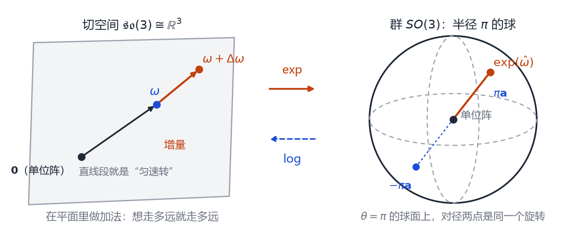
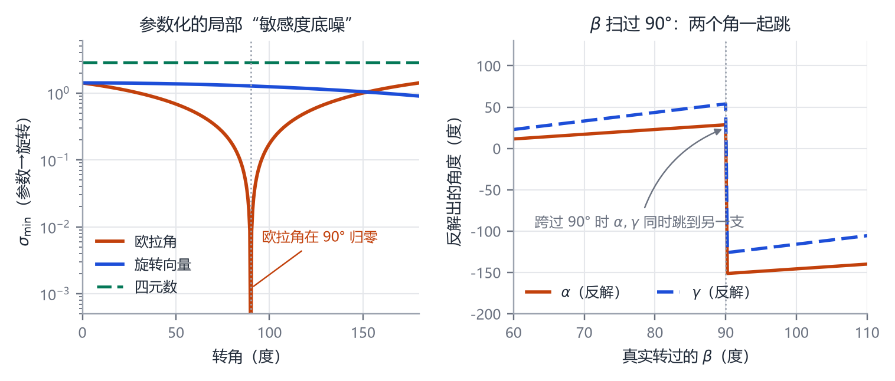
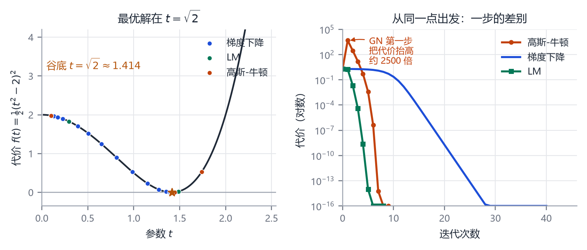
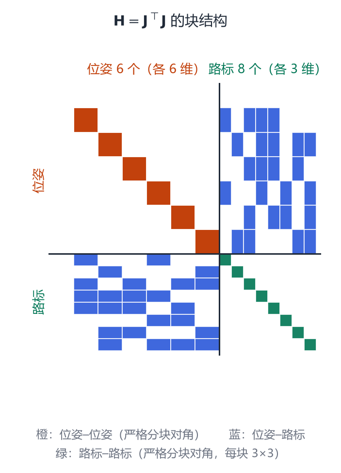

# 第 4 章 旋转的李群视角与非线性优化

> **本章导读**：真正动手优化一个姿态时，会遇到一个绕不过去的障碍：**旋转矩阵不能相加**。你不能写 $\mathbf R\leftarrow\mathbf R+\Delta$，加出来的东西不是旋转。要绕开它，得把“加法”重新定义在正确的对象上：切空间。增量在切空间里算，用指数映射送回群上。这一章先讲 $SO(3)$ 的这套机制，再搬到刚体变换 $SE(3)$，讲清伴随、左右扰动、以及位姿优化里最常用的那个 $3\times3$ 雅可比。最后把高斯-牛顿、LM、Schur 补、鲁棒核串成一条求解链，落到“用 2D 关键点拟合 SMPL 位姿”上。

## 4.1 三个数不够，九个数太多

这一节要解决的问题是：描述一个旋转该用几个数，用哪几个数。结论是：三种常见写法各有毛病，9 个数有冗余、3 个数有奇点、4 个数有二重性，所以工程上把“状态”和“增量”分开存。

先把问题摆清楚。三维旋转在数学上是一个集合：

$$ SO(3)=\left\{\mathbf R\in\mathbb R^{3\times3}\ \middle|\ \mathbf R^\top\mathbf R=\mathbf I,\ \det\mathbf R=1\right\}. \tag{4.1} $$

一个旋转矩阵有 9 个数。式 (4.1) 的约束里，$\mathbf R^\top\mathbf R=\mathbf I$ 看着只有一条，展开其实是 6 条独立方程：对称矩阵 $\mathbf R^\top\mathbf R$ 的对角线 3 条（每列长度为 1）、非对角线 3 条（三列互相垂直）。$\det\mathbf R=1$ 是第 7 条，但它与前面不独立——正交矩阵的行列式只能是 $\pm1$，$\det=1$ 只是“选一个分支”。于是自由度是

$$ 9-6=3. $$

**旋转只有 3 个自由度。** 9 个数里有 6 个是冗余；换 3 个数（欧拉角、轴角）没有冗余，但一定在某些点上坏掉；换 4 个数（四元数）只多了一条约束（单位四元数住在三维球面上），却在 $\pm q$ 上有二重性。这个“要么冗余、要么奇异”的两难，是本章反复要用的主线。

先看最朴素的错误做法：把旋转矩阵当成普通矩阵相加。

$$ \mathbf R_1=\mathbf R_z(40^\circ),\quad \mathbf R_2=\mathbf R_z(140^\circ),\quad \mathbf M=\frac{\mathbf R_1+\mathbf R_2}{2}. $$

两者都在 $SO(3)$ 里，取平均看起来天经地义。实际算出来的 $\mathbf M$ 是

$$
\mathbf M=\begin{bmatrix}
0 & -0.6428 & 0 \\
0.6428 & 0 & 0 \\
0 & 0 & 1
\end{bmatrix}, \qquad \det\mathbf M=0.4132 .
$$

行列式只有 0.41，正交性误差 $\|\mathbf M^\top\mathbf M-\mathbf I\|_F=0.83$。仔细看这个矩阵：它的形状是一个转 $90^\circ$ 的旋转，但 $xy$ 平面里那部分被整体缩到了 $0.6428$ 倍。这个数不是巧合：两个转角相差 $100^\circ$，平均之后恰好按 $\cos(100^\circ/2)=\cos 50^\circ=0.6428$ 收缩；只有 $z$ 方向没被缩。也就是说，$\mathbf M$ 把 $xy$ 平面上的单位圆压成了半径 $0.64$ 的圆。它连旋转都不是。相差 $100^\circ$ 时错得这么厉害，那相差 $10^\circ$ 呢？$\mathbf R_z(10^\circ)$ 与 $\mathbf R_z(20^\circ)$ 的平均行列式是 0.9924、正交性误差 0.0107，看起来“差不多能用”，但优化器每一步都在这个量级上累加，误差会滚起来。**矩阵平均不是旋转平均。**

那换 3 个参数呢？欧拉角 $(\alpha,\beta,\gamma)$ 确实只有 3 个数，可它有两个毛病。第一，不唯一：$(\alpha,\beta,\gamma)$ 与 $(\alpha+\pi,\pi-\beta,\gamma+\pi)$ 表示同一个旋转。第二，**万向锁**：第二个角到 $\pm90^\circ$ 时，第一个轴和第三个轴共线，两个参数去控制同一个转动方向，剩下的那个方向没有参数能控制。这不是数值精度问题，是参数化本身的坐标奇点。

所以问题变成：**能不能保留“3 个增量”的简洁，同时让叠加这一步永不奇异？**

答案是把两个层面分开：

- **状态**用矩阵（或四元数）存，它永远合法、永远没有奇点；
- **增量**用 3 个数的向量存，它只在一瞬间有效，用完就丢掉；
- 两者之间靠一个映射来回搬运：**指数映射**负责“增量 → 状态”，**对数映射**负责“状态 → 增量”。

这套思路的数学名字叫**李群**（Lie group）。$SO(3)$ 是群（可以相乘、有单位元、有逆），同时又是光滑流形（局部长得像 $\mathbb R^3$），所以能“在切空间里做微积分”。你不需要完整学一遍李群理论，本章只用到其中三件事：切空间、指数映射、伴随。

## 4.2 反对称矩阵：旋转的"速度"

这一节要解决的问题是：优化器吐出来的三个数到底代表什么。结论是：它是一个角速度矢量的坐标，而“绕这个矢量转”这个动作可以用一个反对称矩阵写成乘法。

要从 3 个数走到一个旋转，先得回答：3 个数代表什么？

回忆二维：绕原点转，位置 $\mathbf p$ 的速度是 $\dot{\mathbf p}=\dot\theta\,\mathbf J\mathbf p$，其中 $\mathbf J=\begin{bmatrix}0&-1\\1&0\end{bmatrix}$ 是“逆时针转 $90^\circ$”。三维里对应的是叉乘：绕轴 $\mathbf a$ 以角速度向量 $\boldsymbol\omega$ 转动时，点 $\mathbf p$ 的速度是

$$ \dot{\mathbf p}=\boldsymbol\omega\times\mathbf p . $$

叉乘可以写成矩阵乘法。定义 **hat 算子**（也叫反对称化）：

$$
\boldsymbol\omega^\wedge= \begin{bmatrix}
0 & -\omega_3 & \omega_2 \\
\omega_3 & 0 & -\omega_1 \\
-\omega_2 & \omega_1 & 0
\end{bmatrix}, \qquad \boldsymbol\omega=(\omega_1,\omega_2,\omega_3)^\top . \tag{4.2}
$$

这个矩阵满足 $(\boldsymbol\omega^\wedge)^\top=-\boldsymbol\omega^\wedge$，所以叫**反对称矩阵**。所有 $3\times3$ 反对称矩阵构成的空间记作 $\mathfrak{so}(3)$（哥特体，读作“so 三”），它就是一个三维向量空间：$\boldsymbol\omega$ 的三个分量可以随便取，没有任何约束。反过来，从反对称矩阵取回向量记作 $\vee$ 算子，$(\boldsymbol\omega^\wedge)^\vee=\boldsymbol\omega$。

有了它，叉乘就是矩阵乘法：

$$ \boldsymbol\omega^\wedge\mathbf p=\boldsymbol\omega\times\mathbf p . \tag{4.3} $$

这条恒等式是整个记号体系的地基，值得亲手验一遍。取 $\boldsymbol\omega=(0,0,1)^\top$、$\mathbf p=(1,2,3)^\top$：

$$
\boldsymbol\omega^\wedge\mathbf p= \begin{bmatrix}
0&-1&0 \\
1&0&0 \\
0&0&0
\end{bmatrix} \begin{bmatrix}
1 \\
2 \\
3
\end{bmatrix} =\begin{bmatrix}
-2 \\
1 \\
0
\end{bmatrix},
$$

而直接算 $(0,0,1)\times(1,2,3)=(0\cdot3-1\cdot2,\ 1\cdot1-0\cdot3,\ 0\cdot2-0\cdot1)=(-2,1,0)$，一致。

还有一个恒等式在后面反复用到：

$$ \mathbf R\,\boldsymbol\omega^\wedge\mathbf R^\top=(\mathbf R\boldsymbol\omega)^\wedge . \tag{4.4} $$

它的几何意思是：**“在世界坐标系里绕 $\boldsymbol\omega$ 转”和“在物体坐标系里绕 $\mathbf R\boldsymbol\omega$ 转”是同一件事**，只是同一根转轴被 $\mathbf R$ 搬到了另一个坐标系里描述。这句话看着不起眼，4.7 节的伴随矩阵就是它的六维推广。

## 4.3 指数映射：从速度积分出旋转

这一节要解决的问题是：已经有一个 3 维的速度，怎样把它变成一个合法的旋转矩阵。结论是：解一个矩阵微分方程，得到矩阵指数；它的闭式就是 Rodrigues 公式，只用到 $\mathbf I$、$\boldsymbol\omega^\wedge$、$(\boldsymbol\omega^\wedge)^2$ 三项。

### 4.3.1 微分方程

设刚体以恒定角速度 $\boldsymbol\omega$ 转动，且 $\boldsymbol\omega$ 在世界系里描述，姿态矩阵 $\mathbf R(t)$ 满足

$$ \dot{\mathbf R}(t)=\boldsymbol\omega^\wedge\mathbf R(t),\qquad \mathbf R(0)=\mathbf I . \tag{4.5} $$

为什么是左乘？物体上一点 $\mathbf p_0$ 在 $t$ 时刻的位置是 $\mathbf R(t)\mathbf p_0$，它的速度应当是 $\boldsymbol\omega\times(\mathbf R\mathbf p_0)=\boldsymbol\omega^\wedge\mathbf R\mathbf p_0$；这个式子要对任意 $\mathbf p_0$ 成立，于是得到式 (4.5)。

这是矩阵常微分方程，解就是矩阵指数：

$$ \exp(\boldsymbol\omega^\wedge t)=\sum_{k=0}^{\infty}\frac{(\boldsymbol\omega^\wedge t)^k}{k!} =\mathbf I+\boldsymbol\omega^\wedge t+\frac{(\boldsymbol\omega^\wedge t)^2}{2!}+\cdots . \tag{4.6} $$

这里的 $\exp$ 不是逐元素取指数，而是这个幂级数。两个性质可以立刻验证：$\exp(\mathbf 0)=\mathbf I$；$\exp(\mathbf A)\exp(\mathbf B)=\exp(\mathbf A+\mathbf B)$ 只在 $\mathbf A\mathbf B=\mathbf B\mathbf A$ 时才成立。矩阵乘法一般不可交换，这一点是后面所有麻烦的根源。

### 4.3.2 Rodrigues 公式怎么推出来

式 (4.6) 是无穷级数，直接算不了。但只要注意 $\boldsymbol\omega^\wedge$ 的特殊结构，级数会在三项以后循环。设 $\theta=\|\boldsymbol\omega\|$、$\mathbf a=\boldsymbol\omega/\theta$，记 $\mathbf W=\boldsymbol\omega^\wedge=\theta\mathbf a^\wedge$。由式 (4.3) 与三重叉乘公式可以验证

$$ (\boldsymbol\omega^\wedge)^3=-\theta^2\,\boldsymbol\omega^\wedge . \tag{4.7} $$

取 $\boldsymbol\omega=(0.3,-0.7,1.1)^\top$，用程序算 $\mathbf W^3+\theta^2\mathbf W$，最大元素绝对值是 $2.2\times10^{-16}$，也就是机器精度意义上的零。这条关系为什么成立？几何上，$\mathbf a^\wedge$ 作用在垂直于 $\mathbf a$ 的平面上是“转 $90^\circ$ 并保持长度”，所以 $(\mathbf a^\wedge)^2$ 在那个平面上等于 $-\mathbf I$；而 $\mathbf a^\wedge\mathbf a=\mathbf 0$。三者组合，三次幂就退回一次幂。

有了式 (4.7)，所有高次幂都能降到 $\mathbf I$、$\mathbf W$、$\mathbf W^2$ 三项：

$$ \mathbf W^{2k+1}=(-1)^k\theta^{2k}\mathbf W,\qquad \mathbf W^{2k+2}=(-1)^k\theta^{2k}\mathbf W^2\quad(k\ge0). $$

代回式 (4.6)，按 $\mathbf I$、$\mathbf W$、$\mathbf W^2$ 分组：

$$ \begin{aligned} \exp(\mathbf W) &=\mathbf I+\Big(\sum_{k\ge0}\frac{(-1)^k\theta^{2k+1}}{(2k+1)!}\Big)\frac{\mathbf W}{\theta} +\Big(\sum_{k\ge0}\frac{(-1)^k\theta^{2k+2}}{(2k+2)!}\Big)\frac{\mathbf W^2}{\theta^2}\\[2pt] &=\mathbf I+\frac{\sin\theta}{\theta}\mathbf W+\frac{1-\cos\theta}{\theta^2}\mathbf W^2 . \end{aligned} $$

两个括号里的级数正是 $\sin\theta$ 和 $1-\cos\theta$ 的泰勒展开。把 $\mathbf W=\theta\mathbf a^\wedge$ 代进去，得到 **Rodrigues 公式**：

$$ \exp(\boldsymbol\omega^\wedge)=\mathbf I+\sin\theta\,\mathbf a^\wedge+(1-\cos\theta)\,(\mathbf a^\wedge)^2 , \qquad \theta=\|\boldsymbol\omega\|,\ \mathbf a=\boldsymbol\omega/\theta . \tag{4.8} $$

这个式子和前面按“轴角”写下的 Rodrigues 公式完全一样——现在你知道它是从矩阵指数推出来的，不是凭空定义的。

<figure class="fig">

<figcaption><b>图 4-1</b>　切空间与群的关系。左边是切空间 $\mathfrak{so}(3)$，它是真正的向量空间，两个箭头可以首尾相接做加法；右边把 $SO(3)$ 画成半径 $\pi$ 的球：球内每一点对应一个旋转，从球心出发的直线段就是"绕同一根轴匀速转"。球面上 $\theta=\pi$ 的对径两点表示同一个旋转（转 $+\pi$ 与转 $-\pi$ 结果相同），所以这个球的两端是粘起来的，它并不是普通的球面。</figcaption>
</figure>

算一个具体的。取 $\boldsymbol\omega=(0.3,-0.7,1.1)^\top$：

- $\theta=\sqrt{0.09+0.49+1.21}=1.3379$ 弧度，约 $76.66^\circ$；
- $\mathbf a=(0.2242,-0.5232,0.8222)^\top$；
- 代入式 (4.8) 得

$$
\mathbf R=\begin{bmatrix}
0.2695 & -0.8902 & -0.3673 \\
0.7097 & 0.4413 & -0.5491 \\
0.6509 & -0.1127 & 0.7508
\end{bmatrix}.
$$

验算：$\|\mathbf R^\top\mathbf R-\mathbf I\|_{\max}=4.4\times10^{-16}$，$\det\mathbf R=1.0000$。合法。

顺带一个常用特例：绕 $z$ 轴转 $\theta$，$\boldsymbol\omega=(0,0,\theta)^\top$，式 (4.8) 给出

$$
\exp(\theta\mathbf e_3^\wedge)=\begin{bmatrix}
\cos\theta&-\sin\theta&0 \\
\sin\theta&\cos\theta&0 \\
0&0&1
\end{bmatrix},
$$

与二维旋转矩阵一致。取 $\theta=\pi/2$ 就是 $\mathbf R_z(90^\circ)$。

### 4.3.3 小角度近似，以及它的误差到底多大

优化时每步的增量 $\boldsymbol\phi$ 通常很小（几度以内），于是可以令 $\sin\theta\approx\theta$、$1-\cos\theta\approx\theta^2/2$：

$$ \exp(\boldsymbol\omega^\wedge)\approx\mathbf I+\boldsymbol\omega^\wedge . \tag{4.9} $$

这叫**小角度近似**，也叫一阶近似。它的误差有多大？用 Frobenius 范数量一量，取 $\boldsymbol\omega=(0,0,\theta)^\top$ 逐个试：

| $\theta$（弧度） | 折合角度 | $\|\exp(\boldsymbol\omega^\wedge)-(\mathbf I+\boldsymbol\omega^\wedge)\|_F$ | $\theta^2/\sqrt2$ |
|---:|---:|---:|---:|
| 0.5 | $28.6^\circ$ | $1.76\times10^{-1}$ | $1.77\times10^{-1}$ |
| 0.1 | $5.7^\circ$ | $7.07\times10^{-3}$ | $7.07\times10^{-3}$ |
| 0.01 | $0.57^\circ$ | $7.07\times10^{-5}$ | $7.07\times10^{-5}$ |
| 0.001 | $0.057^\circ$ | $7.07\times10^{-7}$ | $7.07\times10^{-7}$ |

误差严格按 $\theta^2/\sqrt2$ 走，也就是二阶。含义很实际：**增量在 $0.1$ 弧度（约 $5.7^\circ$）时，一阶近似只错千分之七**；到 $0.01$ 弧度（不到 $1^\circ$）时只错万分之七。所以

- 做雅可比矩阵时可以放心用 $\mathbf I+\boldsymbol\phi^\wedge$ 代替 $\exp$，两者差 $O(\|\boldsymbol\phi\|^2)$，在求导的极限里不影响结果；
- 但**更新状态时必须用精确的 $\exp$**。如果每步直接写 $\mathbf R\leftarrow\mathbf R(\mathbf I+\boldsymbol\phi^\wedge)$，$\mathbf R$ 每步都会偏离正交性一点点，几百步以后模型就“烂”了：网格被剪切、拉伸，重投影误差反而不降。

还有一个人人踩过的坑：$\boldsymbol\phi=\mathbf 0$ 时，式 (4.8) 里 $\mathbf a=\boldsymbol\omega/\theta$ 是 $0/0$。工程实现必须单独判断 $\theta<10^{-8}$ 之类，直接返回 $\mathbf I+\boldsymbol\omega^\wedge$。忘了这一步，第一次迭代（增量恰好为零）就会得到 NaN。

## 4.4 对数映射：从矩阵回到三个数

### 4.4.1 公式

由式 (4.8) 可以反解。先取迹：$\operatorname{tr}(\mathbf a^\wedge)=0$，而 $(\mathbf a^\wedge)^2$ 的两个非零特征值都是 $-1$，所以 $\operatorname{tr}\big((\mathbf a^\wedge)^2\big)=-2$，于是

$$ \operatorname{tr}\mathbf R=1+2\cos\theta \ \Longrightarrow\ \theta=\arccos\frac{\operatorname{tr}\mathbf R-1}{2}. $$

再取反对称部分：式 (4.8) 里的 $\mathbf I$ 与 $(\mathbf a^\wedge)^2$ 都是对称的，只有 $\sin\theta\,\mathbf a^\wedge$ 是反对称的，所以 $\mathbf R-\mathbf R^\top=2\sin\theta\,\mathbf a^\wedge$。于是

$$ \log(\mathbf R)=\frac{\theta}{2\sin\theta}\left(\mathbf R-\mathbf R^\top\right)^\vee, \qquad \theta=\arccos\frac{\operatorname{tr}\mathbf R-1}{2}\in[0,\pi] . \tag{4.10} $$

右边的 $\theta\mathbf a$ 就是旋转向量（也叫轴角向量、log 向量）。它和四元数的关系很直接：$\mathbf a$ 是四元数向量部分的方向，$\theta$ 是它的 $2\arccos w$。

算一个例子。绕 $(1,1,1)/\sqrt3$ 转 $120^\circ$，即 $\theta=2\pi/3$，式 (4.8) 给出

$$ \mathbf R=\begin{bmatrix}0&0&1\\1&0&0\\0&1&0 \end{bmatrix}, $$

一个循环置换矩阵。反过来用式 (4.10)：$\operatorname{tr}\mathbf R=0$，$\theta=\arccos(-1/2)=2.0944$；$\mathbf R-\mathbf R^\top=2\sin\theta\,\mathbf a^\wedge$ 取 $\vee$ 得到 $2\sin\theta\,\mathbf a$，前面的系数 $\theta/(2\sin\theta)=2.0944/(2\times0.8660)=1.2092$ 正好把它还原成 $\theta\mathbf a$，结果是

$$ \log\mathbf R=(1.2092,\ 1.2092,\ 1.2092)^\top, $$

长度正好 $2.0944$，回到起点。

### 4.4.2 两个必须处理的奇点

式 (4.10) 有两个数值陷阱，写代码时必须显式分支。

**第一，$\theta\to0$。** 分母 $\sin\theta\to0$，同时分子 $\mathbf R-\mathbf R^\top\to\mathbf 0$，是 $0/0$。$\log$ 在单位阵附近其实是良态的——它的导数在 $\mathbf I$ 处就是单位阵，扰动量与角增量一一对应——只是这个闭式写法在这里失效。解决办法是用级数：$\theta$ 很小时 $\log\mathbf R\approx\frac12(\mathbf R-\mathbf R^\top)^\vee$。

**第二，$\theta\to\pi$。** 分母又趋于零，但这次分子不为零，是真正的奇点。几何上，转 $+\pi$ 和转 $-\pi$ 是同一个旋转，两侧的极限不同，所以无论怎么改公式都好不了。工程做法是把对称部分拿出来定轴：由式 (4.8)，$\theta=\pi$ 时 $(\mathbf R+\mathbf I)/2=\mathbf a\mathbf a^\top$，于是 $\mathbf a$ 可以从这个秩一矩阵的列（或对角元开方）里读出来，符号用最大分量确定。

这两个坑说明一件事：**$\log$ 不是全局连续的函数**。它只能当成"在 $\mathbf I$ 附近（$\|\boldsymbol\omega\|<\pi$）的一张坐标卡"，超出这个范围就要换卡。这正是"流形"这个词的实际含义——没有一张图能覆盖整个 $SO(3)$。

## 4.5 三种参数化：谁在什么地方坏掉

这一节要解决的问题是：欧拉角、旋转向量、四元数，到底哪个好。结论是：没有赢家，只有“奇点在哪里”的区别，所以选奇点不在工作区里的那个。

把 3 种常见写法摆在一起比一比。判断"坏不坏"需要一个量:**从参数到旋转的局部敏感度**。设参数是 $\boldsymbol\eta\in\mathbb R^k$,把它拉平成 $9\times1$ 的矩阵元素向量 $\mathbf f(\boldsymbol\eta)$,雅可比 $\mathbf J=\partial\mathbf f/\partial\boldsymbol\eta$。如果 $\mathbf J$ 的某列几乎为零(或某两列几乎线性相关),就说明"参数动了很多、旋转几乎没动"--那个方向上的信息丢了,优化器在那附近会疯掉。衡量指标取最小奇异值。欧拉角与旋转向量的雅可比是 $9\times3$,看 $\sigma_3$;四元数只要把增量限制在切空间(三个方向),雅可比同样是 $9\times3$,也看 $\sigma_3$。$\sigma_{\min}$ 越小越糟。

三种写法各算一遍：

- **欧拉角**：$\mathbf R(\alpha,\beta,\gamma)=\mathbf R_z(\alpha)\mathbf R_x(\beta)\mathbf R_y(\gamma)$，3 个参数；
- **旋转向量**：$\mathbf R=\exp((\theta\mathbf a)^\wedge)$，3 个参数；
- **四元数**：单位四元数 4 个参数，但自由度只有 3，求导必须在切空间取 3 个正交方向，否则多出来的法向会给出一个恒零的列。

<figure class="fig">

<figcaption><b>图 4-2</b>　三种参数化的局部行为。左图把转角从 $0^\circ$ 扫到 $180^\circ$（转轴固定），纵轴是 $\sigma_{\min}$（对数刻度）：欧拉角在 $\beta=90^\circ$ 处精确归零，这就是万向锁；旋转向量缓慢下降但不会归零，代价是 $\log$ 在 $180^\circ$ 处不连续；四元数在切空间里取方向时恒为 $2\sqrt2$，一路平坦。右图更直观：让真实的 $\beta$ 平滑扫过 $90^\circ$，反解出来的 $\alpha$ 与 $\gamma$ 会在同一时刻从 $+28.6^\circ$、$+53.9^\circ$ 跳到 $-151.3^\circ$、$-126.0^\circ$。不是反解算错了，是这个参数化在这里本来就断成两支。</figcaption>
</figure>

左图的数字（$\sigma_{\min}$，转轴固定，扫过转角）：

| $\beta$ | 欧拉角 | 旋转向量 | 四元数（切空间） |
|---:|---:|---:|---:|
| $0^\circ$ | 1.4142 | 1.4142 | 2.8284 |
| $45^\circ$ | 0.7654 | 1.3781 | 2.8284 |
| $60^\circ$ | 0.5176 | 1.3505 | 2.8284 |
| $89^\circ$ | 0.0175 | 1.2763 | 2.8284 |
| $90^\circ$ | 0.0000 | 1.2732 | 2.8284 |
| $120^\circ$ | 0.5176 | 1.1695 | 2.8284 |
| $179^\circ$ | 1.4018 | 0.9053 | 2.8284 |

读这张表能得到三条实用结论。

**第一，欧拉角的毛病是结构性的，不是“慢”或“不准”。** $89^\circ$ 时 $\sigma_{\min}$ 只剩 $0.0175$，意味着参数在这个方向上的效率只有正常方向的 $1\%$；到 $90^\circ$ 干脆是 $0$，正规方程直接奇异。更糟的是它不连续：$\beta$ 从 $60^\circ$ 变到 $120^\circ$，$\sigma_{\min}$ 先降到零再升回来，中间那段优化器会给出巨大的步长。所以**不要在优化里用欧拉角做状态**，用它做界面显示没问题。

**第二，旋转向量是三者里最“均匀”的。** 转角从 $0$ 到 $180^\circ$，$\sigma_{\min}$ 只从 1.41 降到 0.90，没有归零。原因很漂亮：$\exp$ 沿径向是等距的，参数空间里走多远，群上的转角就变多少，所以参数长度和转角严格成比例。它唯一的硬伤在 $180^\circ$：$+\pi$ 与 $-\pi$ 两个参数向量表示同一个旋转，$\log$ 在那里不连续。**只要保证每步增量不超过 $180^\circ$（优化里几乎总是这样），旋转向量就够用**——这正是 SMPL 的姿态参数取轴角的理由 [@loper2015smpl]。

**第三，四元数的问题不在 $\sigma_{\min}$，而在那 4 个数本身。** 单位四元数住在 $\mathbb R^4$ 的单位球面上，维数是 3。如果把 4 个分量都当自由参数求导，雅可比变成 $9\times4$，多出来的径向方向对应一列恒零，$\sigma_4(\mathbf J)=0$——不是四元数不好，是你在用 4 个参数描述 3 个自由度。正确做法是把增量限制在切空间（与 $q$ 正交的三维子空间），此时 $\sigma_{\min}=2\sqrt2$ 恒定、条件数永远是 1，这是三者里数值性质最好的。代价是多一层归一化，且 $q$ 与 $-q$ 表示同一个旋转。

一句话总结这一节：**没有一种参数化能全局无奇异。能做的是选一个奇点不在工作区里的参数化，并且只在切空间里做增量。**

## 4.6 刚体变换的群 $SE(3)$

这一节要解决的问题是：旋转之外还有平移，怎样把两者放进同一个“可累加”的框架里。结论是：用 $6$ 维向量与 $4\times4$ 矩阵指数，但要注意指数映射描述的是螺旋运动，不是“先转再平移”。

### 4.6.1 齐次形式

旋转之外还有平移，而平移不能和旋转分开优化，因为二者耦合。齐次形式在前面讲三维表示时已经出现过：

$$ \mathbf T=\begin{bmatrix}\mathbf R&\mathbf t\\ \mathbf 0^\top&1 \end{bmatrix}\in SE(3), \tag{4.11} $$

作用在齐次点 $\tilde{\mathbf p}=(\mathbf p,1)^\top$ 上就是 $\mathbf T\tilde{\mathbf p}=(\mathbf R\mathbf p+\mathbf t,1)^\top$。$SE(3)$ 有 6 个自由度（旋转 3 加平移 3），矩阵有 16 个数、10 条冗余约束。

它的李代数记作 $\mathfrak{se}(3)$，元素是 6 维向量

$$
\boldsymbol\xi=\begin{bmatrix}
\boldsymbol\rho \\
\boldsymbol\phi
\end{bmatrix}\in\mathbb R^6, \qquad \boldsymbol\xi^\wedge=\begin{bmatrix}
\boldsymbol\phi^\wedge&\boldsymbol\rho \\
\mathbf 0^\top&0
\end{bmatrix}\in\mathbb R^{4\times4}. \tag{4.12}
$$

注意这个顺序：**前三维是平移部分 $\boldsymbol\rho$，后三维是旋转部分 $\boldsymbol\phi$**。有的库反过来写，读代码时务必确认，否则 6 维雅可比的列会整体错位。

### 4.6.2 指数映射的闭式

$\exp(\boldsymbol\xi^\wedge)$ 是 $4\times4$ 的矩阵指数。用与 4.3 节相同的手法（把 $\boldsymbol\xi^\wedge$ 拆成旋转块与平移块，逐项展开再把级数按幂次归并）可以得到闭式：

$$
\exp(\boldsymbol\xi^\wedge)= \begin{bmatrix}
\exp(\boldsymbol\phi^\wedge) & \mathbf V(\boldsymbol\phi)\,\boldsymbol\rho \\
\mathbf 0^\top & 1
\end{bmatrix}, \tag{4.13}
$$

其中 $\mathbf R=\exp(\boldsymbol\phi^\wedge)$ 就是式 (4.8)，而

$$
\mathbf V(\boldsymbol\phi)= \frac{\sin\theta}{\theta}\mathbf I +\left(1-\frac{\sin\theta}{\theta}\right)\mathbf a\mathbf a^\top +\frac{1-\cos\theta}{\theta}\mathbf a^\wedge , \qquad \theta=\|\boldsymbol\phi\|,\ \mathbf a=\boldsymbol\phi/\theta . \tag{4.14}
$$

这个 $\mathbf V$ 叫 $SE(3)$ 的**左雅可比**（left Jacobian）。很多教材写成 $\mathbf J$，本文用 $\mathbf V$ 以免和普通雅可比混淆。

**这个 $\mathbf V$ 说明了什么？** 它说明 $\boldsymbol\rho$ 并不是平移量。式 (4.13) 的右上是 $\mathbf V\boldsymbol\rho$，只有当 $\mathbf V=\mathbf I$ 时平移才等于 $\boldsymbol\rho$。什么时候 $\mathbf V=\mathbf I$？$\boldsymbol\phi\to\mathbf 0$ 时：此时 $\frac{\sin\theta}{\theta}\to1$、$1-\frac{\sin\theta}{\theta}\to0$、$\frac{1-\cos\theta}{\theta}\to0$，三项退化成 $\mathbf I$。也就是说，**$\boldsymbol\rho$ 只有在小转动附近才近似是平移**。

算一个数字例子，看差距有多大。取 $\boldsymbol\phi=(0,0,\pi/2)^\top$（绕 $z$ 轴转 $90^\circ$）、$\boldsymbol\rho=(1,2,3)^\top$：

$$
\mathbf V(\boldsymbol\phi)= \begin{bmatrix}
0.6366&-0.6366&0 \\
0.6366&0.6366&0 \\
0&0&1
\end{bmatrix}, \qquad \mathbf V\boldsymbol\rho=\begin{bmatrix}
-0.6366 \\
1.9099 \\
3
\end{bmatrix}.
$$

而“先转再平移”会给出 $\mathbf R\boldsymbol\rho=(-2,\ 1,\ 3)^\top$。三个结果——$\boldsymbol\rho=(1,2,3)$、$\mathbf V\boldsymbol\rho=(-0.6366,1.9099,3)$、$\mathbf R\boldsymbol\rho=(-2,1,3)$——没有两个相等。用程序直接对 $4\times4$ 矩阵取 $\exp$ 验证，与式 (4.13) 的差在 $10^{-16}$ 量级，确认 $\mathbf V\boldsymbol\rho$ 才是正确处理。

### 4.6.3 “先转再平移”和螺旋运动不是一回事

上面三个数的差别，根源是一个几何事实：**$SE(3)$ 的指数映射描述的是螺旋运动（screw motion），而不是“先转再平移”。**

- **先转再平移**：$\mathbf t=\boldsymbol\rho$，绕原点转 $\boldsymbol\phi$，再整体挪 $\boldsymbol\rho$。两个动作先后发生，轨迹是“转一段圆弧，再走一段直线”。
- **螺旋运动**：绕某根轴（不一定过原点）转 $\theta$，**同时**沿这根轴平移一段。轨迹是一段螺旋线。

任何刚体运动都可以写成某个螺旋运动（Chasles 定理），所以用螺旋参数化 $SE(3)$ 是完备的、不丢解。$\mathbf V$ 就是把“螺旋参数里的轴向位移”翻译成“最终的总平移”的那个转换矩阵。它还有一个隐含的好处：$\exp$ 自动保证变换的旋转块正交、行列式为 1，不像“旋转用 3 个数、平移用 3 个数分别存”那样会出现旋转漂移。

$\mathbf V$ 的逆也有闭式（把 $\frac{1-\cos\theta}{\theta}$ 换成 $\frac{\theta-\sin\theta}{\theta^3}$ 之类的组合），所以 $\log$ 可以算：

$$ \log(\mathbf T)=\begin{bmatrix}\mathbf V(\boldsymbol\phi)^{-1}\mathbf t\\ \log(\mathbf R) \end{bmatrix}. $$

拿上面的例子验证：$\mathbf V^{-1}(-0.6366,1.9099,3)^\top$ 恰好回到 $(1,2,3)^\top$，$\log$ 与 $\exp$ 互为逆运算。这一点很重要——**它是后面“$\boxplus/\boxminus$ 能当加减法用”的前提**。

> **实操建议**：不要手写 $\mathbf V$ 与 $\mathbf V^{-1}$。用 `scipy.linalg.expm` / `logm` 直接对 $4\times4$ 矩阵算，或者用成熟的库（Sophus、GTSAM、Ceres 的 `SE3` 类型）。手写闭式的收益是速度，风险是 $\theta\to0$ 与 $\theta\to\pi$ 两个分支写漏，而这两个分支恰好是优化中最常出现的状态。

## 4.7 伴随：换坐标系时扰动怎么变

这一节要解决的问题是：同一个物理扰动，写在世界系和写在物体系里数值不同，两者怎么换算。结论是一个 $6\times6$ 的伴随矩阵，它的右上块就是“旋转会连带出平移”的数学表达。

### 4.7.1 定义

现在有一个技术问题。你在世界系里给刚体施加一个小扰动 $\boldsymbol\xi$,写成 $\mathbf T\leftarrow\exp(\boldsymbol\xi^\wedge)\mathbf T$(左乘)。但你的优化变量如果存在物体坐标系里,就要写 $\mathbf T\leftarrow\mathbf T\exp(\boldsymbol\eta^\wedge)$(右乘)。**同一个物理扰动,两种写法下的 6 维向量不一样**,换算关系就是**伴随矩阵**(adjoint):

$$
\mathrm{Ad}_{\mathbf T}= \begin{bmatrix}
\mathbf R & \mathbf t^\wedge\mathbf R \\
\mathbf 0&\mathbf R
\end{bmatrix}\in\mathbb R^{6\times6}, \qquad \mathbf T=\begin{bmatrix}
\mathbf R&\mathbf t \\
\mathbf0^\top&1
\end{bmatrix}. \tag{4.15}
$$

它的核心性质是“把共轭搬到李代数上”：

$$ \mathbf T\exp(\boldsymbol\xi^\wedge)\mathbf T^{-1}=\exp\big((\mathrm{Ad}_{\mathbf T}\boldsymbol\xi)^\wedge\big). \tag{4.16} $$

右边就是“在另一个坐标系里看同一个扰动”。左乘 $\exp(\boldsymbol\xi^\wedge)\mathbf T$ 与右乘 $\mathbf T\exp((\mathrm{Ad}_{\mathbf T}\boldsymbol\xi)^\wedge)$ 是**完全等价**的两个式子。程序验证：随机取 $\mathbf T$ 与 $\boldsymbol\xi$，两边差 $1.1\times10^{-16}$。

### 4.7.2 $\mathrm{Ad}_{\mathbf T}$ 的那个耦合块

$\mathrm{Ad}_{\mathbf T}$ 的结构值得读一遍。右上块 $\mathbf t^\wedge\mathbf R$ 是耦合项，它说的是：**在物体系里转一下，会连带产生世界系里的平移**。

举个最小的例子。设 $\mathbf T$ 的旋转是绕 $z$ 转 $30^\circ$，平移是 $\mathbf t=(1,0,0)^\top$（物体被搬到了 $x$ 轴正方向一米处）。取 $\boldsymbol\xi=(\mathbf 0,\ \mathbf e_3)$，即“绕 $z$ 轴的单位旋转”。那么

$$ \mathrm{Ad}_{\mathbf T}\boldsymbol\xi=(0,-1,0,\ 0,0,1)^\top . $$

读法：旋转部分还是 $z$ 轴（$\mathbf R\mathbf e_3=\mathbf e_3$），但**平白多出了 $(0,-1,0)$ 的平移**。为什么？物体已经不在原点了，它在 $(1,0,0)$。绕世界 $z$ 轴转它，等价于绕物体自己的 $z$ 轴转**再**沿 $y$ 方向挪一点——挪的方向垂直于“原点到物体的连线”，大小等于转角乘半径。这就是“绕远端的轴转”会带来平移的日常经验。

### 4.7.3 $\boxplus$ 与 $\boxminus$：流形上的加减法

有了 $\exp$ 与 $\log$，就可以在流形上重新定义加法和减法，记作 $\boxplus$（boxplus）与 $\boxminus$（boxminus）：

$$ \mathbf R\boxplus\boldsymbol\phi=\mathbf R\exp(\boldsymbol\phi^\wedge),\qquad \mathbf R_1\boxminus\mathbf R_2=\log(\mathbf R_2^\top\mathbf R_1), \tag{4.17} $$

$$ \mathbf T\boxplus\boldsymbol\xi=\mathbf T\exp(\boldsymbol\xi^\wedge),\qquad \mathbf T_1\boxminus\mathbf T_2=\log(\mathbf T_2^{-1}\mathbf T_1). $$

用这两个符号，优化算法的写法就和普通欧氏优化一模一样了：

```text
初始化        x = x0
重复：
    r = 残差(x)
    J = ∂r/∂δ          # 对切空间增量 δ 求导，δ 永远在原点附近
    δ = 解正规方程
    x = x ⊞ δ          # 用 exp 把增量送回群上
直到 ‖δ‖ 足够小
```

注意这一步一换：**雅可比是对 $\boldsymbol\delta$ 求的，$\boldsymbol\delta$ 永远在原点附近**，所以 4.3.3 节的小角度近似总是成立；而状态 $\mathbf x$ 永远合法，不会漂出 $SO(3)$。这就是整套框架的全部价值。

$\boxminus$ 的用途是算“两个姿态差多少”，也就是残差。例如“当前旋转与目标旋转的距离”就是 $\|\mathbf R_{\text{cur}}\boxminus\mathbf R_{\text{tar}}\|=\|\log(\mathbf R_{\text{tar}}^\top\mathbf R_{\text{cur}})\|$，它恰好等于两者之间的转角——一个几何上正确的距离，不会像矩阵差那样报出虚假的大值（相差 $180^\circ$ 时矩阵差的范数是 $2\sqrt2$，而转角距离是 $\pi$）。

## 4.8 扰动模型：位姿优化里最常用的那个 3×3

这一节要解决的问题是：残差里含有 $\mathbf R\mathbf p$，它对旋转增量的导数长什么样。结论是一个反对称矩阵，左扰动下是 $-(\mathbf R\mathbf p)^\wedge$，右扰动下是 $-\mathbf R\mathbf p^\wedge$。

### 4.8.1 两种约定

优化中最频繁出现的一项，是“点被旋转之后，对旋转增量求导”。有两种约定，结果差一个 $\mathbf R$。

**右扰动**（在物体坐标系里加扰动）：$\mathbf R\leftarrow\mathbf R\exp(\boldsymbol\phi^\wedge)$。此时

$$ \mathbf R\exp(\boldsymbol\phi^\wedge)\mathbf p\approx\mathbf R(\mathbf I+\boldsymbol\phi^\wedge)\mathbf p =\mathbf R\mathbf p+\mathbf R(\boldsymbol\phi\times\mathbf p) =\mathbf R\mathbf p-\mathbf R\,\mathbf p^\wedge\boldsymbol\phi , $$

所以

$$ \frac{\partial(\mathbf R\mathbf p)}{\partial\boldsymbol\phi}=-\mathbf R\,\mathbf p^\wedge \qquad\text{（右扰动）}. \tag{4.18} $$

**左扰动**（在世界坐标系里加扰动）：$\mathbf R\leftarrow\exp(\boldsymbol\phi^\wedge)\mathbf R$。此时

$$ \exp(\boldsymbol\phi^\wedge)\mathbf R\mathbf p\approx(\mathbf I+\boldsymbol\phi^\wedge)\mathbf R\mathbf p =\mathbf R\mathbf p+\boldsymbol\phi\times(\mathbf R\mathbf p) =\mathbf R\mathbf p-(\mathbf R\mathbf p)^\wedge\boldsymbol\phi , $$

所以

$$ \boxed{\ \frac{\partial(\mathbf R\mathbf p)}{\partial\boldsymbol\phi}=-(\mathbf R\mathbf p)^\wedge\ } \qquad\text{（左扰动，本文采用）}. \tag{4.19} $$

这两条式子互为“共轭”关系，与式 (4.15) 一致：$-\mathbf R\,\mathbf p^\wedge\mathbf R^\top=-(\mathbf R\mathbf p)^\wedge$。

为什么本文选左扰动？因为左扰动的雅可比**不依赖 $\mathbf R$ 的展开形式**，只依赖旋转之后的点 $\mathbf R\mathbf p$。写代码时少一次矩阵乘法，也不容易把 $\mathbf R$ 的位置搞错。

> **读别人的代码时，第一件事是确认他用了哪种约定。** 搞错了不会报错，只会收敛得很慢、或者收敛到一个略微偏离的解。判别方法：看他更新完之后是否把扰动加在左边。

### 4.8.2 数值

取 $\mathbf R=\mathbf R_z(30^\circ)$、$\mathbf p=(1,-0.5,2)^\top$。先算 $\mathbf R\mathbf p=(1.1160,\ 0.0670,\ 2)^\top$，再代入式 (4.19)：

$$
\frac{\partial(\mathbf R\mathbf p)}{\partial\boldsymbol\phi}= \begin{bmatrix}
0 & 2.0000 & -0.0670 \\
-2.0000 & 0 & 1.1160 \\
0.0670 & -1.1160 & 0
\end{bmatrix}.
$$

中心差分（$\pm10^{-6}$）与解析式的最大差是 $9.9\times10^{-11}$，通过。

这个矩阵有三件事可看：

1. **它是反对称的。** 因为 $-(\mathbf R\mathbf p)^\wedge$ 天生反对称。这有一个漂亮的结果：$\boldsymbol\phi^\top\frac{\partial(\mathbf R\mathbf p)}{\partial\boldsymbol\phi}\boldsymbol\phi=0$，也就是“沿扰动方向本身的位移为零”——绕一个轴转，点不会沿那个轴移动。
2. **它不是旋转。** 有人以为“旋转的雅可比也是旋转”，这是错的。它只是一个普通的线性映射，把“旋转增量”映成“点位移”，特征值是 $0,\pm i\|\mathbf R\mathbf p\|$。
3. **各列长度不一样**：$2.000$、$2.291$、$1.118$。这三个数恰好是点 $\mathbf R\mathbf p$ 到三根坐标轴的距离——离 $y$ 轴最远（$z$ 分量 2 加上 $x$ 分量 1.116），所以绕 $y$ 转时点动得最多；离 $z$ 轴最近，所以绕 $z$ 转时动得最少（只有 $y$ 方向那一半）。这三列的差异就是优化里的病态来源之一。

如果 $\mathbf p=\mathbf 0$，即那个点正好在旋转中心上，这个雅可比整个变成零矩阵：转多少它都不动。这说明“只监督旋转中心”的残差对旋转完全没有约束力——这也是为什么关节旋转必须靠它带动的那些点（子关节、蒙皮顶点）来约束。

## 4.9 非线性最小二乘：从残差到增量

这一节要解决的问题是：目标函数不是二次的，一次解不完，怎样一步步迭代。结论是：每一步把残差线性化、解一个带阻尼的正规方程；在稀疏结构下，这个方程可以拆成“先解位姿、再回代路标”。

### 4.9.1 问题形式

现在把前面的零件装起来。参数化模型拟合的标准形式是

$$ \min_{\mathbf x}\ F(\mathbf x)=\frac12\sum_{i=1}^{m}\left\|\mathbf r_i(\mathbf x)\right\|^2 =\frac12\left\|\mathbf r(\mathbf x)\right\|^2, \qquad \mathbf x\in\mathcal M, \tag{4.20} $$

其中 $\mathcal M$ 是参数流形（$SO(3)^K$、$SE(3)$、$\mathbb R^n$ 的乘积），$\mathbf r_i$ 是第 $i$ 个残差——重投影误差、先验偏差、关节限位惩罚，都算在内。

非线性的来源有两层：投影是除法（$u=fX/Z$），姿态通过 $\exp$ 进入。所以不能一次解完，只能迭代。

### 4.9.2 高斯-牛顿

在当前估计 $\mathbf x$ 处做一阶展开：$\mathbf r(\mathbf x\boxplus\boldsymbol\delta)\approx\mathbf r+\mathbf J\boldsymbol\delta$，其中 $\mathbf J=\partial\mathbf r/\partial\boldsymbol\delta$。代回式 (4.20)：

$$ F\approx\frac12\|\mathbf r+\mathbf J\boldsymbol\delta\|^2 =\frac12\|\mathbf r\|^2+\mathbf r^\top\mathbf J\boldsymbol\delta+\frac12\boldsymbol\delta^\top\mathbf J^\top\mathbf J\boldsymbol\delta . $$

对 $\boldsymbol\delta$ 求导令其为零，得到**正规方程**（normal equation）：

$$ \underbrace{\mathbf J^\top\mathbf J}_{\mathbf H}\ \boldsymbol\delta =-\underbrace{\mathbf J^\top\mathbf r}_{\mathbf g}, \qquad \boldsymbol\delta=-\mathbf H^{-1}\mathbf g . \tag{4.21} $$

$\mathbf H$ 叫近似 Hessian（或信息矩阵），$\mathbf g$ 叫梯度。更新 $\mathbf x\leftarrow\mathbf x\boxplus\boldsymbol\delta$。

高斯-牛顿等于“把残差线性化后精确求最小”。残差接近零时它收敛是二阶的（误差平方级下降），非常快。但它有一个致命弱点：**它只信一阶模型，不管走多远**。如果当前点离最优解很远、或者残差本身很大（高阶项不可忽略），$\mathbf H$ 可能接近奇异，算出来的 $\boldsymbol\delta$ 会巨大，一步跨到天边，代价反而暴涨。

一个只有一维的例子能把这件事说透。取残差 $r(t)=t^2-2$（注意它自身就是非线性的），代价 $f(t)=\frac12(t^2-2)^2$，最优解 $t=\sqrt2$。从 $t_0=0.1$ 出发：

$$ g=2t\,(t^2-2)=-0.398,\qquad H=(2t)^2=0.04,\qquad \delta=-g/H=9.95 . $$

第一步就把 $t$ 从 $0.1$ 推到了 $10.05$，代价从 $1.98$ 涨到 $4.90\times10^{3}$——**放大了约 2500 倍**。之后它靠二阶收敛慢慢爬回来：$5.12\to2.76\to1.74\to1.44\to1.4145\to1.4142$，一共 9 次更新。

### 4.9.3 LM 与信赖域

列文伯格-马夸尔特（Levenberg-Marquardt, LM）的思路很朴素：**别让步子太大**。把上式改成一个带阻尼的版本：

$$ \left(\mathbf H+\lambda\,\mathbf D\right)\boldsymbol\delta=-\mathbf g, \tag{4.22} $$

$\mathbf D$ 常取 $\mathbf I$（也可取 $\mathrm{diag}(\mathbf H)$），$\lambda>0$ 是阻尼系数。两条极限行为说明了它的本质：

- $\lambda\to0$：退化成高斯-牛顿，步子大、收敛快、可能发散；
- $\lambda\to\infty$：$\boldsymbol\delta\approx-\mathbf g/\lambda$，退化成梯度下降，步子小、一定下降、但极慢。

所以 $\lambda$ 是“信任一阶模型的程度”的旋钮。工程上的标准做法是**自适应**：算一个候选步，如果代价下降就接受并把 $\lambda$ 缩小（更信任 GN）；如果代价上升就拒绝、把 $\lambda$ 放大、重算（更保守）。这就是“信赖域”（trust region）的离散版本——$\lambda$ 隐式地定义了“我信这个线性模型到多远”。

回到同一个 $t_0=0.1$（初值 $\lambda=2$）：

| 迭代 | 高斯-牛顿 $t$ | 代价 | LM $t$ | 代价 |
|---:|---:|---:|---:|---:|
| 0 | 0.1000 | $1.98\times10^{0}$ | 0.1000 | $1.98\times10^{0}$ |
| 1 | 10.0500 | $4.90\times10^{3}$ | 0.2951 | $1.83\times10^{0}$ |
| 2 | 5.1245 | $2.94\times10^{2}$ | 1.4856 | $2.14\times10^{-2}$ |
| 3 | 2.7574 | $1.57\times10^{1}$ | 1.4173 | $3.87\times10^{-5}$ |
| 4 | 1.7414 | $5.33\times10^{-1}$ | 1.4142 | $2.33\times10^{-9}$ |
| 5 | 1.4449 | $3.86\times10^{-3}$ | 1.4142 | $9.59\times10^{-15}$ |

LM 每步都让代价单调下降，5 次更新就到机器精度；GN 先炸一次再收，多花四次。梯度下降（步长 $0.08$ 配回溯线搜索）要 40 次才到同等精度。

<figure class="fig">

<figcaption><b>图 4-3</b>　三种方法在同一个代价函数 $f(t)=\frac12(t^2-2)^2$ 上的表现，全部从 $t_0=0.1$ 出发。左图是代价曲线与迭代落点：梯度下降（蓝）沿坡一点点挪，高斯-牛顿（橙）一步就冲到 $t=10.05$ 的远处再折返，LM（绿）几乎直接落在谷底。右图把代价画成对数刻度：橙线第一步先抬到 $4.9\times10^3$ 才下来，绿线则一路单调下降；蓝线下降得又稳又慢，要四十步左右才下到底。三者终点都是 $t=\sqrt2\approx1.4142$——GN 并不"错"，只是在初值远离解时不可靠。</figcaption>
</figure>

图 4-3 也解释了为什么实践中几乎没人裸用高斯-牛顿：它的爆炸不是极端情况，是最普通的情况。而梯度下降在参数尺度差异大的问题里（旋转约 1 弧度、平移约 1 米、焦距约 1000 像素）根本走不动，因为同一个步长在不同量纲的方向上效果完全不同。

$\mathbf D=\mathrm{diag}(\mathbf H)$ 的那个变体（Marquardt 原始形式）比 $\mathbf D=\mathbf I$ 更好用，原因是它做了**尺度归一**：$\mathbf H$ 的对角元恰好是“这一维的敏感度”，用它做阻尼相当于“每个方向按自己的尺度限步”。对于位姿优化这种量纲混杂的问题，这是必须的。

### 4.9.4 别求逆：Cholesky 与稀疏结构

式 (4.21) 写成 $\boldsymbol\delta=-\mathbf H^{-1}\mathbf g$ 是数学写法，不是算法写法。实际永远是**解线性方程组** $\mathbf H\boldsymbol\delta=-\mathbf g$，因为求逆不仅慢（与解方程同为 $O(n^3)$ 量级，但常数更大），而且数值上不稳定——求逆会把条件数平方。

$\mathbf H=\mathbf J^\top\mathbf J$ 有两个好性质：**对称**、**半正定**（$\boldsymbol\delta^\top\mathbf H\boldsymbol\delta=\|\mathbf J\boldsymbol\delta\|^2\ge0$）。加上 LM 的 $\lambda\mathbf D$ 之后是正定的。所以可以用 **Cholesky 分解** $\mathbf H=\mathbf L\mathbf L^\top$（$\mathbf L$ 下三角），然后前代一次、回代一次，大约 $n^3/3$ 次浮点运算，比 LU 的 $2n^3/3$ 省一半，且不需要选主元。LDLT 是它的无平方根变体，数值上更稳一点，很多求解器默认用它。

但对人体重建这类问题，$n$ 会很大。SMPL 有 24 个关节，单帧参数就有 $24\times3+3=75$ 维；一段 100 帧的序列是 7500 维；如果同时优化几千个稀疏关键点或稠密对应点，$\mathbf H$ 会是几万乘几万。Cholesky 的 $O(n^3)$ 直接不可行。

好消息是 $\mathbf H$ 极度稀疏。看它的块结构（图 4-4）：

- **位姿–位姿块**：每个残差只涉及一个位姿，所以 $\mathbf H_{pp}$ 是**分块对角**的（对角块 $6\times6$）；
- **路标–路标块**：同理，$\mathbf H_{ll}$ 也分块对角（对角块 $3\times3$）；
- **位姿–路标块**：只有当“位姿 $i$ 看到了路标 $j$”时才非零，是稀疏的长方形块。

<figure class="fig">

<figcaption><b>图 4-4</b>　一个位姿-路标问题的 $\mathbf H=\mathbf J^\top\mathbf J$ 的块结构（6 个位姿、8 个路标，共 60 维）。橙色是位姿–位姿块，严格分块对角，因为每个残差只连一个位姿；绿色是路标–路标块，也严格分块对角，每块 $3\times3$；蓝色是位姿–路标块，稀疏程度由"谁看到了谁"决定。这张图案是从真实的 $\mathbf J$ 乘出来的，不是画上去的。</figcaption>
</figure>

利用这个结构，可以把方程组分块写：

$$
\begin{bmatrix}
\mathbf H_{pp}&\mathbf H_{pl} \\
\mathbf H_{lp}&\mathbf H_{ll}
\end{bmatrix} \begin{bmatrix}
\boldsymbol\delta_p \\
\boldsymbol\delta_l
\end{bmatrix} =\begin{bmatrix}
-\mathbf g_p \\
-\mathbf g_l
\end{bmatrix}.
$$

因为 $\mathbf H_{ll}$ 分块对角，它的逆极易求（每个 $3\times3$ 块单独求逆）。于是从第二行解出 $\boldsymbol\delta_l$、代回第一行，得到 **Schur 补**（Schur complement）：

$$
\underbrace{\left(\mathbf H_{pp}-\mathbf H_{pl}\mathbf H_{ll}^{-1}\mathbf H_{lp}\right)}_{\mathbf S} \boldsymbol\delta_p=-\mathbf g_p+\mathbf H_{pl}\mathbf H_{ll}^{-1}\mathbf g_l, \qquad \boldsymbol\delta_l=\mathbf H_{ll}^{-1}\left(-\mathbf g_l-\mathbf H_{lp}\boldsymbol\delta_p\right). \tag{4.23}
$$

这就是光束法平差（Bundle Adjustment）里那句“先解位姿、再回代路标”的确切含义。$\mathbf S$ 的大小只有位姿维数（比如 $7500\times7500$），而且**$\mathbf S$ 是稠密的**——两个原本不直接相连的位姿通过共享路标产生了耦合。这就是所谓的 fill-in。

收益有多大？假设 6000 个位姿、90000 个路标，总维数 $n=6\times6000+3\times90000=306000$。不利用结构的 Cholesky 约 $n^3/3\approx9.6\times10^{15}$ 次浮点运算；用 Schur 补后主导项是 $\mathbf S$ 的分解，$\mathbf S$ 只有 $36000$ 维，约 $36000^3/3\approx1.6\times10^{13}$，差 **约 600 倍**。路标越多、位姿越少，这个倍数越大——这就是为什么 SLAM 与人体动捕系统能在笔记本上跑。

> **一句话记忆**：$\mathbf H_{pp}$ 块对角，意味着位姿之间没有直接耦合，于是可以“消掉路标”，剩下一个位姿规模的稠密问题。真实系统还会用 Cholesky 的符号分析、AMD/COLAMD 重排、增量式分解进一步提速。

## 4.10 鲁棒核：外点的杀伤力与 IRLS

这一节要解决的问题是：关键点检测器总会错几个，平方损失为什么会被这几个点带跑。结论是：给大残差降权，而所有降权方式都可以写成一串加权最小二乘。

### 4.10.1 二范数为什么怕外点

式 (4.20) 用的是平方损失，它对大残差的惩罚是**二次增长**的。这意味着一个错得非常离谱的点，会主导整个目标函数。

用最简单的一维例子：估计一个常数 $c$，观测是 $\{1.02,\ 0.97,\ 1.05,\ 0.99,\ 1.01,\ 8.0\}$。前五个是同一个量（真值约 $1.008$），最后那个 $8.0$ 是明显的错误（检测器把别人的手腕当成了本人的）。平方损失的最优解是均值：

$$ c_{\text{LS}}=\frac{1.02+0.97+1.05+0.99+1.01+8.0}{6}=2.1733 . $$

一个外点把估计拉偏了 $115\%$。这不是“稍微差一点”，是完全错了。而中位数是 $1.015$，几乎不受影响。

### 4.10.2 三类鲁棒核

鲁棒核（robust kernel，也叫 M 估计）的做法是：**给小残差保留平方惩罚，对大残差改成线性或饱和惩罚**，让外点的话语权不再随残差平方增长。

**Huber**（$\delta$ 是阈值）：

$$ \rho(r)= \begin{cases} \tfrac12 r^2, & |r|\le\delta,\\[2pt] \delta\left(|r|-\tfrac12\delta\right), & |r|>\delta . \end{cases} \tag{4.24} $$

**Cauchy**：$\rho(r)=\frac{\delta^2}{2}\log\big(1+(r/\delta)^2\big)$。

**Geman-McClure**：

$$ \rho(r)=\frac{r^2/2}{1+(r/\delta)^2} . \tag{4.25} $$

三者的区别在尾部：Huber 的影响函数 $\psi=\rho'$ 饱和到常数 $\delta$（外点以线性方式累加）；Cauchy 与 Geman-McClure 的影响函数在 $|r|\to\infty$ 时衰减到零，**极端外点被完全忽略**。这更激进，代价是目标函数非凸性更强、更容易停在“把所有点都当外点”的退化解上。

### 4.10.3 IRLS：鲁棒核就是重加权最小二乘

这些核怎么优化？有一个统一的技巧。定义权重

$$ w(r)=\frac{\rho'(r)}{r}, \tag{4.26} $$

则 $\rho$ 的梯度等于 $\sum_i w(r_i)\,r_i\,\partial r_i$，也就是**加权的最小二乘**问题。于是迭代变成：用当前估计算残差 $r_i$；算权重 $w_i=w(r_i)$；解一次加权最小二乘（$\sum w_i\|\mathbf r_i\|^2$）；回到第一步。这叫**迭代重加权最小二乘**（Iteratively Reweighted Least Squares, IRLS）。

它的价值在于：把非凸的鲁棒目标化成一串凸的二范数问题，实现上只需要在每次迭代把 $\mathbf J$ 的第 $i$ 行乘上 $\sqrt{w_i}$，求解器完全不用改。Huber 的权重是 $w=\min(1,\ \delta/|r|)$，外点按 $1/|r|$ 衰减；Geman-McClure 的权重在大残差时按 $1/r^4$ 衰减。

用上面那组数据（$\delta=0.15$）跑 IRLS：

| 方法 | 估计值 $c$ | 与真值 $1.008$ 的偏差 |
|---|---:|---:|
| 平方损失（均值） | 2.1733 | $+1.165$ |
| Huber（$\delta=0.15$） | 1.0380 | $+0.030$ |
| Cauchy（$\delta=0.15$） | 1.0086 | $+0.001$ |
| Geman-McClure（$\delta=0.15$） | 1.0077 | $-0.0003$ |

一个外点，误差从 $1.165$ 降到 $0.0003$。这就是为什么人体重建里的 2D 关键点损失基本都用 Huber 或 Geman-McClure：关键点检测器的错误率在百分之几量级，而且错得很离谱（左右手互换、把背景当关节），平方损失撑不住。

> **一个实践细节**：$\delta$ 是**有量纲**的。对像素单位的重投影误差，$\delta$ 取“几个像素”合理（或图像对角线的 $0.5\%$）；对米单位的关节位置，$\delta$ 要取厘米级。量纲用错会导致两种相反的灾难：$\delta$ 太小则所有点都被当外点、权重全灭，优化器原地不动；$\delta$ 太大则核完全不起作用、退化成平方损失。另外 $\delta$ 应该在迭代中**退火**：开局给大一点（先把大错纠过来），收敛阶段收紧（精修），这也是 Ceres 里 `LossFunction` 配合信赖域策略的常见用法。

## 4.11 实例：用 2D 关键点拟合 SMPL 的位姿

这一节要解决的问题是：前面十节的零件怎么装成一个能跑的系统。结论是：一个带三项的目标函数、一条穿过投影与蒙皮的雅可比链，以及一张“哪类参数在哪里更新”的表。

把前面所有零件装成一个完整的问题。给定一张图上的 $J$ 个 2D 关键点 $\mathbf j_j^{\text{obs}}$,求 SMPL 的姿态参数(以及可选的形状),使模型关节的投影与观测重合。这是 SMPLify 类方法的骨架 [@bogo2016smplify]。

### 4.11.1 目标函数

$$ E(\boldsymbol\theta,\boldsymbol\beta)=\sum_{j=1}^{J}\rho\Big(\big\|\pi\big(\mathbf X_j(\boldsymbol\theta,\boldsymbol\beta);\mathbf K\big)-\mathbf j_j^{\text{obs}}\big\|\Big) +\lambda_\theta\big\|\boldsymbol\theta-\boldsymbol\theta_0\big\|^2 +\lambda_\beta\big\|\boldsymbol\beta\big\|^2 . \tag{4.27} $$

三项分别是：**重投影误差**（带鲁棒核 $\rho$）、**姿态先验**（拉向均值姿态 $\boldsymbol\theta_0$，防手肘反折）、**形状先验**（$\boldsymbol\beta$ 的高斯先验等价于 $\|\boldsymbol\beta\|^2$ 惩罚）。其中 $\mathbf X_j$ 是第 $j$ 个关节的三维位置，由 LBS 给出：

$$ \mathbf X_j=\sum_{k}w_{k,j}\,\mathbf G_k(\boldsymbol\theta)\,\mathbf G_k(\mathbf 0)^{-1}\mathbf t_j , $$

$\mathbf G_k$ 是第 $k$ 个关节的全局变换（沿骨架树连乘），$\mathbf t_j$ 是静止姿势下关节的位置，$w_{k,j}$ 是关节 $j$ 对骨 $k$ 的权重；$\pi(\mathbf X)=f\mathbf X_{xy}/X_z+\mathbf c$ 是投影。

### 4.11.2 雅可比怎么穿过去

式 (4.27) 对 $\boldsymbol\theta$ 的导数要穿过三层：投影、蒙皮、骨架树。链式法则一层层写：

$$ \frac{\partial\mathbf r_j}{\partial\boldsymbol\theta_k} =\underbrace{\frac{\partial\pi}{\partial\mathbf X_j}}_{2\times3} \cdot\underbrace{\frac{\partial\mathbf X_j}{\partial\mathbf G_k}}_{3\times4} \cdot\underbrace{\frac{\partial\mathbf G_k}{\partial\boldsymbol\theta_k}}_{4\times3}. \tag{4.28} $$

**第一层**，投影的导数。由 $u=fX/Z+c_x$、$v=fY/Z+c_y$：

$$
\frac{\partial\pi}{\partial\mathbf X}= \begin{bmatrix}
f/Z&0&-fX/Z^2 \\
0&f/Z&-fY/Z^2
\end{bmatrix} =\frac{f}{Z}\begin{bmatrix}
1&0&-X/Z \\
0&1&-Y/Z
\end{bmatrix}.
$$

这里出现了 $1/Z$ 与 $1/Z^2$。人体在图像里通常 $Z\approx2\sim5$ 米、$f\approx1000$ 像素，所以这一层的元素量级是 $10^2\sim10^3$，比旋转那层大两三个数量级。**量纲差异就从这里来**，也是 LM 要用 $\mathrm{diag}(\mathbf H)$ 做阻尼的原因。

**第二层**，蒙皮对变换的导数。$\mathbf X_j$ 对 $\mathbf G_k$ 是线性的（权重 $w_{k,j}$ 是常数），所以这一层是常数矩阵，只需把齐次坐标的第四行去掉。

**第三层**，变换对参数 $\boldsymbol\theta_k$ 的导数，这是本章的主角。$\mathbf G_k$ 是沿树的乘积，$\boldsymbol\theta_k$ 只影响它自己和它的子孙，所以

$$
\frac{\partial\mathbf G_k}{\partial\boldsymbol\theta_k} =\mathbf G_{\text{parent}(k)}\cdot\frac{\partial\mathbf L_k}{\partial\boldsymbol\theta_k}, \qquad \mathbf L_k=\begin{bmatrix}
\exp(\boldsymbol\theta_k^\wedge)&\mathbf o_k \\
\mathbf 0^\top&1
\end{bmatrix}.
$$

而 $\frac{\partial}{\partial\boldsymbol\phi}\exp(\boldsymbol\phi^\wedge)\big|_{\boldsymbol\phi=\mathbf 0}$ 就是式 (4.19)：作用在点上时是 $-\mathbf p^\wedge$，作用在矩阵上是“把每一列各转一份”。对非零的 $\boldsymbol\phi$，严格的写法要用右雅可比：

$$ \exp\big((\boldsymbol\phi+\delta\boldsymbol\phi)^\wedge\big)\approx\exp(\boldsymbol\phi^\wedge)\exp\big((\mathbf J_r^{-1}\delta\boldsymbol\phi)^\wedge\big), \qquad \mathbf J_r^{-1}\approx\mathbf I-\tfrac12\boldsymbol\phi^\wedge+\cdots . $$

大多数库直接取 $\mathbf J_r\approx\mathbf I$（误差 $O(\|\boldsymbol\phi\|)$）。在增量很小、关节角不大的情况下够用；但对大角度关节（肩、髋）这个近似会明显拖慢收敛。

### 4.11.3 更新在哪做

四类参数，三种不同的更新方式：

| 参数 | 维度 | 状态存在哪 | 增量在哪做 |
|---|---:|---|---|
| 全局朝向 | 3 | $SO(3)$ 矩阵（或四元数） | $\mathfrak{so}(3)$，$\exp$ 回群 |
| 根平移 | 3 | $\mathbb R^3$ | $\mathbb R^3$，直接加 |
| 关节角 | $3(K-1)$ | 轴角向量 | 每个关节各自 $\mathfrak{so}(3)$ |
| 形状 $\boldsymbol\beta$ | 10 | $\mathbb R^{10}$ | 直接加 |

为什么关节角可以“存在轴角向量里、增量在 $\mathfrak{so}(3)$ 里”？因为轴角向量本身就是 $\log$ 的结果，它和切空间是同一个 $\mathbb R^3$。每次把增量加进轴角向量再取 $\exp$，等价于在群上做乘法——只要每步增量不超过 $180^\circ$ 就没问题。这就是 4.5 节“旋转向量够用”的具体体现。形状参数 $\boldsymbol\beta$ 是纯欧氏的，直接加。相机外参如果是全局位姿，用 $SE(3)$（$\boxplus$ 用 6 维 $\boldsymbol\xi$）。

### 4.11.4 为什么相机内参可以分离

优化时经常把焦距 $f$、主点 $(c_x,c_y)$ 也放进去一起解，但实践中更常见的是**先估内参、后固定**，或者“交替优化”。原因就在式 (4.28) 的第一层：$\partial\pi/\partial\mathbf X$ 里 $f$ 是**乘性**出现的，而 $\mathbf X$ 对 $\boldsymbol\theta$ 的依赖与 $f$ 无关。于是

$$ \frac{\partial\mathbf r}{\partial f}=\frac{1}{f}\,\mathbf r_{\text{proj}}, $$

其中 $\mathbf r_{\text{proj}}$ 是投影点相对主点的偏移。也就是说，**$f$ 的梯度方向就是当前残差的方向**，与姿态的梯度方向高度共线。两者在 $\mathbf H$ 里强耦合，联合优化会形成一条又长又扁的“香蕉形”山谷，收敛极慢。

物理上这个耦合就是**尺度-深度歧义**：人变大一点、离远一点，投影几乎不变；等效地，$f$ 变大一点、人变近一点，也几乎不变。所以 $f$ 与“人的绝对尺度/深度”本质上是同一件事的两种说法。工程上有三条处理办法：**固定 $f$**（用 EXIF 或单目深度先验估一个，SMPLify 就这么做）；**弱透视近似**（把 $f/Z$ 合成缩放 $s$、把 $f\mathbf t/Z$ 合成平移，歧义消失但深度也丢了）；**交替优化**（固定姿态解内参、再固定内参解姿态，反复几轮，收敛慢但不需调权重）。

### 4.11.5 两自由度算一遍

为了看清整条链怎么转，取一个极简的“人”：根关节固定在 $(0,0,2.4)$，肩到肘、肘到腕各一段，长度 $0.30$ 与 $0.26$ 米，都在 $y$ 方向；只有两个绕 $z$ 的关节角，$\boldsymbol\theta=(\theta_1,\theta_2)$。相机 $f=800$、主点 $(320,240)$。

真值取 $\boldsymbol\theta^\star=(0.5,-0.7)$。前向算出三个关节

$$ \mathbf X=(0,0,2.4),\quad(0.1438,-0.2633,2.4),\quad(0.0922,-0.5181,2.4), $$

投影得到观测 $\mathbf j^{\text{obs}}=(320,240)$、$(367.94,152.24)$、$(350.72,67.30)$。从 $\boldsymbol\theta=\mathbf 0$ 出发，用高斯-牛顿解式 (4.27)（暂不加先验），残差 6 维（3 个点乘 2 个坐标），雅可比 $6\times2$：

| 迭代 | $\theta_1$ | $\theta_2$ | 代价 | $\|\mathbf g\|$ |
|---:|---:|---:|---:|---:|
| 0 | 0.0000 | 0.0000 | $1.79\times10^{3}$ | $1.09\times10^{4}$ |
| 1 | 0.4794 | $-0.6781$ | $4.06\times10^{0}$ | $5.45\times10^{2}$ |
| 2 | 0.5001 | $-0.7003$ | $1.29\times10^{-4}$ | $1.65$ |
| 3 | 0.5000 | $-0.7000$ | $7.9\times10^{-13}$ | $0.00$ |

三步收敛到真值，代价降到 $10^{-12}$。这个例子里没有局部极小，因为只有 2 个自由度、观测精确。收敛点处的法方程矩阵是

$$
\mathbf H=\begin{bmatrix}
40768 & 14140 \\
14140 & 7511
\end{bmatrix}, \qquad \kappa(\mathbf H)=19.9 .
$$

雅可比本身的奇异值是 $214.4$ 与 $48.1$，两者之比（也就是 $\mathbf J$ 的条件数）是 $4.46$；平方之后 $\mathbf H$ 的条件数是 $19.9$，仍然健康。但要注意量级：$\mathbf H$ 的元素到了 $10^4$，因为 $\mathbf J$ 里带着 $f/Z\approx333$ 这个因子。如果把 $f$ 也放进未知量（$3\times3$ 的 $\mathbf H$），实测条件数会跳到 $1.0\times10^{6}$：最小特征值掉到 $0.045$，而最大特征值是 $4.6\times10^{4}$，相差五个数量级。原因就是 4.11.4 节说的尺度-深度歧义——存在一个几乎不改变重投影误差的方向，它对应 $\mathbf H$ 的近似零特征值，正规方程在那个方向上几乎无法确定步长。

## 4.12 失败模式清单

这一节要解决的问题是：公式都对，为什么跑出来不对。结论是：排错按这七条从上到下看，能盖住绝大多数情况。

公式都对，落地仍然会翻车。下面七条是排错时最先该看的。

**一、局部极小。** 式 (4.27) 对 $\boldsymbol\theta$ 是非凸的。人体姿态空间里有大量“投影几乎一样但三维完全不同”的构型：手肘向内还是向外、腿在前还是在后，单张图上分辨不出来。梯度法会停在离初值最近的那个极小，而它往往不是解剖上正确的那个。对策：好的初值（回归网络的预测）、姿态先验（GMM 或 VAE）、多初值重启。

**二、初值敏感。** 4.9 节的例子已经说明高斯-牛顿在远处会炸。真实系统里更糟：如果初值让某个关节跑到相机后面（$Z<0$），投影的 $1/Z$ 变号，整个梯度方向反了，优化器会往完全错误的方向走。对策：初始化时检查所有关节深度为正；用 LM 而不是裸 GN；对严重错误的初值先做一次粗搜索（比如在朝向的球面上撒 24 个种子）。

**三、关节角的物理限位。** 膝盖不能反折、肘不能过伸、脖子不能转 $180^\circ$。这些是**硬约束**，但式 (4.27) 是无约束的。两种处理：加惩罚项 $\sum_k\max(0,|\theta_k|-\theta_k^{\max})^2$，简单但只能“软”限制，权重小了不管用、大了病态；或者每步更新后把越限的角夹回边界（投影到可行域），简单有效但可能破坏收敛性。工业界常用两者组合。

**四、深度翻转（flip ambiguity）。** 单目 2D 关键点无法区分“人朝前”与“人朝后”，因为两者的投影几乎一致（严格说是镜像对称）。加上左右标注错误（左手关键点被检测到右手位置），优化会给出一个前后颠倒的解。这是**数据层面的不可辨识**，不是优化器的问题。对策：左右对称先验、躯干朝向的额外监督（人脸/胸部关键点）、多帧时序约束——把相邻帧的位姿一起优化，让“翻转”在时序上不连续，自然被压掉 [@loper2014mosh]。

**五、阻尼系数调参。** $\lambda$ 的初值、增大倍率、减小倍率都会影响收敛。太小则退化成 GN，第一步就炸；太大则退化成梯度下降，几百步不动。经验做法：初值取 $\lambda=10^{-4}\cdot\max\mathrm{diag}(\mathbf H)$；接受步时 $\lambda\leftarrow\lambda/3$，拒绝步时 $\lambda\leftarrow3\lambda$。如果发现 $\lambda$ 一直在增大、从不减小，那多半是雅可比写错了，不是调参问题。

**六、量纲混杂导致条件数爆炸。** 旋转（弧度，$O(1)$）、平移（米，$O(1)$）、焦距（像素，$O(10^3)$）、关键点残差（像素，$O(10^2)$）混在一个 $\mathbf H$ 里，条件数可以到 $10^{10}$。双精度大约有 16 位有效数字，损失 10 位之后留给迭代的精度已经很薄。对策：变量缩放（把焦距除以 $f_0$ 归一化）、按块做预条件、或者干脆分组优化。

**七、数值下溢与除零。** 这一条最容易查、也最容易漏：$\theta=\|\boldsymbol\phi\|\to0$ 时的 $\sin\theta/\theta$ 与 $(1-\cos\theta)/\theta$ 用泰勒展开的前几项代替；$\theta\to\pi$ 时的 $\log$ 换用对称部分定轴；$Z\to0$ 时的投影要加 $\max(Z,\epsilon)$，并把 $Z<0$ 的点标为无效；鲁棒核先算 $|r|/\delta$ 再算 $\rho$，避免 $r^2$ 上溢。

## 本章小结

- 旋转只有 3 个自由度。9 个数有 6 条冗余约束，3 个数（欧拉角）一定有奇点（万向锁处最小奇异值精确归零），4 个数（四元数）有 $\pm q$ 二重性。**状态用矩阵或四元数存，增量在切空间算，靠 $\exp$ 回群**——这是绕开两难的唯一路子。
- $\mathfrak{so}(3)$ 就是 $\mathbb R^3$，$\boldsymbol\omega^\wedge$ 把叉乘写成矩阵乘法。$\exp$ 的闭式来自 $(\boldsymbol\omega^\wedge)^3=-\theta^2\boldsymbol\omega^\wedge$，级数三项以后循环，得到 Rodrigues 公式；小角度近似 $\exp\approx\mathbf I+\boldsymbol\omega^\wedge$ 的误差是 $\theta^2/\sqrt2$ 量级，用来求导够、用来更新不够。
- $SE(3)$ 的指数映射是螺旋运动，不是“先转再平移”。$\boldsymbol\rho$ 不是平移，平移是 $\mathbf V(\boldsymbol\phi)\boldsymbol\rho$；$\mathbf V$ 在 $\boldsymbol\phi\to\mathbf 0$ 时退化成 $\mathbf I$。
- 伴随 $\mathrm{Ad}_{\mathbf T}$ 负责世界系扰动与物体系扰动的换算，$\mathbf T\exp(\boldsymbol\xi^\wedge)\mathbf T^{-1}=\exp((\mathrm{Ad}_{\mathbf T}\boldsymbol\xi)^\wedge)$；$\boxplus$ 与 $\boxminus$ 用 $\exp$ 与 $\log$ 在流形上定义加减。位姿优化最常用的雅可比是 $\partial(\mathbf R\mathbf p)/\partial\boldsymbol\phi$：左扰动下是 $-(\mathbf R\mathbf p)^\wedge$，右扰动下是 $-\mathbf R\mathbf p^\wedge$，只差一个 $\mathbf R$。
- 高斯-牛顿在残差线性化后可解，收敛二阶但会炸；LM 用 $\lambda$ 在 GN 与梯度下降之间插值，配自适应接受/拒绝；线性系统用 Cholesky/LDLT 解，利用 $\mathbf H_{pp}$、$\mathbf H_{ll}$ 分块对角的稀疏性做 Schur 补，把 $O(n^3)$ 降到 $O(n_p^3)$。
- 平方损失怕外点（一个外点能把估计拉偏 $115\%$）；Huber、Cauchy、Geman-McClure 都是“给小残差留平方、给大残差降权”；IRLS 说明它们等价于一串加权最小二乘，实现上只是给 $\mathbf J$ 的行乘一个 $\sqrt{w}$。

## 思考题

1. 为什么 $\exp(\boldsymbol\omega^\wedge)$ 在 $\|\boldsymbol\omega\|=\pi$ 的两侧给出同一个旋转？用 $\mathbf a$ 与 $-\mathbf a$、$+\pi$ 与 $-\pi$ 各算一遍，并解释这为什么让 $\log$ 在该点不连续。
2. 设 $\mathbf R=\mathbf I$、$\mathbf p=(1,0,0)^\top$，算 $\partial(\mathbf R\mathbf p)/\partial\boldsymbol\phi$。它为什么是反对称的？如果 $\mathbf p=(0,0,0)^\top$ 呢，这个雅可比说明什么？
3. 在 4.11.5 的两自由度例子里，如果把 $f$ 也当成未知量一起优化，$\mathbf H$ 会从 $2\times2$ 变成 $3\times3$。请估计条件数会到什么量级，并说明“尺度-深度歧义”在数学上为何表现为 $\mathbf H$ 的一个近零特征值。
4. 一个外点使平方损失的最优解从 $1.008$ 偏到 $2.173$。如果把外点从 $8.0$ 改成 $80.0$（其余不变），均值会变成多少？Huber 的估计会变吗？这说明了鲁棒核的什么性质？
