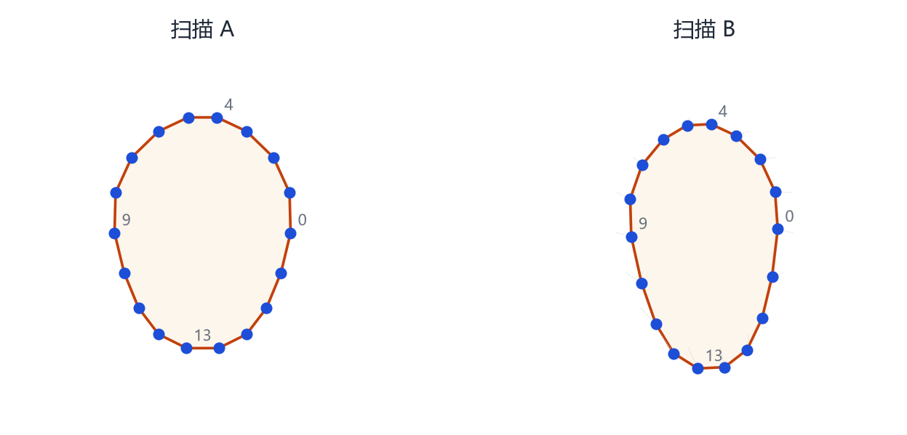
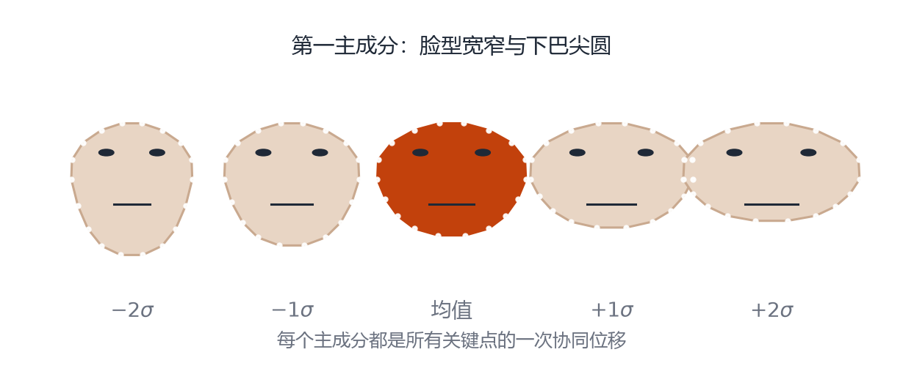
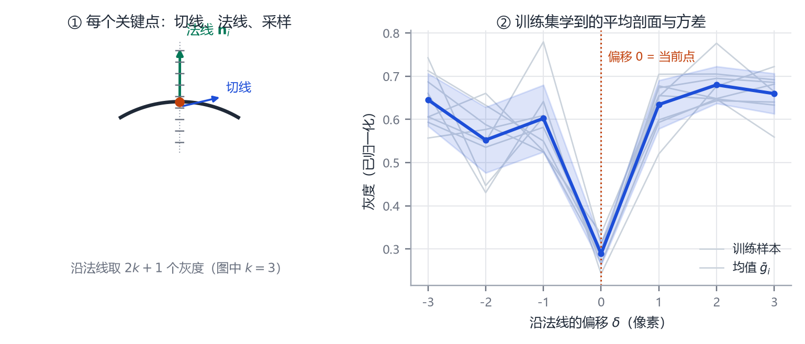
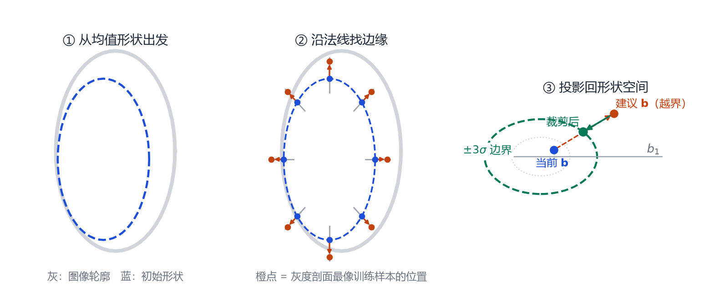
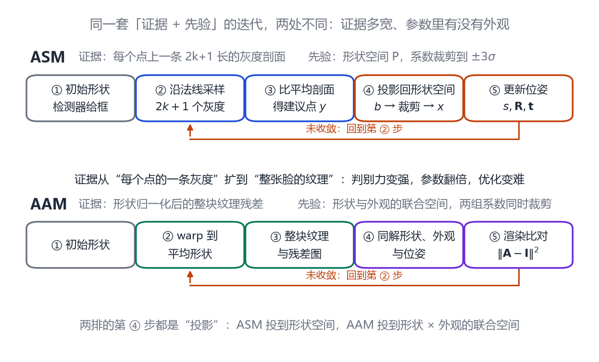
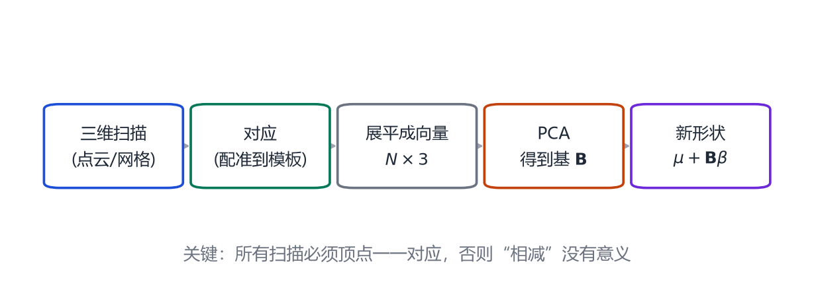
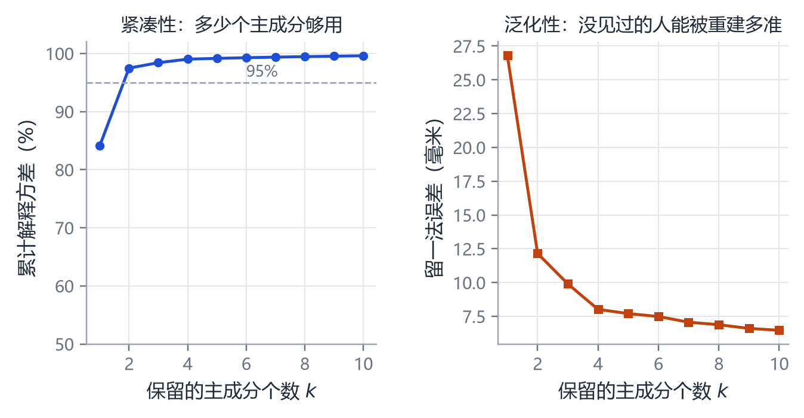
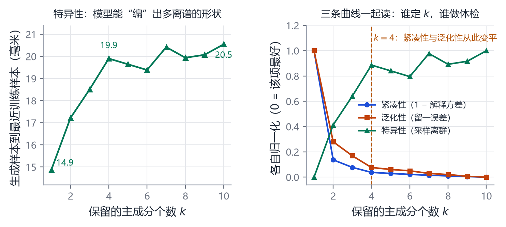

# 第 6 章 统计形状模型：从 ASM 到 3DMM

> **本章导读**：前面几章分别讲了“怎么表示”“怎么降维”“怎么变换”。这一章把它们合起来，回答一个更具体的问题：**如何从一堆扫描数据里，自动学出一个可调节的形状模型？** 这条线索从 1995 年的主动形状模型（ASM）开始，经过主动外观模型（AAM），到 1999 年的三维形变模型（3DMM），构成了今天所有人脸、人体、人手、动物参数化模型的共同祖先。

## 6.1 一个想法：形状是可以“统计”的

这一节要解决的问题是：如何把“很多人都有、但每人又不一样”这种常识变成一个可以计算的量。结论是：先建立对应、再求均值、再用 PCA 抽出变化模式，就得到一个能“调节”的形状模型。

1990 年代初，医学图像分析面临一个难题：在 CT 或 MRI 里自动找到器官的轮廓。不同病人的器官形状不一样，但又有共同规律。Cootes、Taylor 等人想到：**如果先把很多样本的轮廓对应起来，再用 PCA 描述它们的变化，就能得到一个“形状的先验”[@cootes1995asm]。** 搜索轮廓时，只在这个先验允许的范围内找，既快又不容易跑偏。

这就是**统计形状模型**（Statistical Shape Model, SSM）的核心。它包含三个要素：

1. 一组已经**对应**好的样本；
2. 一个**均值形状**；
3. 一组**变化模式**（主成分）及其允许范围。

先看一个数字，体会“先验”到底省了什么。若一个人脸轮廓用 68 个关键点描述，每个点两个坐标，就是 $68\times2=136$ 个数。没有先验时，找这 136 个数就是一个 136 维的搜索问题，每个点都可以独立乱跑。若统计出前 20 个主成分就能解释 $95\%$ 的变化，搜索就变成 20 维：**剩下的 116 个方向被“不允许偏离平均脸太远”这条先验锁住了。** 搜索变快只是附带好处，真正重要的是它不再生成“膝盖长在肘部”这类合法但不是人脸的形状。

一个模型要能用，这三样东西缺一不可。缺样本，就没有统计；缺对应，样本之间不能相减；缺参数范围，模型能生成的形状会无边无际——你在参数空间里随便取一组数，得到的可能是一张“没有下巴的脸”。后面每一节，实际上都在补齐或修补这三样中的某一样。

所以，统计形状建模的全部难点可以归成一句话：**先把一批形状对齐成可比较的数字，再从这些数字里抽出少数几个方向，最后规定这些方向能走多远。**

## 6.2 对应：一切的起点

这一节要解决的问题是：两个形状要相减，前提是什么。结论是：顶点编号必须在所有样本上具有相同的解剖含义，否则相减得到的数是噪声。

<figure class="fig">

<figcaption><b>图 6-1</b>　对应（correspondence）的含义。两张脸的轮廓都取了 18 个编号一致的点：0 号都在右侧脸颊，4 号都在额头中央，13 号都在下巴。只有编号含义一致，形状向量逐维相减才有意义。</figcaption>
</figure>

假设你有两张人脸网格，一张 5000 个顶点，另一张 5200 个顶点。它们不能直接相减——维度都不一样。即使顶点数相同，如果第 100 号顶点在第一张脸上是鼻尖、在第二张脸上是嘴角，相减得到的数也没有任何解剖意义。

所以统计形状建模的第一步永远是**对应**（correspondence）：把所有样本变形到同一个模板上，使每个顶点在所有样本里都对应同一个解剖位置。常见做法有三类：

- **人工/半自动关键点**：在每个人脸上标 68 个点，再用薄板样条（thin plate spline, TPS）把模板 warp 过去。简单，但关键点之外靠插值，细节会糊。
- **非刚性配准**（non-rigid ICP）：以模板为参考，迭代地找最近点、估计形变、最小化能量。Amberg 等人的“最优步长非刚性 ICP”是经典实现。
- **光流/多视角立体**：对纹理清晰的扫描，用光流建立像素级对应，再反投影到三维。

为了方便判断“对应好不好”，工程上常用一个代理指标：把所有样本的顶点位置按坐标画成散点。如果对应正确，同一解剖位置的点会挤成薄薄一层；如果对应有系统性偏差，它们会散成一条粗带。这个“壳有多厚”没有统一阈值，它是相对量：同一批数据上换两种配准方法，壳更薄的那种通常更好用。

对应质量直接决定模型质量。如果对应有系统性偏差（比如嘴角总是对到偏上 2 毫米），PCA 会把这种偏差当成“形状变化”学进去，模型就会莫名其妙地“歪嘴”。更麻烦的是这种错误**不会报错**：方差比依然漂亮，重建误差依然很小，只是模型学到的第一主成分是“配准算法的偏差方向”，而不是“人脸的宽窄”。

> **一句话**：统计形状模型的上限，由对应质量决定；后面的 PCA、拟合都是在这个上限内做文章。

所以，“对应”不是预处理里可以顺手跳过的一步，它决定了后面所有数字的含义。本册后面出现的每一个形状向量 $\mathbf{x}$，都默认“第 $i$ 个分量在所有样本里是同一个解剖位置”。

## 6.3 ASM：在允许的形状里搜索

这一节要解决的问题是：给定一张没见过的图像，如何利用“形状先验 + 局部图像证据”找到关键点。结论是把两件事交替做：先让每个点跟着图像走，再把整组点拉回形状空间。

<figure class="fig">

<figcaption><b>图 6-2</b>　ASM 的形状空间。把所有样本的关键点展平成向量做 PCA，得到均值（中间）和若干主成分。沿第一主成分从 $-2\sigma$ 走到 $+2\sigma$，脸型从窄长逐渐变宽圆。每个主成分都是所有关键点的一次协同位移。</figcaption>
</figure>

ASM 把形状表示成 $n$ 个关键点的坐标串：

$$
\mathbf{x}=(x_1,y_1,x_2,y_2,\dots,x_n,y_n)^\top\in\mathbb{R}^{2n}.
\tag{6.1}
$$

式 (6.1) 的输入是 $n$ 个点的二维坐标，输出是一个 $2n$ 维向量。读法：前两个分量是 1 号点的 $x$ 与 $y$，接着是 2 号点，依次类推。这样“一个形状”就变成了“一个点”，可以放进向量空间里做减法和投影。

对所有训练样本做 Procrustes 对齐（去掉平移、旋转、缩放），再跑 PCA：

$$
\mathbf{x}\approx\bar{\mathbf{x}}+\mathbf{P}\mathbf{b},
\qquad
\mathbf{P}=[\mathbf{p}_1,\dots,\mathbf{p}_t].
\tag{6.2}
$$

式 (6.2) 的输入是形状向量 $\mathbf{x}$，输出是一组系数 $\mathbf{b}$ 与重建形状。三个因子要分开看：$\bar{\mathbf{x}}$ 是平均形状（“标准脸”），$\mathbf{P}$ 的每一列是一个主成分（“所有点一起怎么动”），$\mathbf{b}$ 是每个方向走多远。$\mathbf{b}$ 是形状参数。

为了避免生成不合理的形状，通常限制每个参数在 $\pm3\sqrt{\lambda_i}$ 以内（$\lambda_i$ 是对应的特征值），这相当于“只走 3 个标准差”。

搜索时，ASM 做两件事**交替**进行：

1. **局部搜索**：沿每个关键点的法线方向采样灰度，找边缘最强的位置；
2. **模型约束**：把找到的点拟合回式 (6.2) 的形状空间，去掉不符合先验的位移。

这两句话信息密度很高，下面拆成五小节讲：为什么非要“搜索”、两步各在算什么、为什么必须交替、代码长什么样、什么时候会失败。

### 6.3.1 为什么需要“搜索”

这一小节要解决的问题是：为什么不直接用一个网络从图像回归关键点，而要迭代地“搜”。结论是：形状空间不知道该把模型放在图像里的哪里，局部外观也不知道整体该长什么样，只有交替使用两者才能定下来。

先明确目标：给一张**没见过**的图像 $\mathbf{I}$，输出 $n$ 个关键点的位置 $\mathbf{x}$。我们手上只有两样东西：

- **形状空间**（式 6.2）：告诉我们“什么样的形状是合法的”，但它不知道这张图里的人在**哪、多大、什么姿势**；
- **局部外观模型**：对每个关键点，训练时学到了“它周围的一条灰度剖面”（沿**法线**方向采样，见 6.3.2；例如眼角处灰度先降后升），但它只描述**一个点附近**，不知道全局。

任何一样单独都不够：只用形状空间，你只能画出平均脸，位置完全对不上；只用局部外观，每个点都会跑向离它最近的强边缘，整组点会散架（下巴的点跑到脖子上）。

一个具体的数字：假设初始框把 68 个点整体往右偏了 15 个像素。只用形状空间，这 15 个像素永远修不回来；只用局部外观，每个点各自去找最近的边缘，有的被拉到十几像素外，有的基本没动，方向也不一致，整组点不再构成一张脸。

所以 ASM 选择**迭代**：从初始猜测出发，让图像证据把点“拉”向边缘，再让形状先验把它们“拽”回合法形状，重复到不再移动。**这个过程就是“搜索”**——在形状空间允许的集合里，找让图像证据最好的那组参数。

> 一句话区分两种思路：**搜索/拟合**是“先有模型，再让模型去贴合图像”；**检测/回归**是“直接从图像预测参数”。ASM 属于前者（慢、可控），HMR 那类直接回归参数的神经网络属于后者（快、吃数据）。两者不是替代关系，而是互补：后来的 SPIN 就是把优化器塞进了回归网络。

所以，ASM 的“搜索”不是算法上的随意选择，而是因为它手里的两样知识各自都不完整——只能一边猜一边纠。

### 6.3.2 训练阶段到底学到了什么

这一小节要解决的问题是：ASM 的“训练”到底存下了哪些数字。结论是两样：形状的主成分，以及每个关键点附近一条灰度剖面的均值与方差。

**（1）形状：对齐 + PCA。** 这部分 6.2 已经讲过：把每张训练图的关键点做 Procrustes 对齐（去平移、旋转、缩放），展平成向量后做 PCA，得到均值 $\bar{\mathbf{x}}$、主成分 $\mathbf{P}$、特征值 $\lambda_i$。它回答“什么样的形状合法”。

**（2）局部外观：每个关键点一条灰度剖面。** 这里第一次出现“法线”，先把词说清楚：

- **切线**：轮廓在该点的走向。离散情况下用相邻两点估计：$\mathbf{t}_i\propto\mathbf{x}_{i+1}-\mathbf{x}_{i-1}$；
- **法线**：与切线垂直的方向。二维里把切线转 90°：$\mathbf{n}_i\propto\big(-(y_{i+1}-y_{i-1}),\ x_{i+1}-x_{i-1}\big)$，再归一化成单位向量；符号统一取“朝轮廓外侧”。

有了法线，训练时对**每个关键点 $i$、每张训练图**做同一件事：沿法线在 $\delta=-k,\dots,k$ 上采样 $2k+1$ 个灰度值，得到一条长度为 $2k+1$ 的小向量 $\mathbf{g}_i$（$k$ 通常取 2–4，也就是跨边界数 5–9 个像素）。为了不受整体明暗影响，一般先把它归一化（减均值、除标准差）。

<figure class="fig">

<figcaption><b>图 6-3</b>　ASM 训练阶段学到的东西。左：对每个关键点，用相邻两点估切线，再取垂线得到法线，沿法线采 $2k+1$ 个灰度；右：把训练集所有样本的剖面画在一起，算出平均剖面 $\bar{\mathbf{g}}_i$（粗线）与每个位置的方差（浅色带）。这张“平均长相 + 允许多大波动”就是每个点的局部外观模型。</figcaption>
</figure>

把所有训练样本的 $\mathbf{g}_i$ 收集起来，算两个统计量：

- **平均剖面** $\bar{\mathbf{g}}_i$：这个点“应该”长什么样（例如眼角处灰度先降后升）；
- **协方差矩阵** $\mathbf{S}_i$：这个剖面允许有多大变化（哪些位置敏感、哪些位置本来就很模糊）。

这就是“训练学到了沿法线方向的灰度长什么样”的完整含义。搜索时用式 (6.3) 的马氏距离，问的正是：**当前这条剖面，和训练时见过的平均剖面比，偏离得有多罕见？**

存储量值得算一下：$n=68$ 个点，每条剖面 $2k+1=7$ 个数，每个点存一个 $7\times7$ 的协方差，一共 $68\times(7+49)=3808$ 个数。相比之下，一个 68 点的形状模型要存 $136\times136$ 的协方差（若显式存），共 18496 个数。**ASM 的“轻”来自它把局部信息压缩成了一条极短的剖面。**

> 为什么只取一维、而不是整块图像？因为 ASM 的假设很朴素：**轮廓处的判别信息集中在“跨过边界时灰度怎么变”**。这也是它的软肋——光照一变、或者部位本身很平（脸颊），一条线的灰度就不可靠了。AAM 用整块纹理补的就是这个洞（见 6.4）。

所以，ASM 训练出来的不是一组“关键点检测器”，而是一份**允许多大波动的清单**：每个点知道自己该长什么样，也知道自己可以偏多少。

### 6.3.3 第 1 步（局部）：沿法线找边缘

这一小节要解决的问题是：给定当前的点位置，怎么算出“往哪挪、挪多远”。结论是：沿法线方向逐个候选偏移比一比，取和马氏距离最接近训练剖面那个。

对每个关键点 $i$：

1. **算法线**：用相邻两个关键点估计切线，再取它的垂线，得到单位法线 $\mathbf{n}_i$（朝向轮廓外侧）。
2. **采样 profile**：在 $\mathbf{x}_i+\delta\,\mathbf{n}_i$ 处取 $2k+1$ 个灰度值（典型 $k=2\sim4$，即 5–9 个像素），得到一条一维灰度曲线 $\mathbf{g}_i(\delta)$。
3. **和训练时学到的 profile 比**：训练集里每个点都有一条平均 profile $\bar{\mathbf{g}}_i$ 和它的协方差 $\mathbf{S}_i$。取**马氏距离**最小的偏移：

$$
\delta_i^{*}=\arg\min_{\delta}\;
\big(\mathbf{g}_i(\delta)-\bar{\mathbf{g}}_i\big)^{\!\top}\,
\mathbf{S}_i^{-1}\,
\big(\mathbf{g}_i(\delta)-\bar{\mathbf{g}}_i\big).
\tag{6.3}
$$

式 (6.3) 的输入是当前点周围的一条灰度剖面 $\mathbf{g}_i(\delta)$（对每个候选偏移 $\delta$ 都有一条），输出是一个标量距离。读法：括号里是“当前剖面减平均剖面”，中间乘 $\mathbf{S}_i^{-1}$ 相当于“按训练时的方差把这个差归一化”，最后得到的是一个“偏离了多少个标准差”的量。取最小的那个 $\delta$，就是这一步的建议。

4. **得到建议位置**：$\mathbf{y}_i=\mathbf{x}_i+\delta_i^{*}\mathbf{n}_i$。

三个“为什么”：

- **为什么只沿法线走**：轮廓的移动主要是法向的；沿切线方向滑动几乎不改变轮廓形状，却会让点“滑走”（比如从鼻翼滑到脸颊）。
- **为什么用马氏距离而不是灰度差**：不同部位、不同纹理的灰度对比度差很多。$\mathbf{S}_i^{-1}$ 按训练时的方差归一化——某个点天生对比度低，就自动放宽容差；天生锐利，就严格。这正是“按数据自己的尺度衡量”的意思（第 2 章讲过）。
- **为什么这条一维曲线够用**：对**轮廓**来说，最有判别力的信息就是“沿法线跨过边界时灰度怎么变”。这就是 ASM 的名字来源：Active **Shape** Model，只有形状，没有纹理。

举一个能手算的（示意）：某点训练剖面的平均是 $(0.2,0.5,0.9,0.5,0.2)$（灰度先升后降，边界在中间），协方差近似为单位阵。当前图上有两条候选剖面：一条 $(0.22,0.52,0.88,0.50,0.21)$，一条 $(0.90,0.60,0.30,0.20,0.10)$。第一条的差向量长度约 $0.045$，第二条约 $1.09$。前者是“同一个边界，只是位置略偏”，后者是“灰度从亮到暗，方向反了”。马氏距离把这个差别放大到 20 倍以上，所以选前者。

所以，局部步做的事情很朴素：**在一条一维的线上，找一个“最像训练时那条剖面”的位置。**

### 6.3.4 第 2 步（全局）：把结果投影回形状空间

这一小节要解决的问题是：局部步给出的一组点可能根本不成形状，怎么把它变回合法的形状。结论是：做一次最小二乘投影，再按 $\pm3\sigma$ 裁剪系数，最后更新位姿。

现在我们有了一组“证据位置” $\mathbf{y}$。它们可能根本不成形状：有的点被强边缘拉远了，有的点没动。

于是做一次**最小二乘拟合**，把它们拉回形状空间。因为 $\mathbf{P}$ 的列正交（$\mathbf{P}^\top\mathbf{P}=\mathbf{I}$），解是闭式的：

$$
\mathbf{b}=\mathbf{P}^{\top}\big(\mathbf{y}-\bar{\mathbf{x}}\big),
\qquad
b_i\leftarrow\operatorname{clip}\big(b_i,\,-3\sqrt{\lambda_i},\,+3\sqrt{\lambda_i}\big),
\qquad
\mathbf{x}=\bar{\mathbf{x}}+\mathbf{P}\mathbf{b}.
\tag{6.4}
$$

三个式子分别读：

- 第一式：把“证据位移”投影到前 $t$ 个主成分上——只保留形状空间能解释的部分。因为 $\mathbf{P}$ 的列正交，投影不需要求逆，一次矩阵乘法就完事；
- 第二式：把每个系数裁剪到 $\pm3\sigma$，防止外插出不像人脸的形状。裁剪是逐维的，不改变其他维度；
- 第三式：用裁剪后的参数重建一组新点。

还没完：$\mathbf{y}$ 在图像坐标里，而形状空间是在**对齐后**的坐标系里。所以每轮还要更新相似变换（缩放 $s$、旋转 $\mathbf{R}$、平移 $\mathbf{t}$），用 Procrustes 对齐 $\mathbf{x}$ 与 $\mathbf{y}$：

$$
(s,\mathbf{R},\mathbf{t})=\arg\min\ \sum_i\big\|\,s\mathbf{R}\mathbf{x}_i+\mathbf{t}-\mathbf{y}_i\,\big\|^2 .
$$

这个式子的输入是两组点（形状空间的 $\mathbf{x}$ 与图像里的 $\mathbf{y}$），输出是一个**相似变换**（4 个自由度：1 个缩放、1 个旋转角、2 个平移）。然后 $\mathbf{x}\leftarrow s\mathbf{R}\mathbf{x}+\mathbf{t}$。这一步让模型能“变大变小、转一点、挪过去”，否则它永远只能贴合初始位置附近的轮廓。

所以，全局步的本质是：**把“图像说了什么”翻译成“形状参数说了什么”；翻译不出来的部分（平移、旋转、缩放）交给位姿。**

### 6.3.5 为什么必须交替：证据与先验的拔河

这一小节要解决的问题是：两步为什么不合并成一步，非要一轮一轮来回做。结论是：两步各自只满足一半约束，交替的过程就是让两者逐步达成一致；而投影掉的那部分位移，恰好是位姿能吸收的。

单独做任何一步都会坏：

| 只做局部搜索 | 只做形状约束 |
|---|---|
| 每个点独立跑向最近的强边缘 | 形状始终停在均值附近 |
| 遮挡处、眼镜框、发出的强边缘会把点拉飞 | 永远无法贴合个体差异（脸宽、下巴长短） |
| 整组点散架，不再是“脸” | 图像证据完全没用上 |

交替的结果是两者折中：**局部步负责“贴合这张图”，全局步负责“像一张脸”。** 权重关系由形状空间的维度 $t$ 和 $\pm3\sigma$ 的裁剪共同决定——主成分越少，先验越强，结果越“标准”也越僵。

<figure class="fig">

<figcaption><b>图 6-4</b>　ASM 一轮迭代的三步。① 从均值形状出发；② 每个关键点沿法线采样灰度，找到边缘最强的偏移（箭头），得到一张“建议形状”；③ 把建议形状投影回形状空间，超出 $\pm3\sigma$ 的部分被裁掉，得到合法形状，再进入下一轮。</figcaption>
</figure>

下面用两个点、一个主成分，把一轮迭代手算一遍（这是示意，真实模型的维度要大得多，但结构完全一样）。

**设定。** 形状只有两个点；均值形状是水平的两端 $\bar{\mathbf{x}}=(0,0,\ 1,0)$。训练集里这两个点只会“一端上一端下”地开合，所以只有一个主成分

$$
\mathbf{p}_1=\frac{1}{\sqrt2}\,(0,\ 1,\ 0,\ -1),
$$

对应标准差 $\sqrt{\lambda_1}=0.1$，于是裁剪上界是 $3\sqrt{\lambda_1}=0.3$。

**证据。** 局部步找完边缘后，建议位置是 $\mathbf{y}=(0,0.3,\ 1,-0.1)$：左端被抬高 $0.3$，右端被压低 $0.1$。

**投影。** 先算 $\mathbf{y}-\bar{\mathbf{x}}=(0,0.3,\ 0,-0.1)$。再乘 $\mathbf{p}_1^\top$：

$$
b_1=\mathbf{p}_1^\top(\mathbf{y}-\bar{\mathbf{x}})
=\frac{0.3+0.1}{\sqrt2}\approx0.283 .
$$

$0.283<0.3$，不需要裁剪。重建：

$$
\mathbf{x}=\bar{\mathbf{x}}+b_1\mathbf{p}_1
=(0,0,1,0)+0.2\,(0,1,0,-1)
=(0,0.2,\ 1,-0.2).
$$

对比一下：证据说“左端上 0.3、右端下 0.1”，投影后变成“左端上 0.2、右端下 0.2”。**投影把两边的不对称平均掉了，只留下形状空间允许的那一半。**

**残差。** 剩下的 $\mathbf{y}-\mathbf{x}=(0,0.1,\ 0,0.1)$ 是“两端同时上移 0.1”，也就是一次平移。它不在形状空间里（Procrustes 对齐时平移已被去掉），但恰好是位姿参数 $\mathbf{t}$ 能吸收的东西。这不是巧合：投影到形状空间的正交补上，剩下的就是平移、旋转、缩放这一小类整体运动。

这个例子说明了交替的必要性：

- 如果只做局部步，得到的是 $(0,0.3,1,-0.1)$，两端抬降不对称——在这种形状空间里是“不合法”的，因为模型只学过对称开合；
- 如果只做全局步，$\mathbf{y}$ 从来没被用上，形状永远停在 $(0,0,1,0)$；
- 交替之后，形状拿到了“能解释的那部分”，位姿拿到了“整体运动”，剩下的是两者都不管的噪声，下一轮继续。

实际运行时不会一轮就收敛。常见的收敛曲线是：前几轮位移大，点在图像上明显“跳”，之后每轮位移迅速变小，10–30 轮后稳定。这也解释了 6.3.6 里的收敛判据为什么用“最大位移小于阈值”而不是“能量下降多少”——最终状态本来就应该是“不再动”。

所以，“交替”不是实现细节，而是这个方法的核心：**它把一个大问题拆成了两个各自可解的小问题，再用迭代把它们缝起来。**

### 6.3.6 伪代码与工程细节

这一小节要解决的问题是：把上面几步写成代码时，哪些地方最容易错。结论是五个细节：多分辨率、初始化、位姿更新、收敛判据、数值保护。

```python
x = init_from_detector(I)          # 人脸框 + 均值形状缩放
for it in range(max_iter):         # 典型 10–30 次
    for i in range(n):
        n_i = normal(x[i-1], x[i+1])          # 由相邻点估法线
        g = sample_profile(I, x[i], n_i, k)   # 2k+1 个灰度
        d = best_offset(g, mean_profile[i], cov[i])   # 式 (6.3)
        y[i] = x[i] + d * n_i                 # 建议位置
    b = P.T @ (y - xbar)                      # 式 (6.4)
    b = clip(b, -3*sd, 3*sd)
    x = xbar + P @ b
    s, R, t = procrustes(x, y)                # 更新位姿
    x = s * R @ x + t
    if max_abs(x - x_prev) < eps: break
```

工程上的几个经验：

- **多分辨率**：先在半分辨率图上跑几轮（profile 更平滑、更稳），再到全分辨率细化。否则细节纹理容易把点带偏。
- **初始化很关键**：用现成的人脸检测器给框，再把均值形状缩放塞进去；初始化偏差太大时，局部搜索会收敛到错误的边缘。
- **每轮都更新相似变换**：只拟合 $\mathbf{b}$ 不更新位姿，模型无法跟随人脸的位移与尺度。
- **收敛判据**：所有点位移的最大值小于阈值（比如 0.5 像素），或达到最大迭代次数。
- **数值保护**：$\mathbf{S}_i$ 在训练样本少时可能是奇异的（剖面只有 7 个位置，训练图却只有 3 张），求逆前要加一个小的对角项（$\mathbf{S}_i+\epsilon\mathbf{I}$），或者改用伪逆。

还有一处容易忽略的细节：**法线方向的符号**。如果第 $i$ 个点的法线朝里、第 $i+1$ 个点的法线朝外，采样出来的剖面会翻转，马氏距离算出来一片混乱。工程上通常用“轮廓的绕行方向”统一符号：沿轮廓逆时针走一圈，法线一律取右手侧。

所以，ASM 的代码很短，短到可以写在一页纸上；但上面这五个细节，决定了它是“能用”还是“一跑就飞”。

### 6.3.7 什么时候会失败

这一小节要解决的问题是：ASM 在哪些输入上会失效，失效的原因是什么。结论是五种典型情况，其中两种（光照、平坦部位）直接催生了下一节的 AAM。

- **初始化太远**：大角度侧脸、极端表情，局部搜索一开始就抓错边缘；
- **强边缘干扰**：眼镜框、刘海、胡须、口罩，都会给出比真实轮廓更强的梯度；
- **遮挡**：被挡住的关键点没有证据，只能靠先验“猜”，一猜就可能全错；
- **光照与纹理**：只用一维灰度，光照一变、或者部位本身很平（脸颊），profile 就失效；
- **形状空间覆盖不足**：训练集里没有这种脸型/表情，$3\sigma$ 之外的真值被裁掉，永远拟合不上。

这五条可以归成两类。前三条是“证据错了”：要么找错地方，要么根本没证据。后两条是“模型不够”：先验覆盖不到，或者先验依赖的东西（灰度）不稳定。

第二类里的“光照”和“平坦部位”特别值得说。一根法线上的 7 个像素，能提供的判别信息实在有限：如果整张脸的光照从左上变成右上，同一个边界两侧的相对亮度可能整个反过来；如果部位本身是平缓的（脸颊、额头），灰度变化可能只有几个灰阶，跟噪声差不多。**ASM 的失败不是因为它笨，而是因为它看得太少。**

所以，接下来的问题是：如果不只看一条线，而是把整块脸皮的纹理都统计进去，会怎样？

## 6.4 AAM：把纹理也统计进来

这一节要解决的问题是：如何把“纹理”也变成可统计、可调节的参数，让模型能合成出一整张脸而不只是一圈轮廓。结论是：先把每张脸 warp 到平均形状，再对纹理做一次 PCA；模型因此变强了，但拟合也变难了。

<figure class="fig">

<figcaption><b>图 6-5</b>　ASM 与 AAM 的搜索流程对照。两排骨架完全相同：初始化 → 取图像证据 → 和统计模型比 → 解参数 → 判收敛。差别只有两处：ASM 的证据是每个点上一条一维灰度剖面，AAM 的证据是形状归一化之后的整块纹理残差；ASM 的参数只有形状，AAM 的参数里还有外观。</figcaption>
</figure>

**主动外观模型**（Active Appearance Model, AAM）由 Cootes、Edwards、Taylor 在 1998–2001 年间提出 [@cootes2001aam]。它的想法很直接：既然 ASM 的软肋是“只看一条线”，那就把整块纹理都建模。

### 6.4.1 动机：一条法线上的 7 个像素不够

这一小节要解决的问题是：AAM 为什么非要引入纹理。结论是：ASM 的证据只覆盖轮廓上的一条细线，而判断一个点“对不对”的信息大量分布在轮廓内部。

先做一道算术。68 个关键点，每个点采 7 个灰度，一共 $68\times7=476$ 个像素。一张 $200\times200$ 的人脸图有 40000 个像素。**ASM 用到的像素不到全图的 1.2%。**

这 1.2% 里的信息还很不均匀：

- 眼角、嘴角、鼻翼这些地方，灰度变化剧烈，一条法线足够；
- 脸颊、额头、下巴侧面这些地方，灰度几乎不变，法线上只有噪声。

于是出现一种很典型的失败：模型在脸颊上“滑”。因为脸颊上没有强边缘，局部步给不出明确的方向，点就停在原地或者被邻近的边缘带走几像素；投影步又没有办法知道“它其实该往上一点”，因为它只有形状先验，没有“这块皮肤应该是什么样”的知识。

AAM 的回答是：**那就把轮廓内部的样子也学下来。** 如果模型知道“平均脸的脸颊在这个位置是这种亮度和梯度”，一个滑到脖子上的点就会立刻显得不对劲——它周围的纹理和模型预期的完全不同。

所以，AAM 的动机可以压缩成一句：**把“边界处怎么变”换成“整块区域长什么样”，让证据的覆盖面从 1.2% 变成 100%。**

### 6.4.2 第一步：先把形状去掉

这一小节要解决的问题是：不同人的脸大小形状都不一样，纹理怎么比较。结论是：先把每张脸 warp 到同一个平均形状上，得到“形状归一化后的纹理”。

直接把两张脸的像素相减是没有意义的：一张脸的眼睛在 $(80,90)$，另一张在 $(74,86)$，同一个像素位置上可能是眼睛也可能是眼皮。所以必须先做**形状归一化**（shape normalization）：用当前形状到平均形状的映射，把图像“拉”成平均形状的样子。

具体做法是分片仿射 warp：

1. 把关键点连成三角网格（Delaunay 三角剖分）；
2. 对每一个三角形，算从当前形状到平均形状的仿射变换（3 个顶点定 3 个对应点，正好定一个仿射变换）；
3. 把每个三角形里的像素按这个变换搬到平均形状的位置上；
4. 三角形外面的区域用插值补。

于是每张脸都变成了一张**同样大小、五官位置一致**的纹理图。这一张图就是“形状归一化纹理”，记作 $\mathbf{A}$。数字感受一下：若平均形状下两眼间距是 52 像素，某张脸是 60 像素，warp 之后这张脸的眼间距也会变成 52——眼睛本身被压窄了约 $13\%$。这一步的代价是插值模糊：压得越多，细节越糊。

所以，形状归一化是把“形状差异”和“纹理差异”解耦的第一步，没有它，纹理 PCA 学到的会是两者混在一起的怪东西。

### 6.4.3 第二步：对纹理做 PCA

这一小节要解决的问题是：形状归一化之后，纹理怎么变成少数几个参数。结论是：和形状完全一样——展平成向量、减去均值、做 PCA。

把每张形状归一化纹理展平成一个长向量（一张 $128\times128$ 的灰度图就是 16384 维），然后

$$
\mathbf{A}=\bar{\mathbf{A}}+\mathbf{P}_a\mathbf{b}_a .
$$

读法与式 (6.2) 完全平行：$\bar{\mathbf{A}}$ 是平均纹理（“标准脸皮”），$\mathbf{P}_a$ 的列是纹理主成分（“整体变亮”“鼻影加深”“嘴唇变红”这类协同变化），$\mathbf{b}_a$ 是外观系数。

有了两组参数，就可以分别调节：

- 只改 $\mathbf{b}_s$：同一个人的不同脸型；
- 只改 $\mathbf{b}_a$：同一张脸型的不同长相（肤色、眉色、阴影）；
- 两组一起改：生成一个新的、没见过的人。

AAM 更进一步，把两组参数**联合**再做一次 PCA，去掉形状与纹理之间的相关性（例如“脸宽的人往往鼻子也宽”）。这一步让参数量再降一截，代价是形状与纹理不再能独立调节。

所以，加了纹理之后，模型第一次能“合成一整张脸”；但参数从一组变成两组，还要联合降维，这为下一小节的问题埋下了伏笔。

### 6.4.4 为什么反而更难

这一小节要解决的问题是：ASM 拟合只需要 20 来个参数，AAM 有了纹理应该更准，为什么实际用起来反而更脆弱。结论是四个原因：维数、形状与纹理纠缠、光照的乘性、遮挡下的平方损失。

这是本节最需要说清的地方。加了纹理之后，模型确实“知道得更多”了，但拟合问题同时变难了四倍。

**（1）维数。** ASM 的搜索空间是形状参数，$t$ 个，典型 20 来个。AAM 的搜索空间是形状 + 外观，即使联合 PCA 压缩过，也常在 30–50 个；如果不做联合压缩，形状 20 个加上外观上百个，经常是三位数。维数上去，同样的迭代次数下收敛更慢，参数之间的耦合也更多。

**（2）形状与纹理纠缠。** 这是最本质的困难。给定一张图和模型，像素差 $\mathbf{A}-\mathbf{I}$ 可以由很多种原因造成：

- 形状参数偏了 2 个单位（五官位置整体挪了 2 像素）；
- 外观参数偏了（皮肤变亮了）；
- 位姿偏了（整张脸平移 2 像素）；
- 光照不同（一侧被照亮）。

在梯度层面，这几种原因产生的像素变化**几乎在同一个方向**。也就是说，雅可比矩阵的列高度相关，条件数很差——优化器看到“该怎么改”，但分不清该改哪一组。ASM 没有这个问题，因为它的证据和参数是一一对应的：某个点的灰度对不上，就改形状。AAM 里“某个像素对不上”，可能是形状，也可能是纹理。

**（3）光照不是线性的。** PCA 建模的是**加性**变化：$\bar{\mathbf{A}}+\mathbf{P}_a\mathbf{b}_a$。但光照进入图像是**乘性**的：一张脸被侧光照亮，是每个像素乘以一个随位置变化的系数，再叠加阴影。乘性变化在用 PCA 表示时，需要很多主成分才能近似——而每一份多出来的主成分，都会让参数空间更大、更容易被误用。实践中 AAM 会用“先做光照归一化，再拟合”来绕过，但这又引入了新的失败模式。

**（4）损失函数对遮挡极敏感。** AAM 的目标是最小化像素差的平方和。平方和里，一个被遮挡的区域（比如一只手挡在脸上）会产生巨大的残差，优化器为了压这个残差，会把整张脸往错误的方向拉。ASM 也有遮挡问题，但它的残差是逐点的一维距离，几个点坏掉不会主导全局；AAM 的残差是几万个像素的平方和，一小块遮挡就能占据主导。后来的做法是换鲁棒核（第 4 章讲过 IRLS），或者显式建模遮挡。

再补一条工程上的：**warp 本身有误差。** 形状归一化要靠三角剖分和插值，三角形越大、弯曲越多，插值误差越大。这个误差会被当成“纹理变化”学进模型里，等于在数据里掺了一层系统噪声。

所以，“加纹理”不是免费的午餐：它把证据从 476 个数扩大到几万个数，同时把“该改哪个参数”这个问题的条件数弄坏了一个量级。**模型更强，但更不好解。**

### 6.4.5 分析—合成拟合

这一小节要解决的问题是：给定一张图，怎么反解出 AAM 的参数。结论是解一个“渲染出来像不像”的最小化问题，并用反向组合等技巧把它变成可以实时的事。

AAM 的拟合是**分析—合成**（analysis-by-synthesis）：猜一组参数，合成一张图，比较，改进。写成式子：

$$
\min_{\mathbf{b}_s,\mathbf{b}_a}\ \big\|\mathbf{A}\big(\mathbf{x}(\mathbf{b}_s);\mathbf{b}_a\big)-\mathbf{I}\big\|^2.
\tag{6.5}
$$

输入是观测图像 $\mathbf{I}$ 和当前的形状/外观参数；输出是让“合成图”最接近观测的那组参数。三个记号读法：$\mathbf{x}(\mathbf{b}_s)$ 是由形状参数生成的形状（关键点位置）；$\mathbf{A}(\cdot\,;\mathbf{b}_a)$ 是“按这个形状把外观参数画出来”的纹理图；两者合起来就是一张**按当前参数渲染出的脸**。减号后面是真实图像，平方和是逐像素差。

这个目标函数通常用高斯-牛顿或梯度下降来解。1998 年的原始实现很慢（每次迭代都要重算梯度和 Hessian），后来有两项关键技巧让 AAM 能实时：

- **反向组合**（inverse compositional）：把“更新参数”的作用从“作用于模型”改成“作用于输入图像”，于是 Hessian 可以在**离线阶段**算一次、之后每次迭代都复用，省掉了最贵的一步；
- **project-out**：把外观参数的变化投影掉，只优化形状，等形状收敛后再解外观。

这两项技巧的细节超出本册范围，但结论值得记住：**AAM 之所以在 2000 年代成为人脸对齐的主流，不是因为它的目标函数更好，而是因为它把 Hessian 的成本摊到了离线阶段。**

所以，AAM 的“合成”与 ASM 的“投影”是同一件事的两种写法：都是把在线搜索的负担尽量搬到离线。

### 6.4.6 成败边界

这一小节要解决的问题是：AAM 适合什么场景，不适合什么场景。结论是：约束环境（正面、光照稳定、无遮挡）里非常有效，自然场景里容易崩。

AAM 的黄金时期是 2000 年代的“约束环境”：证件照、视频会议、人脸动画驱动。在这些场景里，光照可控、姿态接近正面、遮挡很少，AAM 能做到几十毫秒一帧，精度到几个像素。

一旦换到自然场景，问题就集中在 6.4.4 列的四条上：

- 侧脸时，纹理有一半不可见，模型没学过“半边脸”的纹理；
- 光照变化让加性模型失效；
- 表情改变了纹理，而 AAM 的表情建模能力有限；
- 遮挡让平方损失爆炸。

这也是为什么后来的人脸模型转向了三维（下一节）和判别式回归（第 4 章提到的直接预测参数）：**三维模型天然处理姿态，判别式方法不需要在线优化。**

所以，AAM 的贡献不在于它今天还在被直接使用，而在于它确立了“形状 + 外观”这一对建模思路——今天所有的三维人脸模型，仍然是这个框架的三维版本。

## 6.5 3DMM：把统计形状搬到三维

这一节要解决的问题是：二维的统计形状模型受姿态和光照拖累，能不能把同样的统计思想搬到三维。结论是能，而且关键的一步不是 PCA，而是“把所有扫描都变成同一个模板的位移场”。

1999 年，Blanz 与 Vetter 在 SIGGRAPH 上发表 *A Morphable Model for the Synthesis of 3D Faces*，把 ASM 的思想从二维轮廓搬到三维人脸。这就是 **3D 形变模型**（3D Morphable Model, 3DMM）。

### 6.5.1 关键一步：从“轮廓点”到“位移场”

这一小节要解决的问题是：三维扫描的顶点数和拓扑各不相同，怎么把它们变成可以相减的向量。结论是引入一个公共模板，把每个扫描都配准成模板的形变。

回忆 ASM 的形状向量（式 6.1）：$n$ 个点的坐标串。这个表示有一个隐含前提——**所有样本的点数必须一样，点的顺序必须是同一套**。在二维关键点上这个前提不难满足（人工标 68 个点），但在三维扫描上完全不成立：

- 扫描 A 有 8 万个顶点，扫描 B 有 12 万个；
- 就算顶点数相同，三角形怎么连也完全不同（拓扑不同）；
- 扫描出来的网格还带着姿态、表情、发型，甚至会有一块缺失。

所以 3DMM 的第一步是一个决定性的动作：**选一个参考模板（reference mesh），把每一个扫描都用非刚性配准变形到这个模板上**，于是每个样本都变成一个 $3\times V$ 的顶点表，可以写成“模板 + 位移”的形式：

$$
\mathbf{S}_i=\mathbf{T}+\mathbf{d}_i,\qquad \mathbf{d}_i\in\mathbb{R}^{3V},
$$

其中 $\mathbf{T}$ 是模板顶点（所有样本共享），$\mathbf{d}_i$ 是第 $i$ 个样本相对模板的位移场。读法：模板提供“顶点编号和连接关系”，位移场提供“这个人跟模板差在哪”。

这一步带来三个好处，每一个都很关键：

1. **样本变成同维向量**：不管原始扫描有多少顶点，配准之后都是 $V$ 个顶点，可以直接相减、做 PCA；
2. **形状与姿态分离**：配准的时候可以同时估计一个刚体变换，把姿态“去掉”，只留下形状差异——这就是为什么 3DMM 不像 AAM 那样被姿态直接卡死；
3. **纹理有了落脚点**：所有样本都对应到模板的同一套 UV 坐标上，纹理可以像贴图一样逐像素比较。

代价也很明确：配准误差直接变成模型误差。如果某个扫描配准得不好（例如鼻子歪了 3 毫米），这 3 毫米会被当成“这个人的形状特点”学进主成分里。三维配准比二维关键点难得多，这也是 3DMM 类模型的质量长期受限于配准质量的原因。

<figure class="fig">

<figcaption><b>图 6-6</b>　统计形状模型的训练流程。扫描 → 配准到统一模板 → 展平成向量 → PCA 得到基 → 用少量系数生成新形状。每一步都可能引入误差，其中“对应”是最关键的一步。</figcaption>
</figure>

顺带说一个量级：模板取 5 万个顶点，形状就是 15 万维；200 个样本组成一个 $200\times150000$ 的矩阵。这个矩阵的协方差是 $150000\times150000$，显式求特征分解根本做不了——必须走第 2 章讲的 SVD 路线，或者用对偶形式（样本数远小于维数时，$200\times200$ 的特征问题就够了）。

所以，二维到三维的“关键一步”不是公式变了，而是**表示的对象变了**：从“轮廓上的一串点”变成“模板上的一层位移”。

### 6.5.2 三组基：形状、纹理、表情

这一小节要解决的问题是：3DMM 的参数到底有哪几组，各自控制什么。结论是三组：形状、纹理、表情；前两组来自 PCA，第三组来自表情扫描或手工基。

形状的表示是：

$$
\mathbf{S}=\bar{\mathbf{S}}+\sum_{i=1}^{m}\alpha_i\mathbf{S}_i,
\tag{6.6}
$$

纹理表示是：

$$
\mathbf{T}=\bar{\mathbf{T}}+\sum_{i=1}^{m}\beta_i\mathbf{T}_i,
\tag{6.7}
$$

式 (6.6) 与 (6.7) 的结构完全相同，读法也一样：$\bar{\mathbf{S}}$ 是平均脸的三维顶点（$3V$ 维），$\mathbf{S}_i$ 是第 $i$ 个形状主成分（同样 $3V$ 维，表示“所有顶点一起怎么挪”），$\alpha_i$ 是系数。纹理同理，$\bar{\mathbf{T}}$ 是平均脸的颜色（每个顶点一个 RGB 值，所以也是 $3V$ 维），$\mathbf{T}_i$ 是纹理主成分，$\beta_i$ 是系数。

数字感受一下：$\alpha_1=+2$ 的意思是“沿第一个形状主成分走两个标准差”。如果第一个主成分是“脸的宽窄”，那么 $+2$ 就是一张明显偏宽的脸，$-2$ 是明显偏窄的脸。超过 $\pm3$ 的区域，模型通常不再可信。

后来为了处理表情，又加了表情基 $\mathbf{B}_j$：

$$
\mathbf{S}=\bar{\mathbf{S}}+\sum_i\alpha_i\mathbf{S}_i+\sum_j\gamma_j\mathbf{B}_j.
\tag{6.8}
$$

式 (6.8) 与式 (6.6) 的差别就是多了一项 $\sum_j\gamma_j\mathbf{B}_j$。读法：$\alpha$ 管“这个人是谁”，$\gamma$ 管“这个人现在做什么表情”。两者相加，就得到“这个人做这个表情”的脸。分开建模的好处是表情和身份可以独立组合——这正是今天所有表情驱动、换脸、数字人的基础。

早期 3DMM 的表情基是手工做的（类似 blendshape），后来的模型（如 FLAME、FaceVerse）改成从大量表情扫描里学，并且区分“身份基”和“表情基”的统计来源。

### 6.5.3 训练流程与每一环的误差

这一小节要解决的问题是：从一堆原始扫描到一个能用的模型，中间有哪几步，每步会引入什么误差。结论是四步，误差主要来自配准。

训练流程与 ASM 完全平行，只是数据从二维关键点换成了三维扫描（图 6-6）：

1. **采集**：三维扫描仪或摄影测量，得到带纹理的网格；
2. **配准**：把每个扫描非刚性配准到模板，得到位移场；
3. **对齐 + 展平**：去掉刚体变换，把 $V$ 个顶点的坐标展平成 $3V$ 维向量；
4. **PCA**：得到均值与主成分，按需要保留前 $m$ 个。

每一步的误差特征不同：

- 采集阶段的噪声（毛发、反光、扫描盲区）会在配准后被“抹”进几何，表现为模板表面的小鼓包；
- 配准阶段若把表情当成身份，会把“笑”学成“脸宽”；
- 对齐阶段若只做刚体对齐、不做非刚性，个体差异会被压缩；
- PCA 阶段若样本有偏（比如全是年轻人），主成分描述的是“这批人的差异”，不是“人类的差异”。

Blanz 与 Vetter 当年只用了约 200 个扫描，就得到了能生成逼真人脸、做表情迁移、做姿态校正的模型。这个数字今天看起来很小，但它证明了一件事：**人脸的变化高度集中，少量主成分就能覆盖大部分差异。** 后来的大规模模型把样本数提到几百人级别、并按年龄性别分层，才把覆盖面拓宽。

所以，训练流程的每一步都不难写，难的是让每一步的误差不叠加成“模型学到的其实是配准算法的偏差”。

### 6.5.4 用 3DMM 拟合一张照片

这一小节要解决的问题是：给定一张照片，怎么反解出 3DMM 的参数。结论是分析—合成的循环，难点在于身份、表情、姿态、光照互相纠缠。

给定一张人脸照片，3DMM 的拟合是一个循环：

1. 猜一组形状、纹理、姿态、光照参数；
2. 用这些参数渲染出一张图；
3. 比较渲染图与输入图的像素差；
4. 根据差值调整参数，重复。

难点在于**身份、表情、姿态、光照纠缠在一起**：同一张脸，换个光照可能被解释成“鼻子变高”；同一个人笑与不笑，可能被解释成“脸型不同”。这种歧义不是优化器不够好，而是问题本身欠定——多组参数能生成几乎相同的图像。

工程上的应对是**先验 + 分步**：先用少数几个参数（姿态、光照）把图对齐，再放开形状，最后放开表情；每一步都用 $\pm3\sigma$ 的裁剪限制参数，不让它跑到不合理的区域。这个策略和 6.3.5 讲的“交替”是同一个思路：不要让所有参数同时乱动。

1999 年的实现用随机梯度下降，渲染一张图要几秒，拟合一张脸要几分钟。今天的实现用可微渲染 + 神经网络，可以做到实时；但**问题的结构没有变**，仍然是“在参数空间里找一个让渲染结果最像输入的点”。

所以，3DMM 的贡献可以概括成一句话：**它把“人脸”变成了一个低维的、可微的参数向量，从此“拟合一张脸”变成了“解一组系数”。**

## 6.6 从线性到非线性

这一节要解决的问题是：线性模型什么时候不够用，不够用时有什么替代品。结论是有两条路——核 PCA 和自编码器——它们能把“弯曲的分布”表达出来，但代价是可解释性与可逆性的丧失。

### 6.6.1 线性模型在哪里弯掉

这一小节要解决的问题是：什么情况下“均值 + 主成分”这套写法会系统性出错。结论是：当数据分布本身是弯的，PCA 的直线近似会在两端留下有结构的残差。

线性模型有一个根本限制：它只能表示“沿主成分方向的直线变化”。如果真实数据分布是弯曲的，线性模型要么欠拟合，要么在参数空间里产生不存在的“中间形状”。

举个能手算的例子（示意）。五个点排成一条上翘的弧：$(-1,0.8)$、$(-0.5,0.2)$、$(0,0)$、$(0.5,0.2)$、$(1,0.8)$。均值是 $(0,0.4)$，协方差是

$$
\mathbf{C}=\begin{bmatrix}0.625 & 0\\ 0 & 0.14\end{bmatrix},
$$

两个特征值就是对角线上的两个数。第一主成分沿 $x$ 轴，解释 $0.625/0.765\approx81.7\%$ 的方差。

如果只保留第一主成分，每个点都被投到水平线 $y=0.4$ 上：重建结果是 $(x_i,0.4)$。两端的误差是 $|0.8-0.4|=0.4$——垂直方向偏了整整 0.4。

关键不在误差大小，而在**误差的形状**：它是 $y$ 关于 $x$ 的二次函数，完全由 $x$ 决定，不是随机的。PCA 把这种“有结构的残差”当成了噪声丢掉，于是画出来的形状永远是一条直线，再怎么加主成分也变不弯——加第二个主成分只能把 $y$ 方向拉回一点，但这个“弯曲”本身是一个一维的流形，需要非线性才能表达。

所以，线性模型的局限不是“主成分不够多”，而是“它只会画直线”。

### 6.6.2 核 PCA：先把点搬到高维

这一小节要解决的问题是：怎么让 PCA 能表示弯曲的分布。结论是把点先用一个非线性映射 $\phi$ 搬到高维空间，在那里做 PCA，而整个过程可以只用内积完成、不需要显式算 $\phi$。

思路很直接：如果数据在原来的空间里是弯的，就找一个映射把它“拉直”。二维的弧线映射到三维就能变成一条直线。但高维映射的维数可能是无穷大，显式算 $\phi(\mathbf{x})$ 不现实。

**核技巧**（kernel trick）绕开了这一点。PCA 的计算只需要样本之间的内积：协方差矩阵的元素是 $\phi(\mathbf{x}_i)^\top\phi(\mathbf{x}_j)$。而这个内积可以直接用**核函数**（kernel function）算：

$$
k(\mathbf{x}_i,\mathbf{x}_j)=\phi(\mathbf{x}_i)^\top\phi(\mathbf{x}_j).
$$

常用的径向基核（RBF）是 $k(\mathbf{x}_i,\mathbf{x}_j)=\exp\!\big(-\|\mathbf{x}_i-\mathbf{x}_j\|^2/(2\sigma^2)\big)$。读法：两个点越近，核值越接近 1；越远，越接近 0；$\sigma$ 控制“多近算近”。

于是算法变成：先算一个 $N\times N$ 的核矩阵 $\mathbf{K}$（$N$ 是样本数），中心化之后做特征分解，得到核主成分。**矩阵的尺寸只跟样本数有关，跟维数无关**——这是核方法在小样本高维问题上好用的原因。

代价也很清楚：

- **没有显式的主成分向量**。要投影一个新样本，必须把它和所有训练样本的核值都算一遍，投影一次的计算量是 $O(N)$；
- **必须保留整个训练集**。模型不能压缩成几个向量，部署时很重；
- **$\sigma$ 很敏感**。$\sigma$ 太大（比如 10，而数据跨度只有 2），所有点互相都“很近”，核矩阵接近全 1 的矩阵，第一核主成分退化成“所有点的平均方向”，等于什么也没学到；$\sigma$ 太小，每个点只跟自己相似，核主成分变成“每个样本一个方向”，过拟合；
- **无法外插**。核 PCA 的潜在空间没有“坐标系”的含义，你不能说“沿第一核主成分走 2 个单位”。

所以，核 PCA 能表达弯曲，但把“可解释、可求逆、可裁剪”这三个线性模型的优点全丢了。

### 6.6.3 自编码器：把编解码学出来

这一小节要解决的问题是：能不能不用人工选核，而让数据自己决定怎么“压”和“展”。结论是能，这就是自编码器，它是“学出来的非线性 PCA”。

**自编码器**（autoencoder）由两部分组成：编码器 $\mathbf{z}=f_\theta(\mathbf{x})$ 把高维形状压成低维码，解码器 $\hat{\mathbf{x}}=g_\phi(\mathbf{z})$ 把码展回形状。训练目标就是“展回来要像”：

$$
\min_{\theta,\phi}\ \frac{1}{N}\sum_{i=1}^{N}\big\|\mathbf{x}_i-g_\phi\big(f_\theta(\mathbf{x}_i)\big)\big\|^2 .
$$

读法：输入是训练集，输出是两个网络的参数。$f$ 和 $g$ 通常是对称的多层网络，中间那层的宽度就是“保留几个自由度”。

有一个很漂亮的事实可以当基准：**如果 $f$ 和 $g$ 都是线性的，且中间层宽度是 $k$，那么自编码器学到的最优解张成的子空间与 PCA 的前 $k$ 个主成分完全相同。** 换句话说，线性自编码器就是 PCA 的另一种写法。加上非线性激活之后，它学到的不再是“子空间”，而是“流形”——这正是线性 PCA 做不到的（6.6.1 的弧线就是一个一维流形）。

代价：

- **需要数据量**。PCA 在 50 个样本上就能跑，自编码器可能要几千个；
- **潜在空间无正交性**。$\mathbf{z}$ 的各维可以任意旋转、缩放，甚至互相纠缠，“第 3 维是脸宽”这种解释不再成立；
- **不可逆、不好裁剪**。PCA 的 $\pm3\sigma$ 裁剪有明确含义（“最多偏离平均三个标准差”），自编码器的潜在空间里没有“标准差”这回事，限制参数范围要靠额外手段；
- **训练不稳定**。初始化、学习率、网络结构都会影响结果，可重复性不如一次 SVD。

所以，自编码器把“选核”换成了“选网络”，把“显式基”换成了“隐式流形”；代价是更难解释、更难控制。

### 6.6.4 为什么工业界还用线性

这一小节要解决的问题是：既然有非线性方法，为什么 SMPL、BFM 这些主流模型还是 PCA。结论是四个优点：可解释、可求逆、可裁剪、计算便宜。

即便有了核 PCA 和自编码器，线性 PCA 仍然是工业界的主力：

- **可解释**：每个主成分是一组顶点位移，可以画出来看“它在改哪里”；
- **可求逆**：给定目标形状，求系数就是一次最小二乘（因为基正交，甚至是闭式的），不需要迭代；
- **可裁剪**：$\pm3\sigma$ 给出一个“合理范围”，拟合时直接当约束，简单可靠；
- **计算便宜**：一次矩阵乘向量就是全部运量，GPU 上可以跑几百万顶点。

在“形状差异”这种相对平滑的分布上，线性已经够好：人脸的差异主要是一组低幅度的、协同的位移，把它们拆成少数几个方向，损失很小。

扩散模型是另一条路线，它直接学数据分布，用去噪过程生成样本。它不再有“主成分”的概念，但常常**以 PCA 模型为条件**（例如在 SMPL 参数空间上做扩散）——这恰好说明了线性模型的另一个价值：它给出了一个干净的、低维的坐标系统，让其他模型可以在里面工作。

所以，选线性还是非线性，不是“新旧”之争，而是“你要可解释的坐标，还是要表达的容量”的取舍。

## 6.7 怎么评价一个统计形状模型

这一节要解决的问题是：两个模型都能用，怎么比出高低。结论是三个指标——紧凑性、泛化性、特异性——它们互相牽制，必须一起报。

三个指标的直觉分别是：

- **紧凑性**（compactness）：要多少个参数，才能把数据重建到给定精度；
- **泛化性**（generalization）：能不能重建没见过的人；
- **特异性**（specificity）：能不能只生成“像人”的形状。

下面用同一批数据（一张合成的高斯云，四个生成方向）把三个指标各算一遍。图 6-7 与图 6-8 的数字都来自同一份代码，$k$ 是保留的主成分个数。

### 6.7.1 紧凑性：多少参数才够

这一小节要解决的问题是：怎么用一个数字回答“这个模型需要几个参数”。结论是看累计解释方差，它随 $k$ 上升得越快，模型越紧凑。

形式上就是累计解释方差

$$
C(k)=\frac{\lambda_1+\cdots+\lambda_k}{\lambda_1+\cdots+\lambda_d} .
\tag{6.9}
$$

输入是特征值序列，输出是一个 $0$ 到 $1$ 之间的数。读法：分子是前 $k$ 个主成分解释的方差，分母是全部方差；$C(k)=0.95$ 的意思是“保留 $k$ 个就留住了 95% 的变异”。

<figure class="fig">

<figcaption><b>图 6-7</b>　同一批数据上的两个指标。左：紧凑性——第 1 个主成分已经解释 $84.1\%$，第 2 个就到 $97.5\%$，第 4 个到 $99.0\%$，之后每加一个只多一点点。右：泛化性——留一法误差从 $k=1$ 的 $26.8$ 毫米降到 $k=4$ 的 $8.0$ 毫米，之后基本停在 $7$ 毫米附近不再降。停住的位置就是数据里的噪声底：再多给主成分，模型开始拟合噪声。</figcaption>
</figure>

在图 6-7 左的例子里：$k=1$ 是 $84.1\%$，$k=2$ 是 $97.5\%$，$k=4$ 是 $99.0\%$，到 $k=10$ 也只有 $99.6\%$。前两步就把大部分变异吃掉了，后面的主成分几乎不重要——这就是“紧凑”。

紧凑性也有陷阱。如果训练集的对应很差，第一主成分常常是“配准偏差方向”，它的特征值很大，于是曲线看起来非常漂亮，但模型学到的不是形状。**紧凑性高只能说明“数据里确实只有几个方向”，不能说明“这几个方向是对的”。**

### 6.7.2 泛化性：没见过的人能不能重建

这一小节要解决的问题是：训练集上重建得好不算本事，怎么衡量对新样本的能力。结论是用留一法，看模型对没参与训练的那个样本重建误差。

**泛化性**（generalization）用留出集测试。常用“留一法”：每次去掉一个样本训练，看对它重建的误差。

$$
G(k)=\frac{1}{n}\sum_{i=1}^{n}\big\|\mathbf{x}_i-\hat{\mathbf{x}}_i^{(-i)}(k)\big\| ,
\tag{6.10}
$$

其中 $\hat{\mathbf{x}}_i^{(-i)}$ 表示“用去掉第 $i$ 个样本之后的模型重建第 $i$ 个样本”。读法：外层求和遍历每个被留出的样本，内层是“真值与重建值的欧氏距离”，最后取平均。注意单位：距离用毫米，最后报的也是毫米。

回到图 6-7 右：$k=1$ 时是 $26.8$ 毫米，$k=2$ 降到 $12.2$，$k=4$ 是 $8.0$，再往后是 $7.7$、$7.5$、$7.1$……基本不降了。**这条曲线的“拐点”就是有用的信息：在 $k=4$ 之后，再加主成分学到的不是“泛化能力”，而是“训练集的噪声形状”。**

为什么停在 $7$ 毫米左右？因为数据生成时加了标准差 $0.002$（换算成毫米是 $2$）的噪声，而 10 个点、20 维向量的距离自然会有几毫米的底噪。这个“底”不是模型的错，是数据本身的信息量上限。

### 6.7.3 特异性：模型会不会“编”

这一小节要解决的问题是：一个模型重建得准，但它会不会生成根本不存在的人。结论是用“生成样本离训练集有多远”来量，距离越大越差。

**特异性**（specificity）：从模型随机采样生成的形状，是否都像“合理的人”。如果生成了外星人，说明参数范围太宽或数据有偏。

一个可计算的代理是：从模型采样 $M$ 个形状，对每个生成形状找训练集里最近的样本，量距离；取平均。

$$
S(k)=\frac{1}{M}\sum_{j=1}^{M}\ \min_{i}\big\|\hat{\mathbf{x}}_j^{\mathrm{gen}}-\mathbf{x}_i\big\| .
\tag{6.11}
$$

输入是模型（$k$ 个主成分、均值、特征值），输出是一个长度（毫米）。读法：$\hat{\mathbf{x}}_j^{\mathrm{gen}}$ 是按 $\mathbf{b}\sim\mathcal{N}(\mathbf{0},\mathrm{diag}(\lambda_1,\dots,\lambda_k))$ 采样得到的形状（实际实现里再裁剪到 $\pm3\sigma$），内层 $\min_i$ 是“离训练集里哪个样本最近”，外层对所有生成样本取平均。

<figure class="fig">

<figcaption><b>图 6-8</b>　三条评价曲线。左：特异性——采样 300 个形状，量它们到最近训练样本的平均距离；$k=1$ 时是 $14.9$ 毫米，$k=4$ 时 $19.9$ 毫米，$k=10$ 时 $20.5$ 毫米。右：三条曲线各自归一化后画在一起（$0$ = 该项最好）。紧凑性与泛化性都在 $k=4$ 附近变平，特异性却随 $k$ 单调变差——它不给“选 $k$”的答案，只用来检查参数范围是不是太宽。</figcaption>
</figure>

图 6-8 左的数字值得读两遍：$k=1$ 时 $14.9$ 毫米，$k=2$ 时 $17.2$，$k=4$ 时 $19.9$，$k=10$ 时 $20.5$。**特异性随 $k$ 变差。** 这很直觉：主成分越多，模型能“走到”的方向越多，从这些方向上采样就越容易走到数据没覆盖的地方。

特异性也会骗人。这个代理指标依赖“样本密度”：训练集只有 60 个样本时，任意一个新形状到最近样本的平均距离本来就有十几毫米；若样本变成 600 个，同一个模型的特异性数值会明显下降，但模型本身没变。所以报特异性时必须报清楚“多少训练样本、多少个生成样本、截断在几倍标准差”。

### 6.7.4 三条曲线一起读

这一小节要解决的问题是：三个指标指向不同的 $k$，到底怎么选。结论是用紧凑性和泛化性定 $k$，用特异性做体检。

把图 6-7 与图 6-8 放在一起看，就得到选 $k$ 的实际做法：

- **紧凑性说“够了”**：再多的主成分几乎不增加解释度；
- **泛化性说“再多也没用”**：误差已经碰到噪声底；
- **特异性说“别太过分”**：每多一个自由度，模型就更容易编出不存在的形状。

图 6-8 右把三条曲线归一化后放在一起。可以看到：紧凑性和泛化性几乎同时在 $k=4$ 处变平，而特异性从 $k=1$ 到 $k=4$ 上升得最快、之后再慢慢上升。所以在这个数据上，**$k=4$ 是一个合理的折中**：它正好对应生成数据时用的四个变化方向，第五个以后都是噪声。

注意，三者的关系不是对称的：参数越多，紧凑性越差、泛化性可能先好后坏，特异性则单调变差。所以**特异性不参与选 $k$**，它更像一个体检项：如果你选定的 $k$ 上特异性已经很差（比如比训练集内部的平均样本间距还大），说明要么参数范围（$\pm3\sigma$）太宽，要么训练集本身有偏。

最后一条很实用：报指标时很少只报一个数，通常是“在某个数据集上、取某个 $k$ 时”的三个值连在一起报；只抄其中一个数字、不带 $k$ 和数据集，这个数字就没有意义。

所以，评价一个统计形状模型不是打一个分，而是画三条曲线、读它们交叉出来的那个区间。

## 本章小结

- 统计形状模型 = 对应好的样本 + 均值 + 主成分 + 参数范围；对应质量决定上限。
- ASM 把“沿法线的局部证据”与“形状空间的先验”交替使用；投影掉的那部分位移恰好是位姿能吸收的。
- AAM 把形状归一化后的整块纹理也纳入统计，判别力变强；代价是维数、纠缠、光照、遮挡四个问题同时变重。
- 3DMM 的关键一步不是 PCA，而是“把所有扫描配准成同一模板的位移场”，从而同时解决同维、姿态分离、纹理对应三件事。
- 线性模型的局限是“只会画直线”；核 PCA 与自编码器能表达弯曲，但丢掉了可解释性与可逆性。
- 评价看三条曲线：紧凑性与泛化性定 $k$，特异性做体检；三个数字必须连着 $k$ 和数据集一起报。

## 思考题

1. 如果训练样本没有对齐（有人脸大、有人脸小），PCA 的第一主成分会是什么？它会让紧凑性指标变好还是变差？
2. 用 6.3.5 的两个点例子算第二轮：若第二轮证据又把左端抬高 0.3、把右端压低 0.1（相对新的 $\mathbf{x}$），$b_1$ 会变成多少？它会收敛到哪里？
3. 为什么 AAM 的损失函数对遮挡比对光照更敏感？两者在残差上的表现有什么区别？
4. 3DMM 的拟合中，如果先放开表情、后放姿态，会发生什么？说说优化路径的变化。
5. 若某个模型的特异性很好但泛化性很差，可能是哪两步出了问题？请从“对应”和“$k$”两个角度各举一种可能。

