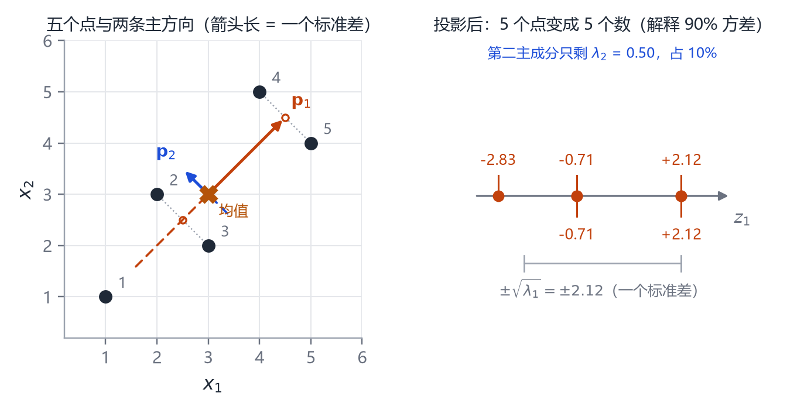
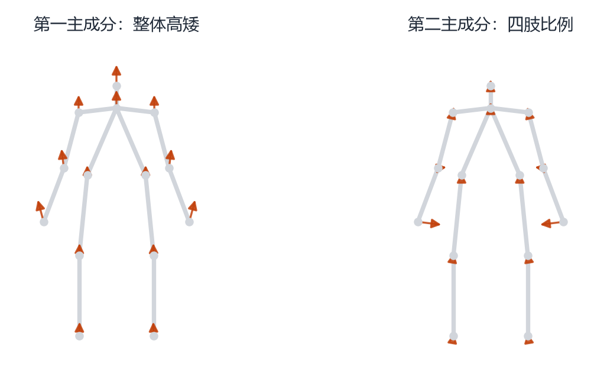
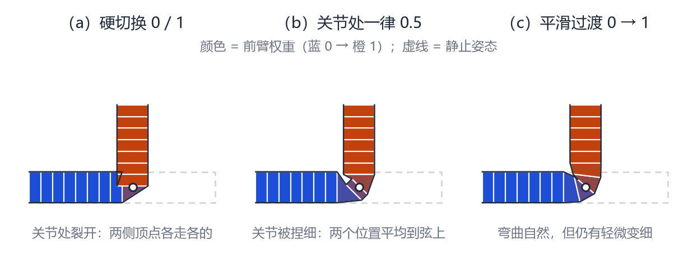
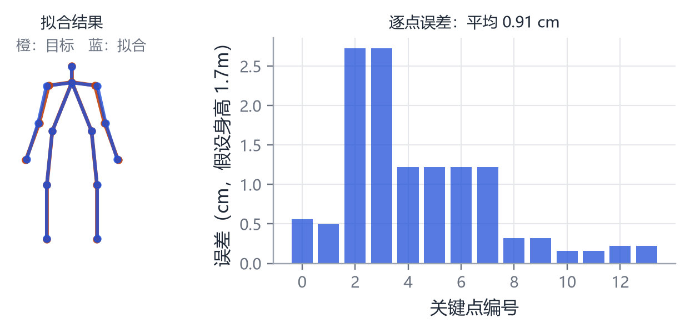

# 第 7 章 动手实践：从 PCA 到拟合

> **本章导读**：这一章把第 2 章的 PCA、第 5 章的 LBS、第 1 章的最小二乘变成四段能跑起来的代码。我们刻意不依赖 SMPL 模型文件（它需要申请许可），而是用 5 个点、14 个关键点搭出“迷你形状空间”，把每一步的中间结果打印出来。读完你应该能自己改参数、加约束、换数据，并且能判断“我算对了没有”。

## 7.1 环境与自检

这一节要解决的问题是：怎么确认机器上的环境能跑本章的代码。结论是三行命令加对照一次输出，两分钟就能确认。

只需要三个包：

```bash
python -m pip install numpy matplotlib scipy
```

本章使用的 Python 是 3.12。代码不依赖 GPU，也不依赖任何深度学习框架——第 7.7 节之前的全部实验，只用 numpy 与 scipy（画图另用 matplotlib）就能跑完。

装完之后先做一次自检，不要等到跑实验时才发现问题：

```python
import numpy as np, scipy, matplotlib
print(np.__version__, scipy.__version__)
X = np.array([[1., 1.], [2., 3.], [3., 2.], [4., 5.], [5., 4.]])
w = np.linalg.eigvalsh(np.cov(X.T))
print(np.round(w, 3))
```

**应该看到什么。** 第一行是两个版本号；第二行是 `[0.5 4.5]`。这里的 `0.5` 与 `4.5` 就是 7.2 节要手算的那两个特征值。数字对得上，说明 numpy、LAPACK、`np.cov` 全部正常；对不上，后面所有数字都不必信。

代码都在本册的 `code/ch07/` 目录下：

| 文件 | 作用 | 输出 |
|---|---|---|
| `demo.py` | 迷你人体的形状空间与拟合 | 图 7-2、图 7-4 |
| `fig_pca_five.py` | 五个点的 PCA | 图 7-1 |
| `fig_lbs_weights.py` | 三种蒙皮权重 | 图 7-3 |
| `lab_checks.py` | 把本章所有“应该看到”的数字打印一遍 | 终端输出 |

在 `code/ch07/` 下执行 `python lab_checks.py`，它会依次打印本章四组数字。**建议一边读一边跑，看到自己的输出和我写的一样，再往下走。**

一条常见的报错信息要提前说：`UserWarning: Glyph ... missing from font(s)`。这表示 matplotlib 找不到中文字体，图里的中文会变成方块。解决办法是在画图前指定字体，例如 `plt.rcParams["font.sans-serif"] = ["Microsoft YaHei", "SimHei"]`；本册的图都走 `books/code/figstyle.py` 里的统一设置，已经处理过这个问题。

所以，环境这一步的判据不是“装完了”，而是“`[0.5 4.5]` 打印出来了”。

## 7.2 实验一：五个点，手算一遍 PCA

这一节要解决的问题是：PCA 到底在算什么，能不能用纸笔验证。结论是能，五个点就够，而且每一步都只有加法和一个 $2\times2$ 的特征分解。

### 7.2.1 数据

这一小节要解决的问题是：第一个实验用什么数据。结论是五个二维点，小到能用纸笔算完。

五个二维点（这是示意，不是真实测量）：

| 编号 | 1 | 2 | 3 | 4 | 5 |
|---|---|---|---|---|---|
| $x_1$ | 1 | 2 | 3 | 4 | 5 |
| $x_2$ | 1 | 3 | 2 | 5 | 4 |

把它们看成五个人身上的“两个测量值”，或者五个形状的“两个坐标”。目标是：找出一个方向，让这五个点投影上去之后分得最开。

### 7.2.2 五个步骤

**第一步，算均值。** $\bar{\mathbf{x}}=(3,3)$。这一步给出“数据中心在哪”。

**第二步，中心化。** 每个点减去均值：

$$
(1,1)\to(-2,-2),\quad (2,3)\to(-1,0),\quad (3,2)\to(0,-1),\quad (4,5)\to(1,2),\quad (5,4)\to(2,1).
$$

**第三步，算协方差矩阵。** 协方差衡量“两个坐标是不是一起变”：

$$
\mathbf{C}=\frac{1}{n-1}\sum_{i=1}^{n}(\mathbf{x}_i-\bar{\mathbf{x}})(\mathbf{x}_i-\bar{\mathbf{x}})^\top .
\tag{7.1}
$$

式 (7.1) 的输入是中心化之后的样本，输出是一个 $2\times2$ 的对称矩阵。读法：对角线是每个坐标自己的方差，非对角线是两个坐标的协方差。手算 $C_{11}$（$x_1$ 的方差）：$((-2)^2+(-1)^2+0+1^2+2^2)/4=10/4=2.5$。$C_{22}$ 同理是 $2.5$。$C_{12}=((-2)(-2)+(-1)(0)+0+1\times2+2\times1)/4=(4+0+0+2+2)/4=2$。所以

$$
\mathbf{C}=\begin{bmatrix}2.5 & 2.0\\ 2.0 & 2.5\end{bmatrix}.
$$

**第四步，特征分解。** 因为两个对角元相等，这个矩阵的特征值特别好算：$\lambda=2.5\pm2$，即 $4.5$ 和 $0.5$。对应的单位特征向量是 $(0.707,0.707)$ 与 $(-0.707,0.707)$——也就是 $45^\circ$ 和 $135^\circ$ 两个方向。解释的方差比是 $4.5/5=90\%$ 与 $0.5/5=10\%$。

**第五步，投影。** 每个点在第一主成分上的坐标是

$$
z_i=\mathbf{p}_1^\top(\mathbf{x}_i-\bar{\mathbf{x}}).
\tag{7.2}
$$

式 (7.2) 的输入是一个点，输出是一个数。读法：把“这个点相对均值的位置”投到主方向上，长度就是 $z$。代入五个点：$(-2,-2)\cdot(0.707,0.707)=-2.83$，$(-1,0)\to-0.71$，$(0,-1)\to-0.71$，$(1,2)\to2.12$，$(2,1)\to2.12$。

于是五个二维点变成了五个数：$[-2.83,\ -0.71,\ -0.71,\ 2.12,\ 2.12]$。这就是“降维”的全部内容。

<figure class="fig">

<figcaption><b>图 7-1</b>　五个点的 PCA。左：黑点是数据，金色叉是均值，橙色箭头是第一主成分 $\mathbf{p}_1$（长 $2.12=\sqrt{\lambda_1}$），蓝色是第二主成分；空心圆是各点在 $\mathbf{p}_1$ 上的投影。右：投影之后的一维坐标，五个点变成五个数，第一主成分解释了 $90\%$ 的方差。第 2、3 号点投影到同一位置（$-0.71$），第 4、5 号点也重合（$+2.12$）——这正是只保留一维时丢掉的信息。</figcaption>
</figure>

### 7.2.3 代码与“应该看到什么”

这一小节要解决的问题是：把上面五步写成代码，并判断结果对不对。结论是八行 numpy，输出必须和手算逐位一致。

```python
import numpy as np

X = np.array([[1., 1.], [2., 3.], [3., 2.], [4., 5.], [5., 4.]])
mu = X.mean(0)                      # (3, 3)
Xc = X - mu                         # 中心化
C = Xc.T @ Xc / (len(X) - 1)        # 式 (7.1)
w, V = np.linalg.eigh(C)            # 对称矩阵用 eigh，结果是升序
idx = np.argsort(w)[::-1]           # 改成降序
w, V = w[idx], V[:, idx]
z = Xc @ V[:, 0]                    # 式 (7.2)：所有点一起投影
print(w, 100 * w / w.sum())         # [4.5 0.5] [90. 10.]
print(np.round(z, 2))               # [-2.83 -0.71 -0.71  2.12  2.12]
```

八行，跑出来必须和手算一致：特征值 `[4.5 0.5]`、方差比 `[90. 10.]`、坐标 `[-2.83 -0.71 -0.71 2.12 2.12]`。

再补一步验证：只用第一主成分重建，看看丢了什么。

```python
rec = mu + np.outer(z, V[:, 0])
print(np.round(rec, 2))                       # 重建的五个点
print(np.round(np.linalg.norm(X - rec, axis=1), 3))   # 逐点误差
```

`lab_checks.py` 打印的结果是：重建后的点变成 $(1,1)$、$(2.5,2.5)$、$(2.5,2.5)$、$(4.5,4.5)$、$(4.5,4.5)$；逐点误差是 `[0, 0.707, 0.707, 0.707, 0.707]`。**1 号点本来就在 $y=x$ 这条线上，误差为 0；其余四个点被拉到了这条线上，各偏 0.707。** 这就是 90% 的含义：一维保留了大部分结构，代价是把四个点“压”到了对角线上。

### 7.2.4 三个常见错误

这一小节要解决的问题是：这一步最常在哪三处写错。结论是中心化、分母、按列取这三件事。

- **忘了中心化。** 如果直接对 `X.T @ X` 做特征分解，第一主成分会指向“数据中心离原点最远的方向”，而不是“点云最长的方向”。本节的五个点重心在 $(3,3)$，不中心化时第一主成分会偏向这个偏移方向，方差比也会算错。
- **分母用了 $n$ 而不是 $n-1$。** 用 `np.cov` 或除以 $n-1$ 是样本协方差；除以 $n$ 是总体协方差。本节的数字（$2.5$、$4.5$）是按 $n-1=4$ 算的，换成 $n=5$ 会得到 $3.6$ 和 $0.4$，看起来“也对”，但对不上书里的数。
- **把 `V` 的行和列搞反。** `np.linalg.eigh` 返回的 `V` 里，**每一列**是一个特征向量。写成 `V[0]` 取到的是第一行（两个不同主成分的第一个分量），投影结果会完全错乱。

所以，PCA 的门槛不在公式，而在“中心化、$n-1$、按列取”这三个习惯上。养成之后，任何维度都是同一套流程。

## 7.3 实验二：14 个关键点的迷你人体

这一节要解决的问题是：五个点的例子太抽象，能不能做一个人形、让主成分“看得见”。结论是能，14 个关键点、7 个参数就够。

### 7.3.1 造一个人

这一小节要解决的问题是：怎么用几十行代码造一批“合理的人”。结论是 7 个参数加 14 个关键点，采样 400 次就够做 PCA。

取 14 个关键点：头、颈、双肩、双肘、双腕、双髋、双膝、双踝。它们的位置由一个 7 维参数决定：身高、肩宽、髋宽、臂长、腿长、手臂张开角、腿张开角。

```python
def body(p):
    h, sw, hw, al, ll, pa, pl = p
    head = np.array([0.5, 0.90 * h])
    neck = np.array([0.5, 0.80 * h])
    sh_l = np.array([0.5 - sw / 2, 0.78 * h])
    sh_r = np.array([0.5 + sw / 2, 0.78 * h])
    # 关节按“角度 + 长度”逐级往下生成，肘、腕、膝、踝同理
    ...
    return np.array([head, neck, sh_l, sh_r, el_l, el_r, wr_l, wr_r,
                     hip_l, hip_r, kn_l, kn_r, an_l, an_r])
```

把每个人展平成 $14\times2=28$ 维的向量，采样 400 个人（参数在基准值上乘一个 $1\pm6\%$ 的随机扰动），做 PCA。先按 7.2.3 的步骤包一个小函数：

```python
def pca(X, k=3):
    mu = X.mean(0)
    w, V = np.linalg.eigh((X - mu).T @ (X - mu) / (len(X) - 1))
    idx = np.argsort(w)[::-1]
    return mu, V[:, idx][:, :k], w[idx][:k]
```

然后用它：

```python
X = np.array([body(BASE * (1 + RNG.normal(0, 0.06, 7))).ravel() for _ in range(400)])
mu, P, w = pca(X, 3)                        # 均值、前 3 个主成分、前 3 个特征值
print(np.round(100 * w / w.sum(), 1))       # [62.5 19.8  9. ]
```

### 7.3.2 把主成分画出来

这一小节要解决的问题是：28 维的主成分怎么让人看懂。结论是把它还原成 14 个位移箭头，画在均值骨架上。

主成分本身是 28 维向量，但它有一个好处：可以还原成 14 个位移箭头。把 $\pm2\sqrt{\lambda_k}\mathbf{p}_k$ 按点拆成 14 个二维位移，画在均值骨架上，就得到图 7-2。

<figure class="fig">

<figcaption><b>图 7-2</b>　从 400 个随机样本里学出的主成分。灰色是均值骨架，橙色箭头是关键点在 $+2\sigma$ 时的位移。左：整体高矮——所有点一起向上，只有幅度不同；右：四肢比例——末端向外，越靠末端幅度越大。箭头长度都放大了，否则看不清。</figcaption>
</figure>

读这张图要注意两件事：

- **箭头是“一起动”的。** 第一主成分不是“每个人随机上下”，而是一个所有 14 个点协同的位移场；这正是“主成分 = 一个形变模式”的含义。
- **符号是任意的。** 特征向量乘 $-1$ 还是同一个主成分，所以“第一主成分是变高还是变矮”取决于代码里怎么定符号。工程上常约定“让某个关键点的某个分量为正”，本册的图就是这么统一过来的。

### 7.3.3 读方差比

这一小节要解决的问题是：方差比这一列数字该怎么读。结论是它直接告诉你该保留几个参数，以及哪几个参数其实是同一件事。

`lab_checks.py` 打印的方差比是：

```text
前 6 个方差比: [62.5 19.8  9.   5.1  3.   0.5]
前 3 个累计: 91.3
```

四个数字值得读一遍：

- **第一主成分 62.5%**：这个“人”的变化里，最大的一块是整体高矮——因为身高 $h$ 同时缩放所有纵向坐标，影响面最大；
- **第二主成分 19.8%**：四肢比例（臂长、腿长同时变），影响的是末端；
- **第三主成分 9.0%**：肩宽与髋宽的组合；
- **前三个累计 91.3%**：7 个参数生成的 28 维数据，用 3 个主成分就能解释九成。

第四、第五个还剩 5.1% 和 3.0%，第六个只有 0.5%。这说明：**7 个独立参数并没有变成 7 个主成分**，因为其中几个参数的作用几乎线性相关（比如身高和腿长都拉长纵向坐标）。PCA 自动把它们合并了——这正是 PCA 在形状建模里的价值：**它不只是压缩，还会告诉你哪些参数其实是同一件事。**

> **你可以改的地方**：把扰动标准差从 0.06 改成 0.15，看主成分是否还是“高矮”；把样本数从 400 改成 20，看基向量是否变得杂乱（样本太少时，PCA 会把个别样本的特点当成“主成分”）。

所以，方差比不是装饰性的数字：它直接告诉你“这个模型该保留几个参数”。

## 7.4 实验三：二十行以内实现 LBS

这一节要解决的问题是：LBS 那个“四个矩阵相乘再加权”的公式，代码到底长什么样。结论是二维版本不到二十行，而且能手算核对。

### 7.4.1 公式与代码

这一小节要解决的问题是：第 5 章的 LBS 公式落到二维代码里长什么样。结论是十二行，核心只有“减中心—旋转—加中心”。

二维、两根骨头（上臂、前臂）的 LBS 是：

$$
\mathbf{p}'=\sum_{k=1}^{2}w_k\Big(\mathbf{R}_k(\mathbf{p}-\mathbf{c}_k)+\mathbf{c}_k\Big),
\qquad \sum_k w_k=1 .
\tag{7.3}
$$

式 (7.3) 的输入是一个顶点 $\mathbf{p}$、两根骨头的旋转角、两个关节位置 $\mathbf{c}_k$、两个权重 $w_k$；输出是变形后的位置。读法：括号里是“绕关节 $k$ 旋转”这个动作（先减关节位置进入局部坐标，转，再加回来），外面乘权重再相加。对比第 5 章的式 (5.3)，二维版本只是把 $4\times4$ 的齐次矩阵换成了“减中心—旋转—加中心”。

```python
import numpy as np

def rot2(a):
    c, s = np.cos(a), np.sin(a)
    return np.array([[c, -s], [s, c]])

def lbs(points, weights, angles, pivots):
    """points: (N,2) 静止顶点；weights: (N,2) 两根骨头的权重，行和为 1；
       angles: 两个旋转角；pivots: 两个关节位置。"""
    out = np.zeros_like(points)
    for k in range(2):
        moved = (points - pivots[k]) @ rot2(angles[k]).T + pivots[k]
        out += weights[:, k:k + 1] * moved
    return out
```

十二行。三维版本只是把 `rot2` 换成 $3\times3$ 的旋转、把关节位置换成三维，其余一字不改。

### 7.4.2 手算核对

这一小节要解决的问题是：代码算出来的数对不对。结论是用第 5 章的例子手算一遍，两边要一致到小数点后三位。

用第 5 章的数值：肘在 $(0.55,0.30)$，顶点在 $(0.91,0.37)$，受上臂权重 $0.3$、前臂权重 $0.7$，肘弯 $90^\circ$。

- 只随前臂（绕肘转 $90^\circ$）：$(0.91,0.37)-(0.55,0.30)=(0.36,0.07)$，转 $90^\circ$ 变成 $(-0.07,0.36)$，加回肘位置得 $(0.48,0.66)$；
- 混合：$0.3\times(0.91,0.37)+0.7\times(0.48,0.66)=(0.609,0.573)$。

`lab_checks.py` 打印的结果是 `只随前臂: [0.48 0.66]`、`混合结果: [0.609 0.573]`，到肘的距离从 $0.367$ 缩短到 $0.279$，**掉了 23.8%**。

这个 23.8% 就是第 5 章说的“捏细”（pinching）：两个刚体位置的线性平均一定落在它们的连线上，而连线穿过关节内侧。

### 7.4.3 三种权重，三种结果

这一小节要解决的问题是：权重怎么取才不会做出一个坏关节。结论是硬切换会裂、均匀 0.5 会捏细、平滑过渡才自然。

权重沿肢体怎么分布，决定了弯曲处好不好看。把一条带状网格（上臂 0.05–0.55，前臂 0.55–0.95）的前臂权重换成三种方案：

- **硬切换 0/1**：关节两侧完全分开，弯曲处出现一条缝；
- **关节处一律 0.5**：过渡带上所有顶点都用一半一半，弯曲处被捏成尖角；
- **平滑过渡**：权重从 0 连续升到 1，弯曲处形成圆弧。

<figure class="fig">

<figcaption><b>图 7-3</b>　同一根“手臂”，三种权重，肘弯 $90^\circ$。颜色表示前臂权重（蓝 0 → 橙 1），虚线是静止姿态。左：硬切换，关节处裂开；中：只在关节处取 0.5，被捏细；右：平滑过渡，弯曲自然。实测带状面积相对静止分别变化 $0\%$、$-1.6\%$、$-0.9\%$——平坦的弯曲处即使权重平滑，也会损失一点面积。</figcaption>
</figure>

三种方案的面积变化是：硬切换 $0\%$（每块都是刚体，面积不变，但中间有缝）、关节处 0.5 是 $-1.6\%$、平滑过渡是 $-0.9\%$。这个结果有一个反直觉的地方：**硬切换的面积“最准”，但它最难看**——因为面积守恒不代表形状合理。

### 7.4.4 三个常见错误

这一小节要解决的问题是：LBS 写错时有哪些典型症状。结论是权重没归一、忘了减关节、矩阵方向这三处最常错。

- **权重和不为 1。** 如果把权重写成 0.6/0.6，静止姿势下顶点会被放大到 $1.2$ 倍（以世界原点为中心）。第 5 章算过这个例子：整个模型会“脖子没动、手脚变长”。
- **忘了减关节位置。** 直接写 `points @ R.T`，等于绕原点旋转，顶点会飞到屏幕外。判断方法：静止姿势（角度全 0）下输出必须等于输入，这一步不对，后面全错。
- **权重矩阵的方向。** `weights` 是 $(N,2)$（每个顶点一行），不是 $(2,N)$。写反了要么报维度错误，要么算出一堆零。

一个可靠的调试顺序是：先把所有角度设成 0，看输出是否等于输入；再把权重设成 0/1，看每段是否刚性移动；最后才放开混合权重。**每加一层复杂度，都要有一个“应该看到什么”的判据。**

所以，LBS 的代码短得不像话，问题几乎全部来自“坐标系没搞清”和“权重没归一”。

## 7.5 实验四：用 2D 关键点拟合形状参数

这一节要解决的问题是：给一组观测到的关键点，怎么反推它在形状空间里的坐标。结论是解一个带边界的最小二乘，四行代码就够。

### 7.5.1 目标函数

这一小节要解决的问题是：“拟合”这个动作怎么写成公式。结论是一个带 $\pm3\sigma$ 边界的平方误差最小化。

已知均值 $\boldsymbol{\mu}$、主成分 $\mathbf{P}$、特征值 $\mathbf{w}$，观测到目标关键点 $\mathbf{t}$（展平成 28 维）。要找系数 $\mathbf{z}$，使得重建出来的点最接近 $\mathbf{t}$：

$$
\mathbf{z}^{*}=\arg\min_{\mathbf{z}}\ \big\|\,\boldsymbol{\mu}+\mathbf{P}\mathbf{z}-\mathbf{t}\,\big\|^2
\quad \text{s.t.}\quad -3\sqrt{\lambda_i}\le z_i\le 3\sqrt{\lambda_i}.
\tag{7.4}
$$

式 (7.4) 的输入是目标点、均值、主成分与特征值；输出是一组系数。读法：括号里是“重建值减观测值”，平方和是逐点误差；约束是每个系数不许超过三个标准差。**如果没有这个约束，问题会退化成“用 4 个参数硬拟合 28 个数”，解出来的系数可能大得离谱。**

```python
from scipy.optimize import least_squares

def fit(target, mu, P, w):
    def resid(z):
        return mu + P @ z - target.ravel()
    sol = least_squares(resid, np.zeros(P.shape[1]),
                        bounds=(-3 * np.sqrt(w), 3 * np.sqrt(w)))
    return sol.x
```

因为 $\mathbf{P}$ 的列正交，如果**不加**边界约束，这个问题有闭式解 $\mathbf{z}=\mathbf{P}^\top(\mathbf{t}-\boldsymbol{\mu})$，一次矩阵乘法就完事。加了边界之后才需要迭代——这也是“约束让问题变难”的一个具体例子。

### 7.5.2 应该看到什么

这一小节要解决的问题是：拟合跑完，怎么判断结果合理。结论是看系数是否落在 $3\sigma$ 内、平均误差是否在一厘米量级。

用 300 个人（与 `demo.py` 的拟合脚本一致）训练出 4 维形状空间，然后造一个“目标人”（身高 $+8\%$、肩宽 $-10\%$），把它丢给 `fit`：

```text
解出的系数 z: [-0.189 -0.059  0.016  0.001]  允许范围 ±3σ: [0.498 0.296 0.205 0.14 ]
逐点误差 (cm, 身高按 1.7 m): [0.56 0.5  2.73 2.73 1.22 1.22 1.22 1.22 0.32 0.32 0.16 0.16 0.22 0.22]
平均误差: 0.91 cm，最大 2.73 cm（第 3 号点）
```

三个观察：

- **系数都远小于 $3\sigma$**：说明目标人落在模型覆盖的范围内，不需要靠裁剪硬撑；
- **平均误差 0.91 厘米**（按身高 1.7 米折算）：这个量级已经接近“关键点标注本身的差异”（人工标点的重复性通常在几毫米量级），也就是说，再拟合得更准，意义也不大了；
- **误差集中在第 3、4 号点（双肩）**，各 2.73 厘米，而脚踝只有 0.2 厘米。

<figure class="fig">

<figcaption><b>图 7-4</b>　拟合结果。左：蓝色拟合与橙色目标几乎重合，只有肩膀处能看出一丝偏差；右：逐点误差，双肩（3、4 号）最大，约 $2.7$ cm，肘腕（5–8 号）约 $1.2$ cm，脚踝最小。</figcaption>
</figure>

肩膀误差最大不是 bug。第 2 到第 4 号点同时受“肩宽”和“身高”影响，而这两个参数在数据里高度相关（高的人往往肩宽也大）。两个参数可以互相补偿出同一个肩膀位置，于是拟合在“宽而矮”和“窄而高”之间摇摆——**这就是病态性（ill-conditioning），不是代码写错了。**

### 7.5.3 加一点正则

这一小节要解决的问题是：拟合太“激进”时怎么压住。结论是往残差里加一项系数惩罚，用一点偏差换稳定。

如果想让系数更保守，可以在残差里加一项：

```python
def resid(z):
    return np.concatenate([mu + P @ z - target.ravel(), 0.1 * z])
```

`0.1` 是权重：越大越“不愿意动参数”，拟合会更平滑但偏差更大。这就是第 1 章讲的岭回归，用在这里的效果是：肩膀的误差会略增，但系数的绝对值会变小，模型更“像平均人”。

所以，拟合的难点从来不是“会不会写最小二乘”，而是“误差集中在哪、为什么集中在那里”。

## 7.6 一张对照表：每步应该看到什么

这一节要解决的问题是：跑完代码怎么判断“我做对了”。结论是每一步都有一个可核对的数字或现象，对不上就先停在那一步。

| 步骤 | 应该看到 | 对不上时先查 |
|---|---|---|
| 环境自检 | `[0.5 4.5]` | 是否用了 `np.cov`（默认 $n-1$） |
| 五点 PCA | 特征值 `[4.5 0.5]`，方差比 `[90. 10.]` | 是否中心化；`V` 是否按列取 |
| 五点投影 | `z = [-2.83 -0.71 -0.71 2.12 2.12]` | 投影用的是 $\mathbf{X}_c$ 而不是 $\mathbf{X}$ |
| 五点重建 | 误差 `[0, .707, .707, .707, .707]` | 重建是否加回了均值 |
| 迷你人体方差比 | 前三个约 $62\%$、$20\%$、$9\%$，累计 $91\%$ | 采样标准差、样本数是否改过 |
| LBS 静止姿势 | 输出 $=$ 输入 | 是否忘了减关节位置 |
| LBS 混合 | $(0.609,0.573)$ | 权重是否行和为 1 |
| LBS 弯曲 | 弯曲处变细，不是裂开也不是尖角 | 权重是否硬切换 |
| 拟合 | 平均误差 $<1$ cm，双肩最大 | 边界是否为 $\pm3\sqrt{\lambda}$ |

常见的报错与原因：

| 报错 | 原因 |
|---|---|
| `ModuleNotFoundError: No module named 'figstyle'` | 没把 `books/code` 加进 `sys.path` |
| `ValueError: matmul: ... core dimension` | 矩阵乘法的内维不匹配；通常是把 $(N,2)$ 当成 $(2,N)$ |
| `LinAlgError: Singular matrix` | 协方差不可逆（样本数小于维数，或重复点） |
| 中文变方块 + `Glyph missing` | 字体没设对 |
| 图能存但全是空白 | `plt.show()` 前就 `savefig`，或数据全在坐标范围外 |

所以，“能跑”不等于“跑对”；把对照表里的数字逐行对一遍，才算真的完成了一个实验。

## 7.7 换成真实的 SMPL

这一节要解决的问题是：迷你模型和真实模型的差距到底在哪。结论是只在维度：流程、公式、代码结构完全一样。

真实 SMPL 的使用流程与上面完全一样，只是把“14 个关键点”换成“6890 个顶点”，把“7 个参数”换成“10 + 72 个参数”：

| | 迷你模型 | SMPL |
|---|---|---|
| 形状参数 | 7 个 | 10 个（$\beta$） |
| 姿态参数 | 2 个角度 | 72 个（根 3 + 23 个关节 × 3） |
| 顶点数 | 14 个点 | 6890 个 |
| 形状基 | PCA 得到 | 从几千个扫描学得 |
| 蒙皮 | 两根骨头 | 24 根骨头 |

### 7.7.1 获取模型

这一小节要解决的问题是：真实模型从哪来、压缩包里有什么。结论是要注册许可，文件里的五样东西正对应五个概念。

SMPL、SMPL-H、SMPL-X、MANO、FLAME、SMAL 都需要在各自官网注册并同意许可协议，不能随意分发。官方入口：

- SMPL：`smpl.is.tue.mpg.de`
- SMPL-X：`smpl-x.is.tue.mpg.de`
- MANO：`mano.is.tue.mpg.de`
- FLAME：`flame.is.tue.mpg.de`
- SMAL：`smal.is.tue.mpg.de`

下载后会得到 `.pkl` 或 `.npz` 文件，里面包含模板顶点、形状基、姿势基、关节回归器、蒙皮权重。这五样对应下面五件事，读文件时可以逐个对：

- 模板顶点 $\mathbf{\bar{T}}$：均值形状（对应本章的 `mu`）；
- 形状基 $\mathcal{S}$：PCA 主成分（对应 `P`）；
- 姿势基 $\mathcal{P}$：姿势矫正的基（本章的迷你模型没有这一项）；
- 关节回归器 $\mathcal{J}$：从顶点算关节位置（本章里关节是直接给定的）；
- 蒙皮权重 $\mathcal{W}$：每个顶点对每根骨头的权重（对应本章的 `weights`）。

### 7.7.2 用 smplx 库加载

这一小节要解决的问题是：把模型读进内存，并确认读对了。结论是参数维度对上、全零输出等于模板，就说明加载正确。

```python
import smplx, torch

model = smplx.create("models/", model_type="smplx", gender="neutral",
                     use_pca=False, batch_size=1)
out = model(betas=torch.zeros(1, 10),
            expression=torch.zeros(1, 10),
            body_pose=torch.zeros(1, 63),
            global_orient=torch.zeros(1, 3),
            left_hand_pose=torch.zeros(1, 45),
            right_hand_pose=torch.zeros(1, 45))
verts = out.vertices          # (1, 10475, 3)
joints = out.joints           # (1, 54, 3)
```

注意几个坑：

- `body_pose` 是 63 维（21 个关节 × 3），**不含**根关节；
- `global_orient` 单独给（3 维）；
- 手部姿态默认可用 PCA 空间，`use_pca=False` 时是 45 维轴角（每只手 15 个关节 × 3）；
- 坐标系是 $y$ 向上、面朝 $+z$，渲染前先确认，否则模型会“躺着”或“倒着”。

一个快速的健康检查：全部参数给 0 时，输出的顶点应该就是模板顶点（只差一个 T-pose 的姿态矫正）；如果差很多，多半是把参数维度弄错了。

### 7.7.3 一个最小的渲染

这一小节要解决的问题是：怎么最快看一眼模型长什么样。结论是用 matplotlib 画三角面，慢但足够做检查。

不想装 PyTorch3D 的话，可以用 matplotlib 的三角面：

```python
import matplotlib.pyplot as plt
from mpl_toolkits.mplot3d.art3d import Poly3DCollection

V = verts[0].detach().numpy()
F = model.faces
ax = plt.figure(figsize=(6, 8)).add_subplot(projection="3d")
ax.add_collection3d(Poly3DCollection(V[F], alpha=0.3, facecolor="tan"))
ax.set_xlim(V[:, 0].min(), V[:, 0].max())
ax.set_ylim(V[:, 2].min(), V[:, 2].max())
ax.set_zlim(V[:, 1].min(), V[:, 1].max())
ax.view_init(elev=10, azim=-60)
```

这段代码很慢（6890 个顶点、一万多个三角面，全部交给 matplotlib 的软件渲染），只适合检查模型是否加载正确。要做实时渲染，用 PyTorch3D、nvdiffrast 或 Blender。

所以，“从迷你模型到 SMPL”不是一次跳跃，而是同一个循环里把四个数字变大：顶点数、参数个数、骨头数量、样本数。

## 7.8 三个可以立刻做的练习

这一节要解决的问题是：读完怎么巩固。结论是三个改动，每个都在十行代码以内。

**练习一：把 LBS 改成三维。** 把 `rot2` 换成 `scipy.spatial.transform.Rotation`，把关节位置换成三维，观察弯曲 90° 时体积如何变化（用蒙皮后的四面体体积估算）。提示：三维里“捏细”之外还会出现“糖纸效应”，需要用扭转而不是弯曲才能复现。

**练习二：给拟合加正则。** 在 `resid` 里加上 `0.1 * z`，把权重从 $0.01$ 试到 $10$，画出“系数模长”与“平均误差”两条曲线。你会看到一条典型的掎中曲线：正则太强时误差上得快，太弱时系数大得不合理。

**练习三：加一个关节限位。** 给每个角度加 `bounds`，比如肘部只能向一个方向弯（$\theta\in[0,\pi/2]$），观察拟合结果是否更合理。再试试把限位去掉，看拟合会不会把肘“反折”。

一个进阶的方向：把 7.2 的五个点换成“一只手的五个指尖”，看第一主成分是否还是“张开程度”。如果主成分变成了“整体平移”，说明你忘了中心化。

所以，真正的掌握不是读懂公式，而是能预测“改掉这一行，输出会怎么变”。

## 本章小结

- 本章四个实验只依赖 numpy 与 scipy，跑完一共只要几秒。
- PCA 的三个习惯：中心化、除以 $n-1$、特征向量按列取；五个点的例子就能验证全部三个。
- 主成分可以还原成位移箭头画出来，符号任意、幅度要乘 $\sqrt{\lambda}$。
- LBS 的二维版本只有十几行；三种权重对应撕裂、捏细、自然三种结果，面积变化并不能说明好坏。
- 拟合 = 带 $\pm3\sigma$ 边界的最小二乘；误差集中在哪，就说明哪里是病态的。
- 真实 SMPL 的流程与迷你模型相同，差别只在维度与许可。

## 思考题

1. 把 `least_squares` 的初值从 0 改成 $3\sigma$，结果会变吗？先猜，再跑。
2. 如果在 LBS 里把权重之和改成 1.2，模型会发生什么？用式 (7.3) 推导一遍。
3. 为什么真实 SMPL 的 `body_pose` 是 63 维而不是 72 维？
4. 在五点例子里，若把五个点绕原点旋转 $45^\circ$，特征值与方差比会变吗？主方向会变吗？
5. 你能设计一个“只看轮廓、不看关键点”的拟合损失吗？它的病态性会比关键点版本更好还是更差？

