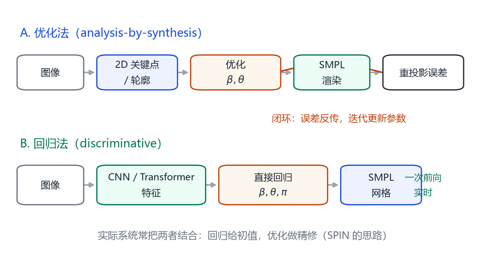
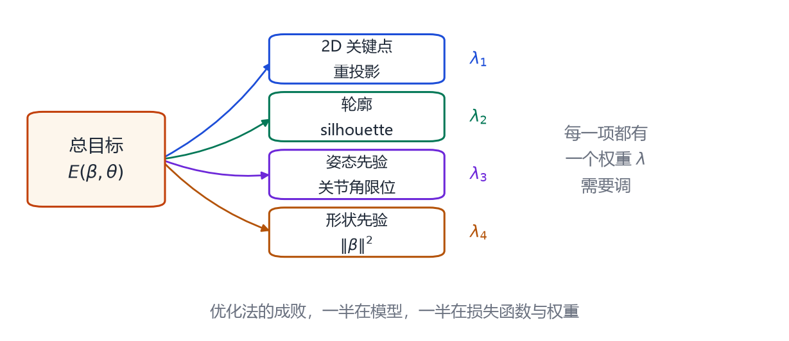
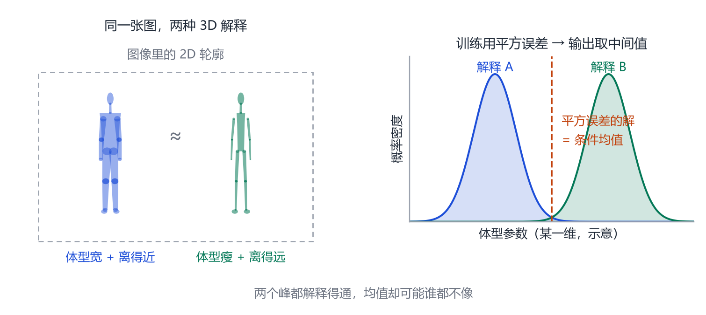
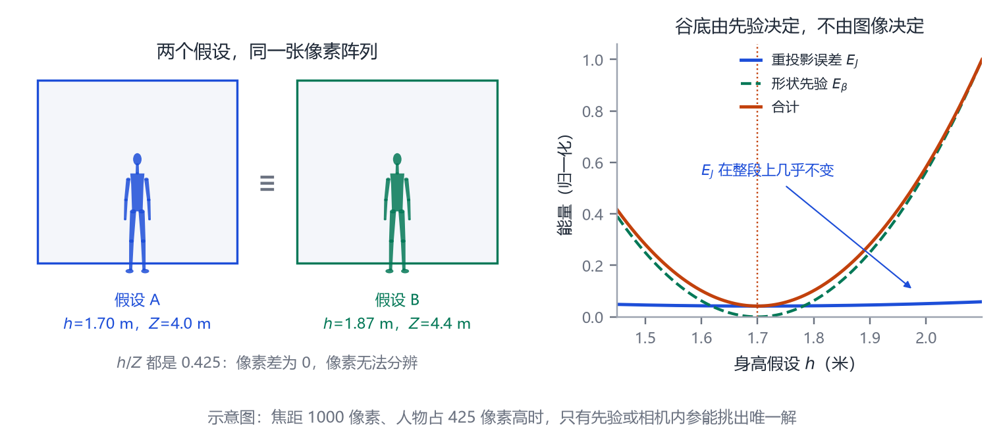

# 第 1 章 从单张图片反推人体：优化法与回归法

> **本章导读**：模型有了，参数也有了，剩下的问题是：给我一张照片，怎么求出 $\boldsymbol{\beta}$ 和 $\boldsymbol{\theta}$？两条路线——优化法与回归法——以及它们如何结合，构成本章的主干。你会看到 SMPLify、HMR、SPIN、GraphCMR 这些名字背后的具体机制，也会明白为什么单图重建至今仍然容易在遮挡、尺度、奇怪姿势上翻车。

## 1.1 任务定义：输入、输出与评价

这一节要把“给我一张照片，估出人”这句话写成可以检查的输入、输出和评分口径。结论是：系统的输出从来不是一个网格，而是“一组参数 + 一个相机假设”；评价也因此分成关节、网格、尺度三层，混着比就会得出错误结论。

先把输入说清楚。最典型的输入是一张 **RGB 图像**，比如 $1920\times1080$（约 200 万像素），加上一个 2D 关键点检测器的输出。检测器给的点数取决于它的训练集：MPII 风格是 14 个，COCO 风格是 17 个，OpenPose 的 BODY_25 是 25 个。点数和 SMPL 的 24 个关节并不一一对应，所以任何系统内部都有一张“关键点名字 → SMPL 关节编号”的映射表；这张表写错了，误差会以“左右手互换”“膝盖对到脚踝”这种荒谬形式出现，而不是简单地变大。

输出是一组参数：

- 形状 $\boldsymbol{\beta}\in\mathbb{R}^{10}$：10 个 PCA 系数，**单位是标准差**，不是米；
- 姿态 $\boldsymbol{\theta}\in\mathbb{R}^{72}$：24 个关节各 3 个轴角，其中根节点的 3 个是全局朝向；
- 相机 $\boldsymbol{\pi}$：弱透视下是缩放 $s$ 与平移 $\mathbf{t}$ 共 4 个自由度；透视下是焦距 $f$ 加旋转平移共 7 个；
- 可选：表情、手指、衣服位移、纹理与光照。

从这 82 个数可以派生出一大堆量：6890 个顶点的网格、24 个关节的三维坐标、骨骼长度、身高、胸围、体积。**派生量越多，越容易在论文里“挑好看的那个报”。** 所以先明确一件事：参数量本身没有物理意义，能比较的是它派生出来的几何。

为什么输出参数而不是直接输出顶点？顶点是 $6890\times3=20670$ 个数，参数只有 82 个。参数空间自带三条硬保证：拓扑固定、骨骼长度一致、能直接喂给动画管线。代价是表达力受限——10 维体型覆盖不到所有真实身材差异，这一点在 1.8 节会作为失败模式单独列出来。

评价标准（第 3 章细讲，这里只点名）：关节用 MPJPE 与 PA-MPJPE（单位毫米），网格用 PVE，像素用 PCK，尺度用“估计身高与真实身高之差除以真实身高”的百分比，速度用 FPS。这五个数常常互相矛盾，原因在后面。

### 1.1.1 输入里已经藏了一半误差

检测器的输出不是“观测”，而是“另一个模型的预测”。在受控的室内数据集上，2D 关键点误差可以做到 5 像素以内；换到网络图片，同一个检测器的误差能到 15 像素，而且是**系统性**的——它会把被遮挡的关节放在“看起来合理”的位置，而不是留空。

这一点决定了后面两条路线的性格。优化法把关键点当成观测，检测器错了它就跟着错；回归法把关键点当成训练信号，检测器的偏差被平均进网络权重里，表现为“某种固定的坏习惯”。要判断一个方案靠不靠谱，先问它用的是谁的 2D 关键点。

### 1.1.2 相机假设决定了误差的量级

同一个 3D 人体，用透视投影和用弱透视投影拍下来，像素坐标不一样。透视投影写成

$$
u=f\,\frac{X}{Z}+c_u,\qquad v=f\,\frac{Y}{Z}+c_v,
\tag{1.1}
$$

$(X,Y,Z)$ 是相机坐标下的三维点，$f$ 是焦距（单位：像素），$(c_u,c_v)$ 是主点。$f/Z$ 就是“一米的物体在图像上占多少像素”。举个数：$f=1000$ 像素、人站 $Z=4$ 米处，身高 1.70 米的人占 $1.70\times1000/4=425$ 像素；走近到 2 米，变成 850 像素。

弱透视把它简化成

$$
\hat u=sX+t_u,\qquad \hat v=sY+t_v,
\tag{1.2}
$$

$s$ 是一个统一的缩放，**不再随 $Z$ 变化**。人在画面里占 425 像素高、深度从 4 米到 5 米，透视下前后端的高度会差 25%；弱透视下完全一样。当人体在画面里只占三四百像素、深度变化不大时，这个误差可以接受；当人贴近镜头、或者画面里同时有近处和远处两个人时，弱透视会把两个人放到错误的深度上。

所以：**相机假设不是实现细节，它决定了你后续所有几何误差的量级**。看到论文只写“we use a weak-perspective camera”而不讨论适用距离，就要知道它的精度上限被这句话锁死了。

## 1.2 路线 A：优化法

优化法要解决的问题是“只有 2D 观测，怎么反解 3D 参数”。它的答案是：把正问题（参数 → 渲染 → 像素）写出来，然后反复调整参数让渲染结果逼近图像。这条路线的优点是每一步都能解释，缺点是慢、并对初值和权重敏感。

<figure class="fig">

<figcaption><b>图 1-1</b>　两条路线。优化法先用 2D 关键点/轮廓构造误差，再反复“渲染—比较—更新”；回归法用网络一次前向输出参数。实际系统常把两者结合。</figcaption>
</figure>

### 1.2.1 SMPLify：第一个能用的单图系统

2016 年，Bogo 等人的 **SMPLify** 是第一个把 SMPL 用到单张自然图像上的系统 [@bogo2016smplify]。输入是 2D 关节点（当时的 DeepCut 检测器给 14 个点），输出是 $\boldsymbol{\beta}$、$\boldsymbol{\theta}$ 和弱透视相机。目标函数是四项之和：

$$
E(\boldsymbol{\beta},\boldsymbol{\theta})=
\lambda_{J}E_{J}+\lambda_{\beta}E_{\beta}+\lambda_{\theta}E_{\theta}+\lambda_{S}E_{S}.
\tag{1.3}
$$

四项各管一件事，读法如下。

- $E_{J}$：3D 关节投影到 2D 后，与检测到的 2D 关节的距离。它管“投影要对得上”。
- $E_{\beta}$：形状参数的平方和。它管“体型别乱跑”。
- $E_{\theta}$：姿态先验，用 8 个高斯组成的混合模型（Gaussian Mixture Model，GMM）在约 100 万个动作捕捉姿态上学习。它管“姿势要像人”。
- $E_{S}$：自相交惩罚。它管“手别插进身体”。

SMPLify 还做了一个很实用、后来被普遍继承的设计：**按性别选模型**。男女的体型分布不同，用对应的模型可以消掉很大一块歧义——否则一个中等身材的女性会被拉向“两性平均”的形状。

优化用 OpenDR 提供的可微渲染 [@loper2014opendr] 配合拟牛顿法（L-BFGS）。整个流程在 GPU 上要几十秒到几分钟。慢，但精度不错，而且**每一项误差都能单独打印出来看**，这在调试时非常值钱。

只用 14 个关键点带来一个结构性后果：**有些自由度根本没有观测**。前臂的扭转、手腕的朝向、脚掌的内外翻，都不会明显改变这 14 个点的位置。这些自由度最后完全由先验决定，也就是“由训练集里最常见的姿势决定”。这就是为什么 SMPLify 的结果看起来“姿势对、细节僵”。

### 1.2.2 一次拟合的误差预算

把误差拆开看，比记一个总 MPJPE 有用得多。设定一个具体场景（**以下数字是示意，用来展示量级，不是某篇论文的实测值**）：1080p 图像，人全身占 700 像素高，真实身高 1.70 米，于是比例尺是 $700/1.70\approx412$ 像素每米。

按这个比例尺换算：

- 2D 关键点定位误差 8 像素 $\approx$ 地面上 1.9 厘米。前臂长 26 厘米、在图上约 107 像素，8 像素的端点误差对应约 4.3° 的肘部角度误差；
- 深度错估 10%（4 米当成 4.4 米），要维持同样的 425 像素高度，身高就得“变成” 1.87 米——**17 厘米的体型误差，全由深度歧义贡献**；
- 体型 PCA 只保留 10 维，真实身材里“肩宽而腰细”这类组合可能落在子空间之外，剩余量级在 1–2 厘米；
- 姿态先验把罕见姿势往常见姿势拉，在瑜伽、攀岩这类动作上能造成 2–6 厘米的关节偏移；
- 优化停在一个局部极小，同一张图换初值能差 1–5 厘米。

把这五项按平方和相加（假设彼此独立），得到 15–25 厘米量级的整体误差；而论文里报告的 PA-MPJPE 常常是 50–80 毫米。两者的差距来自最后一步：**PA 对齐会把“尺度”和“整体摆放”这两项误差整个吸收掉**（第 3 章会用一组具体数字演示这件事）。所以看到 50 毫米不要以为系统能精确到 5 厘米——它只是“形状对得上”，位置和大小都被对齐吃掉了。

### 1.2.3 轮廓项：比关键点多一千倍的信息

只靠十几个关键点，有些东西永远定不下来——身体的宽窄、腹部的凸起、大腿的粗细。这些量对关节位置影响很小，对“像不像这个人”影响很大。轮廓项就是为这件事加的。

做法是按当前参数渲染一张**剪影**（silhouette，把网格投到图像平面、填成实心区域），再与图像分割得到的**人体掩码**（mask）比较，误差取两者的交并比或者边界距离。为了让梯度能传回去，通常先把掩码转成**距离变换**：每个像素存“离最近的边界有多远”，于是“渲染的边界落在掩码内部多深”就变成了一个连续、可导的量。

量级上的差别很直观（示意）：一个 700 像素高的人，在掩码里大约覆盖 10 万个像素，边界周长约 1200 像素；14 个关键点只提供 28 个坐标。信息量差了三四个数量级。这就是为什么加上轮廓项之后，体型（尤其是四肢粗细）会明显变准。

它的边界也很清楚。分割网络在暗背景、宽松衣服、多人重叠时会出错；轮廓项对“厚度”不敏感——正面拍的人，前后方向的厚度完全看不见；穿长裙的人，掩码是裙子的形状，硬拟合会把腿做粗。所以轮廓项一般与关键点项按 1:1 到 1:5 的比例混用，而不是单独用。

所以：轮廓项补的是“整体形状”，关键点项补的是“关节位置”，两者不能互相替代；加轮廓之前要先有一个可靠的分割，否则等于把分割的错误直接写进体型。

### 1.2.4 优化法的优缺点

**优点**：可解释（每一项误差都有物理含义）；不需要训练数据（有模型和检测器就能跑）；容易加约束（关节限位、地面接触、物理可行性都能写成惩罚项，这一条在视频与手物交互里很关键）。

**缺点**：慢且对初值敏感；权重 $\lambda$ 难调，换数据集就要重调；2D 关键点错了会“将错就错”；单图的深度歧义没有消失，优化只是在一个平坦的解空间里挑了一个“看起来合理”的点。

<figure class="fig">

<figcaption><b>图 1-2</b>　SMPLify 类方法的损失构成。关键点、轮廓、姿态先验、形状先验各自带一个权重；调参的本质，是在“相信图像”与“相信先验”之间找平衡。</figcaption>
</figure>

所以：优化法把“人体长什么样”的知识完全写在目标函数里，因此每一步都能查；代价是它把“求解”变成了一门调参手艺。

## 1.3 路线 B：回归法

回归法要解决的问题是“优化太慢”。它的答案是：把‘图像 → 参数’这件事直接学成一个函数，一次前向出结果。这条路线的优点是快、鲁棒，缺点是把歧义藏进了网络权重，出问题时不容易定位。

2018 年，Kanazawa 等人的 **HMR**（End-to-end Recovery of Human Shape and Pose）[@kanazawa2018hmr] 是这个范式的起点。网络结构很简洁：

1. 用 ResNet-50 提取图像特征（2048 维）；
2. 接一个迭代回归器，输出 $\boldsymbol{\beta}$、$\boldsymbol{\theta}$、相机 $\boldsymbol{\pi}$；
3. 用可微渲染把模型投影回图像，计算 2D 关键点损失。

训练时没有 3D 真值怎么办？HMR 用了两个技巧。**弱监督**：只有 2D 关键点标注时，用重投影损失，让投影落在标注点上。**对抗先验**：训练一组判别器，区分“真实的 SMPL 参数”和“网络预测的参数”，迫使预测落在合理的姿态分布内。

HMR 的意义在于：**它把人体重建变成了一个标准的“图像 → 参数”回归问题**，可以端到端训练，速度达到实时。之后的绝大多数方法都沿用了这个范式。

一个容易被忽略的工程细节：HMR 回归的旋转不是 3 个轴角，而是 6 个数（旋转矩阵前两列拉平）。轴角在 0 与 $2\pi$ 处是同一个旋转，网络在这里会被迫拟合一个不连续的映射；6 维表示是连续的，代价只是多 3 个输出通道。2024 年的 HMR 2.0 [@shin2024hmr2] 把骨干换成 ViT、把训练数据扩到约 100 万张从视频里自动标注的图像，鲁棒性（尤其遮挡与截断）比第一代提升明显——但底层范式没变。

### 1.3.1 SPIN：把优化器放进训练循环

HMR 的弱点是对罕见姿势不敏感：训练集里没见过的姿势，网络只能输出“附近那个见过的东西”。**SPIN**（Kolotouros 等，2019）[@kolotouros2019spin] 的想法很巧妙：既然优化法在单张图上更准，就把优化器放进训练循环。

具体做法是四步循环：

1. 网络先预测一组参数；
2. 用 SMPLify 以这组参数为初值，针对当前图像做优化；
3. 把优化后的参数当作“伪真值”，监督网络；
4. 同时用判别器保证参数合理性。

这样网络在训练时就“见过”优化器如何修正自己，推理时即使不做优化，也能接近优化后的结果。SPIN 是“回归 + 优化”结合的典范，也解释了一件事：**优化的价值不一定体现在推理阶段，它可以被蒸馏进网络**。

它的边界也要说清：优化器自己的偏差（比如把罕见姿势拉回常见姿势）会一起被学进去。论文里那些“网络输出了优化器才有的错误”的案例，根源就在这里。

### 1.3.2 GraphCMR：不回归参数，直接回归顶点

**GraphCMR**（Kolotouros 等，2019）[@kolotouros2019graphcmr] 走了另一条路：不预测 $\boldsymbol{\beta},\boldsymbol{\theta}$，而是用图卷积直接在网格顶点之间传消息，输出 6890 个顶点的坐标。

好处是：不受参数空间的线性限制，能表达体型子空间之外的形变。坏处有三个：输出维度高（20670 个数）；需要很强的网格先验才不会出现“顶点飞出去”；骨骼长度不再自动一致——参数化模型里长度由 $\boldsymbol{\beta}$ 统一决定，直接回归顶点则可能一条腿长一条腿短。

后来的方法大多又回到参数化输出。原因不是顶点不好，而是**参数空间把“这是个人”这件事写进了结构里**。同一时期还有直接回归位移图的路线（如 I2L-MeshNet [@moon2020i2lmeshnet]），思路类似：用图像特征逐顶点回归三维位置。它们的共同问题是“对网格拓扑的依赖强”，换模型（比如从 SMPL 换到 SMPL-X）就要重训。

### 1.3.3 迭代回归与特征对齐

一步回归的精度有上限：网络只能做一次映射，误差无法自己修正。**PyMAF**（Pavlakos 等，2021）[@pavlakos2021pymaf] 的做法是把“对齐”变成网络内部的循环：每一轮把当前预测的网格投影回图像，在投影位置采样特征，再根据特征修正参数，并把“网格轮廓与图像轮廓的偏差”当作显式的监督信号。

这实质上是把 1.2 节的“渲染—比较—更新”搬进了网络，只是更新规则由网络学，而不是由 L-BFGS 算。它带来两个好处：回归误差可以自我修正；轮廓信息被用上了（关键点只有十几个，轮廓有上千个像素）。代价是推理要跑几轮，速度比一步回归慢一倍以上。

所以：回归法的进化史可以概括为“从一次映射，到可微的迭代”；每一次改进都在把优化法的某一部分搬进网络，而网络化之后的速度优势仍然保留。

### 1.3.4 两阶段流程里，前一级的误差会放大

绝大多数回归法并不是真的“端到端”：前面还有一个人体检测器给框，框被裁成固定尺寸再送进网络。这个接口会产生一类很隐蔽的误差。

网络拿到的输入是“裁剪后缩放到 $224\times224$ 的块”，它无法区分“这个人很矮”与“这个人离得近”。为了把这个歧义解开，网络会把**框在图像里占多大**当成尺度线索学进去：框大、人多半近。于是框的稳定性直接决定了身高估计的稳定性。

举个示意例子：真实身高 1.70 米的人，检测框应该 700 像素高。检测器漏掉了头顶 14 像素（长发、帽子、低分辨率），框变成 686 像素；网络按“框高与身高成比例”的统计规律推断，输出身高 1.66 米——**2% 的框误差变成 2% 的尺度误差**。这 4 厘米在 PA-MPJPE 里完全看不见（被对齐吸收了），在“量身高”的业务里却是硬伤。

更麻烦的是遮挡：人被桌子挡住下半身时，检测框会收缩到可见部分，网络会把这个收缩也当成线索，于是体型被系统性预测得偏瘦。这类偏差不会随模型变大而自动消失，反而会被更强的模型“更自信地学到”。

所以：评估回归法时，要把“检测框的质量”当成系统的一部分来报告；只换检测器不换网络，结果也可能变差 10%，而这件事在论文表格里看不到。

## 1.4 两条路线的融合

现实系统要解决的问题是“既要快又要准”。答案不是二选一，而是分工：回归给初值，优化做精修，时序模型做平滑。

典型组合有三种。

**回归 + 精修**：先用 HMR 类网络出一组参数，再拿它当初值跑 20–50 次优化。因为初值已经接近，优化不会掉进远处的局部极小，速度也比从零姿态起步快一个量级。

**回归 + 特化头**：FrankMocap [@rong2021frankmocap] 把身体、手、脸分成三个模块各自回归，再用优化把手腕对齐到身体的手臂末端。模块化让每个子问题可以独立改进，代价是接口处的误差会累积（手腕的 2 厘米错位，会让整只手看起来“脱臼”）。

**回归 + 时序**：视频里先逐帧回归，再用时序模型平滑并补全（第 2 章）。这是 2023 年之后工程上最主流的形态。

融合也有代价：系统变得难调，误差来源难以归因。一个 15 厘米的误差，可能来自检测器、网络、优化器、平滑器中的任何一个。所以工业系统通常会保留“每一级的中间输出”，出问题时逐级对比。

## 1.5 为什么单图重建仍然难

这一节要回答一个看似矛盾的现象：论文指标年年降，实际用起来还是经常崩。结论是：指标降的是“平均样本”，而崩的是“长尾样本”，两者的分布几乎不重叠。

**深度与尺度**。单目图像缺少绝对尺度。模型可以输出“看起来 1.7 米”的人，但没有相机内参或场景参照，真实身高无法确定。把人和相机同时放大 $k$ 倍，投影像素一个都不变——这个对称性无法从单张图内部打破。CameraHMR [@cho2024camerahmr]、NLF [@dwivedi2024nlfs] 这类工作专门解决它（第 2 章）。

**遮挡与截断**。下半身被桌子挡住时，网络只能猜。猜出来的腿可能长度不对、朝向不对；更麻烦的是它猜得很自信——输出的置信度不会因为“看不见”而降低。

**罕见姿势**。瑜伽、攀岩、舞蹈，训练集里少，先验会把这些姿势“拉回”常见分布。表现是“姿势大体对、关节角度明显不对”，比如手臂抬到 170° 被拉成 150°。

**衣服与物体**。SMPL 是裸体模型，穿裙子的人会被拟合成“紧身裤”；手拿包、拄拐杖，会让关键点检测器把包带当成手臂。

**评估偏差**。很多论文在 3DPW 上报告 MPJPE，但 3DPW 的 3D 真值本身来自优化拟合，存在“用同类方法评估同类方法”的循环（第 3 章）。

还有一个不常被写进论文的困难：**图像本身的信息量不够**。一张 400 像素高的人，全身可用的像素约 16 万个，要确定 82 个参数，平均每个参数不到 2000 像素的信息；而人体的某些自由度（前臂扭转）几乎不改变任何像素。信息不够时，任何方法都只能靠先验，而先验就是“平均值”。

## 1.6 优化法复盘：把式 (1.3) 拆到原子级

这一节要把目标函数拆成可以直接写成代码的形式，看清每一项在什么情况下说话。结论是：四项不是并列的，而是有明确的“接管顺序”——证据强时数据项主导，证据弱时先验接管。

**（1）关键点项。** 它衡量“模型关节投影到图像上，离检测到的 2D 点多远”：

$$
E_{J}=\sum_{i}w_i\,\rho\Big(\big\|\Pi_{\mathbf K}\big(R_{\boldsymbol\theta}(\mathbf J(\boldsymbol\beta))_i\big)-\mathbf j_i\big\|\Big).
\tag{1.4}
$$

$i$ 遍历 2D 关键点，$\mathbf j_i\in\mathbb{R}^{2}$ 是像素坐标，$\mathbf J(\boldsymbol\beta)$ 是 3D 关节，$R_{\boldsymbol\theta}$ 摆好姿态，$\Pi_{\mathbf K}$ 投影；$w_i$ 是置信度，被遮挡的关节它就该少听。

$\rho$ 是鲁棒函数（SMPLify 用 Geman–McClure，$\rho(e)=e^{2}/(e^{2}+\sigma^{2})\in[0,1)$）：一个错了的关键点会有几百像素误差，平方会把它放大成天文数字，$\rho$ 让大误差饱和，等于**放弃这个点**；$\sigma$ 是“多大偏差算离谱”的分界，取 100 像素左右意味着“偏了一百像素以上就别管它了”。

**（2）形状项。** $E_{\beta}=\|\boldsymbol\beta\|^{2}$ 不是“让体型变小”，而是“让体型靠近 $\mathbf 0$”——零向量正是平均人；各维已按主成分方差缩放过，平方和就近似“标准高斯下的负对数概率”。**证据不足时，是它在决定腿有多长。**

**（3）姿态项。** 一块是数据先验：8 个高斯拟合约 100 万个姿态（来自多个动作捕捉数据集，经 MoSh [@loper2014mosh] 拟合成 SMPL 参数），取负对数：

$$
E_{\theta}=-\log\sum_{j=1}^{8}g_j\,\mathcal N(\boldsymbol\theta;\boldsymbol\mu_j,\boldsymbol\Sigma_j)
\approx\min_{j}\big(-\log c\,g_j\,\mathcal N(\boldsymbol\theta;\boldsymbol\mu_j,\boldsymbol\Sigma_j)\big).
\tag{1.5}
$$

用最小值近似“求和”是为了可微、算得快，代价是交界处梯度不连续。另一块是解剖约束 $E_a=\sum_i\exp(\theta_i)$，只对膝、肘的**反向**弯曲求和：反关节物理上不可能，要用指数函数压死（式 (1.3) 把它并进了 $E_{\theta}$，原论文其实是五项）。

**（4）自相交项。** SMPLify 用 20 个胶囊（不含手指脚趾）近似身体，再退化成沿轴的一串球，对“不该相交”的球对用高斯乘积的积分近似重叠体积。它只是**惩罚**不是**禁止**：权重小了照样穿模；优化体型时必须关掉，否则优化器会把人体压瘦来躲开。

分工也就清楚了：证据强时 $E_J$ 主导；关节被遮挡时 $E_{\theta}$ 与 $E_a$ 接管，输出“合理但可能不对”；只拍到半身时 $E_{\beta}$ 决定腿脚，腿被猜成平均值；左右手搞反时两者互相拉扯。量级也要匹配：$\rho$ 有界，$E_J$ 最多贡献“关键点个数”量级，而 $\|\boldsymbol\beta\|^{2}$ 无界增长——**$\lambda$ 要按残差量级调**，不能照抄别人的数值。

### 1.6.1 一次迭代到底在算什么

```text
输入：图像 I，2D 关键点 {(j_i, w_i)}，初值 (β, θ)，性别对应的模型
重复：
  1. 前向：T_P ← 模板 + 形状 + 表情 + 姿态校正；J ← J(β)；V ← LBS
  2. 投影：p_i ← Pi_K( R_θ(J)_i )        # 3D 关节 → 像素
  3. 能量：E ← λ_J·E_J + λ_β·E_β + λ_θ·E_θ + λ_S·E_S
  4. 反传：g ← dE/d(β, θ)                # 自动微分
  5. 更新：(β, θ) ← (β, θ) - α·inv(H)·g   # 拟牛顿（L-BFGS）一步
  6. 判断：|ΔE|/E < 1e-4 或 ||g|| < 1e-3 或达最大迭代数 → 停
输出：(β, θ) 与相机参数
```

第 1、2 步算“模型长什么样”，第 3 步打分，第 4—6 步改参数并判停。**收敛**不能只看能量：$\min$ 近似与自相交项会造出能量平台，参数还在漂，所以同时看参数变化量与梯度范数。**迭代次数**取决于初值：回归给初值时几十次够用，从零姿态起步要多得多；单次优化还会掉进局部极小，常见做法是几组初值各跑一次——这就是“优化法慢”的原因。

### 1.6.2 为什么“换数据集就要重调权重”

权重的作用是把不同量纲的误差换算到同一个尺度上。$E_J$ 的单位是像素，$E_\beta$ 是无量纲的平方和，$E_S$ 近似体积。要让它们可比，就得各自乘上一个“把典型残差归一化”的系数。

问题在于典型残差随场景变：同一套权重，用在 700 像素高的人身上合适，用在 200 像素高的远景人身上就过强——因为像素误差变小了 3.5 倍，而 $E_\beta$ 的尺度没变，优化器就会更多地相信“平均体型”。所以正确的做法是按人数、按比例尺重新归一化，而不是照抄论文里的 8 个数字。

## 1.7 回归法的病根：歧义与“平均人”

这一节要回答“为什么网络会输出一个谁都不像的人”。结论是：平方误差的最优解是条件均值，而“平均的体型”往往不在人体流形上。

优化法把歧义写在明面上，回归法把歧义藏进网络权重里。歧义本身没有消失，只是换了个地方发作。

**（1）尺度与深度可以互相抵消。** 回到式 (1.2)：$s=f/Z$ 是缩放，$\mathbf t$ 是平移。把体型放大 $k$ 倍、同时把人推远 $k$ 倍：$s$ 变成 $s/k$，而 $s\cdot kX=sX$——**投影一个像素都没变**。所以“体型 × 深度”有一整族解；真实世界靠地面接触与透视收敛打破它，裁好的一张图里这些线索往往都不在。

**（2）平方误差的解是“平均”，不是“某个人”。** 设两个解 $\boldsymbol\beta_1,\boldsymbol\beta_2$ 都能解释同一张图，用平方误差训练时网络的最优输出不是其中任何一个，而是**条件均值**：

$$
\boldsymbol\beta^{*}=\arg\min_{\hat{\boldsymbol\beta}}\mathbb E\big[\|\hat{\boldsymbol\beta}-\boldsymbol\beta\|^{2}\,\big|\,\mathbf I\big]=\mathbb E\big[\boldsymbol\beta\,\big|\,\mathbf I\big],
\tag{1.6}
$$

两解等概率时就是两者中点。体型参数不是一条直线：两个“都像人”的体型取平均，可能得到“谁都不像”的体型（比如一个很胖和一个很瘦的人取平均，得到的是“瘦胖子”——四肢细、躯干厚）。训练集里越罕见的人（很胖、很瘦、儿童）越容易被拉向均值——这就是“塌成平均人”。

**（3）判别器补的正是这块。** HMR 训练了一组判别器判断“这组参数是不是真人的参数”：形状一个（10 维），每个关节的旋转各一个（$3\times3$ 矩阵拉平），再加一个看整体姿态。分成许多小判别器不是炫技：输入维度低，网络就能很小、训练也稳定；而“每个关节一个判别器”在语义上等价于**从数据里学出每个关节的角度限位**。

它与重投影损失互补：前者管“像不像人”，后者管“投影对不对”。HMR 的消融很说明问题——既不用 3D 监督、又去掉判别器时，网络输出“怪物”：2D 误差很小，体型姿势却都不像人。两种失败是镜像的：**先验太强 → 塌成平均人；先验太弱 → 怪物**。

SMPLify-X 后来把高斯混合换成变分自编码器（VPoser，第 5 章细讲），因为它更会抓高维姿态流形——思路没变：**给歧义配一个从数据里学来的偏好。**

<figure class="fig">

<figcaption><b>图 1-3</b>　歧义如何变成“平均人”。左：两个 3D 体型投影几乎相同，$E_J$ 分不开；右：平方误差训练的输出落在两峰之间（虚线），那里可能谁都不像。</figcaption>
</figure>

### 1.7.1 多解的几何：一条平坦的谷

把 $E$ 看成“尺度”与“深度”两个变量的函数，会看到一条**平坦的谷**：沿“体型放大 $k$ 倍 + 深度推远 $k$ 倍”的方向，重投影误差几乎不变。这条谷正是式 (1.2) 那个对称性的几何样子。

具体化一下：设真实身高 1.70 米、$Z=4$ 米、$f=1000$ 像素，人在图上 425 像素高。现在把体型放大到 1.87 米、深度推到 4.4 米，投影仍是 $1.87\times1000/4.4=425$ 像素。再放大到 2.04 米、5 米——还是 425 像素。这一族解在 (尺度, 深度) 平面上排成一条从原点出发的射线，误差沿射线方向是常数。

<figure class="fig">

<figcaption><b>图 1-4</b>　尺度—深度歧义。左：同一组关节在三种 (尺度, 深度) 组合下的投影完全重合。右：把 $E_J$ 画成尺度的函数，谷底是一段平台，最优点由先验（虚线）与正则项共同决定，而不是由图像决定。</figcaption>
</figure>

谷底的存在解释了两个日常现象。第一，**加一点点噪声，最优点会沿谷底滑很远**：几像素的检测抖动足以让人从“1.70 米/4 米”跳到“1.90 米/4.5 米”，而重投影误差只差一两个像素。第二，**同一张图两次运行结果差几厘米**，如果两次的初值不同、或者优化器的随机性不同。

打破谷底只有三条路：给出相机内参（把 $s=f/Z$ 里的 $f$ 固定）；给出场景参照（地板、门框）；给出多视角。三者都没有时，任何方法都只是在谷底某个位置停下，而这个位置由先验决定。

所以：回归法的精度上限由“歧义 + 平方损失”共同决定，网络本身再大也绕不过去；能改善的只有两件事——把先验学得更准，把歧义用额外信息（相机、时序、场景）压掉。

### 1.7.2 一个能跑的最小系统

把前面的内容压成一套可以在一周内搭起来的流程，分五步。

**第一步，检测与裁剪。** 用人体现检测器给框，把长宽比固定为 1:1，扩边 1.2 倍，缩放到网络输入尺寸。同时跑一个 2D 关键点检测器，记住每个点的置信度。

**第二步，单帧回归。** 用现成的 HMR 类模型给初值。这一步的输出不需要很准，它只是初值，误差在 10 厘米量级就够用。

**第三步，优化精修。** 以初值起步，跑 20–50 次 L-BFGS；损失用式 (1.3) 的四项，权重按残差量级归一化（见 1.6.2 节）。关键点权重用检测器置信度，被遮挡的点自动降低。

**第四步，物理检查。** 检查三件事：骨骼长度是否偏离模型均值太多、脚是否在地面下方、手是否穿进躯干。三项都可以用现成的几何量算，只需要几行代码。

**第五步，输出与记录。** 除了参数，把中间量（检测框、关键点、优化前后的能量、迭代次数）都存下来。出问题时，这些中间量比最终结果有用一百倍。

这套系统的精度大约在 MPJPE 80–120 毫米、PA-MPJPE 55–70 毫米（示意量级，取决于测试集），比不上大模型的单帧精度，但它能跑、能查、能在任何新场景上快速验证一个想法。

## 1.8 失败模式清单

这一节把前面散落的失败模式整理成可以直接照着查的表。结论是：单图重建的失败几乎总能归到六类，每一类都有对应的“看什么就能发现”。

**表 1-1**　单图重建的六类失败（现象、成因、自查方法）。

| 类别 | 典型现象 | 成因 | 怎么发现 |
|---|---|---|---|
| 遮挡 / 截断 | 腿长明显不对、脚朝向诡异 | 关键点缺失，先验接管 | 把人体检测框裁到只剩上半身再跑一次，看腿是否“自动变标准” |
| 极端姿势 | 手臂抬不到顶、膝盖角度不足 | 先验把罕见姿势拉回分布内 | 挑 AMASS 里最少见的 5% 动作单独测 |
| 多义姿势 | 肘部朝向反了 | 投影近似对称，2D 无区分力 | 从侧面重投影看是否穿模 |
| 尺度 | 身高系统性偏矮或偏高 5–15% | 弱透视 + 深度歧义 | 报“身高相对误差”，而不是只报 PA-MPJPE |
| 衣着 / 配件 | 裙摆消失、背包被当成驼背 | 裸体模型 + 关键点被物体污染 | 用带衣服的子集单独评估 |
| 长尾体型 | 儿童、极胖、极瘦被拉向平均 | 10 维体型子空间 + 条件均值 | 按体型分组报误差，而不是报总平均 |

最后一类最容易被忽略。一个方法的总 MPJPE 是 55 毫米，听起来不错；但如果按体型分组，可能成年人 45 毫米、儿童 110 毫米。产品上线后遇到的第一个投诉，几乎一定来自长尾。

六类失败对应的缓解手段也值得列一下，因为它们决定了你能做到什么程度。

**表 1-2**　六类失败的缓解手段与代价。

| 类别 | 缓解手段 | 代价 |
|---|---|---|
| 遮挡 / 截断 | 训练时随机遮挡（cutout）、用可见性掩码、时序补全 | 遮挡比例大时仍然只能靠先验 |
| 极端姿势 | 在合成数据里造罕见姿势、减弱先验权重 | 减弱先验会让“怪物”出现 |
| 多义姿势 | 用轮廓项、从多视角监督 | 需要分割标注或多视角数据 |
| 尺度 | 估透视相机、用场景参照、给相机内参 | 单图仍无法完全消除 |
| 衣着 / 配件 | 衣服模型（第 4 章）、把配件检测出来排除 | 拓扑受限、系统变复杂 |
| 长尾体型 | 扩大体型训练集、分组建模 | 数据成本高 |

看这张表会发现一个共同结构：**每一种缓解手段都是用“额外信息”换“一类误差”**。额外信息可以是数据（更多体型）、可以是标注（分割、多视角）、可以是先验（人体物理）、也可以是硬件（深度相机）。不可能凭空变准，这也是判断一个方案可信度的根据——如果它宣称全面变好，却没说额外的信息来源，就要打个问号。

## 1.9 判断一个单图方案靠不靠谱

这一节给一份可以直接拿去审论文、审开源代码的清单。结论是：先看它承认了什么假设，再看它在假设被破坏时怎么表现。

按顺序问六个问题。

1. **相机假设是什么？** 弱透视还是透视？如果是弱透视，测试集里人的深度范围有多大？深度超过 5 米、或者画面里有多人时，误差会放大。
2. **2D 关键点从哪来？** 是数据集给的标注，还是自己跑的检测器？后者的域差异会直接进最终误差。
3. **训练集和测试集有没有重叠？** 尤其要看 3DPW 是否被用于训练（很多方法“不小心”用了）。
4. **报的是哪一个指标？** 只有 PA-MPJPE 的数字，不能用来判断“能不能量身高”；只有 PVE，不能判断关节对不对。
5. **有没有失败案例？** 只放成功案例的论文，通常意味着失败率不低。
6. **推理成本多少？** 单帧时间、显存、是否需要 2D 关键点作为输入（这决定了它能不能端到端部署）。

六个问题里有三个答不上来，这个方案就还不能用于产品。

## 本章小结

- 单图重建的输出是 $\boldsymbol{\beta},\boldsymbol{\theta}$ 与相机参数；评价要分关节、网格、尺度三层，混着比会得出错误结论。
- 优化法（SMPLify）用 2D 关键点 + 先验 + 自相交惩罚，准但慢、难调参；它把人体知识全部写在目标函数里，因此可解释。
- 回归法（HMR）用网络直接预测参数，快但依赖训练分布；SPIN 把优化器放进训练循环，把优化的收益蒸馏进网络。
- GraphCMR 直接回归顶点，绕开参数空间，但更难约束；后来又回到参数化输出，因为参数空间把“这是个人”写进了结构。
- 把式 (1.3) 拆开：$E_J$ 用有界的鲁棒函数抗错误关键点，$E_{\beta}$ 把体型拉向平均人，$E_{\theta}$ 是 8 个高斯的姿态先验加反关节惩罚，$E_S$ 用胶囊球惩罚自相交——谁的证据强，谁就说话。
- 一次拟合是“前向 → 投影 → 打分 → 反传 → 更新 → 判停”的循环；解空间里有一条尺度—深度的平坦谷，所以结果对噪声敏感、对初值敏感。
- 回归法的根病是尺度-深度歧义与平方误差的“求平均”，判别器/先验网络把输出拉回人体参数流形：先验太强塌成平均人，太弱则成怪物。

## 思考题

1. 为什么 SMPLify 需要“自相交惩罚”？如果只加关键点项和先验，优化器会输出什么样的网格？
2. HMR 的对抗先验在训练中扮演什么角色？去掉它、同时保留 3D 监督，结果会和“既无 3D 监督又无判别器”有什么不同？
3. SPIN 用优化结果监督网络，会不会把优化器的偏差也学进去？如果会，怎么设计实验验证？
4. 如果给两张同一场景、不同角度的照片，深度歧义能消除吗？需要什么额外条件？
5. 一个方法报告 PA-MPJPE 是 45 毫米，你还需要哪些数字才能判断它能不能用来量身高？
