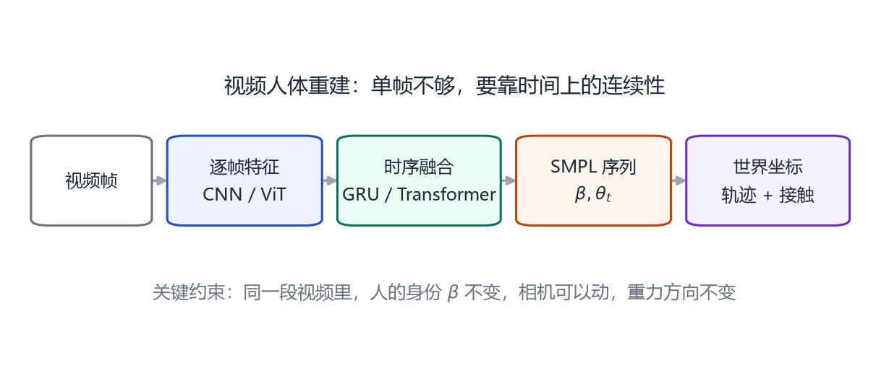
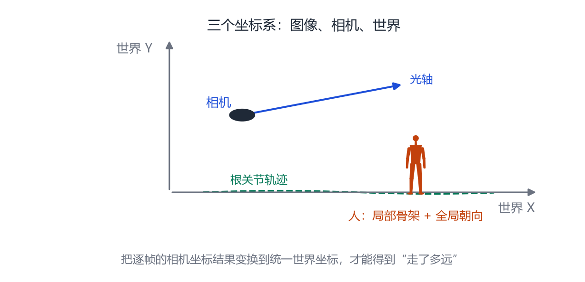
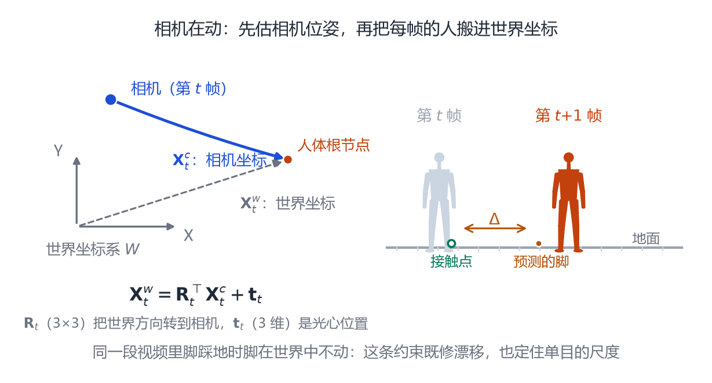
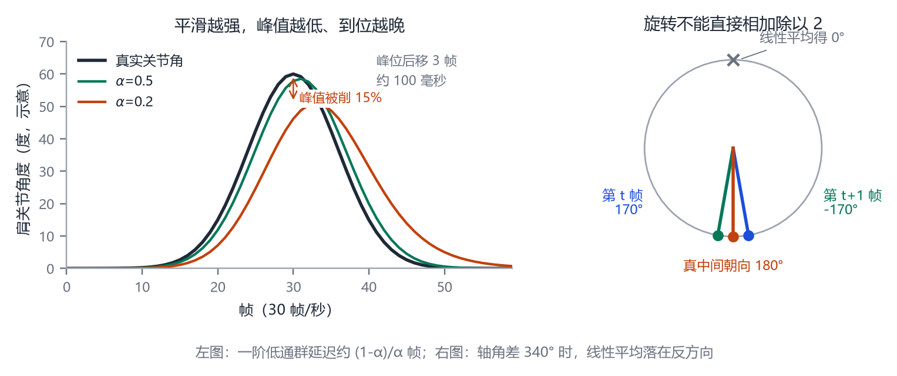

# 第 2 章 视频、多人、全身与度量尺度

> **本章导读**：单张图能猜出一个人，但视频里有时间、有多个人、有相机运动，还有“人到底走了多远”这个问题。这一章按“从帧到序列、从相机到世界、从单人到多人、从相对到度量”四条线，讲清楚人体重建如何从“摆姿势”走向“理解场景”，以及每走一步要多付什么代价。

## 2.1 视频不是“很多张图”

这一节要回答：把第 1 章的方法逐帧跑在视频上，为什么结果不能直接用。结论是：逐帧方法丢掉了三样东西——身份不变、动作连续、相机固定，而这三样恰好是视频相对单图多出来的全部信息。

先把任务写清楚。输入是一段 $T$ 帧的视频（常见 30 帧每秒，10 秒就是 300 帧），输出是每个人在每一帧的 $\boldsymbol{\beta},\boldsymbol{\theta}$，外加**每一帧的相机位姿**，以及（如果要轨迹）人在世界坐标里的根节点位置 $\mathbf{r}_t\in\mathbb{R}^3$。评价标准也随之变多：除了单帧的关节误差，还要看抖动、漂移、脚滑、身份一致性（2.10 节列表）。

逐帧跑会出现三个毛病，而且都不是随机噪声，是有结构的偏差。

**抖动**：相邻帧的参数独立预测，体型、关节角小幅跳动。幅度不大——关节位置每帧差两三毫米——但人眼对高频抖动极其敏感，看起来像“抽搐”。60 帧的视频里这种抖动会形成 5–8 Hz 的视觉噪声，正好落在人眼最敏感的频段。

**身份漂移**：同一个人在不同帧被预测成不同的 $\boldsymbol{\beta}$。$\boldsymbol{\beta}$ 是 10 维，每维差 0.1 个标准差，身高就能差 1 厘米；累积到一秒钟，人会“忽胖忽瘦”。

**深度跳变**：单帧的深度歧义（第 1 章式 (1.2) 的对称性）在每帧独立求解时，会在谷底的不同位置停下，于是人“忽大忽小、忽远忽近”。

<figure class="fig">

<figcaption><b>图 2-1</b>　视频人体重建的典型流程。逐帧提特征，再做时序融合，输出 SMPL 序列，最后变换到世界坐标并估计脚与地面的接触。</figcaption>
</figure>

解决办法只有一句：**把“同一个人”这个假设用起来**。同一个人的形状应该不变，动作应该连续，相机运动应该平滑（或者至少在短时间内是刚体运动）。后面所有方法，本质都是在不同的地方加这三条约束。

### 2.1.1 抖动的量化：加速度误差

要说清“抖不抖”，需要一个数。最常用的是**加速度误差**：把关节位置看成时间序列，求二阶差分，再与真值的二阶差分比较。

$$
\text{Accel}=\frac{1}{T-2}\sum_{t=2}^{T-1}\Big\|(\mathbf p_{t+1}-\mathbf p_t)-(\mathbf p_t-\mathbf p_{t-1})\Big\|_2 .
\tag{2.1}
$$

$\mathbf p_t\in\mathbb{R}^3$ 是第 $t$ 帧某个关节的位置，单位毫米；二阶差分单位是“毫米每帧²”。读法：它衡量“速度变化得多快”，一个匀速直线运动的关节，加速度是 0；一个来回抖动的关节，加速度很大。

这个指标有两个坑，看清了才不会误读论文。第一，**它不关心准不准**：把整个人固定不动，加速度误差是 0，但姿势完全错误。第二，**它依赖帧率**：同样的物理运动，30 帧每秒与 60 帧每秒算出的数值差 4 倍（因为差分了两次）。所以跨论文比较时，先确认帧率和是否降采样。有些论文报的是“毫米每帧²”，有些先除以帧间隔平方变成“毫米每秒²”，两者能差三个数量级。

所以：视频任务的第一步是承认“逐帧独立”这个假设是错的；第二步是把“不变的东西”显式写进模型或后处理，而不是指望网络自己学会。

## 2.2 时序模型：从 GRU 到跟踪

这一节要回答：怎么让网络“看见时间”。结论是：主流做法不是把整个视频塞进一个大模型，而是“逐帧提特征 + 轻量时序融合 + 强单帧模型兜底”三段式。

**VIBE**（Kocabas 等，2020）[@kocabas2020vibe] 是最早把视频时序引入 SMPL 回归的工作之一。结构分三段：CNN 逐帧提特征；GRU 做时序融合，把历史帧的信息压进一个隐状态；回归头输出每帧的 $\boldsymbol{\beta},\boldsymbol{\theta}$ 与弱透视相机。训练时加一个**运动判别器**：它看一段预测出来的参数序列，判断“这段动作像不像真实的动作捕捉”，从而逼网络生成平滑、符合人体动力学的运动。

这个判别器的设计值得说清，因为它是后面所有“运动先验”的雏形。判别器的输入不是像素，而是参数序列；正样本来自 AMASS 的动作捕捉数据 [@mahmood2019amass]，负样本来自网络的预测。它学到的其实是“真实动作在参数空间里的统计规律”——包括速度的范围、关节的联动关系、脚落地时的减速。这比“低通滤波”高明的地方在于：**它知道哪些高频是真实的，哪些是噪声**。

VIBE 的边界也要说清：它输出的相机是**逐帧独立的弱透视参数**，没有跨帧一致性，所以人的世界位置无法从中恢复——它给的是“相机坐标系下的序列”，不是“场景里的轨迹”。

**4D-Humans**（Goel 等，2023）[@goel2023humans4d] 走的是工程路线：先用更强的单帧模型 HMR 2.0 [@shin2024hmr2] 逐帧回归，再用多目标跟踪把不同帧里的“同一个人”串起来，最后接一个学习式的时序平滑器。它的价值在于证明了一件事：**强单帧模型 + 简单跟踪 + 平滑，就能得到可用的结果**，不需要为视频专门设计一个复杂的端到端网络。

这条工程路线之所以有效，原因很朴素：单帧模型的误差主要是随机的（每帧的深度歧义停在不同位置），而随机误差可以被时间上的平均压掉；相比之下，端到端时序模型要同时学“单帧精度”和“时序一致性”，训练更难。HMR 2.0 用约 100 万张从视频里自动标注的图像训练，单帧鲁棒性比第一代高出一个档次，这就把“逐帧”这一环的短板补上了。

### 2.2.1 三种接法

把单帧模型变成视频模型，工程上有三种接法，各有明确的适用场景。

**循环融合**（VIBE 的 GRU）：隐状态携带历史，计算量随帧数线性增长但常数很小；缺点是长视频里早期信息会被逐渐冲淡，且无法并行。

**窗口注意力**（Transformer 类）：取一个固定长度的窗口（比如 16 或 81 帧）一起处理，可以并行、可以看双向；缺点是窗口边界处会出现不连续，需要重叠窗口来抹平。

**逐帧 + 后处理**（4D-Humans 一类）：单帧模型完全不动，只在外面套跟踪和平滑；优点是可以随时换更强的单帧模型，缺点是时序一致性只能靠后处理，遇到长时间遮挡就无法补全。

三种接法的误差特征不同：循环融合平滑但滞后；窗口注意力准但边界跳；后处理简单但补不了缺失。工程上常见的选择是“窗口注意力 + 轻度后处理”。

所以：时序模型的价值不在“多了一个模块”，而在“把身份不变、动作连续这两条先验变成了可训练的信号”；这也解释了为什么去掉运动判别器或时序融合，抖动会立刻回来。

### 2.2.2 跟踪：比看上去难

这一节要回答“为什么逐帧模型很好、结果还是穿”。结论是：跟踪是一个独立的失败源，它的错误会以“身份错乱”的形式放大。

“把同一个人串起来”听起来是个简单的分派问题，实际上的失败率不低。

难点之一是**外观会变**。同一个人在一段视频里可能脱下外套、转过背面、走进阴影；基于外观特征的匹配（颜色直方图、特征向量的余弦距离）在这些时刻很容易断。

难点之二是**交叉与遮挡**。两个人迎面走过，在重叠的几帧里他们的框几乎完全重合；跟踪器如果只看框的位置与外观，很容易把 ID 交换。交换之后，两个人的体型参数会在交换点“跳变”——这就是 2.9 节里“身份互换”那一条。

难点之三是**尺度与距离的漂移**。同一个人在远处只占 80 像素高，在近处占 400 像素；跟踪器如果拿“框的大小”作为相似度的一部分，就会把“走得近”误判成“换了一个人”。

工程上常用的缓解办法有三个：用人体的三维位置而不只是二维框做关联；用姿态特征（而不是外观）做二次校验；以及引入“重识别”（把人当成一个可以跨镜头匹配的实体）。这三个都不能完全解决问题，但能把交换率降一个量级。

所以：跟踪不是“前置处理”，而是系统里一个独立的误差源；验收时要专门拍一段“两人交叉”的视频，看 ID 会不会换。

## 2.3 三个坐标系与一次变换

这一节要解决“人在画面里”与“人在场景里”的翻译问题。结论是：从相机坐标到世界坐标只差一个刚体变换，但这个变换的**尺度**必须由外部信息确定，否则轨迹只能恢复到相差一个倍数。

先分清三个坐标系，这是后面所有公式的地基。

- **图像坐标**：像素 $(u,v)$，原点在左上角。
- **相机坐标** $\mathbf{X}^c$：原点在光心，$z$ 轴沿光轴向前，$x$ 向右，$y$ 向下（也有约定 $y$ 向上的版本，读代码时要先确认）。
- **世界坐标** $\mathbf{X}^w$：原点在场景里某个固定点，$y$ 轴朝上（与重力反向），$x,z$ 在地面内。

<figure class="fig">

<figcaption><b>图 2-2</b>　三个坐标系。图像坐标是像素，相机坐标以光心为原点，世界坐标以重力方向为 $y$ 轴。只有把每帧结果变换到世界坐标，才能得到人的运动轨迹。</figcaption>
</figure>

设第 $t$ 帧相机的朝向是 $\mathbf{R}_t$（$3\times3$ 旋转矩阵，方向是“世界 → 相机”），光心在世界里的位置是 $\mathbf{t}_t$（3 维）。同一个 3 维点两套坐标的关系是

$$
\mathbf{X}^{w}=\mathbf{R}_t^{\top}\mathbf{X}^{c}_t+\mathbf{t}_t .
\tag{2.2}
$$

逐项读：$\mathbf{X}^c_t$ 是点在相机坐标下的位置；左乘 $\mathbf{R}_t^{\top}$ 把它转到世界方向——为什么用转置？因为 $\mathbf{R}_t$ 的方向是“世界 → 相机”，反过来用就得取逆，而旋转矩阵的逆恰好等于转置；最后加 $\mathbf{t}_t$ 把原点从光心挪到世界原点。

式 (2.2) 有一个非常实用的性质：**只要变换根节点，其余关节会自动跟着走**。因为 SMPL 的其余关节都是相对根节点定义的，把根节点放到位、把全局朝向与 $\mathbf{R}_t^{\top}$ 复合，整副骨架就落进世界坐标了。所以实现时不需要对 6890 个顶点各做一次变换。

但式 (2.2) 里的 $\mathbf{t}_t$ 从哪来？单目视觉只能给出**相对**的相机运动：可以算出“走了 0.3 个单位”，无法算出“走了 0.3 米”。这就是尺度歧义，2.5 节专门处理。

所以：坐标系变换本身是初等几何，真正的难点是“变换的参数从哪来”；这也是视频重建从“姿态估计”升级为“场景理解”的分水岭。

### 2.3.1 世界坐标的朝向：重力从哪来

式 (2.2) 里的 $\mathbf{R}_t$ 是“世界 → 相机”的旋转，它的最后一块拼图是“哪个方向算上”。这个方向由重力定义，而重力必须从图像里估出来。

有三条常用的估计途径。**从人体姿态反推**：站立的人，从骨盆到头顶的方向在世界里是竖直的；把所有帧的这条方向平均，就得到重力的反方向。**从脚接触反推**：连续多帧同一只脚踩地时，这只脚在世界里不动，相机却可能在动，两者之差就能解出相机的旋转。**从背景几何反推**：室内场景里的桌面、地板、门框，都是天然的水平/竖直参照。

三者都不完美。人靠着墙、躺在地上、做倒立动作时，第一条失效；人一直在走、从不停下时，第二条没有接触帧可用；野外场景没有规则几何时，第三条没有参照。所以实际系统会把三条按置信度加权，并允许“整段视频用同一个重力方向”——这是一个很强的假设，它等价于“相机没有剧烈翻滚”，对手机竖拍、手持走动都成立，对过山车视频就不成立。

估错的后果很直观：重力偏 5°，人的世界轨迹就会带上 8.7% 的“虚假上坡”（$\sin 5^\circ\approx0.087$），走 100 米看起来爬了 8.7 米。这类错误在指标上只表现为“世界坐标误差变大”，不查具体几何很难定位。

## 2.4 相机运动怎么估：从光流到世界位移

这一节要回答工程问题：$\mathbf{R}_t,\mathbf{t}_t$ 具体怎么算出来。结论是四步流水线，其中“抠掉人”这步最容易被忽略，却决定了轨迹是否可信。

设视频有 $T$ 帧，第 $t$ 帧已经用第 1 章的方法拿到 SMPL 参数，此时关节还都在相机坐标系里。链条有四步。

1. **只让背景参与。** 把每帧里检测到的人抠掉（用人体分割掩码），剩下的像素才是“不动的世界”。不抠人，人一走动就会被当成“相机在后退”——这是一个非常常见的错误，表现是轨迹方向与人的运动方向相反。
2. **逐像素找对应。** 在相邻两帧之间估计光流 [@teed2021raft]，得到一堆像素的位移量；或者直接用现成的单目 SLAM 输出位姿。
3. **解相邻帧的相对位姿。** 用这些对应点解出一个 3 维刚体变换：相机从 $t$ 到 $t+1$ 转了多少、走了多少。数学上是“已知若干 3D-2D 或 2D-2D 对应，求本质矩阵再分解”。
4. **连乘。** 把 $T-1$ 个相对位姿串起来，得到整段视频的相机轨迹。

第 3、4 步有一个必须注意的性质：**误差会累积**。每帧的相对位姿有 0.1% 的误差，300 帧后就是 30% 的漂移（粗略地按随机游走算，实际介于线性与平方根之间）。这就是长视频里“人越走越偏”的来源，也是回环检测（loop closure）在 SLAM 里如此重要的原因。

**尺度问题就藏在这里。** 单目 SLAM 只能把轨迹恢复到相差一个未知倍数：$\mathbf{t}_t=s\tilde{\mathbf{t}}_t$，其中 $\tilde{\mathbf{t}}_t$ 是归一化后的轨迹，$s$ 是一个我们还不知道的正数。人、相机、视频同时放大两倍，投影不变——第 1 章的尺度歧义原封不动地跑到了相机轨迹上。

脚接触能把 $s$ 解出来。设第 $t$ 帧左脚踩在地上、第 $t+1$ 帧还没抬起，这只脚在两帧的世界坐标应相同：

$$
s\tilde{\mathbf{t}}_{t+1}+\mathbf{R}_{t+1}^{\top}\mathbf{x}^{c}_{t+1}
=s\tilde{\mathbf{t}}_{t}+\mathbf{R}_{t}^{\top}\mathbf{x}^{c}_{t} ,
\tag{2.3}
$$

其中 $\mathbf{x}^{c}_t$ 是脚的相机坐标，模型输出直接给。把含 $s$ 的项挪到左边：

$$
s\left(\tilde{\mathbf{t}}_{t+1}-\tilde{\mathbf{t}}_{t}\right)
=\mathbf{R}_{t}^{\top}\mathbf{x}^{c}_{t}-\mathbf{R}_{t+1}^{\top}\mathbf{x}^{c}_{t+1} .
$$

读法很直白：**左边是相机走了多远，右边是脚在画面里退了多少。** 脚踩地不动，画面里的位移就全部来自相机；量出它即可反推相机步长，解出 $s$。式 (2.3) 有 3 个方程、1 个未知数，把多个接触帧叠起来做最小二乘即可。

举个示意数：相机每帧移动 0.02 个单位（归一化尺度），脚在画面里退了相当于 0.03 米的量，那么 $s=1.5$，即一个“单位”等于 1.5 米，相机每帧走 3 厘米，30 帧每秒就是 0.9 米每秒——正常步行速度，数值自洽。

失败模式也要记住：接触检测错了（跑、跳、被推着滑），$s$ 会跳变、轨迹跟着抽；人一直坐着吊着，就没有接触帧，尺度无从恢复；脚在地毯上滑动，接触判为真但实际在动，$s$ 会被系统性低估。所以 WHAM [@shin2024wham]、TRAM [@yuan2024tram]、GVHMR [@shen2023gvh] 都会顺便输出一个**接触概率**，让下游知道哪几帧可信。

<figure class="fig">

<figcaption><b>图 2-3</b>　左：相机坐标与世界坐标的关系，两条向量指向同一个根节点。右：脚接触把误差量出来——第 $t$ 帧的脚踩在接触点上，第 $t+1$ 帧预测的脚却偏了 $\Delta$，把 $\Delta$ 扣回根节点即可修正。</figcaption>
</figure>

### 2.4.1 三个代表性系统各自改了什么

同一套物理约束，三个系统的着力点不同，读懂“它改了什么”比记住名字有用。

**WHAM**（Shin 等，2024）[@shin2024wham]：改的是“根节点平移的求法”。它不在相机坐标里直接回归 $\mathbf{r}_t$，而是先预测每帧的脚接触概率，再用接触作为观测、用“根节点速度”作为状态，做一次类似卡尔曼滤波的积分。重力方向不作为已知量，而是从预测的竖直方向里估出来。效果是：长序列的轨迹漂移显著减小，脚滑也变少。

**TRAM**（Yuan 等，2024）[@yuan2024tram]：改的是“相机在动怎么办”。人在动、相机也在动时，式 (2.3) 里的相机位移与人的位移耦合在一起，无法分开。TRAM 借助现成的单目 SLAM 先把相机轨迹估出来，再把它从观测里减掉，剩下的才是人的运动。代价是它继承了 SLAM 的所有失败模式（快速旋转、纹理缺失、运动模糊）。

**GVHMR**（Shen 等，2024）[@shen2023gvh]：改的是“坐标系的选择”。它把人体放到一个“重力—视角对齐”的中间坐标系里预测，再与相机旋转复合。好处是把“人的运动”与“相机的旋转”解耦，相机抖动不会污染人体姿态；坏处是多了一层坐标变换，实现上容易搞错符号。

三个系统共享同一条信念：**世界位移不能靠网络直接回归，必须由物理约束（接触、重力）算出来**。这也是判断一个视频系统是否可信的分界线——直接回归世界轨迹的方法，通常在长视频上漂得很快。

所以：相机运动估计是一条“几何 + 优化 + 一点学习”的流水线，每一步都可能引入系统性误差；能量化“哪一帧的接触可信”的系统，比只输出一个轨迹的系统更实用。

## 2.5 度量尺度：从“看起来”到“量得准”

这一节要解决“这张照片里的人到底多高”。结论是：单目图像的尺度信息不在像素里，只能来自相机内参、人体先验、场景参照或多视角这四类外部信息中的至少一类。

先把歧义说清。把人体、相机、场景同时放大 $k$ 倍，所有投影完全不变；所以“像素 → 米”的换算系数是自由的。要定住它，必须有一样东西的真实尺寸已知。

四类信息各有明确的适用范围。

**相机内参**。如果知道焦距 $f$（单位像素），并且能估出人到相机的距离 $Z$，那么由式 (1.1) 就能算出身高的米数：人在图像里占 $h_{px}$ 像素，则真实高度 $=h_{px}Z/f$。手机照片的 EXIF 里常常有 $f$，但很多社交平台会把它抹掉；专业相机拍摄的视频也可能在缩放、裁剪后丢失。

**人体先验**。假设人是正常身高（比如 1.70 米），反推深度。这对儿童、侏儒不成立，对“人群平均身高不同的地区”也会系统性偏差。一个典型的数字：如果真实身高 1.55 米的人被按 1.70 米假设，深度会被高估 10%，于是所有基于深度的判断（谁在前谁在后）都会错位。

**场景参照**。地板、门框（标准门高约 2.0 米）、楼梯、已知尺寸的物体。这类线索在室内非常有效，在野外几乎没有。

**多视角**。两个视角的三角测量可以彻底消除尺度歧义，但要求视角之间有过标定或能估出基线长度。

**CameraHMR**（Cho 等，2024）[@cho2024camerahmr] 的做法是显式估计**透视相机**：同时回归焦距与人的深度，用“近大远小”这条透视线索把两者绑在一起。它的关键洞察是：单目图像里唯一能区分“人小且近”与“人大且远”的信息，是**透视收缩**——同一个人的头与脚，在图像里的比例会随距离变化。这个信号很弱（几百像素的人，透视差异只有几个像素），所以必须用专门设计的相机参数化（比如把焦距限制在合理范围）来稳定它。

**NLF**（Dwivedi 等，2024）[@dwivedi2024nlfs] 走的是另一条路：不用相机参数作为中间变量，而是直接学一个“把像素映射到人体表面三维点”的神经场，输出就是米制坐标。好处是不依赖相机模型，坏处是训练时必须见过足够多的相机分布。

这两条路线让“从一张照片量身高”从不可能变成“在受控条件下可行”。什么叫受控：人站着、全身可见、相机没有强畸变、身高在训练分布内。满足这四条，误差可以做到 2–3 厘米；不满足，误差能到 10 厘米以上。

所以：度量尺度不是“精度问题”，而是“信息问题”——没有外部参照时，任何方法都只能输出一个“看起来合理”的尺度，而它的合理性来自训练集的平均身高。

## 2.6 多人：一次前向 vs 先检测再拟合

这一节要解决“画面里有五个人怎么办”。结论是：两条路线在精度、速度、抗遮挡上各有胜负，选择取决于人数是否可预测、以及是否需要处理人与人之间的接触。

**自顶向下（top-down）**：先检测每个人的框，再对每个框单独跑单帧模型。优点是可以直接复用最强的单帧模型；缺点是速度随人数线性增长（五个人就是五次前向），而且框重叠时会把两个人裁进同一块，导致“两个人被拟合成一个”。人多时（比如球场、地铁站）几乎不可用。

**单阶段（one-stage）**：一次前向输出所有人的参数。**Multi-HMR**（Baradel 等，2024）[@baradel2024multihmr] 是代表：用 ViT 提取整图特征，直接回归每个实例的 SMPL-X 参数与三维位置，不需要检测框。它能处理相互遮挡、人与人接触的场景，因为整张图的信息在一次前向里被共享——“左边这个人被挡住的那条腿”，可以从右边那个人的姿态与场景布局里推断。

单阶段的代价也要说清。第一，人数上限被模型容量限制，输出是一个固定大小的集合，超过上限只能丢弃。第二，每个人的参数精度通常略低于“单独裁出来跑”，因为分辨率被整图摊薄了：一张 1024×1024 的图里，五个人的每个人只占约 300×500 像素，而自顶向下可以给每个人 224×224 的“满分辨率”输入。第三，训练数据要求“多人同时标注”，这类数据比单人数据稀缺得多，AGORA、CMU Panoptic 这类数据集就是为此而建。

多人还带来一个新问题：**相对位置**。两个人谁在前、谁在后、相距多远，单目图像很难判断。判断依据只有三条：遮挡关系（谁挡住谁）、大小比例（同样身高的人，谁在图上更大）、以及透视（脚的位置与地平线的关系）。三条都弱时，网络会给出“两人贴在一起”的结果。

Multi-HMR 通过预测每个人的根节点深度来缓解，但绝对尺度仍然依赖相机内参或场景先验。一个常见的失败：两个身高差 20 厘米的人站在一起，网络把他们的深度差预测反了，于是“矮的人”被放到更远处、体型被放大，画面看起来“比例怪”。

多人场景的另一类错误是**身份互换**：视频里两个人交叉走过，跟踪器把 ID 交换，此后两个人的体型参数互换，出现“走着走着身材变了”。这类错误在指标上表现为“身份一致性差”，在视觉上非常刺眼。

所以：多人重建的核心矛盾是“分辨率与上下文”——想看清单个人需要高分辨率裁剪，想理解相互遮挡需要整图上下文，两者的权衡决定了你该选自顶向下还是单阶段。

### 2.6.1 场景：被忽略的第三类“人”

多人重建里有一类误差来源既不是检测也不是回归，而是**人与场景的关系**：站在地上还是悬空、坐在椅子上还是穿过椅子、手扶着栏杆还是插进栏杆。

这类关系在单目图像里没有直接的监督信号，只能靠数据学。AGORA 这类数据集为此把人体放进带家具的三维场景里渲染，同时给出人、场景、接触点的标注；BEDLAM 用纯合成的方式批量生成“人在各种环境里”的样本，真值精确但没有真实的纹理与光照。用它们训练出来的模型，会学到“脚大致在地面上”“坐姿时臀部高度约 0.45 米”这类统计规律。

但统计规律不是物理约束。人在楼梯上、在斜坡上、在行驶的车里，规律就失效了；更麻烦的是模型不知道“失效了”，它依然输出一个“看起来合理”的姿势。真正可靠的做法是把地平面当显式变量估出来，再要求脚在接触时落在这个平面上——这也是第 2.4 节那条脚接触约束的另一种用法。

所以：多人场景的精度上限往往不由人本身决定，而由“人与场景的关系估得准不准”决定；只做人体、不管场景的系统，在真实室内环境里会持续出现“浮空”和“穿模”。

## 2.7 时序平滑：平滑了什么，又抹掉了什么

这一节要回答“后处理为什么常常越修越糟”。结论是：平滑对象不同，副作用完全不同；顺序错了，会把刚修好的物理约束又抹掉。

**（一）参数空间平滑。** 直接对模型输出的 $\boldsymbol{\beta}$、$\boldsymbol{\theta}$ 滤波，最简单的是指数滑动平均（EMA）：

$$
\hat{\boldsymbol{\theta}}_t=\alpha\,\boldsymbol{\theta}_t+(1-\alpha)\,\hat{\boldsymbol{\theta}}_{t-1},\qquad 0<\alpha\le1 .
\tag{2.4}
$$

$\alpha$ 是平滑系数：$\alpha=1$ 等于不平滑，越小越平滑。它有两个副作用。

第一是**滞后**：输出慢半拍，挥手、踢腿的峰值被削平，动作看着“糊”。定量地说，一阶低通的群延迟约 $(1-\alpha)/\alpha$ 帧；$\alpha=0.2$ 时延迟 4 帧，30 帧每秒下就是 130 毫秒——人眼能察觉到“动作跟不上声音”。

第二是**旋转不能直接线性平均**：$\boldsymbol{\theta}$ 是轴角，两帧差别大时直接相加再除以 2，得到的朝向与“中间朝向”毫无关系。举个极端例子：绕 $x$ 轴转 $170^\circ$ 与 $-170^\circ$，线性平均是 $0^\circ$，而真正的中间朝向是 $180^\circ$——两者相差 $180^\circ$。正确做法是在旋转群上插值（四元数的球面插值），或者干脆让网络自己学平滑。

<figure class="fig">

<figcaption><b>图 2-4</b>　平滑的两个副作用。左：一次抬手动作上，$\alpha$=0.2 的 EMA 把峰值削掉 15%、峰位后移 3 帧（实测于本图数据，示意）；右：$170^\circ$ 与 $-170^\circ$ 的线性平均落在 $0^\circ$，与真正的中间朝向正好相反。</figcaption>
</figure>

**（二）输出空间平滑。** 对关节的三维轨迹或二维重投影滤波。好处是“看到什么就平滑什么”；坏处是它不再保证骨骼长度不变——几个关节各被拉一点，骨头就会被拉长压扁，网格像橡皮人。平滑二维重投影的坏处更直接：**滑步**。

滑步的机制值得单独说。脚踩地时，脚在世界里不动，但根节点在动（人往前走）。如果平滑把根节点的位移削掉一部分，脚的位置也跟着被削，于是“脚在地上平移”，视觉上像踩在冰面上。

$$
\text{slide}_t=\big\|\mathbf p^{\text{foot}}_{t+1}-\mathbf p^{\text{foot}}_{t}\big\|_2\quad\text{当 } c_t=1 ,
\tag{2.5}
$$

$c_t\in\{0,1\}$ 是接触标志，$\mathbf p^{\text{foot}}$ 是脚在世界坐标的位置。读法：只看“被判定为踩地”的那些帧，脚应该一动不动，所以这个量越接近 0 越好。单位是毫米每帧；正常步行的健康范围在 5 毫米每帧以内，超过 20 毫米每帧就明显“打滑”。

所以正确的顺序是：**先平滑，再做接触修正**。反过来做，平滑会把刚修好的接触又抹掉。

更根本的困难是：**抖动和真实的高频动作长得一样。** 走路时脚落地那一下本来就是高频，固定低通滤波分不清“噪声的高频”与“动作的高频”，切掉噪声的同时也切掉了力度感。VIBE 用运动判别器、4D-Humans 用真实动作训练，本质都是在**学“真实动作的高频该长什么样”**——这才是时序模型相对“逐帧 + 滤波”的优势。

所以：平滑不是“加个滤波器”，而是在“抑制噪声”与“保留力度”之间做取舍；判断一个平滑方案好不好，看两件事——峰值动作有没有被削平，接触帧的脚还滑不滑。

## 2.8 规模化：SMPLer-X

这一节要回答“数据规模还能不能继续换精度”。结论是能，但收益递减，而且会把误差从“方差”变成“偏差”。

**SMPLer-X**（Cai 等，2023）[@cai2023smplerx] 的思路是“大力出奇迹”：用 32 个数据集训练一个 ViT 大模型，输出 SMPL-X 参数（含手与脸）。它证明了**数据规模与模型规模**在人体重建上同样有效：单一模型可以覆盖全身、手、脸，并在多个基准上取得很好的泛化。

它的局限也很明显。训练数据来自不同来源，标注质量参差不齐——有的数据集 3D 真值来自动捕，有的是拟合出来的，有的只有 2D 关键点。把这些混在一起训练，模型学到的是“平均的标注习惯”，在某个具体数据集上可能反而不如专门训练的模型。模型很大，推理成本高；对罕见姿势仍然会失败，因为“数据多”不等于“分布全”——32 个数据集里，攀岩和舞蹈的比例仍然很低。

这条路线给行业的影响是结构性的：以前每家都要自己标数据、训模型，现在可以直接用一个通用模型做初始化，再在自己的场景上微调。代价是**通用模型的偏差会传染**——如果它系统性地把亚洲人的体型预测得偏瘦，所有下游都会继承。

所以：规模化解决的是“覆盖度”，不是“准确度上限”；它把误差从“没见过所以乱猜”变成了“见过但学偏了”，后者更难发现。

## 2.9 失败模式清单

这一节把视频特有的失败整理成可检查的表。结论是：视频的失败大多不是“某一帧错了”，而是“某一类约束被破坏了”。

**表 2-1**　视频人体重建的七类失败。

| 类别 | 现象 | 成因 | 自查方法 |
|---|---|---|---|
| 抖动 | 静止的人也在轻微晃动 | 逐帧独立预测，无时序约束 | 拍一段“站着不动”的视频，看加速度误差 |
| 深度跳变 | 人忽大忽小 | 单帧尺度歧义在谷底漂移 | 画出根节点深度的曲线，看是否来回跳 |
| 滑步 | 脚在地上平移 | 平滑顺序错、接触未约束 | 只看接触帧，量脚的世界位移 |
| 穿地 | 脚陷进地面 | 无地面平面约束 | 画地面网格，看脚是否在网格下方 |
| 轨迹漂移 | 越走越偏、走直线变曲线 | 相机位姿误差累积 | 让人走一条已知长度的直线，量首尾距离 |
| 身份互换 | 两个人交叉后身材对调 | 跟踪 ID 交换 | 看体型参数的时间曲线是否在交叉点跳变 |
| 长时遮挡 | 出画再入画后体型变了 | 无记忆、无重识别 | 遮挡 2 秒再出现，比较前后的 $\boldsymbol{\beta}$ |

七类里最容易被忽略的是“穿地”。它不影响关节误差（脚的位置可以很“准”），但一眼就能看出是假的，因为人眼对“脚与地面的关系”极其敏感——这也是为什么世界坐标方法都把地面接触当成一等公民。

## 2.10 怎么评价视频方法

这一节要给一份“看到表格就知道该信多少”的清单。结论是：单帧指标无法反映视频质量，必须同时看平滑性、轨迹与身份一致性。

除了单帧的 MPJPE、PVE，视频还要看五个量。

**加速度误差**（式 (2.1)）：衡量抖动，单位毫米每帧²，注意帧率。

**世界坐标误差**：把预测与真值的整段轨迹做一次刚体对齐（只允许旋转与平移，不允许缩放），再算关节误差。它衡量“人在场景里走得对不对”，对大范围运动敏感。

**身份一致性**：同一人的 $\boldsymbol{\beta}$ 在整段视频里的标准差。一个健康的值在 0.05 个标准差以内；超过 0.2 就说明“每帧换一个人”。

**脚滑**（式 (2.5)）：只看接触帧，单位毫米每帧。

**接触准确率**：接触检测本身的 precision/recall。它不像其他指标那样直接反映视觉质量，但决定了世界轨迹是否可信。

这些指标比单帧 MPJPE 更接近实际体验。一个方法可能单帧很准，但抖得没法看；也可能单帧一般，但时序平滑、观感很好。所以看视频方法的论文，第一件事是找演示视频，第二件事才是看表格。

**表 2-2**　视频指标各管什么、掩盖什么。

| 指标 | 管什么 | 掩盖什么 |
|---|---|---|
| MPJPE / PA-MPJPE | 单帧姿态 | 时序连续性 |
| Accel | 抖动 | 准不准 |
| 世界坐标误差 | 轨迹与场景关系 | 单帧姿态细节 |
| 身份一致性 | 体型稳定 | 体型是否正确 |
| 脚滑 | 接触物理 | 非接触期的错误 |

所以：评价视频系统的正确姿势是“单帧指标 + 时序指标 + 一段能看的视频”，三者缺一不可；只报单帧指标的视频论文，几乎一定有时序问题。

## 本章小结

- 逐帧重建会抖动、漂移、深度跳变；根因是丢掉了“身份不变、动作连续、相机运动”这三条视频独有的信息。
- VIBE 用 GRU + 运动判别器；4D-Humans 用强单帧模型 + 跟踪；循环、窗口、后处理三种接法各有滞后、边界与补全能力的取舍。
- 世界坐标重建依靠足部接触、重力对齐、身高不变三条约束（WHAM、TRAM、GVHMR）；式 (2.2) 只需变换根节点，其余关节跟着走。
- 相机运动可拆成四步：抠掉人 → 估光流 → 解相邻帧相对位姿 → 连乘成轨迹；单目轨迹有尺度歧义，脚接触用“脚在世界中不动”解出比例 $s$（式 (2.3)）。
- 度量尺度的信息只能来自相机内参、人体先验、场景参照或多视角；多人则要在自顶向下与单阶段之间选，核心矛盾是“分辨率与上下文”。
- 平滑分两派：参数空间平滑会带来滞后，且旋转不能直接线性平均；输出空间平滑会破坏骨骼长度、容易滑步。正确顺序是“先平滑、再接触修正”。
- 视频的七类失败里，“穿地”最不影响数字、最影响观感；评价必须同时看单帧指标、时序指标与演示视频。

## 思考题

1. 为什么“脚踩地”能帮助恢复世界位移？如果人一直坐着，还有什么约束可用？
2. 单目图像中，人和相机同时放大两倍，投影不变。还有哪些变换不会改变投影？它们各自需要什么额外信息才能打破？
3. 多人场景里，如何判断两个人是在握手还是前后站立？如果只有一张图，哪些线索可用？
4. 如果相机在移动，重力方向还能直接用吗？需要估计什么，估错了会表现成什么样的错误？
5. 一个方法报告 PA-MPJPE 下降 8%、加速度误差上升 30%，你会怎么判断它是否适合产品？
