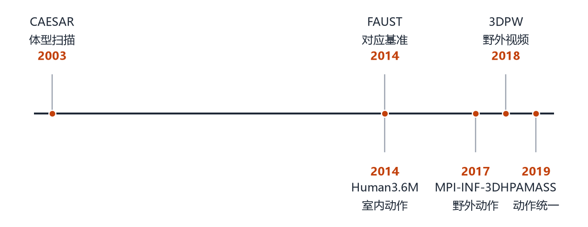
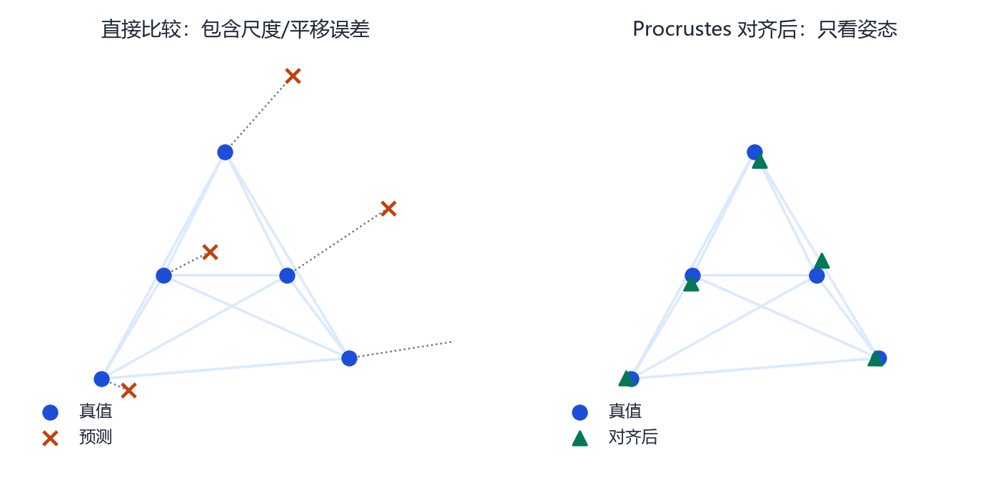
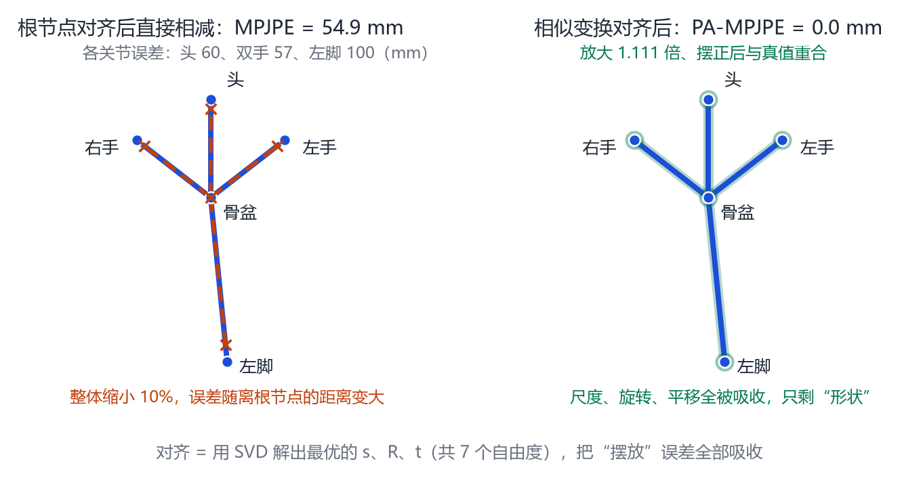
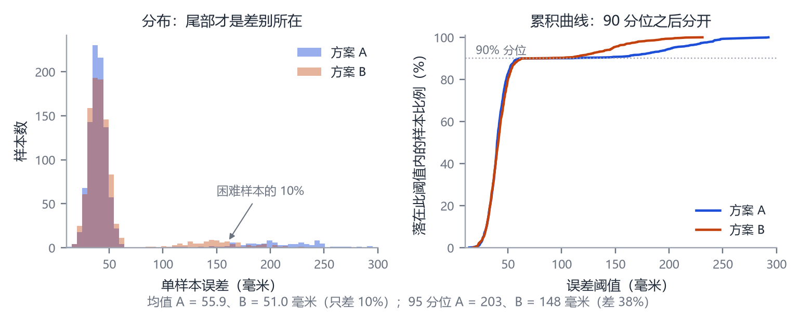

# 第 3 章 数据集、评估指标与常见坑

> **本章导读**：这一章不讲新模型，讲“怎么判断一个模型好不好”。你会看到人体领域常用的数据集、五个核心指标，以及论文里经常被忽略的评估陷阱。读完这一章，你再看到“我们的方法在 3DPW 上降低了 10% 的 MPJPE”时，会先问三个问题：和谁比？怎么对齐？测试集干净吗？

## 3.1 数据集：从实验室到野外

这一节要解决的问题是“训练和测试的数据从哪来，它们各自带什么偏差”。结论是：数据集不是中立的测量工具，每一种采集方式都把一类误差写进了真值里，而这些误差会原样传给在你手上评估的模型。

<figure class="fig">

<figcaption><b>图 3-1</b>　人体数据集的关键节点。早期以实验室扫描和动作捕捉为主，2017 年之后逐渐转向野外图像与视频，评估也从“姿态对不对”扩展到“尺度、轨迹、接触”。</figcaption>
</figure>

人体领域的数据集可以按“有没有 3D 真值”和“在室内还是野外”分成四类。这个分类不是学术洁癖，它直接决定了你能用它做什么。

**表 3-1**　常用人体数据集。

| 数据集 | 类型 | 特点 | 主要用途 |
|---|---|---|---|
| CAESAR | 全身扫描 | 静态、多体型 | 形状空间训练 |
| FAUST | 扫描 + 对应 | 高精度、同拓扑 | 配准与重建评估 |
| Human3.6M | 室内视频 + Mocap | 360 万帧、11 人、15 类动作 | 3D 姿态基准 |
| MPI-INF-3DHP | 室内多视角 | 有标记/无标记 | 跨域评估 |
| 3DPW | 野外视频 | 手持相机、自然场景 | 单图/视频泛化 |
| AMASS | 动作捕捉统一 | 统一到 SMPL 参数 | 动作先验、生成 |
| AGORA | 多人 + 场景 | 全身、遮挡、接触 | 多人重建 |
| BEDLAM | 合成 | 大量渲染、精确真值 | 大规模预训练 |

**CAESAR** 是形状模型的“粮食”：数千名受试者的全身扫描，覆盖不同体型。SMPL 的形状空间就是在它上面训练的。它的偏差很具体——受试者是自愿参与的成年人，极端肥胖与儿童比例偏低，所以模型对“非常规体型”的外插能力差。这也解释了第 1 章那个现象：预测总往平均人塌。

**FAUST** 是“对应关系”的标杆：10 名受试者、每人 10 个姿态，共 100 个扫描，全部手工建立了顶点级对应 [@bogo2014faust]。它的规模很小，但真值最干净（扫描仪精度在毫米级，对应关系是人手工校的），所以常被用来评估“网格重建得准不准”，而不是“姿态估得准不准”。

**Human3.6M** 是 3D 姿态的“老基准”：11 名受试者、15 类动作、360 万帧，配 4 台相机的动作捕捉真值。它的缺点是室内、受控、只有 15 类动作（走路、坐下、打电话、讨论……），训练出来的模型到野外容易崩。它还有一个常被忽略的特点：**它是“演员在演戏”**，动作幅度被刻意做小以便捕捉，所以它的姿势分布比真实生活窄得多。

**MPI-INF-3DHP** 用 8 名演员、14 台相机，提供了绿幕与自然背景两种版本。它的价值在于“跨域”：在绿幕上训练、在自然背景上测试，能暴露模型对背景的依赖。

**3DPW** 是“野外视频”的代表：60 段手持相机拍摄的视频，人在自然场景里走动、互动。它的 3D 真值不是直接捕捉的，而是用优化方法拟合出来的，所以存在“用同类方法评估同类方法”的偏差（3.3 节展开）。

**AMASS** 把 15 个动作捕捉数据集统一成 SMPL 参数 [@mahmood2019amass]，是动作先验、动作生成、物理仿真的基础。它的价值不在“多样”，而在“统一”：所有动作都用同一套参数化表示，可以直接送进网络训练。

**AGORA** 与 **BEDLAM** 解决的是“多人 + 场景”与“数据量”两个问题。AGORA 把高精度人体与真实场景扫描合成，真值精确且带接触标注；BEDLAM 用图形学批量渲染，成本极低、真值完美，但存在“合成到真实”的域差异——渲染出来的皮肤没有次表面散射的真实感，布料褶皱的物理也不完全对。

> **选数据集的建议**：训练形状用扫描，训练姿态用 Mocap 或合成，评估泛化用野外视频。不要只用 Human3.6M 训练然后宣称“野外可用”。

### 3.1.1 真值是怎么来的：四种来源，四种误差

同样的“MPJPE = 50 毫米”，在四种真值上的含义完全不同。这一节按可靠性从高到低排一遍。

**第一等，标记点动捕。** 演员身上贴反光标记点，多台红外相机三角测量，精度在亚毫米级。这是最硬的真值，但它测的是**标记点**，不是关节中心；从标记点到关节要做一次回归（SMPL 的关节回归器就是这么训出来的），这一步会引入 1–2 厘米的系统误差。

**第二等，三维扫描 + 手工对应。** 扫描仪直接测表面，精度毫米级；对应关系由人手工标注或算法配准。FAUST 属于这一等。它测的是**表面**，所以适合评估 PVE，不适合评估关节。

**第三等，多视角拟合。** 用几十台相机拍同一个动作，再用优化把人体的参数拟合到所有视角的轮廓上。3DPW 的“多人”子集、以及很多“in the wild”数据集的 3D 真值都来自这一等。误差在 1–3 厘米，且**误差方向与优化器的偏好一致**——这正是“用同类方法评估同类方法”的根源。

**第四等，单目拟合。** 用第 1 章的方法给网络图片打伪标签，再拿去训练别的网络。这一等的误差最大（数厘米到十几厘米），但它的规模可以到百万级，HMR 2.0 一类工作就是这么做的。

四等真值的可靠性差一个数量级，却经常被放在同一张表里比较。**看论文表格时，先看它用的是哪一等。**

### 3.1.2 三个不写在论文里的数据坑

第一，**训练集与测试集同源**。Human3.6M 的测试集是“第 9、11 号受试者”，如果预处理时不小心把他们的帧混进了训练，指标会虚高一大截。这类错误不会报错，只会让数字“好得不真实”。

第二，**关节定义不统一**。SMPL 的 24 个关节、SMPL-X 的 55 个关节、COCO 的 17 个关键点、OpenPose 的 25 个，名字相似但位置不同（比如“骨盆”在 SMPL 里是一个虚拟点，在 COCO 里没有）。跨数据集评估时，必须先做一次映射，并把映射表写进代码，否则误差会被算到错误的位置上。

第三，**性别与体型标注缺失**。SMPL 分男女两个模型，如果评估时用错性别，形状误差会凭空多出 2–3 厘米。很多数据集没有性别标注，论文里也常常不写它怎么处理——这是一个能解释“为什么我的复现差 5 毫米”的常见原因。

所以：选择数据集不是“选大的”，而是“选误差结构与你关心的能力匹配的”；扫描看形状、动捕看姿态、野外看泛化、合成看规模，四者不能互相替代。

### 3.1.3 合成数据的用法与边界

合成数据（BEDLAM 一类）解决的是“标注不可能得到”的问题：真值完美、可以造任意姿势与体型、成本几乎为零。但它带来一个反向的坑：**模型会学到渲染器的特征**。

具体表现有三类。第一，纹理：渲染的皮肤缺少次表面散射，肤色分布比真实窄，模型到真实图上会把“不常见的肤色”当成异常。第二，光照：合成数据的光照往往太干净，模型学不到强烈阴影与逆光，真实场景里就会把阴影当成衣服褶皱。第三，背景：合成背景的统计与真实室内差异很大，模型可能依赖“背景里没有的东西”做判断。

实用的配比是“合成打底 + 真实微调”：先用几百万张合成数据把网络训到“知道人体长什么样”，再用几万张带真值的真实数据（3DPW、MPI-INF-3DHP）做微调，把渲染器特征洗掉。只用合成数据训练、直接上真实场景的做法，在 PVE 上通常能看，在实际观感上很难看。

所以：合成数据是“规模下采样器”，不是“真实数据替代品”；它的价值取决于你后续用多少真实数据去洗掉它带来的偏差。

## 3.2 五个核心指标

这一节要把五个指标的公式、单位和“它到底在比什么”说清。结论是：五个指标衡量的是五件不同的事，任何一个单独拿出来都能被“优化”到很好看，而其他四件事同时变差。

<figure class="fig">

<figcaption><b>图 3-2</b>　MPJPE 与 PA-MPJPE 的区别。左图直接比较预测与真值，包含尺度、平移、旋转误差；右图先做 Procrustes 对齐（去掉相似变换），只看姿态形状。PA 指标更低，但它会掩盖“人太大/太小/位置不对”的问题。</figcaption>
</figure>

### 3.2.1 MPJPE：最直白也最容易误读

**平均关节位置误差**（Mean Per-Joint Position Error）是把每个关节的位置误差算出来，取平均：

$$
\text{MPJPE}=\frac{1}{J}\sum_{j=1}^{J}\big\|\mathbf{p}_j-\mathbf{g}_j\big\|_2 ,
\tag{3.1}
$$

单位通常是毫米。$\mathbf{p}_j$ 是预测的第 $j$ 个关节，$\mathbf{g}_j$ 是真值，$J$ 是关节数（SMPL 常用 14 或 24 个）。通常先把根节点平移对齐，再算误差——这一步是必须的，因为“人站在画面哪个位置”与“姿势对不对”是两件事。

读法上要抓住一点：**它把尺度、朝向、位置、姿态的误差混在一起**。一个体型整体放大 5% 的预测，MPJPE 会明显变大，尽管姿势完全正确；一个姿势错但整体缩小 5% 的预测，误差可能互相抵消。所以它适合回答“这个 3D 结果能不能直接用”，不适合回答“它懂不懂人体”。

### 3.2.2 PA-MPJPE：只看姿态形状

**Procrustes 对齐后的 MPJPE** 先找一个最优的相似变换（旋转 + 缩放 + 平移），把预测对齐到真值，再算误差：

$$
\min_{s,\mathbf{R},\mathbf{t}}\sum_j\big\|s\mathbf{R}\mathbf{p}_j+\mathbf{t}-\mathbf{g}_j\big\|^2 .
\tag{3.2}
$$

$s$ 是缩放，$\mathbf{R}$ 是旋转，$\mathbf{t}$ 是平移，三个量一共 7 个自由度。解出来之后代回式 (3.1) 就是 PA-MPJPE。

PA 指标衡量“姿态形状”而不是“绝对位置与大小”。它更宽容，也更容易被滥用：一个把所有人体型都预测成平均值的方法，PA-MPJPE 可能不难看，但绝对尺度完全错了。**在论文里看到 PA-MPJPE 特别低、而 PVE 没提，就要怀疑它在体型上偷懒。**

### 3.2.3 PVE / MPVE：网格层面

**每顶点误差**（Per-Vertex Error）把预测网格与真值网格的对应顶点相减，取平均：

$$
\text{PVE}=\frac{1}{N}\sum_{i=1}^{N}\|\mathbf{v}_i-\hat{\mathbf{v}}_i\|_2 ,
\tag{3.3}
$$

$N=6890$ 是 SMPL 的顶点数，$\mathbf{v}_i$ 与 $\hat{\mathbf{v}}_i$ 是两个网格上同编号的顶点。它比关节误差更细，能反映体型、肌肉、衣服的差异。

它的前提是“顶点对应”，而对应只在同拓扑的模型之间成立。所以 PVE 只能用于 SMPL 对 SMPL 的比较；一旦对面是扫描、是隐式表面、是高斯点云，就只能换成 Chamfer 距离（第 4 章）。

### 3.2.4 PCK：阈值内的比例

**正确关键点比例**（Percentage of Correct Keypoints）是“误差小于阈值的关节占比”。阈值可以是绝对像素（比如 10 像素），也可以是“头部长度的比例”（PCKh，阈值取头长的 50%）。

它比 MPJPE 更“宽容”：一个关节错得离谱，对 MPJPE 的贡献很大，对 PCK 的贡献只是“多一个失败”。所以 PCK 适合回答“大多数情况下能不能用”，不适合回答“最坏情况有多差”。跨数据集比较 PCK 时，必须先确认阈值定义——同一个方法，阈值从 10 像素改到 20 像素，数字能翻一倍。

$$
\text{PCK@}\tau=\frac{1}{J}\sum_{j=1}^{J}\mathbb{1}\big[\|\mathbf{p}_j-\mathbf{g}_j\|_2<\tau\big] ,
\tag{3.4}
$$

$\mathbb{1}[\cdot]$ 是指示函数，条件成立取 1、否则取 0。读法：它其实是一个累积分布函数在 $\tau$ 处的取值，所以报一个 PCK 数字而不报曲线，等于只报了一个点。

### 3.2.5 加速度误差：视频专用

$$
\text{Accel}=\frac{1}{T}\sum_t\big\|(\mathbf{p}_{t+1}-\mathbf{p}_t)-(\mathbf{p}_t-\mathbf{p}_{t-1})\big\|_2 ,
\tag{3.5}
$$

衡量抖动。它不关心“准不准”，只关心“稳不稳”——第 2 章已经详细讨论过它的两个坑（不关心正确性、依赖帧率）。

所以：五个指标是五种“考场”，一个方法可以在一个考场上满分、在另一个上不及格；健康的评估必须至少覆盖“姿态（PA-MPJPE）+ 网格（PVE）+ 尺度（绝对误差）”三个维度。

### 3.2.6 尺度误差：身高相对误差

前五个指标里，只有 MPJPE 对尺度敏感，而它又被姿态误差掩盖。所以要单独拿一个数来看“大小对不对”。最直接的是**身高相对误差**：

$$
\varepsilon_h=\frac{|\hat h-h|}{h}\times100\%,
\tag{3.6}
$$

$\hat h$ 是预测网格从脚底到头顶的高度（取最大与最小 $y$ 之差，或按真值同一定义取），$h$ 是真值身高。单位是百分比，与体型大小无关，可以跨样本平均。

为什么不能用 PA-MPJPE 代替：式 (3.2) 的相似变换会把缩放整个吸收掉，于是一个“所有人都矮 5%”的方法在 PA 上是完美的，在身高上却是系统性偏差。为什么不能用 MPJPE 代替：它把尺度误差与姿态误差加在一起，一个姿态很准、尺度错 8% 的方法，MPJPE 可能和一个姿态很差、尺度很准的方法差不多。

量级上（示意）：1.70 米的人错 5 厘米，相对误差 2.9%；儿童（1.20 米）错同样的 5 厘米，就是 4.2%——**同样绝对误差，对小孩的相对误差更大**，这也是按体型分组评估的理由之一。另外要报清楚身高的测量口径：穿不穿鞋、早晩量、站姿还是扫描姿态，三者能差 1–2 厘米，这个量已经与你要证明的改进同量级。

所以：只要你的应用涉及“量尺寸”或“定距离”，就必须单独报尺度误差，而不是指望 MPJPE 把它带出来。

### 3.2.7 四个指标的三角关系

把这些指标放在一起看，会发现它们构成一个三角制约：任两个变好，第三个常常变差。

**姿态准 ↔ 尺度准。** 允许 Procrustes 对齐的指标会把尺度吸收，所以“把所有人拟合成标准身材”的做法能在 PA-MPJPE 上刷分；反之，一旦把尺度算进去（MPJPE），体型估不准的方法立刻拉胯。

**网格准 ↔ 关节准。** PVE 低需要软组织与衣服也对，而这部分恰恰是先验最弱的地方；MPJPE 低只需要骨骼位置对，一件宽松外套不会影响它。

**准 ↔ 稳。** 单帧精度高的方法往往依赖强判别器/强先验，而强先验会让帧间输出变化剧烈（在分布边界上跳）；时序平滑能降抖动，但会把峰值削平、降低单帧精度。

所以：看到“四项全面领先”的表格时要格外小心；要么是真突破了，要么是四项的测试集不是同一份。

## 3.3 论文里常见的评估陷阱

这一节要把“数字为什么不可信”的机制讲透。结论是：绝大多数误读不是作者造假，而是口径不同、真值不独立、或者平均值掩盖了长尾。

**陷阱一：对齐方式不说明。** MPJPE 前有没有做根节点对齐？有没有做 Procrustes？有没有做尺度归一？不同选择能差出 30%。看论文时先找“alignment”这个词；找不到，就去看代码或附录。

**陷阱二：在训练集上评估。** 有些数据集（如 Human3.6M）的训练/测试划分很复杂，稍不注意就会把测试帧混进训练。更隐蔽的是“用测试集的统计量做归一化”，效果一样是虚高。

**陷阱三：用拟合结果当真值。** 3DPW 的 3D 真值来自优化拟合，如果你的方法也是优化拟合，等于“和自己比”。真正干净的真值是 FAUST 这种扫描 + 手动对应。

**陷阱四：只报平均，不报分布。** 平均误差低，可能只是因为大多数简单样本很好，而困难样本（遮挡、罕见姿势）完全崩。要看分位数、失败案例。一个具体的例子：两个方法平均都是 55 毫米，A 的 95 分位是 90 毫米，B 的 95 分位是 180 毫米——对产品来说，B 不可用，虽然它的平均值一样。

**陷阱五：混淆“姿态”与“形状”。** PA-MPJPE 低不代表体型对；PVE 低不代表关节对。两个指标要一起看。

**陷阱六：忽略相机。** 单图方法的尺度误差常常被“弱透视假设”掩盖。真实部署时，相机内参未知，误差会放大。

**陷阱七：比较的基线被削弱。** 有些论文的基线是“自己重新实现的、没调好的版本”。识别方法：看基线数字是否明显差于原始论文；如果是，比较不公平。

**陷阱八：只报单数据集。** 在 3DPW 上涨点、在 Human3.6M 上持平，作者只强调前者。这类选择性报告很难被抓，但可以看它是否给了“逐数据集”的完整表格。

所以：读结果表的第一件事不是看数字，而是看“表头之外的信息”——对齐方式、真值来源、训练集、是否微调；这四样决定了数字能不能跨行比较。

### 3.3.1 一次“提升 10%”的拆解

假设某篇论文宣称“在 3DPW 上把 MPJPE 从 100 降到 90 毫米”。这 10 毫米可能来自五个地方，而它们的可信度差别很大。

**真提了（模型或训练变强）。** 比如用了更大的骨干、更多数据、更好的先验。这类提升最扎实，但应该伴随消融实验：去掉新模块后回升多少。

**对齐口径变了。** 比如对比方法只做了根节点对齐，而新方法还额外做了尺度归一。这一项单独就能贡献 5–10%。判断方法：看两个数字是否出自同一份评估代码。

**测试集被“看过”。** 调参时反复看测试集指标，相当于在测试集上训练； 50 次实验里最好的一次，通常比真实水平好 3–5%。

**基线被削弱。** 重新实现基线时用了默认参数、没调。判断方法：对比基线的数字与它原文的报告值。

**样本变了。** 剔除了失败样本、换了测试子集、改了可见性阈值。这一项最隐敷，也最常见。

一个实用的习惯：看到提升时，先算一下“提升量 / 标准差”。标准差 40 毫米、样本 1000 个时，标准误是 1.3 毫米；10 毫米的提升是显著的，但如果提升只有 2 毫米，就得看它是不是种子噪声。

所以：“提升 10%”本身不说明任何事，能说明事的是“提升从哪里来、可不可复现、在哪些子集上成立”。

## 3.4 一个健康的评估习惯

这一节要给一份可以直接照着做的评估清单。结论是：评估的设计比指标的选择更重要，一份设计良好的小评估胜过一堆口径不明的数字。

如果你要做一个自己的方法，建议至少报告：

1. 三个数据集：一个室内（Human3.6M）、一个野外（3DPW）、一个扫描（FAUST）；
2. 两个指标：PA-MPJPE（姿态）+ PVE（形状），再加一个绝对误差（MPJPE 或身高相对误差）；
3. 一个效率指标：FPS 或参数量，并注明硬件；
4. 一组失败案例：遮挡、多人、极端姿势，附截图而不是只给数字；
5. 消融实验：去掉某个模块后掉多少，以及掉在哪个子集上。

这比“在单个数据集上刷 0.5 毫米”有意义得多。再加两条只有内行才会做的：**报分组的误差**（按遮挡比例、按体型、按人数分组），以及**报方差**（同一模型换随机种子跑三次的波动）。如果三次之间的差异与你宣称的提升同量级，那个提升就不成立。

所以：评估的目标不是“证明方法好”，而是“找出它在什么条件下不好”；后者对使用者的价值高一个数量级。

### 3.4.1 自建一个小评测集

公开数据集永远不会正好覆盖你的场景。落地前最值钱的一步，是花两周做一个几十条的小评测集。

做法很简单：挑 50–100 个真实场景的样本，用两种方式拿真值——能测的用尺子量（身高、肩宽、行步距离），测不了的用多视角或人工标注关键点。然后按“场景 × 失败模式”分格，每一格里放几条。

这个集子的价值不在绝对精度（几十条样本的统计意义很弱），而在**稳定性**：它能告诉你“换一个检测器、换一个分辨率、换一个光照，结果往哪个方向偏”。这类问题在公开数据集上看不到，因为公开数据集的分布是固定的。

要注意两条纪律。第一，**这个集子不能用来调参**，否则它立刻失去“独立测试”的意义；要调参就拿另一批。第二，**定期重测**：模型升级、相机更换、场景搬迁都要重跑一遍，把数字记在本子上。

所以：小评测集的定位是“体检”，不是“考试”；它不告诉你分数，它告诉你“哪一项指标开始变差”。

## 3.5 指标是怎么算出来的：五个关节走一遍

这一节要把“对齐 → 相减 → 平均”这条流水线用具体数字走一遍。结论是：同一个预测，换个对齐方式，误差能从 54.9 毫米变成 0 毫米——这不是 bug，是定义。

所有指标都是同一个三步：**对齐 → 相减 → 平均**。差别只在两处：对齐允许用什么变换、相减的是关节还是顶点。下面把数字算一遍。

**表 3-2**　例子里用的五个关节真值（单位：米，$y$ 轴朝上，$z$ 轴朝向镜头）。

| 编号 | 关节 | $x$ | $y$ | $z$ |
|---|---|---|---|---|
| 0 | 骨盆（根节点） | 0.00 | 1.00 | 0.00 |
| 1 | 头 | 0.00 | 1.60 | 0.00 |
| 2 | 左手 | 0.45 | 1.35 | 0.00 |
| 3 | 右手 | $-0.45$ | 1.35 | 0.00 |
| 4 | 左脚 | 0.10 | 0.00 | 0.00 |

这五个点都落在 $z=0$ 平面上，好比一个人正对镜头站着。现在假设某个方法的预测，是把整个人**等比缩小 10%，再平移一点点**——典型的错误：模型把“标准身材”套在了偏矮的人身上。

**第一步，根节点对齐。** 把预测整体平移，让骨盆与真值骨盆重合：只消平移，不消旋转与尺度。

**第二步，逐关节量距离。** 缩小到 0.9 之后，头离骨盆 0.6 米变成 0.54 米，差 60 毫米；双手各差 57 毫米；左脚离骨盆最远（1 米），差 100.5 毫米；骨盆自己是 0。

**第三步，平均。** $(0+60+57+57+100.5)/5=54.9$ 毫米，这就是 MPJPE。注意误差随“离根节点的距离”线性变大，这正是“整体缩小”的指纹。

换 PA-MPJPE：允许“缩放 + 旋转 + 平移”一起去对齐。这个预测本来就是等比缩小，Procrustes 解出 $s=1/0.9=1.111$，把预测放大 1.111 倍，**恰好抵消**，PA-MPJPE $=0.0$ 毫米。图 3-3 是这两步的对比。

<figure class="fig">

<figcaption><b>图 3-3</b>　同一组预测的两种算法。左：只做根节点平移，误差随离根节点的距离变大，MPJPE 为 54.9 毫米。右：允许相似变换对齐后预测与真值完全重合，PA-MPJPE 为 0——“缩小 10%”这类错误被对齐彻底吸收了。</figcaption>
</figure>

所以：**PA-MPJPE 对尺度完全不敏感。** 把所有人都预测成“标准身材缩小 10%”的方法，PA-MPJPE 可以是 0，MPJPE 却是 54.9 毫米，拿去“量身高”会系统性偏矮。

再加一点料：若在上面的预测上再加 10° 旋转、每个坐标再叠 8 毫米随机噪声，同一组点得到 MPJPE $=110.7$、PA-MPJPE $=17.8$ 毫米；**去掉噪声、只留缩小与旋转，PA 又回到 0**。可见这 17.8 毫米几乎全部来自“关节之间的相对位置不对”。

四个指标的分工：

**表 3-3**　四个指标各在比什么。

| 指标 | 对齐方式 | 比的对象 | 对什么敏感 | 掩盖什么 |
|---|---|---|---|---|
| MPJPE | 只平移（常以根节点对齐） | 关节 | 尺度、朝向、位置 | 网格细节 |
| PA-MPJPE | 相似变换（7 自由度） | 关节 | 关节之间的相对位置 | 尺度、朝向、位置 |
| PVE | 与 MPJPE 相同 | 全部顶点 | 体型、软组织、衣服 | 单个关节是否对得上（被平均掉） |
| PVVE | 与 PVE 相同 | 顶点速度 | 动作对不对 | 绝对位置 |

PVVE 是“逐顶点速度误差”：把 PVE 里的位置换成相邻帧的速度差，用于评价视频结果。与式 (3.5) 的加速度误差是一对。

PVE 与 MPJPE 的差别也值得一个例子。假设关节全部落在正确位置，但预测把腰围做粗了 2 厘米：腹部顶点整体外移约 2 厘米，PVE 在腹部多出 20 毫米量级的误差，而 MPJPE 几乎不动——关节是从骨骼内部回归的，软组织变化影响不到它们。**“关节准”和“网格准”是两件事。**

### 3.5.1 为什么平均会骗人：一个长尾的例子

把上面五个关节的例子推广到 1000 个样本，会看到平均值的另一个问题。

假设 900 个简单样本（人站着、全身可见）误差 40 毫米，100 个困难样本（遮挡、罕见姿势）误差 200 毫米。平均值是 $0.9\times40+0.1\times200=56$ 毫米。现在有两个改进方案：

- 方案 A 把简单样本降到 35 毫米，困难样本不变：平均 $0.9\times35+0.1\times200=51.5$ 毫米，**改进 8%**；
- 方案 B 把困难样本降到 150 毫米，简单样本不变：平均 $0.9\times40+0.1\times150=51$ 毫米，**改进 9%**。

数字上 B 略好，但对使用者来说 B 的价值高得多——它让“原本完全不能用”的 10% 场景变得可用。平均值把它们压成了差不多的两个数。用图 3-4 那批随机样本算一遍：均值 55.9 对 51.0（差 10%），95 分位 203 对 148（差 38%）。**同一批数据，换一个统计量，差距从 10% 变成 38%。**

<figure class="fig">

<figcaption><b>图 3-4</b>　平均值掩盖长尾。左：两种方案的误差分布，均值只差 10%，尾部分得很开。右：累积误差曲线，两条曲线在 90 分位之前完全重合，之后分开；95 分位分别是 203 与 148 毫米（本图数据，示意）。</figcaption>
</figure>

所以：报平均值的同时必须报分位数；如果只能报一个数，报“90 分位”比报“均值”更有信息量。

## 3.6 一个可以直接用的评估脚本

这一节给一份能直接跑的实现。结论是：真正算数的只有六行，其余全是防坑。

输入是两个 $J\times3$ 的数组，单位一致，按米写，第 0 号是根节点。

```python
import numpy as np

def mpjpe(pred, gt):
    """pred, gt: (J,3)，第 0 号是根节点；单位一致。"""
    p, g = pred - pred[0], gt - gt[0]              # 根节点对齐：只去平移
    return np.linalg.norm(p - g, axis=1).mean()

def pa_mpjpe(pred, gt):
    """相似变换对齐后算 MPJPE，不允许镜像。"""
    p, g = pred - pred.mean(0), gt - gt.mean(0)     # 两边都先减掉重心
    U, S, Vt = np.linalg.svd(p.T @ g)               # 3×3 的互协方差
    d = np.sign(np.linalg.det(U @ Vt))              # ±1：防止把镜像当成对齐
    R = (U @ np.diag([1, 1, d]) @ Vt).T             # 最优旋转
    s = (S[0] + S[1] + d * S[2]) / (p ** 2).sum()   # 最优缩放
    return np.linalg.norm(s * p @ R.T - g, axis=1).mean()
```

三个要点逐行说。

**为什么两边都要减重心。** Procrustes 找的是“绕重心”的最优旋转与缩放。不先减重心，平移就会混进 SVD 里，解出来的旋转是错的——这是一个不会报错、只会让指标莫名变差的 bug。

**$\det$ 那一行在防什么。** SVD 的最优解可能是一个**镜像**（行列式为 $-1$）：当两组点近似互为镜像时（左右手搞混、或用了镜像增广），不加修正就会得到一个物理上不存在的对齐，误差虚低，而且很隐蔽。乘一个 $\mathrm{diag}(1,1,d)$ 就是把镜像翻回来。

**缩放的分子为什么是 $S_0+S_1+dS_2$。** $S$ 是三个奇异值，衡量预测与真值在三个方向上的相关性；三者相加再除以预测的平方和，恰好是最小二乘意义下的最优缩放。推导略长，但有一个两秒钟的自检：把真值乘 1.7 倍、随便转一下、挪一下，再喂给 `pa_mpjpe`，输出必须是 0，而解出的 $s$ 必须是 1.7。**这个自检一定要写进你的测试。**（本册的这段代码就是这样验证的：误差 0.000000，$s=1.7000$。）

五个常见实现错误：

1. **忘了去根节点。** 症：数值大得离谱，同一个动作换个站位就变，几百毫米很常见。
2. **毫米和米混用。** 症：结果是别人的 1000 倍或 1/1000。算出 4.7 而论文报 47，先查单位。
3. **关节顺序不一致。** 症：MPJPE 还行、PA 异常差，或者左右手误差对调。跨库（SMPL、SMPL-X、OpenPose）时必查。
4. **没做镜像修正。** 症：PA-MPJPE 好得不真实，明显低于同行的报告值。
5. **把没检测到的关节填成 0。** 症：个别样本误差上千毫米，平均值被拉爆。应该用可见性掩码，只对有效关节求平均。

再补两个统计上的坑。第一，**不要报“最优随机种子”**：跑三次取最好，等价于偷偷把方差当成了提升。第二，**要报置信区间**：1000 个样本、误差标准差 40 毫米时，均值的标准误约 $40/\sqrt{1000}\approx1.3$ 毫米，所以“提升 1 毫米”在统计上等于噪声。差别小于两倍标准误的结论都不该写进摘要。

所以：评估脚本的正确性比模型的花哨更重要；一个算错的指标能让整个章节的结论失效，而且通常没有任何报错提示。

## 3.7 怎么读一张结果表

这一节给一份“三十秒判断法”。结论是：结果的可靠性可以从表格的结构上看出来，不需要复现。

拿到一张表，按顺序看四件事。

**第一，看它有没有“同口径”的基线。** 一行是一个方法，如果某些行的 MPJPE 明显高于该方法的原始论文，说明这行是作者自己重跑的、可能没调好。同口径比较是表格可信的最低要求。

**第二，看它报了几个指标。** 只有 MPJPE 一行数字的表格，通常意味着作者只关心一个维度；同时报 PA-MPJPE 与 PVE 的，说明作者知道两者会打架。

**第三，看有没有“逐子集”的拆分。** 遮挡、多人、儿童、极端姿势——如果全都没有，那么这张表只证明“在平均样本上有效”。

**第四，看效率那一列。** FPS 不写硬件、不写输入分辨率，等于没写。一个“实时”方法如果在 4090 上 30 帧、在手机上是 2 帧，产品经理需要知道这个差别。

还有一条经验：**表格里的最好数字常常不是最适合部署的**。排名第一的方法往往模型最大、依赖最多（需要检测框、需要分割、需要相机内参），而排名第三的方法可能只需要一张图。

所以：读表的能力等于“知道自己会被什么骗”；最常被骗的三处是口径、子集、效率，其余细节可以放到复现时再查。

### 3.7.1 复现别人结果的最小检查单

复现失败时，先查四处，它们能解释大部分“差 5–20%”的差异。

**模型版本。** 同一个名字下可能有多个版本：SMPL 与 SMPL-X 的关节数不同（24 对 55），SMPL-H 带手，SMPL 还有男女两个权重。用错一个，误差直接从第一帧开始就偏。

**输入预处理。** 裁剪时框放大 1.0 倍还是 1.2 倍、归一化用 ImageNet 的均值方差还是自定义、通道顺序是 RGB 还是 BGR。这四项里任何一项不同，都能让指标差几个百分点，而且不会报错。

**是否用了真值 2D 关键点。** 有些论文在评估时偷偷用数据集给的 2D 标注作为输入（因为要隔离“人体先验”的贡献），你用自己的检测器跑，自然差一截。这不是造假，但必须写清楚。

**评估函数本身。** 关节数、对齐方式、是否跳过不可见关节、是否对每个样本先算再平均（而不是把所有关节拉平再平均）。最后一条特别隐蔽：样本关节数不同时，两种平均法结果不同。

经验上的判据：复现结果与原文差距在 5% 以内，算复现成功；差 10–20%，通常是上面四项之一；差一倍以上，先查单位。

## 3.8 失败模式清单

这一节把“评估本身出错”的失败模式列成表。结论是：评估的失败比模型的失败更危险，因为它会让你在错误的方向上继续投入。

**表 3-4**　评估环节的六类失败。

| 类别 | 现象 | 成因 | 自查方法 |
|---|---|---|---|
| 单位混用 | 数值差 1000 倍 | 米与毫米 | 拿一个已知答案的样例跑一遍 |
| 关节错配 | 左右手误差对调、个别关节异常大 | 映射表写错 | 画出每个关节的误差条形图，看是否成对出现 |
| 镜像未修正 | PA 指标异常低 | Procrustes 允许了反射 | 用镜像输入做自检，PA 应当变差 |
| 真值不独立 | 指标好但实际观感差 | 真值来自同类方法 | 换成扫描类真值再测一次 |
| 只报均值 | 长尾崩溃被掩盖 | 汇总方式 | 画累积误差曲线 |
| 选择性报告 | 只报有利的数据集 | 汇总方式 | 找完整表格或补充材料 |

第一行看起来最幼稚，但它是最常见的：一个团队花两周调模型，最后发现评估脚本把毫米当成了米，所有对比都得重做。

所以：先把评估流水线用“已知答案”的样例验证一遍，再开始比方法；这一步花半天，能省下两周。

## 本章小结

- 数据集分扫描、室内 Mocap、野外视频、合成四类，各有用途与偏差；真值也分四等（标记点动捕、扫描+对应、多视角拟合、单目伪标签），可靠性差一个数量级。
- MPJPE 看绝对误差，PA-MPJPE 看姿态形状，PVE 看网格，PCK 看阈值内比例，Accel 看抖动。
- 对齐方式、真值来源、训练/测试划分、平均 vs 分布、基线是否被削弱，是主要陷阱；健康评估应跨数据集、多指标、带失败案例与消融，并报分组误差与方差。
- 所有指标都是“对齐 → 相减 → 平均”：差别只在用什么变换对齐、比关节还是比顶点。
- 同一个“整体缩小 10%”的预测，MPJPE 是 54.9 毫米，PA-MPJPE 是 0.0 毫米——PA 对尺度完全不敏感，它盖不住体型错误。
- PVE 管网格、PVVE 管速度；自己写评估要盯三件事：两边都去重心、防止镜像解、单位一致。
- 平均值会掩盖长尾：900 个简单样本 + 100 个困难样本时，“改进困难样本”与“改进简单样本”在均值上几乎等价，但对使用者完全不同。

## 思考题

1. 一个方法 PA-MPJPE 很低但 PVE 很高，可能是什么原因？反过来呢？
2. 为什么 3DPW 的真值不能算“绝对干净”？如果要一个更干净的真值，你会怎么做？
3. 如果只能选一个指标向非专业用户汇报，你会选哪个？为什么？
4. 合成数据训练、真实数据评估，最大的风险是什么？怎样用一组实验把风险量化出来？
5. 你的方法在 1000 个样本上把均值从 56 毫米降到 51 毫米，标准差是 40 毫米。这个提升值得写进摘要吗？还需要什么信息？
