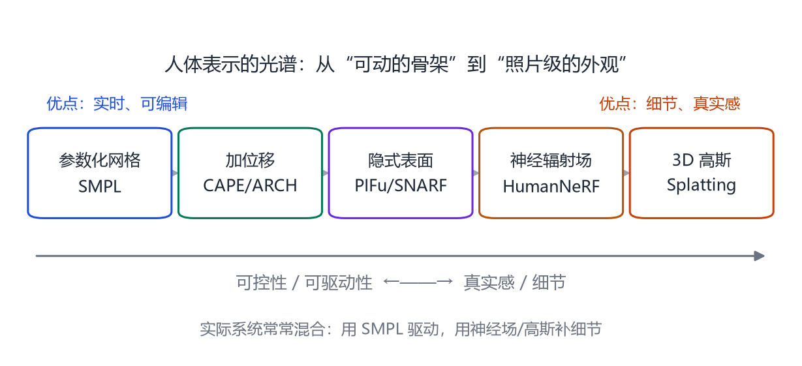
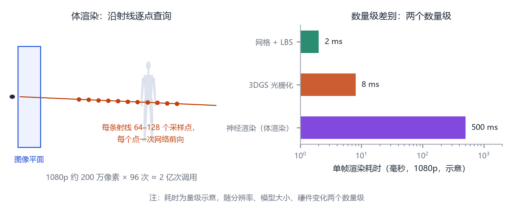

# 第 4 章 着装人体：衣服、头发与神经渲染

> **本章导读**：SMPL 是一个“紧身衣”模型。现实中的人穿裙子、西装、羽绒服，还有头发、胡须、配饰。这一章讲三类补细节的方法：给网格加位移、用隐式场表示表面、用神经渲染表示外观。它们分别对应“可控”“精细”“真实”三个目标，今天最好的系统往往三者混用。

## 4.1 任务定义：从“裸体参数”到“可驱动外观”

这一节要明确“着装人体重建”这个任务到底是什么。结论是：它的输出不是一张好看的图，而是“能被新姿势、新视角、新光照驱动的一套资产”，而这个要求比“重建得像”苛刻得多。

输入通常是多视角图像（8–100 台相机，环绕拍摄）或一段单目视频；输出要包含四样东西：**几何**（带衣服与头发的表面）、**外观**（反照率与材质）、**驱动方式**（怎么跟着骨架动）、**可编辑性**（能不能换姿势、换视角、换衣服）。评价标准也就分成四层：几何看 Chamfer 距离或 PVE，外观看 PSNR/SSIM/LPIPS，驱动看“换姿势后是否穿模、是否跟手”，编辑看主观体验。

为什么不能直接用裸体模型？四个具体失效，每一个都很致命。

**第一，衣服被当成皮肤。** 穿裙子的人会被拟合成“紧身裤”：SMPL 的 6890 个顶点只能贴在身体表面，裙摆的悬垂、摆动、褶皱完全没有。视觉上表现为“腿上有奇怪的凸起”，因为裙子的体积被强行塞进了腿的形状里。

**第二，头发与配饰缺失。** SMPL 的头顶是光滑的球面。长发、马尾、帽子、背包，这些“非人体”的部分要么消失，要么被错误地当成身体的一部分（比如背包被拟合成驼背）。

**第三，纹理与光照不分。** 模型没有颜色，更没有“这件衣服在阳光下是什么质感”。硬贴一张纹理，换个光照就穿帮，因为纹理里烘焙了拍摄时的光照。

**第四，拓扑会变。** 裙摆张开与合拢、长发飘动，这些结构的“连接关系”在变，而 SMPL 的拓扑是固定的 6890 个顶点。任何“固定拓扑 + 顶点位移”的表示，都无法表达这类变化。

<figure class="fig">

<figcaption><b>图 4-1</b>　人体表示的光谱。越往左，越可控、越容易驱动；越往右，越真实、细节越多。实际系统通常用左边的参数化模型做“骨架”，用右边的神经表示补“皮肤”。</figcaption>
</figure>

<figure class="fig">

<figcaption><b>图 4-2</b>　着装人体系统的通用管线。输入多视角图像或视频，先用 SMPL 拟合出“人在哪里、摆什么姿势”，再学一层残差/位移表示衣服与头发，然后把纹理与光照分离，最后得到一个可以换装、换姿势、换视角的可驱动 Avatar。整条管线的关键是把“人”与“衣服 / 头发 / 光照”分开建模。</figcaption>
</figure>

### 4.1.1 为什么“重建得像”不等于“能用”

一个常见的误解是：只要渲染图足够像，系统就成功了。实际部署时还有三道关。

**第一道，新视角。** 训练时只有正面和侧面，转到背面会不会崩？隐式表示与神经渲染在这方面比“位移网格”强，因为它们真的在三维空间里建模；而“只学 UV 位移图”的方法，背面完全是外插。

**第二道，新姿势。** 这是最难的一关。衣服的形变依赖它与身体的接触：抬手臂时腋下的布料会被拉扯，蹲下时膝盖处会堆叠。如果位移是“按姿势查表”学出来的，没见过的姿势就只能给一个平均答案。

**第三道，时序稳定。** 视频驱动时，衣服会“抖”——每帧独立预测的位移场会闪烁，尤其是褶皱区域。加平滑又会把褶皱抹平，变成“塑料衣服”。

所以：评价一个着装人体系统，要按“新视角 → 新姿势 → 时序”三道关依次测；只报一张渲染图的 PSNR，等于只测了第一关的第一小步。

## 4.2 路线一：给 SMPL 加位移

这一节要讲最直接的一条路：保持拓扑不变，让每个顶点自由地“往外鼓”。结论是：它便宜、可驱动、能进引擎，但表达力被拓扑锁死，而且会把褶皱“平均”掉。

先写成公式。给定形状 $\boldsymbol\beta$、姿态 $\boldsymbol\theta$、以及一个衣服类别标签 $c$，位移模型输出每个顶点的偏移：

$$
\mathbf V=\mathbf V_{\text{SMPL}}(\boldsymbol\beta,\boldsymbol\theta)+\mathbf D_\phi(\mathbf V_{\text{SMPL}},\boldsymbol\beta,\boldsymbol\theta,c),
\tag{4.1}
$$

$\mathbf V_{\text{SMPL}}\in\mathbb{R}^{6890\times3}$ 是裸体网格，$\mathbf D_\phi$ 是一个网络，输出同尺寸的位移，$\phi$ 是网络参数。读法：先算出裸体在哪，再在法线方向上把每个顶点推出去一段距离。这一段的量级从几毫米（T 恤）到几厘米（羽绒服），所以它必须能“大于 0 也能小于 0”（有的部位衣服会贴得更紧）。

**CAPE**（Ma 等，2020）[@ma2020cape] 是这条路的代表。它用 4D 扫描（动态人体扫描序列）训练一个位移场：输入是 SMPL 的体型、姿态与衣服类别，输出是逐顶点位移。它能为不同姿势生成合理的褶皱，也能泛化到没见过的姿态——因为位移是“姿态的函数”，而不是“姿态的查表”。

**Tex2Shape**（Alldieck 等，2019）[@alldieck2019tex2shape] 换了参数化的空间：先把 SMPL 渲染成一张 UV 图（把三维表面摊平成二维图片），再用图像到图像的翻译网络，从单张照片预测“法线图 + 位移图”，最后反投影回三维网格。好处是不需要 4D 扫描，只要有照片和拟合好的 SMPL 就行；坏处是细节受限于 UV 分辨率——1024×1024 的 UV 图摊到 6890 个顶点上，每个顶点大约占 12×12 像素，再细的褶皱就表达不了。

**ARCH**（Huang 等，2021）在两者之间：它同时用图像特征与姿态作为条件，引入“姿态校正”模块处理大幅动作，并支持换装（给定一张衣服图片，把它贴到人体上）。

这条路线的优点很实在：**输出仍是网格，能直接进游戏引擎、能实时驱动、能用常规渲染管线**。缺点是三个：拓扑固定，无法表示裙摆、长发这种“拓扑会变”的结构；单层表面，无法表示“衣服与身体之间的空隙”；以及下面这个最隐蔽的问题。

### 4.2.1 多模态问题：褶皱被平均掉了

同一个姿势、同一个人，穿着同一件衬衫，褶皱可以有很多种——取决于布料的历史、湿度、以及上一次动作。这叫**多模态**：一个输入对应多个合理输出。

用平方误差训练一个回归网络时，网络的输出是这些可能性的**条件均值**（第 1 章式 (1.6) 的同一个道理）。平均一堆褶皱，得到的是“浅而模糊的起伏”——看起来像被熨过，又没有熨平。这就是很多位移方法的渲染结果“像塑料”的根本原因，不是分辨率不够，而是损失函数把细节平均掉了。

解决办法有三个方向。用对抗损失，让判别器判断“这个褶皱像不像真的”，从而允许网络输出某一个具体模态而不是平均。用概率模型（比如条件 VAE），显式地建模多模态，推理时采样。或者干脆放弃逐顶点回归，改用隐式表示 + 体渲染，让细节由密度场自己决定（下一节）。

所以：位移网格是“性价比最高”的方案，适合贴身衣物、实时应用、以及只需要“大致体积”的场景；一旦涉及宽松衣物与褶皱，它的天花板就很明显。

### 4.2.2 位移场的监督从哪来

位移场需要“真实的人穿这件衣服、摆这个姿势”作为监督，而这种数据很难拿。三条常用做法各有代价。

**4D 扫描。** 用多相机环绕拍摄一个人做各种动作，每帧重建一个带衣服的网格，再与拟合好的 SMPL 逐顶点相减，得到位移真值。这是最干净的做法（CAPE 就这么做），但设备贵、受试者少、衣服类型有限——扫描库里往往是几十套衣服，而不是上千套。

**单图伪真值。** 先从单张图拟合出带衣服的网格（用轮廓项把衣服的体积拟合进去），再把它当成真值。成本低，但伪真值里混了拟合器的偏差（比如把裙子拟合成筒状），网络会把这些偏差当成“衣服的规律”学下去。

**自监督光度。** 不要求几何真值，只要求“渲染出来像原图”：用可微渲染把位移后的网格投回图像，比较像素。好处是不需要三维标注；坏处是光度损失对“深度方向”不敏感——衣服往前鼓还是往后鼓，投影几乎一样。

三者常常混用：扫描给形状打底，单图给多样性，光度损失做微调。

所以：位移方法的精度上限往往不在网络结构上，而在“监督数据里有多少真实衣服”；没有扫描数据时，你能得到的只是“看起来像衣服”的平均形状。

## 4.3 路线二：隐式表面

这一节要回答：怎么表示“拓扑会变”的表面。结论是把表面写成一个函数的零水平集，让拓扑由函数自己决定，而不是由顶点连接表决定。

隐式表示把表面定义成一个函数：给定空间点 $\mathbf{x}$，输出“这个点在表面内还是外”（有符号距离场，Signed Distance Field，SDF），或者“这个点有多大概率在表面附近”（occupancy）。表面就是函数取零的地方：

$$
\mathcal S=\{\,\mathbf{x}\in\mathbb{R}^3\ \big|\ f_\omega(\mathbf{x};\ \mathbf{z}_{\text{image}},\ \boldsymbol{\beta},\ \boldsymbol{\theta})=0\,\},
\tag{4.2}
$$

$\mathbf{z}_{\text{image}}$ 是图像特征，$\omega$ 是网络参数。读法：给一个空间点，把它投影到图像上取对应位置的特征，再结合体型姿态，判断这个点是不是表面。如果 $f$ 输出的是“在内部的概率”，就叫 occupancy；如果输出有符号距离，就是 SDF。两者只差一个单调映射，训练目标不同：SDF 要满足“梯度模长为 1”的约束，occupancy 只需要分类正确。

**PIFu**（Saito 等，2019）[@saito2019pifu] 是这条路线的起点。它用**像素对齐**（pixel-aligned）的特征：对每个三维点，投影到图像上取出那个像素的特征向量，再与点的深度一起送进 MLP。这样网络学到的不是“全局的人”，而是“这个像素方向上的表面在哪”——它天然支持细节，因为每个像素都有自己的特征。PIFu 能从单张图重建高细节的人体，包括衣服褶皱和头发，但输出不是参数化网格，难以驱动。

**SNARF**（Chen 等，2021）[@chen2021snarf] 解决“驱动”问题。它学习一个**前向蒙皮场**：对隐式表面上的任意一点，预测它应该被哪些骨骼影响、权重多少。这样隐式表面也能跟着姿势动。技术难点在于“对应关系是隐式的”：要给一个变形后的点找到它在标准姿势下的位置，需要解一个方程，SNARF 用几次牛顿迭代来求（通常 3–5 次就收敛）。

**SCANimate**（Shao 等，2021）走的是“无配准”路线：从一堆没有对应关系的扫描里，用循环一致性学习可驱动的隐式人体。它的价值在于降低数据门槛——不需要每个扫描都与模板对齐。

隐式表示的优点是：**不受拓扑限制，能表示头发、裙摆、配饰，也能表示“衣服与身体之间的空隙”**。缺点是：渲染慢、难以实时、难以编辑（你不能“选中裙摆往左挪两厘米”）。

为什么慢？要把“零水平集”变成一张能看的图，必须用体渲染把颜色沿射线积起来：

$$
C(\mathbf{r})=\int_{t_n}^{t_f}T(t)\,\sigma(\mathbf{r}(t))\,\mathbf{c}(\mathbf{r}(t))\,dt,
\qquad T(t)=\exp\Big(-\!\int_{t_n}^{t}\sigma(\mathbf{r}(s))\,ds\Big),
\tag{4.3}
$$

$\mathbf{r}(t)=\mathbf{o}+t\mathbf{d}$ 是一条从相机出发的射线，$\sigma$ 是密度，$\mathbf{c}$ 是颜色，$T(t)$ 是“光线到达 $t$ 时还没被遮住的比例”（透射率）。读法：沿射线采样很多点，每个点问一次“这里有多浓、什么颜色”，再按透射率加权累加。

算一下成本：一条射线通常采 64–128 个点；1080p 图像有约 200 万像素；于是每帧要调用网络 $2\times10^6\times(64\sim128)\approx1.3$ 亿到 2.6 亿次。这就是“质量高但慢”的根源，与它用不用 NeRF 这个名字无关。

> **一个容易搞混的点**：PIFu 类方法**不一定要体渲染**。它可以直接把隐式表面用 marching cubes 抽成网格，然后在网格上渲染。抽成网格的好处是能用常规图形管线、能进引擎；坏处是每次改姿势都要重新抽（拓扑会变），而且抽取的分辨率决定了细节上限——256³ 的体素网格是 1670 万个格子，再往上内存就吃不消了。

所以：隐式表示用“函数”换来了拓扑自由，代价是渲染与编辑都变贵；它适合“离线生成高质量资产”，不适合“实时驱动”。

### 4.3.1 隐式表示的三个工程细节

**编码方式决定速度。** 早期实现用纯 MLP，一个点要过八层全连接，一帧几亿次调用根本跑不动。后来的做法是把空间切成网格（体素网格、多分辨率哈希网格），先在网格里查特征、再用一个很浅的 MLP 解码。查表比算矩阵便宜一个数量级，这就是“分钟级训练”能实现的主要原因。

**法线从梯度来。** 隐式表面没有“面片”，法线只能对函数求导：$\mathbf{n}=\nabla f/\|\nabla f\|$。这带来两个后果：训练时必须约束梯度的模长（否则法线长度不对，光照全错）；抽取网格时必须在零水平集附近加密采样（否则薄结构会被采丢）。

**抽取分辨率是硬上限。** marching cubes 在 $256^3$ 的网格上找零水平集，等价于把空间切成 1 厘米见方的格子——比 1 厘米更细的结构（手指缝、发丝、纽扣）必然丢失。想更细就要 $512^3$，内存涨 8 倍。所以隐式方法常报“高细节”，实际细节上限由抽取分辨率与显存共同决定，而不是由网络容量决定。

所以：隐式表示的能力上限不在“网络多大”，而在“你怎么编码、怎么求法线、抽多细”；这三件事决定了它是“论文里的效果”还是“能交付的资产”。

## 4.4 路线三：神经渲染

这一节要回答“怎么让重建结果看起来像照片”。结论是：把“外观”也当成一个可学习的函数，直接在图像空间上监督，代价是训练与渲染都贵，且结果不容易编辑。

**HumanNeRF**（Weng 等，2022）[@li2022human] 把人体拆成两半：一个“标准姿势下的辐射场”，加一个“把任意姿势映射回标准姿势的运动场”。渲染时，每条射线上的采样点先被运动场搬回标准姿势，再查辐射场的颜色与密度，最后由体渲染积分。SMPL 在这里的作用是提供骨架先验——运动场的形变以骨骼为锚点，避免“自由形变”学出一堆不合理的扭曲。

**InstantAvatar**（Jiang 等，2023）[@jiang2023instantavatar] 解决的问题是“训练太慢”。它的做法是把辐射场放在一个**规范空间**（canonical space）里，用一个快速编码（哈希网格一类）替代深层 MLP，再用少量迭代收敛。论文标题里写着“in 60 seconds”，意思是单目视频、一分钟级训练，这个量级对“用户上传一段视频、等一杯咖啡”的场景已经够用。

**HumanRF**（Gong 等，2023）[@gong2023humanrf] 处理多视角 4D 重建：用多视角视频重建随时间变化的人体，能处理快速动作与复杂衣服。它的关键是把时间当成第四维显式建模，而不是逐帧独立重建。

神经渲染的优点是：**照片级真实感**，连毛孔、布料纹理、光照反射都能学到。缺点是四个：训练慢（分钟到小时）；渲染慢（体渲染，除非用缓存或蒸馏）；难以编辑（改一件衣服要重训）；难以直接进引擎（大部分引擎不支持神经渲染管线）。

### 4.4.1 为什么“真实感”和“可编辑”天然冲突

这不是工程问题，是表示问题。神经渲染把“几何、材质、光照”揉进了一个网络里，它学到的是“从这个角度看，这个像素是什么颜色”。你想要“把红衣服换成蓝衣服”，就得在网络的隐空间里找到一个“只改颜色不改其他”的方向——而这个方向通常不存在，因为训练时从没见过“同一个人穿蓝衣服”。

解耦的努力（4.6 节）就是为此：把反照率、法线、光照拆成独立的量，每个量有自己的监督与先验。拆得越干净，可编辑性越强，但每一层都要有可靠的监督信号，否则误差会互相补偿（“把反照率调暗、把光照调亮”能拟合出同样的像素，但物理上是错的）。

所以：选神经渲染之前先想清楚“要不要改”；如果只是“把这个人的一段表演重放”，它是目前最好的选择；如果要“换装、换光、换场景”，它是最差的选择。

## 4.5 3D Gaussian Splatting：新的折中

这一节要讲 2023 年之后最受关注的一条路。结论是：它用“显式的高斯点 + 光栅化”换来了实时渲染，同时保留了照片级细节，代价是内存与“换装泛化差”。

3D Gaussian Splatting（3DGS）用一堆带方向的椭球表示场景 [@kerbl20233dgs]。一个三维高斯由中心 $\boldsymbol{\mu}$ 与协方差 $\boldsymbol{\Sigma}$ 描述：

$$
G(\mathbf{x})=\exp\Big(-\tfrac12(\mathbf{x}-\boldsymbol{\mu})^\top\boldsymbol{\Sigma}^{-1}(\mathbf{x}-\boldsymbol{\mu})\Big).
\tag{4.4}
$$

读法：$\boldsymbol{\mu}$ 是“这个高斯在哪”，$\boldsymbol{\Sigma}$ 是“它有多扁、朝哪个方向扁”。协方差可以分解成“旋转 × 缩放 × 旋转转置”，所以优化时只要优化一个四元数（旋转）与三个缩放因子，就能保证 $\boldsymbol{\Sigma}$ 始终是合法的协方差矩阵。

投影到图像平面后，二维协方差可以写成

$$
\boldsymbol{\Sigma}'=\mathbf{J}\,\mathbf{W}\,\boldsymbol{\Sigma}\,\mathbf{W}^\top\mathbf{J}^\top,
\tag{4.5}
$$

$\mathbf{W}$ 是世界到相机的旋转，$\mathbf{J}$ 是透视投影在该点处的雅可比（一阶近似）。读法：先转到相机坐标（$\mathbf{W}$），再用投影的局部线性化（$\mathbf{J}$）把它压到图像平面。这个近似在视野中心很准，在边缘会有拉伸误差。

屏幕上每个像素的颜色，是把沿视线方向排序后的高斯按 $\alpha$ 混合：

$$
C=\sum_{i\in\mathcal N}\mathbf{c}_i\alpha_i\prod_{j \lt i}(1-\alpha_j),
\tag{4.6}
$$

$\mathcal N$ 是按深度排序后与当前像素重叠的高斯集合，$\mathbf{c}_i$ 是第 $i$ 个高斯的颜色，$\alpha_i$ 是它的不透明度乘以高斯在该像素的值。这一步是纯光栅化：不需要网络前向、也不需要沿射线采样，所以能到实时（1080p 下 100 帧每秒以上）。

代价也很明确：**顺序错了就会“穿透”**（前后遮挡错误），所以每帧都要按深度排序；人一动，排序和协方差都要重算——这就是“高斯数量与内存”成为瓶颈的原因。典型的人体场景用几十万到上百万个高斯，显存占用以 GB 计。

绑定到人体时（SplattingAvatar 一类），每个高斯记在某个三角面的重心坐标上：

$$
\boldsymbol{\mu}=\sum_{k=1}^{3}b_k\,\mathbf{v}_{f(k)},\qquad b_1+b_2+b_3=1,
\tag{4.7}
$$

$\mathbf{v}_{f(k)}$ 是该三角面的三个顶点，$b_k$ 是重心坐标。读法：高斯不是“飘在空中”的，它钉在某个面片上；顶点一动，高斯中心跟着线性变化，连导数都是现成的，所以能直接套 LBS 驱动。

**SplattingAvatar**（Moreau 等，2024）[@moreau2024splattingavatar] 就是这么做的：把高斯绑到 SMPL 的三角面上，用重心坐标驱动。人一动，高斯跟着面片动，既保留了 3DGS 的实时渲染，又能被骨架驱动。**GaussianAvatars**（Qian 等，2024）[@qian2024gaussianavatars] 把高斯绑到头部的 FLAME 模型上，做照片级人头头像，重点解决“表情驱动时嘴角与眼皮的细节”。

<figure class="fig">

<figcaption><b>图 4-3</b>　体渲染与光栅化的成本差别。左：体渲染每条射线采几十到上百个点，1080p 一帧要上亿次网络调用；右：3DGS 把高斯投影到屏幕、排序后混合，代价与“高斯数 × 覆盖像素”成正比，因此能实时。数字为量级估计。</figcaption>
</figure>

所以：3DGS 目前是“实时 + 真实感”的最佳折中；它的软肋不在渲染，而在“泛化”——换一件衣服、换一个人，都要重新优化一遍高斯。

### 4.5.1 高斯是怎么长出来的

3DGS 的高斯不是预先给定的，而是从一组稀疏点（通常来自运动恢复结构）开始，在优化过程中**自适应增减**。

规则有三条。第一，**克隆**：某个高斯覆盖的区域重建误差大（梯度大），就在它附近复制一个，位置微调。第二，**分裂**：某个高斯太大、太模糊（协方差的两个主轴都超过阈值），就把它拆成两个更小的。第三，**剔除**：不透明度长期低于阈值的高斯被删掉，或者尺寸超出场景范围的高斯被裁掉。

这三条规则合起来的效果是“把高斯搬到需要细节的地方”：脸部和手部会自然长出密集的小高斯，而大片平坦的墙面只需要很少的大高斯。一个人体场景通常收敛到几十万到上百万个高斯，这个数字直接决定了显存与排序开销——所以“3DGS 省算力”是真的，但它省的是“渲染算力”，不是“显存”。

代价还有一条：**它不支持“没见过的东西”**。每个高斯都是为这一段视频、这一个视角集合优化的，换一个人、换一件衣服，就要重新跑一遍优化。这与隐式表示的“函数可外插”形成鲜明对比。

所以：3DGS 的工程属性更像“高质量的三维录像”，而不是“可编辑的模型”；把它变成资产，需要额外做“绑定 + 重定向 + 重训”三步。

## 4.6 把“人”和“衣服/光照”分开

这一节要回答“为什么工业管线一定要解耦”。结论是：只有把几何、材质、光照拆开，才能做到“换一个条件而不用重新采集”。

无论用哪种表示，一个核心原则是**解耦**：

- 人体几何（SMPL）与衣服（位移/隐式残差）分开；
- 反照率（albedo，物体本身的颜色）与光照（shading，光照造成的明暗）分开；
- 身份（形状）与表情/姿势分开。

为什么必须分开？因为“像素 = 反照率 × 光照”是一个乘积，两者可以互相补偿：把反照率调暗、光照调亮，能得到同样的像素。不解耦的话，模型会把拍摄时的光照“烘焙”进纹理，于是换一个光照就穿帮——这也是老式三维重建最常见的破绽：模型只在原来的光照下好看。

解耦的监督从哪来？三条常用来源。多光照采集（同一姿态换几种灯光拍，最直接但设备贵）；先验模型（用统计的人脸/人体反照率先验约束解空间）；以及“物理合理性”约束（比如反照率在可见光范围内应当是平滑的、低频的，而阴影可以是高频的）。

工业管线的做法是分层的：先做一个“裸体 + 骨架”的基础资产，再叠加衣服、头发、材质，每一层都有自己的参数与编辑接口。这样“换一件衣服”只是替换一层，“换一个光照”只是改光照参数，底座不动。

所以：解耦的代价是“每一层都要有独立的监督”，收益是“可编辑”；没有解耦的重建，本质上是一段“录像”，而不是一个“资产”。

### 4.6.1 换装的三条实现路线

“换装”是着装人体最常被问到的需求，也是三条完全不同的技术路线。

**物理仿真。** 把人体当成碰撞体，把衣服当成布料，用弹簧—质点或有限元模拟它的运动。优点是物理正确、任意衣服都能仿真；缺点是慢（实时仿真一件复杂衣服要几十毫秒到几百毫秒）、参数难调（布料的弯曲刚度、摩擦系数都要手工设），而且仿真出来的衣服与“真实的那件衣服”不一定像。

**生成式。** 给定一张衣服图片和一个人体，用生成模型直接“画”出穿上它的样子 [@wang2023sdfusion]。优点是快、可控性强；缺点是没有真实的三维结构，转个角度可能就崩，而且衣服的物理行为（摆动、褶皱）无法保证。

**模板库 + 重定向。** 预先把常见服装做成参数化模板（比如“T 恤有 8 个尺码、5 种松紧”），换装时把模板贴合到目标人体上。优点是可控、可实时、工业上最成熟；缺点是覆盖面有限，非常规服装（婚纱、盔甲）要单独建模。

三条路线不是互斥的：工业管线常常“模板库打底 + 物理仿真补动态 + 生成式补纹理”。选哪条取决于你要的是“物理对”、“看起来像”还是“快”。

所以：换装不是单一技术，而是三条路线按需求组合；讨论“能不能换装”时，先问“换装后要不要物理正确”。

## 4.7 选型：什么时候用哪种表示

这一节给一张可以直接对照的表。结论是：三种表示不是“新的一定比旧的好”，而是各自适配不同的约束。

| 需求 | 位移网格 | 隐式/神经场 | 3DGS |
|---|---|---|---|
| 可驱动（进动画管线） | 最好：直接接 LBS | 需额外学蒙皮场（SNARF 类） | 好：绑到面片上 |
| 实时渲染 | 最好 | 差（体渲染） | 好（光栅化） |
| 头发/裙摆/薄片 | 差（拓扑固定） | 好 | 好 |
| 可编辑（改衣服/改脸） | 好（改顶点） | 差（隐式场不可直接操作） | 中（增删高斯） |
| 内存 | 小 | 中 | 大（百万级高斯） |
| 训练成本 | 低 | 高 | 中 |
| 换装泛化 | 只能训练过的衣服类型 | 可外插但不稳 | 需重训 |

实操上的三个常见坑：

1. **把“能重建”当成“能驱动”**。很多方法在论文里渲染得很漂亮，但输出是一个不可驱动的静态网格；要驱动，必须额外有“前向蒙皮场”或“绑到骨架上的高斯”。
2. **忽略衣服与身体的分离**。如果位移场把衣服和皮肤一起学，换姿势时裙摆会跟着大腿走——因为蒙皮权重是从身体继承的。正确做法是给衣服单独一套权重，或者用“身体 + 衣服”两层表示。
3. **在错误的指标上比较**。只看渲染图的 PSNR，会系统性偏好“模糊但平均正确”的方法；要看轮廓、要看侧面视角、要看动作序列的时序稳定性。

还有一条经验：**先问“下游是谁”**。下游是游戏引擎，选位移网格；下游是影视渲染，选隐式或神经渲染；下游是直播，选 3DGS。技术选型失败的主要原因不是方法不好，而是没问清下游。

### 4.7.1 反向用法：从约束推表示

实际项目里更常见的情形是“约束已定，反推表示”。下面四条约束各自对应一个明确的选择。

**约束：必须在手机上行 30 帧。** 选位移网格（LBS + 蒙皮，几毫秒）或轻量化的 3DGS（高斯数压到十万级）；隐式与体渲染直接排除。

**约束：必须能换衣服。** 选“人体 + 衣服分层”的表示；纯 3DGS 不行（高斯没有语义分区），位移网格也只能换“训练过的衣服类型”。

**约束：头发与簿布必须好看。** 选隐式或 3DGS；位移网格在拓扑上就做不到。

**约束：要能实时改身高、改体型。** 选参数化（SMPL 作骨架）+ 位移；隐式与 3DGS 改了体型就要重训。

四条约束里有三条指向“分层参数化 + 局部神经表示”的混合方案——这也是工业界的主流形态。

## 4.8 评估与难点

这一节要说清“为什么着装人体的评估比裸体难一个档次”。结论是：没有干净真值、没有固定对应、没有统一口径。

三个根本困难。

**没有干净真值。** 衣服会动、会皱，扫描本身有噪声（布料对结构光的反射特性与皮肤不同），多视角重建在薄片处会漏。所以“真值”本身就有几毫米到一厘米的误差，与你想要比较的改进同量级。

**拓扑会变。** 裙摆、长发没有固定顶点对应，PVE 用不了。只能用 Chamfer 距离（最近点距离），而 Chamfer 对“表面是否连通”不敏感——一个破洞的网格和一个完整的网格可以有相同的 Chamfer。

**视角依赖。** 布料的高光、绒毛，换个角度就不一样。所以渲染指标（PSNR/SSIM/LPIPS）必须在**留出的视角**上算，而且要看侧面与背面，不能只看正面。

常用指标包括：几何的 Chamfer 距离、渲染的 PSNR/SSIM/LPIPS、以及人类主观评分。工业界还会看四件事：是否穿模（衣服穿进身体）、是否跟手（手势带动袖口）、是否能实时、以及编辑后是否一致（换了衣服，身体部分应当不变）。

一个具体的数字感（示意）：Chamfer 距离在 5 毫米量级时，肉眼几乎看不出差别；10–15 毫米时能看出“轮廓略胖”；超过 20 毫米，褶皱的走向就明显不对了。而 PSNR 在 30 dB 以上通常“看起来还行”，但 PSNR 高的方法往往更模糊——这与第 3 章“平均值掩盖长尾”是同一件事。

所以：评估着装人体要“几何 + 渲染 + 主观 + 下游可用性”四条腿一起站；只报 PSNR 的论文，通常回避了几何问题。

### 4.8.1 采集系统的工程参数

如果要做自己的着装人体采集，有五个数字决定了质量上限（以下为常见工程范围，示意）。

**相机数量**：8 台能覆盖正面半身，30 台左右能环绕全身，100 台以上才能稳定重建头发与手指。数量不足时，薄结构的“空洞”无法靠算法补。

**同步误差**：多相机必须在 1 毫秒内同步。人挥手时手的速度可达 5 米每秒，1 毫秒的错位就是 5 毫米的位移——比很多方法宣称的精度还大。

**标定精度**：重投影误差要低于 0.5 像素。标定不准会让所有视角的几何“错位”，表现为重建表面出现重影。

**分辨率与快门**：单相机 2K–4K，快门时间短于 1/500 秒，否则运动模糊会把细节抹掉——而模糊是任何算法都无法恢复的信息损失。

**光照**：均匀、无频闪、无强阴影。多相机同时打光容易产生交叉阴影，这些阴影会被误认为是衣服褶皱。

所以：着装人体的精度有一半在采集端就决定了；算法只能在“已经采到的信息”里做取舍，不能凭空造出被模糊、被遮挡、被欠采样抹掉的细节。

## 4.9 失败模式清单

这一节把本章主题下的失败整理成表。结论是：着装人体的失败大多集中在“接触”与“拓扑”两件事上。

**表 4-1**　着装人体的七类失败。

| 类别 | 现象 | 成因 | 自查方法 |
|---|---|---|---|
| 穿模 | 手臂穿过躯干、裙摆穿过腿 | 无碰撞约束、衣服权重继承身体 | 换几个极端姿势渲染，看穿插 |
| 裙摆跟腿 | 走路时裙子贴着大腿走 | 位移场与身体共用蒙皮权重 | 侧视走路的序列，看裙摆是否有滞后摆动 |
| 褶皱糊 | 表面像熨过、像塑料 | 平方误差把多模态褶皱平均掉 | 与真实照片并排比细节 |
| 头发丢失 | 长发变成贴头皮的壳 | 拓扑固定、无法表示薄片 | 转 360° 看头部轮廓 |
| 光照烘焙 | 换光照后颜色不对 | 反照率与光照未解耦 | 把模型放到不同环境光下渲染 |
| 背面崩塌 | 正面好看，背面糊 | 训练视角不足、纯外插 | 只留背面视角做测试 |
| 时序闪烁 | 视频驱动时褶皱抖动 | 逐帧独立预测 | 静止不动的一段视频，看像素抖动 |

第一行“穿模”是最常见的硬伤，也是最难彻底解决的：它本质上是“物理约束缺失”，而大多数学习方法只优化像素或几何误差，不知道“两个表面不能相交”。

所以：着装人体的工程质量，很大程度上取决于你有没有把这些失败做成“可自动检测的回归测试”——穿模检测、接触一致性、时序抖动，都可以写成脚本，每次改模型跑一遍。

## 本章小结

- SMPL 是“紧身衣”模型，补细节有三条路：加位移、用隐式场、用神经渲染（含 3DGS）。
- 位移网格（CAPE/Tex2Shape/ARCH）保持网格与可驱动性，但拓扑固定，且平方误差会把多模态的褶皱平均成“塑料感”。
- 隐式表面（PIFu/SNARF/SCANimate）是函数的零水平集，不受拓扑限制；渲染靠体渲染积分，1080p 一帧要上亿次网络调用，所以慢；抽成网格能进引擎，但每次改姿势要重抽。
- 神经渲染（HumanNeRF/InstantAvatar/HumanRF）真实感最好，但训练与渲染贵、难编辑；InstantAvatar 把单目训练压到分钟级。
- 3DGS 把体渲染换成“投影—排序—混合”，因此能实时；代价是内存与排序开销，绑到三角面上（重心坐标）才能被骨架驱动。
- 核心工程原则是解耦：人 / 衣服 / 光照 / 身份分开建模，才能换装、换光、换姿势；不解耦的重建是“录像”，不是“资产”。
- 选型看四件事：能不能驱动、要不要实时、有没有薄片结构、要不要可编辑；最终由“下游是谁”决定。

## 思考题

1. 为什么“给 SMPL 加位移”无法表示裙摆？隐式表示为什么可以？两者在“驱动”上的代价分别是什么？
2. 3DGS 与 NeRF 的本质区别是什么？为什么 3DGS 更快？这个“快”在什么情况下会消失？
3. 如果要把一个神经化身放进游戏引擎，你会选哪种表示？为什么？需要额外做什么转换？
4. “解耦”会带来什么代价？哪些信息在解耦时容易丢失，丢失后表现为哪种错误？
5. 一个方法报告 PSNR 32 dB、Chamfer 8 毫米，但演示视频只放正面慢动作。你会要求它补充什么？
