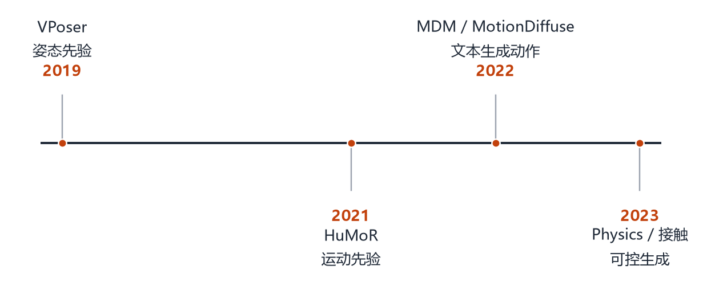

# 第 5 章 人体动作与生成模型

> **本章导读**：前面讲的是“一个人长什么样、摆什么姿势”，这一章讲“人怎么动”。动作是姿态随时间变化的轨迹，比单帧多了速度、加速度、接触、平衡等约束。我们按“先验 → 生成 → 控制”三层来讲，最后讨论为什么“生成动作”比“生成图片”更难评估。

## 5.1 动作是什么：表示与任务谱系

这一节要把“动作”这个词拆成可计算的对象。结论是：动作不是“一串姿态”，而是“一串带物理约束的姿态”，表示的选择直接决定了后面能用什么模型、能加什么约束。

最常用的表示是一串 SMPL 姿态加根节点位移：

$$
\boldsymbol{\Theta}=(\boldsymbol{\theta}_1,\boldsymbol{\theta}_2,\dots,\boldsymbol{\theta}_T),\qquad
\mathbf R=(\mathbf r_1,\mathbf r_2,\dots,\mathbf r_T),
\tag{5.1}
$$

每帧 $\boldsymbol{\theta}_t\in\mathbb{R}^{72}$ 是 SMPL 的姿态（24 个关节各 3 个轴角），$\mathbf r_t\in\mathbb{R}^3$ 是根节点在世界坐标里的位置。所以 $T$ 帧的动作大约是 $T\times75$ 个数：30 帧每秒、10 秒的动作约 22500 个数，压缩后只有几百 KB。**这个紧凑性是动作生成相对视频生成的最大优势**——生成 22500 个数，比生成 300 帧 1080p 视频容易几个数量级。

三种表示各有取舍。

**关节角（轴角或四元数）。** 最紧凑、最符合骨骼结构、天然支持重定向。缺点是：轴角在 $0$ 与 $2\pi$ 处是同一个旋转，回归时会在边界跳变；四元数没有这个问题，但要额外约束单位长度。

**关节位置。** 直观、容易算误差（MPJPE 就是位置误差）。缺点是骨骼长度不再自动一致，需要后处理投影回“合法骨架”。

**SMPL 参数。** 与第 1–4 章的所有工具兼容，能直接驱动网格。缺点是绑定了一个具体的体型，重定向到另一个体型要做一次映射。

<figure class="fig">

<figcaption><b>图 5-1</b>　动作建模的四步。2019 年的 VPoser 把单帧姿态压进隐空间（姿态先验）；2021 年的 HuMoR 把先验从“单帧”扩展到“时序”（运动先验）；2022 年 MDM / MotionDiffuse 把文本条件接进来；2023 年之后开始把接触与物理约束显式加进生成过程。</figcaption>
</figure>

### 5.1.1 五个任务，别混着谈

“动作生成”是一族任务的总称，五个子任务的输入输出完全不同，指标也不能互换。

**姿态先验**：输入一个姿态，输出“它有多合理”。用于拟合时做正则（第 1 章的 $E_\theta$）。

**动作补全**：输入一段有缺帧的序列，输出完整序列。指标是缺失段的 MPJPE。

**动作预测**：输入前 $t$ 帧，输出后 $k$ 帧。指标是未来段的误差，还要看“多模态”——同一个开头可以接很多种后续。

**条件生成**：输入文本、音频、音乐或目标轨迹，输出一段动作。指标包括保真度（对不对得上文本）、多样性、物理合理性。

**物理控制**：输入目标（走到某点、抓住某物），输出能被物理引擎执行的力矩或目标姿态。指标是任务成功率与能量消耗。

混着谈的典型症状：用“动作预测”的指标（未来段 MPJPE）去评价“文本生成”（该看文本对齐），或者用 FID 去评价“物理控制”（该看任务成功率）。读到一篇“动作生成”的论文，第一件事是确认它属于上面哪一类。

### 5.1.2 为什么不能直接回归角度

直接把 72 维角度当成回归目标，会遇到三个问题。

**周期性。** $0$ 与 $2\pi$ 是同一个角度。用平方误差回归时，网络在边界附近会被“拉断”：真值从 $6.2$ 弧度变到 $0.1$ 弧度（实际只转了 0.18 弧度），损失突然变得很大，梯度方向完全错误。解决办法是用 6 维旋转表示（第 1 章）或四元数。

**物理约束。** 脚不能穿地、重心不能悬空、关节不能反折。回归网络不知道这些，它只最小化角度误差；输出一个“角度对但物理不可能”的动作是常态。

**多模态。** 同一句话可以对应很多动作（“打个招呼”可以是挥手、点头、鞠躬），平方误差会把它们平均成一个“半挥手半点头”的怪动作——这和第 4 章褶皱被平均是同一个病。

所以：动作模型通常不是“直接预测角度”，而是先学一个**低维隐空间**（把多模态与物理合理性压进先验），再在隐空间里生成或优化。

### 5.1.3 动作数据从哪来

所有动作模型都依赖动作捕捉数据，而这类数据有三个系统性偏差，直接决定了模型能做什么、不能做什么。

**偏差一：演员在做“标准动作”。** AMASS 里的数据集多数是为了动画制作采集的，动作幅度适中、节奏清晰，很少出现“搬东西时身体歪着撑住”这类日常动作。所以模型生成的“弯腰搬重物”往往看起来像体操。

**偏差二：没有物体、没有场景。** 动捕演员对着空气比划，手里没有杯子也没有门。模型不知道“手碰到东西会减速”，也不知道“拿着东西时胳膊不能随便穿进身体”。

**偏差三：地面是理想平面。** 采集时地板是平的，所以模型对斜坡、楼梯、沙滩几乎没有概念。到了真实场景，脚就很容易穿地或悬空。

这三条偏差解释了为什么“实验室指标很好的模型，放到真机上不能看”。弥补的办法只有两个：采集带场景与物体的数据（成本高），或用物理仿真生成（域差异大）。

## 5.2 姿态先验：VPoser

这一节要回答“怎么让一个姿态看起来像人”。结论是：用一个从数据里学来的概率分布约束姿态，而这个分布最好在一低维流形上。

**VPoser**（Pavlakos 等，2019，随 SMPL-X 发布）[@pavlakos2019smplx] 是一个变分自编码器（Variational Autoencoder，VAE），把 72 维姿态压到一个 32 维的正态分布隐空间。

它的作用有两个：**生成**（从隐空间采样，得到合理的姿态）与**正则**（在拟合图像时，把预测的姿态拉回“像人”的区域，防止反关节）。

为什么用 VAE 而不是第 1 章那种高斯混合？因为维数。8 个高斯在低维空间里能覆盖得不错，但在 72 维空间里，每个高斯要估一个 $72\times72$ 的协方差矩阵（约 2600 个参数），数据根本不够；而姿态的真实分布集中在一个低维流形附近（人不能任意组合关节角度）。VAE 用一个网络把这个流形“摊平”成 32 维的正态分布，参数量与维数解耦。

把 VAE 的目标写出来，就明白“正则”是怎么起作用的：

$$
\mathcal L_{\text{VAE}}=\underbrace{\mathbb E_{q_\phi(\mathbf z|\boldsymbol\theta)}\big\|\boldsymbol\theta-D_\phi(\mathbf z)\big\|^2}_{\text{能复原：别丢信息}}
+\beta\underbrace{D_{\mathrm{KL}}\big(q_\phi(\mathbf z|\boldsymbol\theta)\,\|\,\mathcal N(\mathbf 0,\mathbf I)\big)}_{\text{隐空间靠拢正态}},
\tag{5.2}
$$

- 第一项逼着编码器 $q_\phi$ 把姿态压成 $\mathbf z$、解码器 $D_\phi$ 再从 $\mathbf z$ 复原姿态；只留这一项，隐空间会“记住”每个训练样本，没有泛化；
- 第二项（KL 散度）逼着隐空间分布接近标准正态，所以“在隐空间里随便取一个点”也能解码出合理姿态——这就是采样能用的原因。

$\beta$ 是权衡系数：太大，隐空间丢掉姿态细节（生成的人“千篇一律”）；太小，隐空间变成一张“样本清单”，插值与采样都会失控。这个取舍在下面的动作生成里会再次出现。

### 5.2.1 隐空间里到底有什么

把训练好的 VPoser 的隐空间可视化，会看到结构：某些方向对应“抬手臂”，某些方向对应“弯腰”，还有大量方向“几乎没影响”。前者是数据集里变化大的自由度，后者是数据里几乎不变的（比如手腕的细微内旋）。

这解释了两个现象。第一，**为什么用 VPoser 做正则能防反关节**：反关节的姿态在训练数据里从没出现，它的隐编码会落在正态分布的低概率区，KL 项会把它拉回来。第二，**为什么它有时会把姿势“拉平”**：罕见但合理的姿势（瑜伽的极限拉伸）也在低概率区，同样会被拉回来。所以 SMPLify-X 里 VPoser 的权重需要按场景调——这不是调参偷懒，而是在“防反关节”与“保留极限姿势”之间选位置。

所以：姿态先验的本质是“用数据分布定义什么叫像人”；它的能力上限由训练数据的覆盖度决定，而不是由网络容量决定。

### 5.2.2 在拟合里怎么用：一个惩罚项

把 VPoser 放进第 1 章那个目标函数，只需要加一项：

$$
E_{\text{pose}}=-\log p\big(\mathbf z(\boldsymbol\theta)\big),\qquad \mathbf z(\boldsymbol\theta)=\mu_\phi(\boldsymbol\theta),
\tag{5.3}
$$

$\mu_\phi(\boldsymbol\theta)$ 是编码器输出的隐空间均值，$p$ 是标准正态。读法：先把姿态编码成隐向量，再看这个隐向量在正态分布下有多“罕见”——越罕见，惩罚越大。

这一步替换掉了第 1 章式 (1.5) 里的 8 个高斯。好处有两个：高维下参数不会爆炸；隐空间连续，优化时梯度更稳。坏处是**编码器本身有误差**：它对罕见姿态的编码可能不准，于是“惩罚大”不一定意味着“姿态不合理”。

实践中还有一个细节：**不要对根节点的全局旋转施加这个先验**。全局朝向是自由的（人可以朝任何方向站），把它压进“常见朝向”会让优化结果转向错误的方向。所以正确做法是把根节点旋转从 $\boldsymbol\theta$ 里拆出来，只对剩下的 69 维施加先验。

所以：先验在网络里是“隐空间”，在优化里是“一个惩罚项”；两者形式不同，作用相同——把解限制在“人做得到的姿势”这一片区域里。

## 5.3 运动先验：HuMoR

这一节要回答“怎么让动作连贯且物理上说得通”。结论是：把动作当成一个动态系统，用状态转移建模，而不是把每帧当成独立样本。

单帧姿态先验不知道“动作是否连贯”。**HuMoR**（Rempe 等，2021）[@rempe2021humor] 用条件 VAE 建模“从上一帧到下一帧的变化”，并引入脚与地面的接触状态。

它的生成过程是马尔可夫的：给定当前状态（姿态、速度、接触），预测下一帧的状态分布。状态里显式包含**速度**，这一条很关键——只给姿态，模型不知道人是“正在抬手”还是“正在放下手”，加上速度才能区分。接触状态则告诉模型“这只脚现在承重”，从而约束它的位置与速度。

这个设计带来三种用法。

**去噪**：把带抖动的重建结果送进去，输出平滑但保留高频细节的序列（因为它学过“真实的高频长什么样”）。

**补全**：中间缺 30 帧时，从前后的状态各推一遍，在隐空间里找一条同时满足两端的路径。真人被遮挡半秒（15 帧）很常见，这段补全的质量直接决定了视频观感。

**生成**：从先验采样，得到“像人”的随机动作；但这些动作通常没有明确语义（不是“走路去拿杯子”，只是“像在动”）。

HuMoR 的意义在于：它把“动作”当成一个动态系统，而不是一堆独立的姿态。这为后来的视频重建、动作补全、以及“用运动先验约束生成结果”提供了基础。

它的边界也清楚：马尔可夫假设意味着它只看一步历史（实际实现会用几帧的窗口），所以“长程意图”它抓不到——一个人走向门口再转身，这个“转身”是由意图决定的，不是由上一帧的速度决定的。

所以：运动先验解决的是“局部连贯与物理可行”，不解决“语义合理”；后者要靠条件生成（下一节）。

### 5.3.1 动作预测：多模态与“平均姿态”

预测任务最能暴露“平方误差”的病。给定同一段开头（“他正在走向冰箱”），未来可以有很多种：开冰箱、绕过冰箱、停在冰箱前看手机。

用 MPJPE 训练一个确定性模型，它的最优输出是这些未来的条件均值——一个“往冰箱方向、但手抬到一半、脚步停住”的动作。它在指标上可能很好（因为它离每个真实未来都不远），在观感上完全不对（因为真实的人不会做这个动作）。

这也是为什么预测任务很早就开始用“多样性指标”：给同一个开头生成 50 条，看它们覆盖了多少种真实未来。评价一个预测模型，至少要回答两个问题：最好的那一条有多好（min-MPJPE），以及 50 条里有多少条是合理的。

一个实用的折中是**隐空间采样**：先学一个未来动作的隐分布，再从里面采样多条。这样既能保持多样性，又能用运动先验排除“不可能的未来”。

### 5.3.2 补全一段遮挡：从两端往中间推

动作补全最能说明“运动先验”的价值。设视频第 100–129 帧里人被柱子挡住（30 帧，1 秒），前后各有完整观测。

做法分三步。第一步，用可观测的帧各跑一遍重建，得到两端的姿态与速度（速度从相邻帧差分得到）。第二步，在隐空间里做一次“桥接”：以两端状态为边界条件，找一条状态转移链，使每一步的转移概率都高（也就是每一步都“像真实动作”）。第三步，把隐空间轨迹解码回姿态，再用接触约束修正脚的位置。

质量的分界线很清楚：**遮挡越短、速度信息越完整，补全越可信**。1 秒以内的遮挡，多数方法能做到“看着自然、关节误差 5–10 厘米”；超过 3 秒，模型只能给“合理的猜测”，与真实动作的差别可能很大。

还有一个容易忽略的点：补全出来的那一段**不应该被当成真值去训练**。它是模型的猜测，混进训练集会把先验的偏差固化。这一点与第 1 章 SPIN 用优化结果做伪真值的风险是同一类。

## 5.4 文本生成动作：MDM 与 MotionDiffuse

这一节要回答“怎么让一句话变成一个动作”。结论是：把动作序列当成一个整体去噪，用文本作为条件，训练目标简单、生成质量稳定。

2022 年之后，扩散模型被用到动作生成上。

**MDM**（Tevet 等，2022）[@tevet2022mdm] 把一段动作看成一个序列，用 Transformer 做去噪：训练时把真实动作加噪，网络学习“从噪声中恢复动作”；推理时从纯噪声开始，逐步去噪，并用文本编码作为条件。

**MotionDiffuse**（Zhang 等，2022）[@hong2022motiondiffuse] 用类似的思路，但强调“细粒度控制”：不仅能根据文本生成“一个人走路”，还能控制“左手抬高”“速度变慢”。

这类方法的共同点是：**生成的是参数序列，不是像素**。所以生成结果天然带骨架，可以直接驱动 SMPL、可以重定向到不同体型、可以后期编辑。

<figure class="fig">

<figcaption><b>图 5-2</b>　文本/音频驱动动作生成的典型管线。条件编码后，扩散或自回归模型生成姿态序列与根轨迹，再经过接触/物理后处理，最后渲染或驱动虚拟人。</figcaption>
</figure>

把扩散模型的两条式子写出来，就抓住了它的全部要点。**前向过程**是逐次加噪声：

$$
\mathbf x_t=\sqrt{\bar\alpha_t}\,\mathbf x_0+\sqrt{1-\bar\alpha_t}\,\boldsymbol\epsilon,\qquad \boldsymbol\epsilon\sim\mathcal N(\mathbf 0,\mathbf I),
\tag{5.4}
$$

$\mathbf x_0$ 是一段真实动作（把 $T$ 帧的 $\boldsymbol\theta,\mathbf r$ 拼成一个大向量），$\bar\alpha_t$ 是预设的“保留多少信号”的表，$t$ 越大噪声越多。**训练目标**是让网络学会猜出被加进去的噪声：

$$
\mathcal L_{\text{diff}}=\mathbb E_{t,\mathbf x_0,\boldsymbol\epsilon}\Big\|\boldsymbol\epsilon-\boldsymbol\epsilon_\theta\big(\mathbf x_t,\ t,\ \mathbf c\big)\Big\|^2,
\tag{5.5}
$$

$\mathbf c$ 是条件（文本编码、音频特征、目标轨迹）。**推理**则是从纯噪声一步步去噪，每一步都做“减去当前预测的噪声”：

$$
\mathbf x_{t-1}=\frac{1}{\sqrt{\alpha_t}}\Big(\mathbf x_t-\frac{1-\alpha_t}{\sqrt{1-\bar\alpha_t}}\,\boldsymbol\epsilon_\theta(\mathbf x_t,t,\mathbf c)\Big)+\sigma_t\mathbf z,
\tag{5.6}
$$

最后一项 $\sigma_t\mathbf z$ （$\mathbf z\sim\mathcal N(\mathbf 0,\mathbf I)$）是模棱两可的噪声——它保证了“同一个文本能生成不同动作”（多样性）。$\sigma_t=0$ 时就是确定性的 DDIM 采样，生成稳定但多样性降低。

> **为什么动作生成特别适合扩散，而不是直接用 GAN？** 动作是长序列（上百帧），每帧又有几十维；GAN 的判别器很难对“整段动作是否合理”给出稳定信号，容易训练崩溃。扩散的目标函数是一道回归题（预测噪声），训练反而更稳；代价是推理需要几十步。

### 5.4.1 条件是怎么“加重”的

条件太弱，生成的动作与文本无关；条件太强，多样性消失。工程上最常用的是**无分类器引导**（classifier-free guidance）：

$$
\hat{\boldsymbol\epsilon}=\boldsymbol\epsilon_\theta(\mathbf x_t,t,\varnothing)+w\Big(\boldsymbol\epsilon_\theta(\mathbf x_t,t,\mathbf c)-\boldsymbol\epsilon_\theta(\mathbf x_t,t,\varnothing)\Big),
\tag{5.7}
$$

$\varnothing$ 是“空条件”，$w$ 是引导强度。读法：先算“没有条件时会怎么去噪”，再算“有条件时会怎么去噪”，两者之差就是“条件的方向”，把这个方向放大 $w$ 倍再加回去。

$w=1$ 等于不用引导；$w$ 增大，结果更贴合文本但更像“标准答案”；$w$ 太大（超过 7–10）会出现过饱和、动作僵硬。这一条与第 4 章“拟合得太好反而不自然”是同一个现象。

### 5.4.2 扩散与自回归的分工

另一条路线是自回归：把序列概率分解成一帧一帧地预测，

$$
p(\mathbf x)=\prod_{t=1}^{T}p\big(\mathbf x_t\,\big|\,\mathbf x_{<t},\mathbf c\big),
\tag{5.8}
$$

每一步只看过去。优点是天然支持“流式生成”（边说边动）、长度不受限；缺点是误差会累积，长序列容易漂移，而且训练时要处理“教师强制”与推理时“自己喂自己”的分布错配。

两者的取舍很清楚：**扩散擅长“整体一致”，自回归擅长“实时与长序列”**。近年也有把两者结合的（自回归出关键帧、扩散补细节），思路上与视频生成领域一致。

所以：文本生成动作的核心难点不是“生成得像人”（这一条 VPoser 与 HuMoR 已经解决大半），而是“生成得像这句话”；引导强度就是“像话”与“像人”之间的旋钮。

### 5.4.3 音频与舞蹈：条件换成了节拍

音乐驱动的动作生成把条件从文本换成音频特征。技术上与文本条件几乎一样（都是把条件编码成一个向量送进去），难点在“对齐”。

一首 120 拍每分的曲子，一拍 0.5 秒；30 帧每秒下，一拍 15 帧。舞蹈动作的“重音”应当落在拍点上，误差超过 2–3 帧人眼就能看出“踩不上点”。所以这类方法的评估里常有一个**节拍对齐分数**：检测生成动作的速度突变点（相当于“动作的重拍”），与音乐的重拍比较，算两者的时间差落在容忍窗口内的比例。

除了节拍，还有两个约束：**风格**（同一段音乐，街舞与芭蕾的动作幅度完全不同）与**物理可行**（旋转、跳跃时重心与地面的关系）。前者靠数据里的风格标签，后者又要回到 5.5 节的接触与仿真。

所以：换一种条件（文本、音频、轨迹、目标位置），扩散的骨架不变，变的只是“编码器 + 评估指标”；判断一个新条件生成方法靠不靠谱，就看它有没有为这个条件设计专门的评估。

### 5.4.4 长序列：拼接与漂移

一条 10 秒的动作约 300 帧。大多数扩散模型一次只能生成固定的窗口（比如 49 或 196 帧），长序列就要拼接。

拼接的难点在接缝。直接把两段拼起来，接缝处的速度与加速度会突变，看起来像“抽了一下”。常见做法是让两段在重叠区域上做融合：重叠 10–20 帧，按线性权重渐变；或者把前一段的末帧作为后一段的初始条件。前者简单但会抹平动作；后者保留了动态，但误差会传递。

漂移是更根本的问题。自回归生成长序列时，每步的小误差会累积，表现为“越走越偏”“重心逐渐上移”。缓解的办法包括：周期性地用运动先验“重新对齐”（把当前状态投影回合理区域）、用世界坐标而不是相机坐标回归根节点、以及显式建模接触（接触点相当于“地面锚点”，能拉住漂移）。

## 5.5 可控性与物理约束

这一节要回答“为什么生成的动作看起来像，但站不住”。结论是：像素或参数层面的损失不知道物理，必须显式把接触、动力学、碰撞加进去。

生成模型最容易被诟病的是“看起来像，但物理不对”，具体有四种表现。

**脚滑**：脚在地上滑动。原因是模型只关心“姿态序列像不像数据”，不关心“接触时脚的速度应当为 0”。

**穿地**：脚陷进地面以下。原因是训练数据里地面高度没有被显式建模，模型只学了“相对根节点的姿态”。

**浮空**：整个人悬在地面上方。原因是根节点高度是回归出来的，没有与地面约束耦合。

**穿模**：手穿过身体、两条腿互相穿插。原因是自相交没有被惩罚。

解决办法有三类，代价各不相同。

**接触约束。** 显式预测脚与地面的接触概率，接触时把脚的速度拉向 0。做法可以是在损失里加一项 $\sum_t c_t\|\mathbf v^{\text{foot}}_t\|^2$，也可以做后处理修正。代价很小，效果直接；缺点是它只管脚，不管手与物体的接触。

**逆运动学修正。** 生成完之后，用 IK 把脚“钉”在接触点上，其余的关节跟着调整。优点是实现简单、能保住生成的动作风格；缺点是大幅修正会让姿态变形（膝盖方向扭转、腰部拉伸）。

**物理仿真。** 把生成的动作当成“参考轨迹”送进物理引擎（MuJoCo 一类），用一个 PD 控制器去跟踪，引擎输出的才是物理可行的轨迹。优点是物理严格正确、能处理推、拉、碰撞；缺点是需要一个与人体对应的仿真模型（质量分布、关节限位、肌肉力矩上限），而且跟踪失败时动作会“走形”。

三类方法的共同代价是**多样性下降**：约束越强，生成的动作越保守。极端情况下，物理约束会把所有动作压成“小步慢走”——因为那是唯一不容易摔倒的走法。

所以：可控性不是“加个后处理”，而是在“可信”与“多样”之间分配预算；产品上要明确“宁可僵一点也不能穿模”，还是“宁可偶尔穿模也要生动”。

### 5.5.1 把权衡量化

“可信”与“多样”的权衡不是口号，它可以被量出来。做法是固定条件、扫一个旋钮（比如引导强度 $w$、或物理约束的权重），每个取值下算三个数：内部多样性（同一条件 20 条的两两距离）、物理错误率（脚滑超阈值的帧占比）、以及文本对齐度。

把三个数画在同一张图里，会得到三条方向不同的曲线：多样性随 $w$ 增大而下降，物理错误率随约束权重增大而下降，对齐度先升后饱和。与产品需求对应的点，就在这三条曲线的交叠区里选。

这个做法还有一个副产品：它能把“调参”变成“选点”。当有人问“为什么不把物理约束再加强一点”，你可以指图上“多样性已降到 0.3 以下”那一段，而不是靠臆测。

### 5.5.2 一次脚滑修正：把误差算出来

设一段 30 帧每秒的走路视频，人前进速度 1.2 米每秒，于是每帧根节点前进 4 厘米。左脚从第 10 帧到第 19 帧踩地（10 帧，约 0.33 秒），这段时间里脚在世界坐标应当完全不动。

假设逐帧重建 + 平滑之后，根节点的位移被削掉了 5%：每帧只前进 3.8 厘米。脚的位置跟着根节点走，于是每帧滑 2 毫米。10 帧下来脚在地上平移 2 厘米。

这个量看起来不大，但视觉上非常明显——因为脚是唯一“应当绝对静止”的部位，人眼对它的位移极度敏感。2 厘米的滑移，相当于鞋底在冰面上蹭了一下。

修正的办法是三步。第一，**检测接触**：用脚的高度与速度判断这 10 帧是否踩地（高度低于阈值、速度接近 0）。第二，**算偏移**：把接触区间内的脚位置平均，得到“它应该在的位置”，与每帧的实际位置相减，得到偏移量。第三，**把偏移分摊到根节点与腿链**：根节点平移一部分，剩下的用 IK 调整髋、膝、踝，避免膝盖被拉直。

代价是：第三步兵分摊得不均匀时，膝盖角度会突变，出现“走路一顿一顿”。所以工程上通常在**接触区间内做时间上的平滑过渡**，让修正量从 0 逐渐加到满、再逐渐放回 0。

所以：脚滑修正是一个“检测—估计—分摊—平滑”的小闭环；它不改变姿势的整体风格，但决定了结果“像不像踩在地上”。

## 5.6 为什么动作生成难评估

这一节要回答“怎么知道一个动作生成模型好不好”。结论是：没有单一指标能对应“人看起来自不自然”，必须组合使用，并且一定要看视频。

图像生成可以用 FID、CLIP Score；动作生成没有这么幸运。先把几个常用指标到底在算什么说清。

**FID（在动作特征空间）**：把生成动作与真实动作各送进一个预训的动作编码器，得到两组特征；假设两组特征都近似高斯，FID 就是这两个高斯分布的距离：

$$
\mathrm{FID}=\big\|\boldsymbol\mu_g-\boldsymbol\mu_r\big\|^2+\mathrm{Tr}\Big(\boldsymbol\Sigma_g+\boldsymbol\Sigma_r-2(\boldsymbol\Sigma_g\boldsymbol\Sigma_r)^{1/2}\Big),
\tag{5.9}
$$

$\boldsymbol\mu_g,\boldsymbol\Sigma_g$ 是生成动作特征的均值与协方差，$\boldsymbol\mu_r,\boldsymbol\Sigma_r$ 是真实动作的。读法：第一项比“中心偏多远”，第二项比“形状差多少”。它只比较“分布像不像”，完全不管“某一句文本对不对”。

**R-Precision**：从一批真实动作里取出与文本配对的那一个，再让模型给“生成动作与各文本的相似度”排序；配对的文本排进前 $k$ 的比例就是 R-Precision@$k$。它考察文本—动作对应，但依赖另一个预训编码器——编码器不懂的细节（比如“用左手”），它测不出来。

**多样性 / 多模态距离**：同一文本生成多条，算两两距离（多样性）；再与真实数据集里同一文本的多条比较（多模态距离）。前者高说明“不重复”，后者接近真实说明“多样性刚好”。

**物理指标**：脚滑（着地期位移）、穿地深度、关节超限比例、能量消耗。这些指标不需要真值，可以在任意生成结果上算，所以最适合做“兜底检查”。

问题在于：这些指标没有一个能完全对应“人看起来自不自然”。一个 FID 很低的方法，可能生成的动作僵硬、重复；一个多样性很高的方法，可能生成根本做不到的动作；一个 R-Precision 很高的方法，可能在每段里都塞了“文字里提到的手部动作”，但身体整体是错的。

**表 5-1**　动作生成指标各管什么、掩盖什么。

| 指标 | 管什么 | 掩盖什么 |
|---|---|---|
| FID | 分布相似度 | 单条是否对得上文本 |
| R-Precision | 文本—动作对应 | 动作是否自然、是否物理可行 |
| 多样性 | 是否重复 | 是否合理（噪声也能“多样”） |
| 多模态距离 | 多样性与真实分布的接近程度 | 绝对质量 |
| 物理指标 | 滑、穿、超限 | 语义是否正确 |

所以：阅读动作生成论文时，**一定要看视频**，不要只看表格；表格里的数字只能排除“明显不行”的方法，不能证明“看着舒服”。

### 5.6.1 搭一个能用的评估协议

如果要做自己的动作生成模型，建议按下面这个结构搭协议，四块各占一块预算。

**保真度**：文本→动作用 R-Precision 与人工评分；预测任务用未来段 MPJPE；补全任务用缺失段 MPJPE。这一块回答“对不对”。

**多样性**：同一条件生成 20 条，算两两距离，并与真实数据的“同一条件多条”分布比较。这一块回答“是不是只会一种”。

**物理**：脚滑、穿地深度、关节超限比例、根节点速度的合理性。这一块不需要真值，任何结果都能算，所以最适合做自动化回归测试。

**人工**：至少两个人独立打分（自然度、与条件的匹配度），并报告一致性。人工评分的主观性很强，但它是唯一能捕捉“看起来别扭”的手段——而这恰恰是用户最先注意到的。

两个现成的评测集常被用作公共基准：一个是文本—动作配对的 HumanML3D 风格数据（上万段配对），一个是规模更小的 KIT 风格数据。它们的作用是“可比”，不是“全面”——真实产品的场景（长序列、多人、带物体）通常不在其中。

所以：评估协议的价值在于“能自动跑、能比较、能定位”；只报一个 FID 的评估，等于没有评估。

### 5.6.2 人工评估怎么做才不算凑数

人工评分是最贵、也最容易被充数的环节。要让它有信息量，需要四个设置。

**盲测。** 评分者不知道哪条是哪个方法的输出，也不知道哪条是真实数据。最好把真实数据也掺进去作为隐藏的“上界”，如果模型得分接近真实数据，说明量表饱和了，需要换一组更难的条件。

**成对比较而不是绝对打分。** “哪一条更自然”比“给这条打几分（1–5）”稳定得多，因为人对绝对刻度的理解差异很大。成对比较可以转成胜率，再用统计检验看差异是否显著。

**拆开问。** 把“自然度”“与文本的匹配度”“物理合理性”分成三个问题，而不是问一个笼统的“好不好”。不拆的话，评分者会把三者混成一个“观感”，而观感里权重最大的是“流畅”，不是“正确”。

**报告一致性。** 两个人打分要算一致性（比如 Spearman 相关）；一致性很低时，结论不成立。很多论文不提这一项，因为它能揭穿“人工评估只是个形式”。

所以：人工评估的设计比样本量重要；二十个人随便打分，不如三个人盲测成对比较。

## 5.7 从动作到行为

这一节要说清“动作”与“行为”的差别，以及为什么后者难得多。结论是：动作只要求“身体动得对”，行为要求“动得有意义”，后者需要场景、物体、意图三样东西。

动作生成的下一步是“行为”：不仅要知道“手抬起来了”，还要知道“他在招手”“他在拒绝”。

这需要把动作与场景、物体、语言、意图结合：

- 手物交互：抓杯子、开门，需要同时估计手和被操作物体 [@taheri2020grab]；
- 社交信号：眼神、手势、身体朝向；
- 长时序任务：做饭、组装家具。

难点有三个层次。

**几何层**：手与物体的接触点必须对得上。手的 21 个关节与物体的任意形状接触，是一个高维约束问题；接触点错了，看起来就是“手悬在杯子旁边”。

这一层可以用数字衡量。以常见的手部参数化模型 MANO 为例（778 个顶点、16 个关节），抓取时真正与物体接触的顶点往往只占 10–20%；如果要求“接触点与物体表面的距离小于 1 厘米”，那几十毫秒内的姿态误差就必须控制在毫米量级——这比身体关节的 5 厘米精度要求高一个数量级。再加上物体的 6 自由度位姿本身就有误差（常见 1–3 厘米、5–10 度），手与物体是“两个带误差的估计拼在一起”，误差会叠加而不是抵消。

**语义层**：同一个手部轨迹可以是“拿起”也可以是“放下”，取决于物体是否已经在手里。模型必须维护一个“世界状态”（手里有没有东西），而不只是输出姿态。

**意图层**：人做饭时会先开柜门再拿锅，这个顺序由目标决定。今天的大模型可以理解“描述”，但很难生成“物理上可行、社交上合理”的长动作。这是未来几年的核心问题之一。

所以：动作生成解决的是“身体语言”，行为生成解决的是“做事”；后者需要把物理、物体、意图都纳入模型，单靠更强的序列模型不够。

## 5.8 失败模式清单

这一节把本章主题下的失败整理成表。结论是：动作生成的失败有两类——一类是“不像人”，一类是“不像话”，前者靠先验修，后者靠条件修。

**表 5-2**　动作生成与建模的七类失败。

| 类别 | 现象 | 成因 | 自查方法 |
|---|---|---|---|
| 反关节 | 手肘向后折、膝盖反弯 | 先验太弱或缺失 | 统计每个关节角是否超出解剖范围 |
| 抖动 | 静止时也在小幅晃动 | 逐帧独立生成、无运动先验 | 生成“站立 5 秒”，量加速度误差 |
| 脚滑 | 走着走着脚在地上平移 | 无接触约束 | 只看接触帧，量脚的世界位移 |
| 穿地 / 浮空 | 脚陷进地面、整个人悬空 | 根节点高度无地面约束 | 画地面网格叠在结果上 |
| 漂移 | 长序列越走越偏 | 自回归误差累积 | 生成长序列，量根节点轨迹的闭合误差 |
| 语义错位 | 文本说“挥手”，动作是“鞠躬” | 条件太弱、编码器不懂 | 打乱文本做负样本测试 |
| 千篇一律 | 同一文本多次生成几乎一样 | 引导过强、多样性丢失 | 同一文本生成 20 条，算两两距离 |

最后一行最容易被忽略：演示视频里“一条好看的结果”不能证明模型有多样性。产品上如果需要“同一个指令给出不同风格”，就必须专门测多样性，而不是只看单条质量。

所以：动作模型的调试顺序应当是“先修物理（反关节、穿地、脚滑），再修语义（条件对齐），最后调多样性”；顺序反了，会在错误的基础上调参。

## 本章小结

- 动作是带物理约束的姿态序列，紧凑（10 秒约 22500 个数）但有周期性与物理约束，所以生成通常在低维隐空间里做。
- 五个子任务（先验、补全、预测、条件生成、物理控制）的输入输出与指标各不相同，不能混着谈。
- VPoser 用 VAE 学单帧姿态先验：重建项保信息，KL 项把隐空间拉成正态以便采样；它的能力上限由数据覆盖度决定。
- HuMoR 把先验从“单帧”扩展到“动态系统”，状态里含速度与接触，可用于去噪、补全与随机生成。
- 文本生成动作的主流是扩散：前向加噪、训练预测噪声、反向逐步去噪；噪声项决定多样性，引导强度决定“像话”与“像人”的平衡。
- 可控性靠接触约束、物理仿真、逆运动学三类手段，越强越可信、也越保守。
- 评估指标（FID、R-Precision、多样性、物理量）各有缺口，看论文一定要看视频；物理指标最适合做兜底检查。

## 思考题

1. 为什么动作生成通常不输出顶点，而输出 SMPL 参数？如果输出顶点，会多出哪些麻烦？
2. VPoser 的隐空间为什么能“防止反关节”？它的训练数据起了什么作用？为什么它又会把瑜伽姿势拉平？
3. 扩散模型生成动作时，如何保证“脚不滑”？三种手段各自的代价是什么？
4. 如果让你评估一段“打招呼”的动作，你会设计哪些指标？怎么构造负样本？
5. 一个文本生成动作的模型 FID 很低、R-Precision 很高，但演示视频里动作僵硬。可能的原因是什么？你会要求作者补充什么实验？
